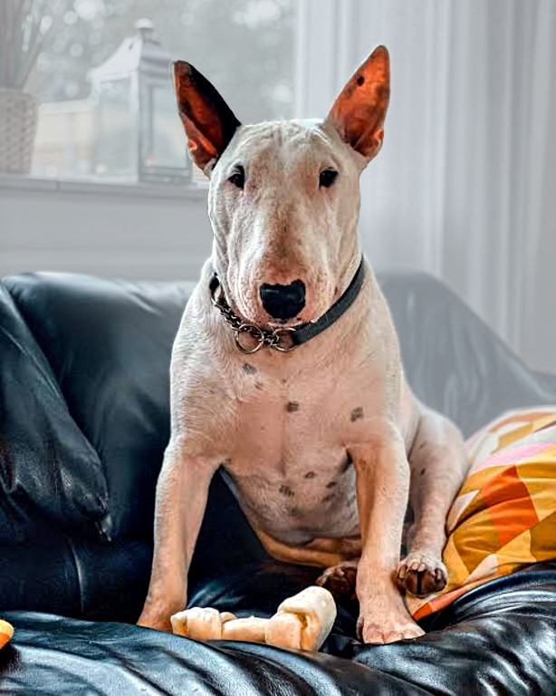

<p align="center">
  
</p>

<h1 align="center">bullterrier-image</h1>

<p align="center">
  <b>Photo effects pipeline you can script.</b><br>
  ASCII art, glitch, halftone, neon grades, dispersing particles.
</p>

<p align="center">
  <a href="https://github.com/bullterrier-studio/bullterrier-image/actions/workflows/ci.yml"></a>
  
  
  
</p>

<p align="center">
  
</p>

**A look you can write down, change with one number, and run on a thousand photos.**

Styling by hand does not repeat. Styling in image code means arrays, loops and magic numbers nobody can read next month.
bullterrier-image makes a look *data*: a short recipe, TOML or Python, listing effects and their values. 84 effects ready.
It finds the subject first: bloom can hit the dog, glitch the background, blur can grow with depth. Edit a number, rerun: only
that recipe redone. Same seed, same pixels. Look wrong? See the picture after every step.

- **Recipes are data.** Look = list of effects, TOML or Python. Same recipe, any photo.
- **Batch ready.** Many photos x many recipes, cached. One bad photo never stops the run. HTML report.
- **Subject- and depth-aware.** Aim an effect at subject, background, near or far.
- **Looks and presets built in.** `bt-image render photo.jpg crt`: nine multi-step looks (glitch, crt, hologram, stained glass...);
  a preset is one effect's named values (`slice_shift` preset `glitch`). `bt-image effects` lists both.
- **Fails early.** Typo fails at load, not halfway through batch.

## Install

Python 3.12+. macOS, Linux, Windows.

```bash
pip install bullterrier-image
bt-image effects        # the built-in looks (`bt-image render photo.jpg crt`), then one line per effect
```

Ready-built for most Linux, macOS and Windows machines; which platforms, and what the others need:
[design decisions, "Platforms"](docs/design-decisions.md#the-rust-core).

## Quick start

Repo ships demo project: one photo, 16 recipes. A checkout builds the Rust core, so it needs
[rustup](https://rustup.rs/) besides uv.

```bash
git clone https://github.com/bullterrier-studio/bullterrier-image.git
cd bullterrier-image
uv sync
uv run bt-image run examples/bt-image.toml
open examples/output/index.html            # macOS; xdg-open on Linux, start on Windows
```

First run downloads subject model (once). Run again: finished work skipped.

Own project:

```bash
uv run bt-image init my-project            # bt-image.toml, a photos/ folder, two starter recipes
cp ~/Pictures/me.jpg my-project/photos/
uv run bt-image run my-project/bt-image.toml
```

## A recipe

Ordered list of effects. Each `[[step]]` names an effect; other keys are its parameters.

```toml
name = "ember-glitch"
size = 1024                       # optional: the output's longest side in px; absent = the photo's own size

[[step]]
effect = "gradient_map"           # a fire palette
stops = ["#0a0000", "#e0261b", "#ffb347", "#fff3d6"]

[[step]]
effect = "gradient"
colors = ["#000000"]
mask = "background"               # "subject", "background" or a region: apply only there

[[step]]
effect = "slice_shift"
preset = "glitch"
bands = 10
amount = 24                       # how far a strip may slide, in px (design pixels: a picture 480 px long)
seed = 4                          # same seed, same result, every time

[[step]]
effect = "rgb_split"              # red right, blue left, wrapping
angle = 0
amount = 4.7
edge = "wrap"

[[step]]
effect = "bloom"
blend_mode = "screen"             # lighten what is below, as light does
opacity = 0.6                     # mix this step in at 60%
```

Same in Python:

```python
from bullterrier_image import Recipe, fx, imageio, render

photo = imageio.load("dog.jpg")

neon_glitch = Recipe(
    [
        fx.gradient_map(stops=("#12002b", "#ff2bd6", "#00f0ff")),
        fx.gradient(colors=["#000000"], mask="background"),  # only where the photo's background is
        fx.slice_shift(preset="glitch", bands=8, seed=4),
        fx.rgb_split(angle=0, amount=5.6, edge="wrap"),
        fx.bloom(radius=12.2, amount=0.65, opacity=0.8, blend_mode="screen"),  # screened over it at 80%
    ],
    name="neon-glitch",
    size=1024,
)

imageio.save(render(photo, neon_glitch), "dog-neon-glitch.jpg")
```

Look wrong? See picture after every step:

```bash
uv run bt-image steps examples/photos/bullterrier.jpeg examples/recipes/ember-glitch.toml
```

<p align="center">
  
</p>

## Gallery

More from same photo. All 16 recipes: [`examples/recipes/`](examples/recipes).

<table>
  <tr>
    <td align="center" width="25%"></td>
    <td align="center" width="25%"></td>
    <td align="center" width="25%"></td>
    <td align="center" width="25%"></td>
  </tr>
  <tr>
    <td valign="top"><a href="examples/recipes/cyberpunk.toml"><b>cyberpunk</b></a><br><sub>Neon night street: fringes, scanlines, rain.</sub></td>
    <td valign="top"><a href="examples/recipes/vaporwave.toml"><b>vaporwave</b></a><br><sub>Sunset gradient, glowing grid, duotoned dog.</sub></td>
    <td valign="top"><a href="examples/recipes/terminal.toml"><b>terminal</b></a><br><sub>Green phosphor CRT: scanlines, glow.</sub></td>
    <td valign="top"><a href="examples/recipes/newsprint.toml"><b>newsprint</b></a><br><sub>Newspaper clipping: dots, torn edge.</sub></td>
  </tr>
  <tr>
    <td align="center" width="25%"></td>
    <td align="center" width="25%"></td>
    <td align="center" width="25%"></td>
    <td align="center" width="25%"></td>
  </tr>
  <tr>
    <td valign="top"><a href="examples/recipes/northern-lights.toml"><b>northern-lights</b></a><br><sub>Aurora behind, aurora rim light on the fur.</sub></td>
    <td valign="top"><a href="examples/recipes/sticker.toml"><b>sticker</b></a><br><sub>Die-cut: white border, soft shadow.</sub></td>
    <td valign="top"><a href="examples/recipes/depth-haze.toml"><b>depth-haze</b></a><br><sub>Room behind mists over by depth.</sub></td>
    <td valign="top"><a href="examples/recipes/double-exposure.toml"><b>double-exposure</b></a><br><sub>Aurora multiplied into the silhouette.</sub></td>
  </tr>
</table>

## Docs

- **[Effect catalogue](docs/effects/README.md)**: every effect with picture, parameters, defaults.
- [Recipes](docs/recipes.md): step keys, regions, fields, driven numbers, framing, presets.
- [Python API](docs/python-api.md): `fx`, sizes, addresses, plugins.
- [Pipeline and command line](docs/pipeline.md): batch behaviour, project file, checks, `bt-image` commands.
- [Subject and depth](docs/subject-and-depth.md): models, offline use, own finders and maps.
- [Development](docs/development.md): layout, adding an effect. Why built this way: [design decisions](docs/design-decisions.md).

## Development

```bash
uv sync
uv run poe setup       # once per clone: git hooks and commit-message template
uv run poe check       # before every push: format, lint, types, tests
```

[CONTRIBUTING.md](CONTRIBUTING.md) | [CHANGELOG.md](CHANGELOG.md) | [SECURITY.md](SECURITY.md)

## License

[MIT](LICENSE) © 2026 Janis Cakstins. Bundled font, JetBrains Mono: [SIL OFL 1.1](LICENSE-FONT).
