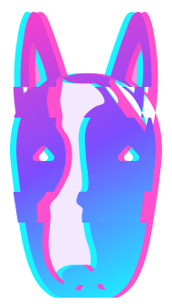
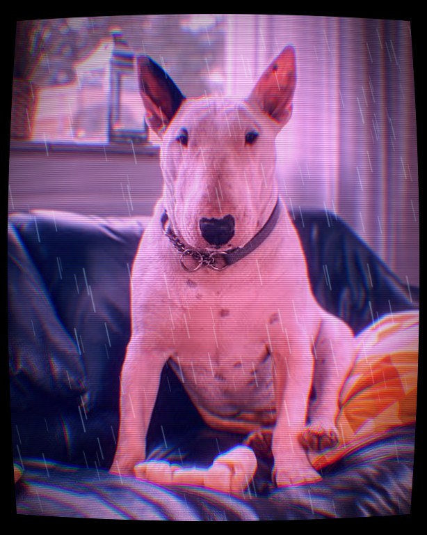
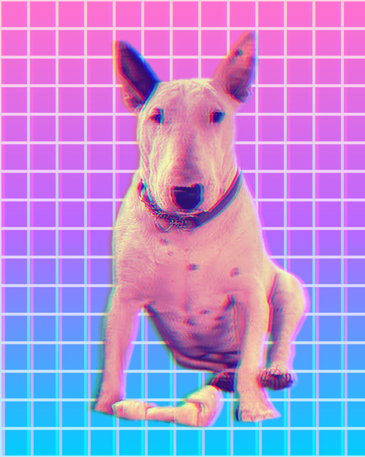
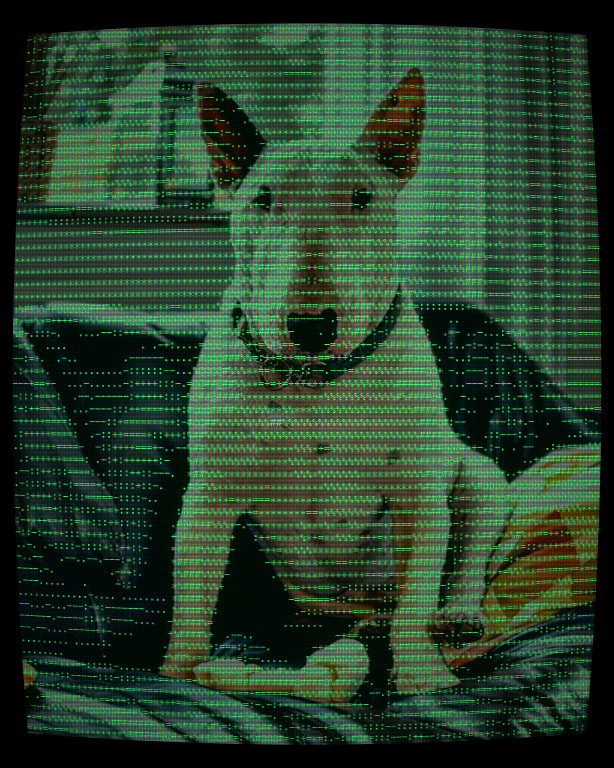
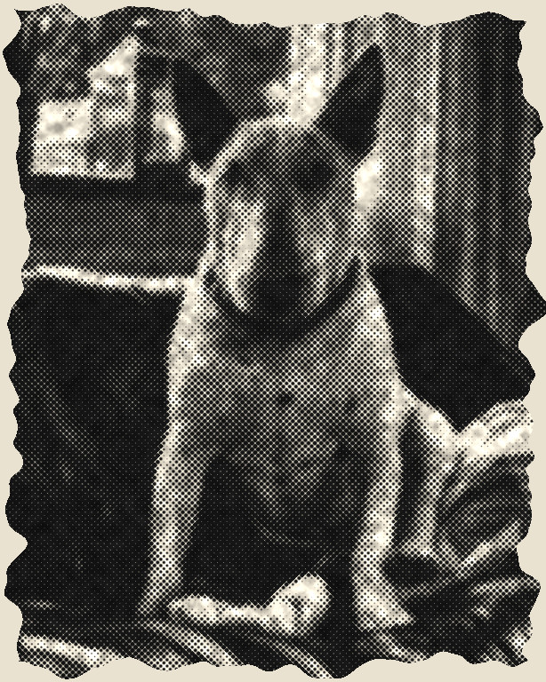
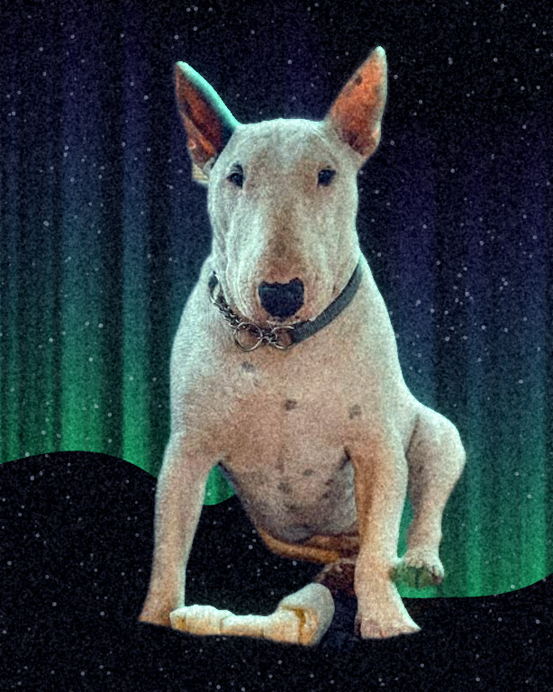
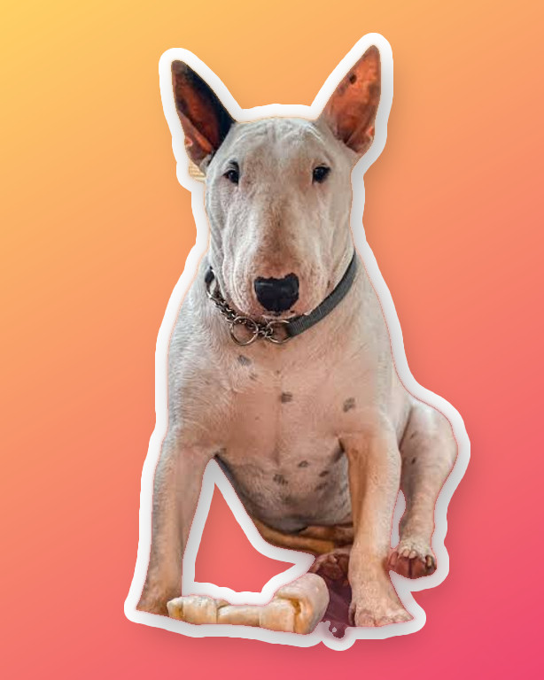
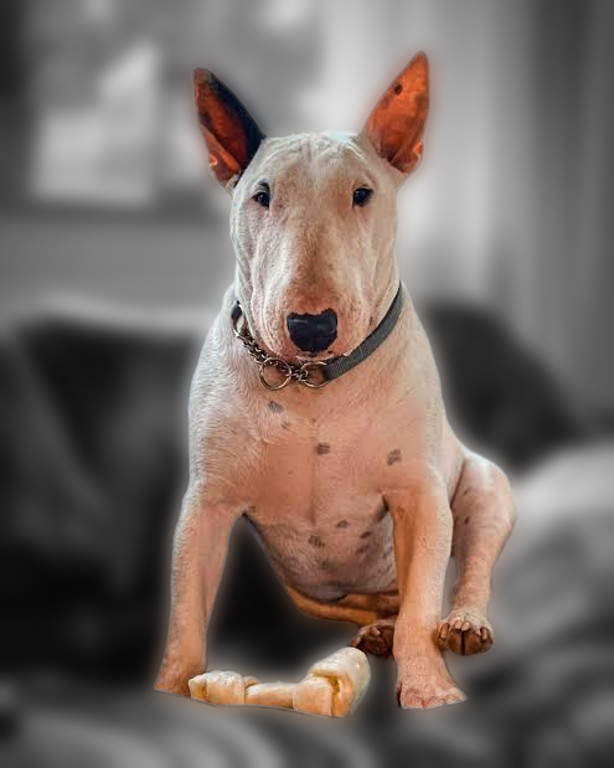
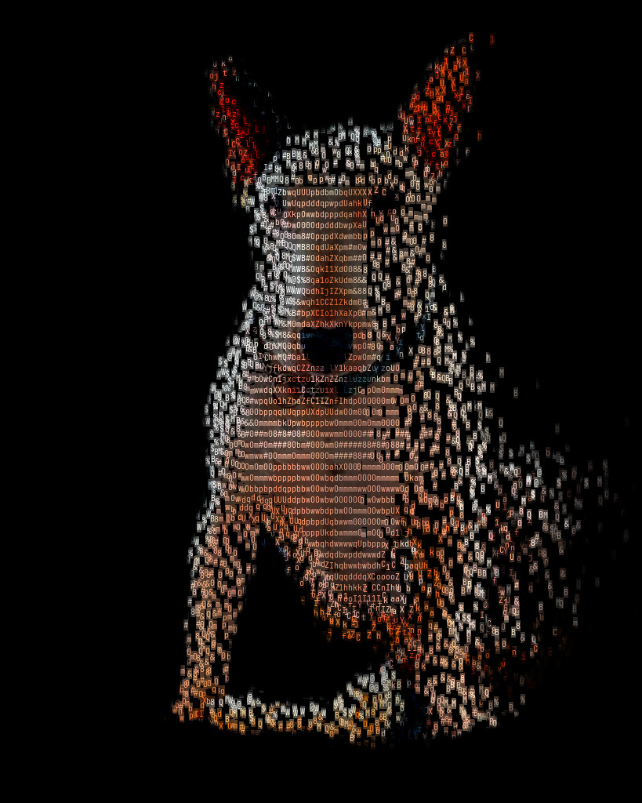
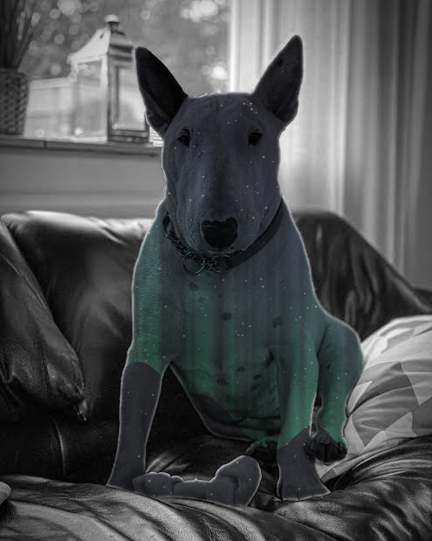

<p align="center">
  
</p>

<h1 align="center">bullterrier-image</h1>

<p align="center">
  <b>A photo-effects pipeline you can script.</b><br>
  Describe a look as a short recipe, run it on one photo or a thousand, and get ASCII art, glitch, halftone,<br>
  neon grades and dispersing particles, with caching, quality checks and an HTML report.
</p>

<p align="center">
  <a href="https://github.com/bullterrier-studio/bullterrier-image/actions/workflows/ci.yml"></a>
  
  
  
  
  
  
</p>

<p align="center">
  
</p>

It can cut the subject (a person, a pet, an object) out of the photo first, so effects can target the subject or the
background separately.

<table>
  <tr>
    <td width="33%" valign="top"><b>Recipes are data</b><br>A look is a list of effects in TOML or Python. Changing a number is a one-line edit, and the same recipe runs on any photo.</td>
    <td width="33%" valign="top"><b>A real pipeline</b><br>Many photos x many recipes, cached on disk. One bad photo never stops the batch, and everything lands in a manifest and a browsable report.</td>
    <td width="33%" valign="top"><b>Developer friendly</b><br>Small pure-function effects, each with its category, example and gallery picture. Typos fail when a recipe is loaded, not halfway through a batch, and editors autocomplete every parameter.</td>
  </tr>
  <tr>
    <td width="33%" valign="top"><b>Transparent</b><br>See the picture after every step with <code>bt-image steps</code>, so a look that is not right can be debugged, not guessed at.</td>
    <td width="33%" valign="top"><b>Checked automatically</b><br>A missed cut-out or a blank result is flagged without anyone having to look.</td>
    <td width="33%" valign="top"><b>One picture, any moment</b><br>Effects like <code>disperse</code> show one moment of a process, set by a plain parameter (<code>progress</code>), so a video tool can drive it from anything, a beat included.</td>
  </tr>
</table>

## Gallery

Every picture here is made from one photo by the recipe linked under it (`examples/recipes/`). Reproduce them with `bt-image run examples/bt-image.toml`.

<table>
  <tr>
    <td align="center" width="20%"></td>
    <td align="center" width="20%"></td>
    <td align="center" width="20%"></td>
    <td align="center" width="20%"></td>
    <td align="center" width="20%"></td>
  </tr>
  <tr>
    <td valign="top"><a href="examples/recipes/neon-pulse.toml"><b>neon-pulse</b></a><br><sub>Hot magenta and cyan on black, split into a faint chromatic fringe, with a glow that spills onto the dark.<br><code>clarity</code> <code>gradient_map</code> <code>fill</code> <code>glitch</code> <code>glow</code></sub></td>
    <td valign="top"><a href="examples/recipes/glitch.toml"><b>glitch</b></a><br><sub>The classic: the subject on black, digitally damaged, with film grain.<br><code>fill</code> <code>glitch</code> <code>grain</code></sub></td>
    <td valign="top"><a href="examples/recipes/ascii-colour.toml"><b>ascii-colour</b></a><br><sub>The photo redrawn as text, every character in the colour of the photo underneath, over a faint ghost of the photo.<br><code>grade</code> <code>clarity</code> <code>ascii</code> <code>fill</code></sub></td>
    <td valign="top"><a href="examples/recipes/halftone-print.toml"><b>halftone-print</b></a><br><sub>A newsprint dot screen: tone becomes dot size, in warm white ink on black.<br><code>clarity</code> <code>halftone</code> <code>fill</code></sub></td>
    <td valign="top"><a href="examples/recipes/ember-glitch.toml"><b>ember-glitch</b></a><br><sub>A fire palette, then torn glitch strips with a red and blue split.<br><code>gradient_map</code> <code>fill</code> <code>glitch</code> <code>glow</code> <code>grain</code></sub></td>
  </tr>
  <tr>
    <td align="center" width="20%"></td>
    <td align="center" width="20%"></td>
    <td align="center" width="20%"></td>
    <td align="center" width="20%"></td>
    <td align="center" width="20%"></td>
  </tr>
  <tr>
    <td valign="top"><a href="examples/recipes/cyberpunk.toml"><b>cyberpunk</b></a><br><sub>A neon night street: magenta and violet grade, colour fringes, scanlines, a glow, rain and the curved glass of a tube. Would gain neon edges (batch 8).<br><code>split_tone</code> <code>chromatic_aberration</code> <code>scanlines</code> <code>bloom</code> <code>rain</code> <code>vignette</code> <code>crt</code></sub></td>
    <td valign="top"><a href="examples/recipes/vaporwave.toml"><b>vaporwave</b></a><br><sub>A sunset gradient with a glowing grid screened over it behind a duotoned dog, split into colour ghosts.<br><code>gradient</code> <code>pattern</code> <code>gradient_map</code> <code>rgb_split</code></sub></td>
    <td valign="top"><a href="examples/recipes/terminal.toml"><b>terminal</b></a><br><sub>The photo as a green phosphor terminal: characters on a curved CRT screen with a shadow mask, scanlines and glow.<br><code>clarity</code> <code>ascii</code> <code>crt</code></sub></td>
    <td valign="top"><a href="examples/recipes/newsprint.toml"><b>newsprint</b></a><br><sub>A newspaper clipping: black and white dots on off-white paper with a torn edge. Would gain CMYK dots (batch 7) and a faded sepia (the sepia preset of gradient_map).<br><code>black_and_white</code> <code>clarity</code> <code>levels</code> <code>halftone</code> <code>paper_texture</code> <code>torn_edge</code></sub></td>
    <td valign="top"><a href="examples/recipes/northern-lights.toml"><b>northern-lights</b></a><br><sub>The dog under a night sky: aurora curtains and stars behind, a cold tint on the fur, a rim of aurora light on the edge, a soft glow.<br><code>aurora</code> <code>starfield</code> <code>split_tone</code> <code>rim_light</code> <code>bloom</code> <code>grain</code></sub></td>
  </tr>
  <tr>
    <td align="center" width="20%"></td>
    <td align="center" width="20%"></td>
    <td align="center" width="20%"></td>
    <td align="center" width="20%"></td>
  </tr>
  <tr>
    <td valign="top"><a href="examples/recipes/sticker.toml"><b>sticker</b></a><br><sub>A die-cut sticker: a white border round the subject, a soft shadow under it, on a sunset gradient.<br><code>gradient</code> <code>outline</code> <code>drop_shadow</code></sub></td>
    <td valign="top"><a href="examples/recipes/portrait-pop.toml"><b>portrait-pop</b></a><br><sub>Portrait mode: the background goes grey and soft, the subject stays in colour and gets a lift.<br><code>black_and_white</code> <code>gaussian_blur</code> <code>vibrance</code> <code>vignette</code></sub></td>
    <td valign="top"><a href="examples/recipes/evaporate.toml"><b>evaporate</b></a><br><sub>The dog drawn as text, caught part-way through dispersing: the right side lets go first and is blown right and up.<br><code>grade</code> <code>clarity</code> <code>ascii</code> <code>fill</code> <code>disperse</code></sub></td>
    <td valign="top"><a href="examples/recipes/double-exposure.toml"><b>double-exposure</b></a><br><sub>The dog in black and white with a night sky of aurora and stars multiplied into its silhouette: a second picture used by a recipe.<br><code>black_and_white</code> <code>blend</code> <code>vignette</code></sub></td>
  </tr>
</table>

Effects are meant to be combined: every recipe chains three or more of them over the same photo, and a step can be limited to the subject or the background (`mask`), mixed in partway (`opacity`) or laid over the picture in a blend mode such as screen or multiply (`blend_mode`).

## Contents

[Gallery](#gallery) | [Install](#install) | [Platforms](#platforms) | [Quick start](#quick-start) | [The pipeline](#the-pipeline) | [Recipes](#recipes) |
[Python API](#python-api) | [Seeing what each step does](#seeing-what-each-step-does) |
[Effects](#effects) | [Automatic checks](#automatic-checks) | [Project layout](#project-layout) | [Development](#development)

## Install

Requires Python 3.12+. As a package:

```bash
pip install bullterrier-image
bt-image effects                   # lists every effect and its main parameters (--advanced: all of them; --category NAME: one category;
                                   # --list-categories: the categories with their number of effects; NAME: one effect in full)
```

From a checkout, with [uv](https://docs.astral.sh/uv/):

```bash
git clone https://github.com/bullterrier-studio/bullterrier-image.git
cd bullterrier-image
uv sync
uv run bt-image effects
```

## Platforms

bullterrier-image runs on macOS, Linux and Windows, on Python 3.12, 3.13 and 3.14. Every effect works everywhere; three things
depend on the machine.

**Finding the subject** (cut-outs, `mask = "background"`, anything that needs a silhouette) has two backends:

| Backend | Where | Notes |
|---|---|---|
| `onnx`: [IS-Net](https://github.com/xuebinqin/DIS) (general use, Apache-2.0) on ONNX Runtime | macOS, Linux, Windows | The default everywhere, so a recipe cuts the same on every machine. People, pets and objects alike; a few seconds per photo on a laptop CPU. |
| `vision`: Apple Vision subject segmentation | macOS | Only when asked (`--segmenter vision`, `BT_IMAGE_SEGMENTER=vision`). Built in: no download, runs on the Neural Engine. Its cut differs from the portable model's. |

The portable model (178 MB) is not in the package. The first cut-out that needs it downloads it once into your cache
folder (`~/Library/Caches/bt-image` on macOS, `$XDG_CACHE_HOME/bt-image` or else `~/.cache/bt-image` on Linux,
`%LOCALAPPDATA%\bt-image\Cache` on Windows), checks its SHA-256 against the one pinned in the code and keeps it; nothing is downloaded when bullterrier-image is imported. Offline, or where the download
is blocked, download the file the error message names by hand and save it where it says, or point `BT_IMAGE_MODEL` at a
copy (`BT_IMAGE_MODEL=/models/isnet-general-use.onnx`), which is then used as it is and never downloaded.

Choose the backend with `--segmenter onnx|vision` (or `subject_matte(rgb, segmenter=...)` in Python), or for every run
with `BT_IMAGE_SEGMENTER=vision`; the option wins over the variable. No model is needed at all if you have the subject's
matte already: `--matte cutout.png` takes a transparent PNG (its alpha) or a black-and-white mask (white = subject) of
the photo's size, and in Python every renderer takes `matte=imageio.load_matte("cutout.png")`. Subject finding lives
in [`matte/`](src/bullterrier_image/matte), so a further backend is added there without touching the rest. On Python versions
newer than 3.14 ONNX Runtime has no release yet, so bullterrier-image installs without it there: the `onnx` backend then says
it is missing, and `--matte` (or, on macOS, `--segmenter vision`) still works.

**Text effects** (`ascii`, `disperse`, `evaporate` and the text strips of `glitch`) draw with a monospaced font: the first that exists of the
files listed in `BT_IMAGE_FONTS` (paths separated like `PATH`), or else of the usual system fonts (Menlo, Monaco or
Courier on macOS, DejaVu Sans Mono on Linux, Consolas on Windows). A machine with none of them, such as a slim Linux
container, still works with Pillow's built-in font, which is not monospaced.

## Quick start

The repository ships a demo project: one photo and a dozen recipes in the layout `bt-image init` makes.

```bash
uv run bt-image run examples/bt-image.toml
open examples/output/index.html            # macOS; xdg-open on Linux, start on Windows
```

That processes `examples/photos/bullterrier.jpeg` with every recipe in `examples/recipes/` (about ten seconds on a
recent Mac, once the subject model is downloaded: the first run does that). Run it
again and finished work is skipped; edit one recipe and only that one is redone. Add photos to `examples/photos/` and
they join the batch.

To start your own project:

```bash
uv run bt-image init my-project            # bt-image.toml, a photos/ folder, two starter recipes
cp ~/Pictures/me.jpg my-project/photos/
uv run bt-image run my-project/bt-image.toml
```

### The command line

`bt-image --help` lists the commands (`render`, `sheet`, `sweep`, `cutout`, `run`, `steps`, `init`, `effects`) and
`bt-image COMMAND --help` shows one command's options and an example. `bt-image --version` prints the version, and
`python -m bullterrier_image` is the same program for when the `bt-image` script is not on your `PATH`. Results are printed to
stdout and progress and errors to stderr. A mistake (a file that is not an image, an unknown effect in a recipe, an
output folder that cannot be written) prints one line, `error: ...`, and exits with 1; usage mistakes exit with 2, Ctrl-C
with 130. `-q` hides the progress lines. For a traceback, add `--debug` or set `BT_IMAGE_DEBUG=1`.

`sweep` shows what one parameter does: the recipe at five values of it (`--count`, 2 to 24), side by side, each labelled. The
target is `effect.parameter` (`effect#2.parameter` for an effect the recipe uses twice); a range that starts below zero
goes after `--`, as in `... -o out/sweep.png -- -2..2`.

```
uv run bt-image sweep examples/photos/bullterrier.jpeg examples/recipes/glitch.toml glitch.split 0..20
```

## The pipeline

```
 photos/*.jpg              recipes/*.toml  (or Recipe objects in Python)
      │                           │
      ▼                           ▼
 ┌─────────┐   ┌─────────┐   ┌─────────┐   ┌─────────┐   ┌─────────┐   ┌──────────┐
 │ ingest  │ → │ analyse │ → │  style  │ → │  check  │ → │ export  │ → │  report  │
 └─────────┘   └─────────┘   └─────────┘   └─────────┘   └─────────┘   └──────────┘
  orientation    find the      run the       cut-out       jpg/png/webp   manifest.json
  + colour       subject       recipe's      sensible?     several        index.html
  profile        (cached)      steps                       sizes
```

| Stage | What it does |
| --- | --- |
| **ingest** | Reads the photo, applying EXIF rotation and colour profile, into one internal format (float RGB). |
| **analyse** | Finds the subject once per photo, only if a recipe needs it, and caches the result on disk by photo hash. |
| **style** | Runs each recipe's steps in order. |
| **check** | Flags a cut-out that covers an implausible share of the photo, and blank or blown-out results. |
| **export** | Writes every format and size you asked for. |
| **report** | `manifest.json` (machine-readable) and `index.html` (browse everything, warnings included). |

**Image files in and out** (`bullterrier_image.imageio`):

- **Reading.** Anything Pillow opens: JPEG, PNG, WebP, TIFF, GIF, BMP... in any mode: 8-bit RGB, greyscale, 1-bit,
  palette and CMYK; 16-bit greyscale at full precision. Transparency is composited over white, so a colour hidden under
  a transparent pixel never shows. An animation (GIF, APNG) gives its first frame.
- **Colour.** An embedded ICC profile (Display P3, a CMYK press profile, a grey gamma) is converted to sRGB from the
  picture's own colour space. Pictures without a usable profile, and 16-bit greyscale, are taken as sRGB, the web's
  rule for untagged images.
- **Errors.** A missing, non-image, truncated or oversized file raises `ImageReadError` naming it. Pillow's
  decompression-bomb limit is kept: pictures over about 179 megapixels (twice `PIL.Image.MAX_IMAGE_PIXELS`) are
  refused; raise that limit yourself for bigger files you trust.
- **Writing.** Stills embed a small sRGB profile and nothing else: no EXIF and no GPS position from your photo, and no
  timestamp, so the same picture always gives the same file. JPEG and WebP quality is the project's `quality` export
  setting (92 unless set; also used by `bt-image steps`), or 95 for `imageio.save`, `bt-image render`, `sheet` and
  `cutout`; JPEGs keep full-resolution colour.

Good batch behaviour is built in, and tested:

- **Incremental.** Each result is fingerprinted from the photo, the recipe, the export settings and the tool's own code. Unchanged work is skipped, and a missing output file is made again.
- **Resilient.** One photo or recipe failing is recorded and the rest carry on. The exit code is non-zero if anything failed (`--strict` also fails on warnings, for CI).
- **Safe to preview.** `--dry-run` shows what would run and writes nothing. `--only 'dog*.jpg'` limits a run to some photos. `--force` redoes everything.

The project file is `bt-image.toml`:

```toml
photos  = ["photos/*.jpg", "photos/*.png"]   # globs, relative to this file
recipes = ["recipes"]                        # recipe files, or folders of them
output  = "output"

[export]
formats = ["jpg"]          # jpg, png or webp
sizes   = [2048, 1080]     # longest side in px; sizes larger than the render are never enlarged
quality = 92
steps   = false            # true: also save the picture after every step of every recipe

[checks]
subject_share = [0.02, 0.97]   # a cut-out outside this share of the photo is flagged
```

## Recipes

A recipe is an ordered list of effects. Each `[[step]]` names an effect, and the other keys are that effect's parameters.

```toml
name = "ember-glitch"
size = 1024                       # longest side in px; effect sizes are relative to this

[[step]]
effect = "gradient_map"           # a fire palette
stops = ["#0a0000", "#e0261b", "#ffb347", "#fff3d6"]

[[step]]
effect = "fill"
color = "#000000"
mask = "background"               # "subject", "background" or a region: apply only there

[[step]]
effect = "glitch"
split = 10
bands = 10
shift = 0.05                      # how far a strip may slide, as a share of the width
seed = 4                          # same seed, same result, every time

[[step]]
effect = "glow"
blend_mode = "screen"             # lighten what is below, as light does
opacity = 0.6                     # mix this step in at 60%
```

Removing a background is just a `fill` step masked to the background. Unknown effects, misspelt parameters and bad
values fail when the recipe loads, naming the file and the step.

**Step keys.** Besides `effect` and the effect's own parameters, every step takes the same four keys. The runner applies
them after any effect, so each step is a layer over the picture below it, as in an image editor: the effect's result is
combined with that picture by the blend mode, then mixed in by the opacity, only where the mask says.

| Key | Values | What it does |
|---|---|---|
| `mask` | `"subject"`, `"background"` or the name of a selection region | Apply the step only there (the subject is found first). |
| `opacity` | 0 to 1, default 1 (or the effect's own) | How much of the step shows: 0 none, 1 fully. An effect meant to be mixed in partway (a shadow, rain) may set the default of its steps' opacity; its documentation (`help(fx.rain)`, `bt-image effects rain`, the catalogue) and its `fx` signature show it, and a step's own `opacity` replaces it. |
| `blend_mode` | `normal` (default), `multiply`, `screen`, `overlay`, `soft_light`, `difference`, `color` | How the result combines with the picture below it: `normal` shows the result, `multiply` darkens, `screen` lightens, `overlay` and `soft_light` deepen contrast, `difference` subtracts, `color` takes the result's hue and saturation and keeps the brightness below. These are the W3C blend modes, the same as the `blend` effect's `mode`. |
| `preset` | a preset's name | Start from one of the effect's named parameter sets (see Presets, below). |

No effect has a parameter with one of these names, so a key means the same in every step, and the same in Python:
`fx.glow(opacity=0.6, blend_mode="screen")`. A gradient screened over the photo, or a texture multiplied into it, is
an ordinary step with a `blend_mode`; the `blend` effect is for a second picture of your own (`image = "grain.png"`),
which it fits to the photo and blends by its own transparency.

**Regions.** A recipe says *where* a step goes by naming regions. With `format = 2`, `[region.NAME]` declares one by its
`kind`: a `grid` (any number of columns and rows, equal or in shares), `shards` (irregular pieces like broken glass or
stone, with presets `glass`, `torn`, `stone` and `mosaic`), a `pick` of some pieces of one of those, or a `subject`.
Grids and shards are *partitions*: every pixel is in one piece, and the pieces are numbered from 0 in reading order
(`bt-image steps` draws them numbered). A `pick`, a `subject` and the built-in `background` are *selections*.
`fit = "subject"` lays a grid or shards over the subject instead of the whole picture, and `edge = { style = "torn" }` tears their borders. A step uses regions by
name: `mask` limits it to a selection, `each` + `looks` gives every piece of a partition its own look (each look is
rendered once over the whole picture, so the cost is the number of looks, not pieces), and `partition` names the
partition the `seams` effect draws lines along:

```toml
format = 2

[region.glass]
kind = "shards"
preset = "glass"
fit = "subject"

[[step]]
each = "glass"
looks = [{ effect = "halftone", cell = 8 }, "none", { effect = "gradient_map", preset = "cyanotype" }]  # "none": as it was
assign = "random"                 # or "cycle" (the default): how the pieces get looks; seed = 4 makes it repeatable
mask = "subject"

[[step]]
effect = "seams"
partition = "glass"
width = 0.0016
```

In Python the regions are declared with the kinds' own models and the `each` step is `Each`:

```python
from bullterrier_image import Each, Recipe, Shards, fx

glass = Recipe(
    "glass",
    regions={"glass": Shards(preset="glass", fit="subject")},
    steps=[
        Each(
            "glass",
            [fx.halftone(cell=8), "none", fx.gradient_map(preset="cyanotype")],
            assign="random",
            seed=4,
            mask="subject",
        ),
        fx.seams(partition="glass", width=0.0016),
    ],
)
```

**Grid first.** `kind = "subject"` with `per` finds the subject inside each piece of a partition on its own and unites the
finds, so small things a search of the whole picture misses show up (a calf behind its mother). Without `per` it is the
built-in `subject`:

```toml
[region.cells]
kind = "grid"
columns = 3
rows = 4

[region.found]
kind = "subject"
per = "cells"            # one run of the subject finder per cell; `found` is a selection like any other
context = 0.25           # the finder sees each cell grown by this share of its size on every side (default 0.25)
threshold = 0.9          # keep only pixels the finder is surer of than this: it invents faint subjects in plain cells
max_coverage = 0.99      # drop a find that fills more of its cell than this (a finder that calls a plain cell all subject)
```

`bt-image run` remembers what the finder found in each cell (by the finder, the photo and the cell's pixels), so a
repeat run asks the model nothing. A `--matte` file does not stand in for the finder here: a cell is a part of the picture.

Names and kinds are checked when the recipe is made. A region that is declared but no step uses costs nothing. Finished
examples are in [`examples/regions/`](examples/regions/).

**Framing and transparency.** A `[frame]` table crops, turns, flips and pads the photo and the subject matte together
before the first step, then `size` scales it, and can cut the finished picture out after the last one. A crop follows the
subject, so a masked step after it still finds the subject:

```toml
size = 512

[frame]
aspect = 1                        # crop to this width over height...
anchor = "subject"                # ...around the subject (or "center", "top", "bottom", "left", "right")
margin = 0.1                      # room kept around the subject, as a share of its size
transparent = "circle"            # "background" (the subject), "circle" or "rounded": the render has an alpha channel
```

The order is fixed: `flip`, `angle` (with `fit` and `resample`), the crop, the `pad_*` borders (with `fill`), then
`size`. `Recipe(..., frame=Framing(...))` is the same in Python; `Framing.documentation()` lists every field with its unit
and range. A recipe with `transparent` renders to PNG or WebP (RGBA), never JPEG: a project that exports it to `jpg`
fails before anything is rendered.

**`bt-image cutout` or `transparent = "background"`?** Both cut the subject out; they are for different jobs.
`bt-image cutout photo.jpg -o dog.png` makes a cut-out *file*: the photo at its own size with the subject's alpha, after
an optional clean-up of the edge (`--shrink` pulls it in, `--feather` softens it), with no recipe. Make one when the
cut-out is an input you will reuse and want to check once: the `--matte` of a later run (`matte=` in Python), so the
subject is not found again, or a picture parameter such as `overlay`'s `image` (`examples/assets/bullterrier-cutout.png`
is one). `transparent = "background"` in a recipe's `[frame]` ends a *look*: the finished picture, at the recipe's size and
after every step, cut out around the subject, as a sticker or an avatar is.

**Presets.** Some built-in effects ship named parameter sets for common looks: `preset = "sepia"` on a `gradient_map` step,
or `fx.gradient_map(preset="sepia")` in Python. Parameters you write next to it win over the preset's
(`fx.gradient_map(preset="sepia", shadow_clip=0.05)`), and `bt-image effects gradient_map` lists the presets of an effect.
They are data (`src/bullterrier_image/presets/<effect>.toml`), checked like any step; third-party effects have none.

## Python API

The same recipes can be written in Python with `fx`. Every effect is a function with its real signature and docstring, so
editors complete names and parameters (`fx.pyi` is generated by `poe regenerate`).

```python
from bullterrier_image import Recipe, fx, imageio, render

photo = imageio.load("dog.jpg")

neon_glitch = Recipe(
    "neon-glitch",
    size=1024,
    steps=[
        fx.gradient_map(stops=("#12002b", "#ff2bd6", "#00f0ff")),
        fx.fill("#000000", mask="background"),  # only where the photo's background is
        fx.glitch(split=12, bands=8, seed=4),
        fx.glow(radius=26, amount=0.65, opacity=0.8, blend_mode="screen"),  # screened over it at 80%
    ],
)

imageio.save(render(photo, neon_glitch), "dog-neon-glitch.jpg")
```

A step is written with the same keys as in a recipe file: after the effect's own parameters, every `fx` function takes
`mask`, `opacity`, `blend_mode` and (for an effect with presets) `preset` as keywords, so
`fx.glow(radius=26, opacity=0.8, blend_mode="screen")` is the step `effect = "glow"`, `radius = 26`, `opacity = 0.8`,
`blend_mode = "screen"`.

`fx.glitch(spilt=8)` raises at once and lists the valid parameters, the same as a typo in a TOML file does. Code-built
recipes can be handed straight to the pipeline: `run(Project(photos=(...), recipes=(neon_glitch,), output=...))`. See
[`examples/python_api.py`](examples/python_api.py) for a complete, runnable example.

Every effect declares its parameters once, as a frozen Pydantic model in which each field has a description, a unit, a
range and a default; validation, `fx` signatures, `help(fx.<effect>)`, `bt-image effects` and
[docs/effects/](docs/effects/README.md) all come from it, so `fx.grade(exposure=12)` fails at once naming the effect, the
field, the limit and the value. Writing an effect follows the same pattern: `uv run poe new-effect <name>
--category <category>` starts one from the template, and [`effects/grade/effect.py`](src/bullterrier_image/effects/grade/effect.py)
is a worked example.

Importing `bullterrier_image` is quick: the effects load the first time one is asked for, once, under a lock, so threads can
render at the same time; register effects at import time only.

### Writing a plugin

Effects can live in your own package. Write them against `bullterrier_image.plugin`, which holds everything an effect author
needs (`EffectParams`, `param`, `Color`, `effect`, `CATEGORIES`):

```python
import numpy as np
from bullterrier_image.plugin import Color, EffectParams, effect, param


class TintParams(EffectParams):
    """Settings of the tint."""

    colour: Color = param("#ff8800", doc="The colour mixed in.")
    amount: float = param(0.3, unit="fraction", min=0, max=1, doc="How much of it, 0..1. Raising it tints more.")


@effect(category="colour", params=TintParams)
def tint(rgb: np.ndarray, params: TintParams) -> np.ndarray:
    """Mixes a flat colour into the picture."""
    return (rgb * (1 - params.amount) + np.asarray(params.colour, np.float32) * params.amount).astype(np.float32)
```

Declare the module as an entry point in your package's `pyproject.toml` and install the package; `tint` is then
available by name in TOML recipes, as `fx.tint(...)` and in `bt-image effects`:

```toml
[project.entry-points."bullterrier_image.effects"]
my_effects = "my_package.effects"
```

A plugin that fails to load stops the first effect lookup with an error naming it; set `BT_IMAGE_PLUGINS=builtin` to
load only bullterrier-image's own effects. Effect names must be unique across every installed package.

## Seeing what each step does

When a look is not right, the cause is rarely the last step. Print the picture after every step:

```bash
uv run bt-image steps examples/photos/bullterrier.jpeg examples/recipes/ember-glitch.toml
```

<p align="center">
  
</p>

The sheet (written to `out/steps/<photo>__<recipe>/`, with one picture per step) shows the photo, the subject cut-out
(white = subject), and the result of each step, with the exact parameters. In Python it is `trace(photo, recipe)`, and `bt-image run --steps` does it for a whole batch (linked from the report).
The last picture is exactly what `render` returns, because both run the same code.

## Effects

Colour grades and gradient maps, light and texture, halftone, ASCII art, glitch, background removal and dispersing
particles, grouped by category. **[The effect catalogue](docs/effects/README.md)** (an index and a page per category) shows every effect with a picture of it, a
one-line description, its parameters and defaults, and the example recipe that made the picture.
`uv run bt-image effects` prints the main parameters of every effect (`--advanced` adds the technique options, `bt-image effects NAME` shows one effect in full).

Adding an effect adds files named for it and edits none. `uv run poe new-effect my_effect --category light` writes
them from the template, working as written:

- `src/bullterrier_image/effects/my_effect/effect.py` (and `__init__.py`): its parameter model and a pure function
  `def my_effect(rgb, params) -> rgb` with the decorator `@effect(category="...", params=...)`. Its docstring becomes its
  documentation. Every package in [`src/bullterrier_image/effects/`](src/bullterrier_image/effects) is found automatically. Effects never
  import each other: what two of them share goes to `src/bullterrier_image/ops/`.
- `tests/effects/my_effect/test_my_effect.py`: tests of the property that defines it.
- `examples/effects/my_effect.toml`: a short example recipe (size 480), which makes its picture in the catalogue,
  `docs/gallery/my_effect.jpg` (`uv run poe gallery --only my_effect`).

The shared tests then check automatically that it keeps the image's shape and range, is deterministic, does not modify
its input, has a category, a docstring, defaults and an example recipe, and uses the shared parameter names (`amount`,
not `strength`).

## Automatic checks

So that a person does not have to look at every result, these run during every export and appear in the report. They
never block an export, and `--strict` turns them into a failing exit code:

| Check | Flags |
| --- | --- |
| Subject coverage | A cut-out covering under 2% or over 97% of the photo (the subject was missed, or there is no background to separate). |
| Blank or broken result | An all-black or all-white picture, a flat colour with no detail, or invalid pixel values. |

## Project layout

```
src/bullterrier_image/                  layers, top to bottom; each imports only from the layers below it
  cli.py         app       the `bt-image` command (no logic of its own); `python -m bullterrier_image` runs it too
  pipeline.py              many photos x many recipes: cache, checks, export, report
  gallery.py               what is generated from the effects (catalogue page, pictures, fx.pyi); new-effect, driven by tools/dev.py
  sheet.py                 contact sheets, step sheets and parameter sweeps
  checks.py                automatic quality checks
  fx.py                    the effects as validated step builders for Python (+ generated fx.pyi)
  recipe.py                the public namespace: the core's recipe names, with the subject finder bound to matte
  imageio.py     adapters  file formats, EXIF and colour profiles; defines the one in-memory image type
  loader.py                load_recipe: reads a recipe file (TOML), and the pictures it names, through imageio
  matte/                   subject_matte(rgb) -> alpha. Which model finds the subject (IS-Net on ONNX Runtime,
                           downloaded on first use; or Apple Vision, when asked) is hidden here
  presets/                 named parameter sets of built-in effects, one TOML file per effect (data, not code)
  effects/       effects   the effect library, one package per effect (code only), found automatically;
                           _template/ is what `poe new-effect` copies
  plugin.py                the effect-author API, also for other packages (EffectParams, param, Color, Picture, effect)
  core/          core      registry.py (effects register here), params.py (parameter models), presets.py (reads the
                           data in presets/), types.py,
                           vocabulary.py, and the recipe engine: steps.py (`Step`, `Recipe`), framing.py (`Framing`),
                           runner.py (render, render_all, trace; given the photo and the subject)
  ops/           ops       shared numeric primitives named by concept: blur, cells, color, distance,
                           frame, glyphs, resample, textart (internal; core may import ops; ops imports nothing above it)
  errors.py      errors    BullterrierImageError and its subclasses: the bottom layer, importable from every other one
examples/        the demo project (bt-image.toml, photos/, recipes/, output/), one snippet per effect (effects/), older experiments (experiments/), a Python example; see examples/README.md
  effects/       one short example recipe per effect, <effect>.toml
docs/            the effect catalogue (effects/, generated: an index and a page per category) and its pictures (gallery/<effect>.jpg), roadmap, design decisions
tests/           mirrors src/: tests/effects/<effect>/test_<effect>.py for each effect's package
```

Each module owns one decision and callers never see it: `imageio` is the only place that knows about file formats,
`matte` the only place that knows about Vision or the portable model, and effects know nothing about files, mattes or recipes. The layers are
import-linter contracts in `pyproject.toml`, checked by the test suite (`uv run lint-imports` runs them alone). Why it is
built this way, decision by decision: [docs/design-decisions.md](docs/design-decisions.md).

## Development

```bash
uv sync
uv run poe setup       # once per clone: installs the git hooks and the commit-message template
uv run poe check       # before every push or merge: format, lint, dead code, dependencies, build, types, tests
uv run poe check-min-deps   # for CI: the tests on Python 3.12 with the lowest dependency releases the floors allow
uv run poe fix         # applies the automatic lint and format fixes
uv run poe new-effect my_effect --category light   # a new effect's files, from the template
uv run bt-image render examples/photos/bullterrier.jpeg examples/effects/my_effect.toml   # look at it, in out/
uv run poe regenerate   # at integration: fx.pyi, docs/effects/, missing pictures
```

Commits follow [Conventional Commits](https://www.conventionalcommits.org/) (`type(scope): imperative subject`, header at
most 72 characters, body explaining why); a `commit-msg` hook checks it. The details are in [CLAUDE.md](CLAUDE.md#git-conventions).
How to contribute is in [CONTRIBUTING.md](CONTRIBUTING.md), what changed in each release in [CHANGELOG.md](CHANGELOG.md),
and how to report a security problem privately in [SECURITY.md](SECURITY.md).

Generated shared files (`src/bullterrier_image/fx.pyi`, `docs/effects/`) are not updated on feature branches, so branches that
add effects never conflict over them; each effect's picture is a file of its own. After merging, `uv run poe regenerate` brings them up to date in one
commit. Pictures that exist are kept (`uv run poe gallery --force` renders them all again; an effect named with `--only` is always rendered).

Every gate (ruff, vulture, deptry, the build check, mypy, the tests) is configured in `pyproject.toml` and listed in
[CLAUDE.md](CLAUDE.md#lint-types-and-the-other-gates); a push to `main` (or a tag) runs the whole gate through the pre-push hook, unless it changes only documentation (pages and `docs/images/`); pushes to other branches are checked by CI when the pull request opens.

The test of Apple Vision is skipped off macOS. The portable backend is tested with tiny stand-in models built in the tests: the suite never
downloads the real model, and its one test of the real model runs only when the model is already in the cache.

## License

[MIT](LICENSE) © 2026 Janis Cakstins
