<h1 align="center">photo-fx</h1>

<p align="center">
  <b>A photo-effects pipeline you can script.</b><br>
  Describe a look as a short recipe, run it on one photo or a thousand, and get ASCII art, glitch, halftone,<br>
  neon grades and evaporating-particle animations, with caching, quality checks and an HTML report.
</p>

<p align="center">
  <a href="https://github.com/jcakstins/photo-fx/actions/workflows/ci.yml"></a>
  
  
  
  
  
  
</p>

<p align="center">
  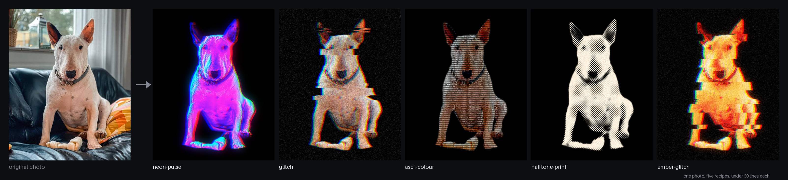
</p>

It can cut the subject (a person, a pet, an object) out of the photo first, so effects can target the subject or the
background separately.

<table>
  <tr>
    <td width="33%" valign="top"><b>Recipes are data</b><br>A look is a list of effects in TOML or Python. Changing a number is a one-line edit, and the same recipe runs on any photo.</td>
    <td width="33%" valign="top"><b>A real pipeline</b><br>Many photos x many recipes, cached on disk. One bad photo never stops the batch, and everything lands in a manifest and a browsable report.</td>
    <td width="33%" valign="top"><b>Developer friendly</b><br>Small pure-function effects, each with its category, example and gallery picture. Typos fail when a recipe is loaded, not halfway through a batch, and editors autocomplete every parameter.</td>
  </tr>
  <tr>
    <td width="33%" valign="top"><b>Transparent</b><br>See the picture after every step with <code>photo-fx steps</code>, so a look that is not right can be debugged, not guessed at.</td>
    <td width="33%" valign="top"><b>Checked automatically</b><br>A missed cut-out, a blank result or an animation that stops moving is flagged without anyone having to look.</td>
    <td width="33%" valign="top"><b>Animates too</b><br>Time-based effects render to video and a filmstrip PNG, with real easing curves and per-piece motion that stays continuous.</td>
  </tr>
</table>

## Gallery

Every picture here is made from one photo by the recipe linked next to it. Reproduce them with `photo-fx run examples/photo-fx.toml`.

<table>
  <tr>
    <td align="center" width="20%">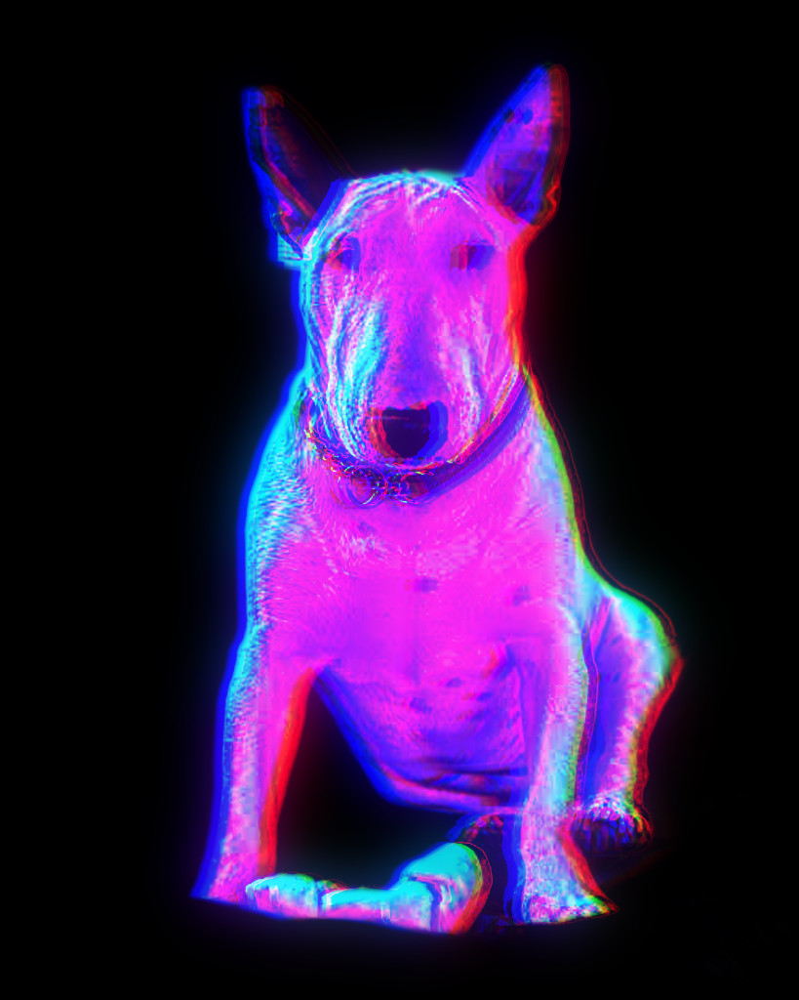</td>
    <td align="center" width="20%">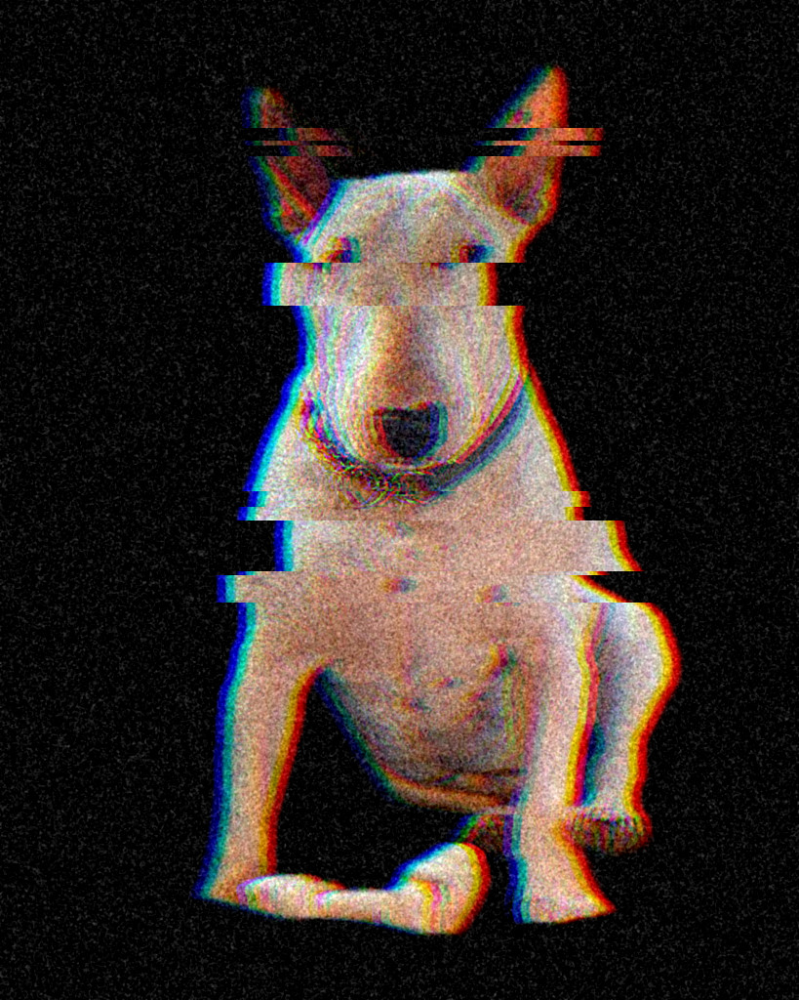</td>
    <td align="center" width="20%">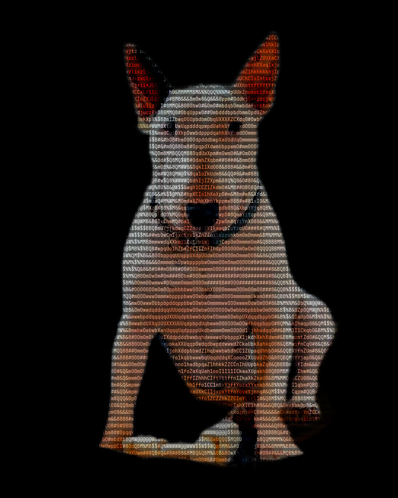</td>
    <td align="center" width="20%">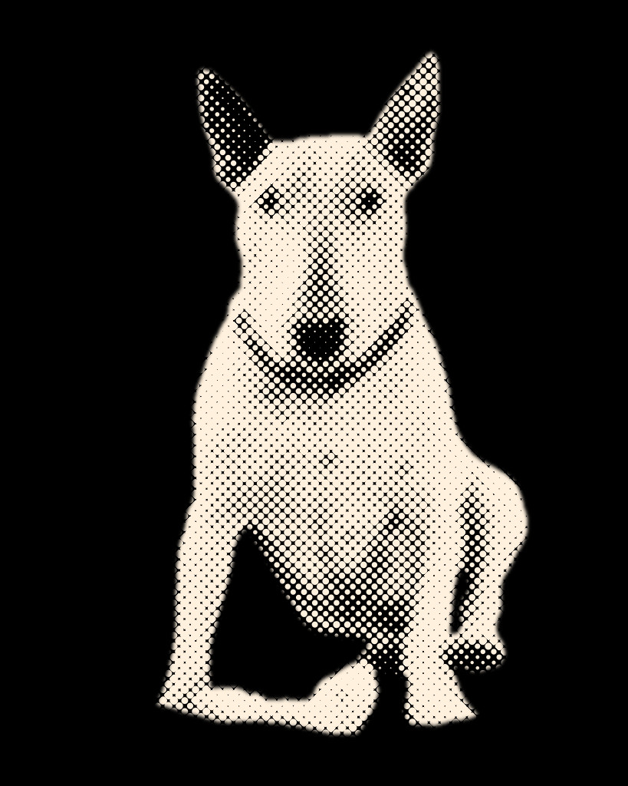</td>
    <td align="center" width="20%">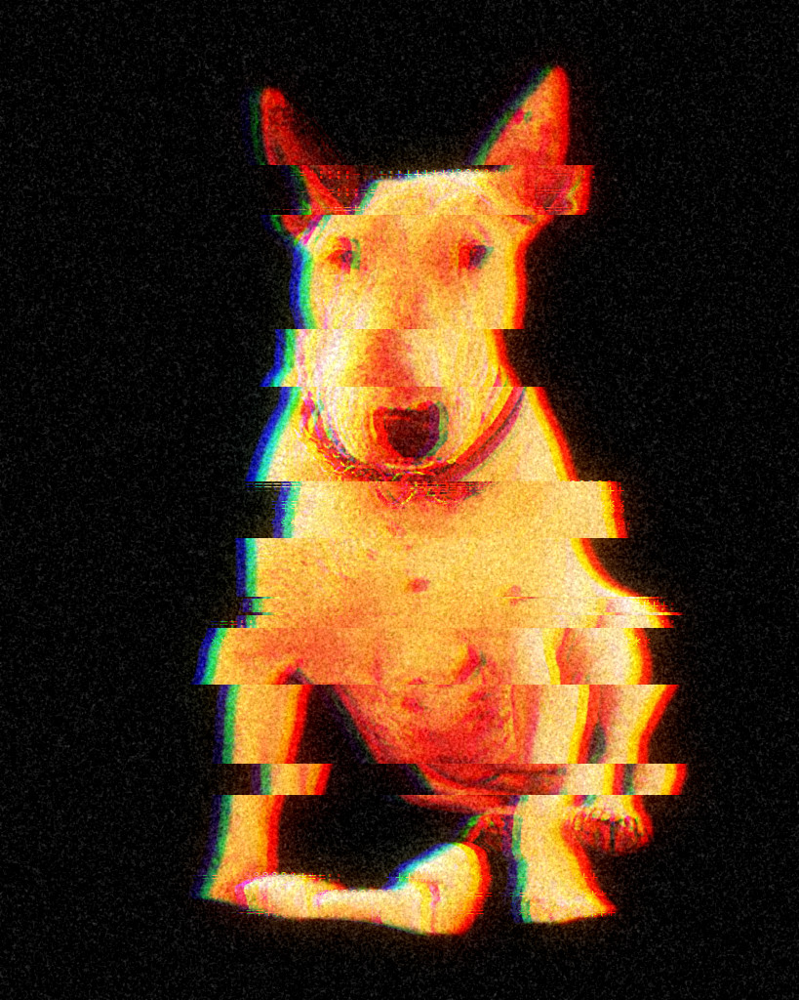</td>
  </tr>
  <tr>
    <td valign="top"><a href="examples/recipes/01-neon-pulse.toml"><b>neon-pulse</b></a><br><sub>Magenta-to-cyan grade, chromatic fringe, glow spilling onto black.<br><code>clarity</code> <code>gradient_map</code> <code>fill</code> <code>glitch</code> <code>glow</code></sub></td>
    <td valign="top"><a href="examples/recipes/02-glitch.toml"><b>glitch</b></a><br><sub>The subject on black, digitally damaged, with film grain.<br><code>fill</code> <code>glitch</code> <code>grain</code></sub></td>
    <td valign="top"><a href="examples/recipes/03-ascii-colour.toml"><b>ascii-colour</b></a><br><sub>Redrawn as text, every character in the photo's own colour.<br><code>grade</code> <code>clarity</code> <code>ascii</code> <code>fill</code></sub></td>
    <td valign="top"><a href="examples/recipes/04-halftone-print.toml"><b>halftone-print</b></a><br><sub>Newsprint dot screen in warm white ink.<br><code>clarity</code> <code>halftone</code> <code>fill</code></sub></td>
    <td valign="top"><a href="examples/recipes/05-ember-glitch.toml"><b>ember-glitch</b></a><br><sub>Fire palette, torn glitch strips, glow and grain.<br><code>gradient_map</code> <code>fill</code> <code>glitch</code> <code>glow</code> <code>grain</code></sub></td>
  </tr>
</table>

The sixth demo recipe is an [animation](#animation).

### Signature looks

Effects are meant to be combined: each recipe below chains three or more of them over the same photo, and a step can be limited to the subject or the background (`mask`) or blended in partway (`opacity`). Reproduce them with `photo-fx run examples/looks.toml`.

<table>
  <tr>
    <td align="center" width="20%">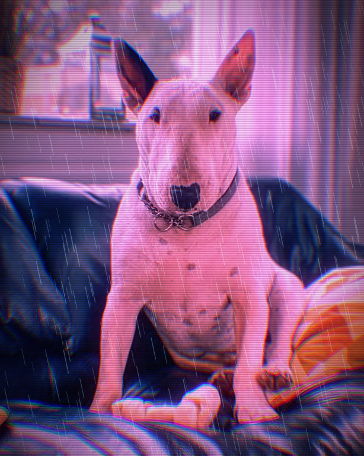</td>
    <td align="center" width="20%">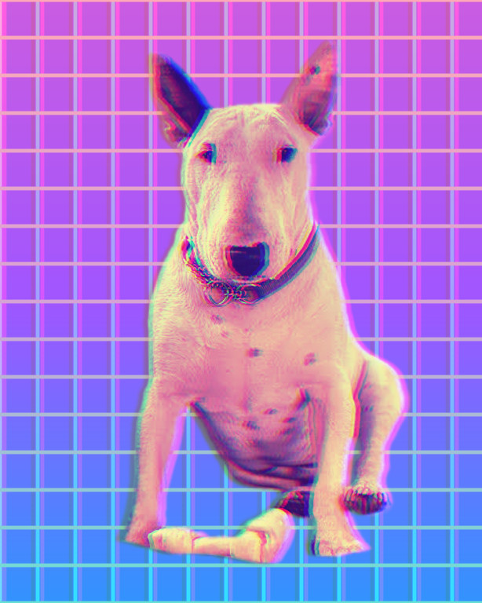</td>
    <td align="center" width="20%">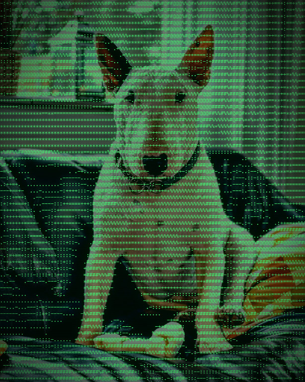</td>
    <td align="center" width="20%">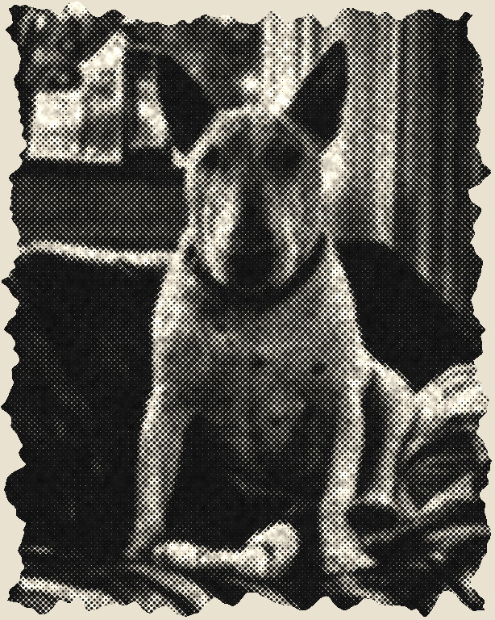</td>
    <td align="center" width="20%">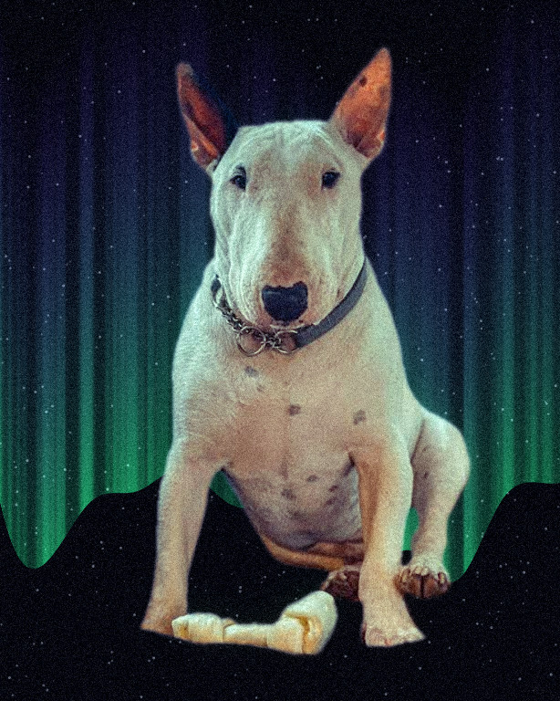</td>
  </tr>
  <tr>
    <td valign="top"><a href="examples/looks/01-cyberpunk.toml"><b>cyberpunk</b></a><br><sub>Magenta and violet grade, colour fringes, scanlines, glow and rain.<br><code>split_tone</code> <code>chromatic_aberration</code> <code>scanlines</code> <code>bloom</code> <code>rain</code> <code>vignette</code></sub></td>
    <td valign="top"><a href="examples/looks/02-vaporwave.toml"><b>vaporwave</b></a><br><sub>A sunset gradient and a grid behind a duotoned dog, split into colour ghosts.<br><code>gradient</code> <code>pattern</code> <code>gradient_map</code> <code>rgb_split</code></sub></td>
    <td valign="top"><a href="examples/looks/03-terminal.toml"><b>terminal</b></a><br><sub>The photo as a green phosphor terminal: characters, scanlines, glow.<br><code>clarity</code> <code>ascii</code> <code>scanlines</code> <code>bloom</code> <code>vignette</code></sub></td>
    <td valign="top"><a href="examples/looks/04-newsprint.toml"><b>newsprint</b></a><br><sub>Black and white dots on off-white paper with a torn edge.<br><code>black_and_white</code> <code>clarity</code> <code>levels</code> <code>halftone</code> <code>paper_texture</code> <code>torn_edge</code></sub></td>
    <td valign="top"><a href="examples/looks/05-northern-lights.toml"><b>northern-lights</b></a><br><sub>Aurora curtains and stars behind a cold-tinted dog.<br><code>aurora</code> <code>starfield</code> <code>split_tone</code> <code>bloom</code> <code>grain</code></sub></td>
  </tr>
</table>

## Contents

[Gallery](#gallery) | [Install](#install) | [Platforms](#platforms) | [Quick start](#quick-start) | [The pipeline](#the-pipeline) | [Recipes](#recipes) |
[Python API](#python-api) | [Seeing what each step does](#seeing-what-each-step-does) | [Animation](#animation) |
[Effects](#effects) | [Automatic checks](#automatic-checks) | [Project layout](#project-layout) | [Development](#development)

## Install

Requires Python 3.12+. As a package:

```bash
pip install photo-fx               # everything but .mp4 / .mov export (unless ffmpeg is already installed)
pip install "photo-fx[video]"      # also a bundled ffmpeg, for video on any OS
photo-fx effects                   # lists every effect and its main parameters (--advanced: all of them; --category NAME: one category;
                                   # --list-categories: the categories with their number of effects; NAME: one effect in full)
```

From a checkout, with [uv](https://docs.astral.sh/uv/) (installs the `video` extra too):

```bash
git clone https://github.com/jcakstins/photo-fx.git
cd photo-fx
uv sync
uv run photo-fx effects
```

## Platforms

photo-fx runs on macOS, Linux and Windows, on Python 3.12, 3.13 and 3.14. Every effect works everywhere; three things
depend on the machine.

**Finding the subject** (cut-outs, `mask = "background"`, anything that needs a silhouette) has two backends:

| Backend | Where | Notes |
|---|---|---|
| `vision`: Apple Vision subject segmentation | macOS | Built in: no download, runs on the Neural Engine. The default on macOS. |
| `onnx`: [IS-Net](https://github.com/xuebinqin/DIS) (general use, Apache-2.0) on ONNX Runtime | macOS, Linux, Windows | The default elsewhere. People, pets and objects alike; a few seconds per photo on a laptop CPU. |

The portable model (178 MB) is not in the package. The first cut-out that needs it downloads it once into your cache
folder (`~/Library/Caches/photo-fx` on macOS, `$XDG_CACHE_HOME/photo-fx` or else `~/.cache/photo-fx` on Linux,
`%LOCALAPPDATA%\photo-fx\Cache` on Windows), checks its SHA-256 against the one pinned in the code and keeps it; nothing is downloaded when photo-fx is imported. Offline, or where the download
is blocked, download the file the error message names by hand and save it where it says, or point `PHOTO_FX_MODEL` at a
copy (`PHOTO_FX_MODEL=/models/isnet-general-use.onnx`), which is then used as it is and never downloaded.

Choose the backend with `--segmenter vision|onnx` (or `subject_matte(rgb, segmenter=...)` in Python), or for every run
with `PHOTO_FX_SEGMENTER=onnx`; the option wins over the variable. No model is needed at all if you have the subject's
matte already: `--matte cutout.png` takes a transparent PNG (its alpha) or a black-and-white mask (white = subject) of
the photo's size, and in Python every renderer takes `matte=imageio.load_matte("cutout.png")`. Subject finding lives
in [`matte/`](src/photo_fx/matte), so a further backend is added there without touching the rest. On Python versions
newer than 3.14 ONNX Runtime has no release yet, so photo-fx installs without it there: the `onnx` backend then says
it is missing, and Apple Vision and `--matte` still work.

**Text effects** (`ascii`, `disperse`, `evaporate` and the text strips of `glitch`) draw with a monospaced font: the first that exists of the
files listed in `PHOTO_FX_FONTS` (paths separated like `PATH`), or else of the usual system fonts (Menlo, Monaco or
Courier on macOS, DejaVu Sans Mono on Linux, Consolas on Windows). A machine with none of them, such as a slim Linux
container, still works with Pillow's built-in font, which is not monospaced.

**Video** (`.mp4`, `.mov`) needs ffmpeg: the one on your `PATH` if there is one, otherwise the one
`pip install "photo-fx[video]"` brings along. GIF export needs neither.

## Quick start

The repository ships a demo: one photo and six looks (five stills and an animation).

```bash
uv run photo-fx run examples/photo-fx.toml
open examples/output/index.html            # macOS; xdg-open on Linux, start on Windows
```

That processes `examples/photos/bullterrier.jpeg` with every recipe in `examples/recipes/` (about ten seconds on a
recent Mac; the first run elsewhere also downloads the subject model). Run it
again and finished work is skipped; edit one recipe and only that one is redone. Add photos to `examples/photos/` and
they join the batch.

To start your own project:

```bash
uv run photo-fx init my-project            # photo-fx.toml, a photos/ folder, two starter recipes
cp ~/Pictures/me.jpg my-project/photos/
uv run photo-fx run my-project/photo-fx.toml
```

### The command line

`photo-fx --help` lists the commands (`render`, `sheet`, `sweep`, `cutout`, `animate`, `run`, `steps`, `init`, `effects`) and
`photo-fx COMMAND --help` shows one command's options and an example. `photo-fx --version` prints the version, and
`python -m photo_fx` is the same program for when the `photo-fx` script is not on your `PATH`. Results are printed to
stdout and progress and errors to stderr. A mistake (a file that is not an image, an unknown effect in a recipe, an
output folder that cannot be written) prints one line, `error: ...`, and exits with 1; usage mistakes exit with 2, Ctrl-C
with 130. `-q` hides the progress lines. For a traceback, add `--debug` or set `PHOTO_FX_DEBUG=1`.

`sweep` shows what one parameter does: the recipe at five values of it (`--count`, 2 to 24), side by side, each labelled. The
target is `effect.parameter` (`effect#2.parameter` for an effect the recipe uses twice); a range that starts below zero
goes after `--`, as in `... -o out/sweep.png -- -2..2`.

```
uv run photo-fx sweep examples/photos/bullterrier.jpeg examples/recipes/02-glitch.toml glitch.split 0..20
```

## The pipeline

```
 photos/*.jpg              recipes/*.toml  (or Recipe objects in Python)
      │                           │
      ▼                           ▼
 ┌─────────┐   ┌─────────┐   ┌─────────┐   ┌─────────┐   ┌─────────┐   ┌──────────┐
 │ ingest  │ → │ analyse │ → │  style  │ → │  check  │ → │ export  │ → │  report  │
 └─────────┘   └─────────┘   └─────────┘   └─────────┘   └─────────┘   └──────────┘
  orientation    find the      run the       cut-out       jpg/png/webp   manifest.json
  + colour       subject       recipe's      sensible?     mp4, several   index.html
  profile        (cached)      steps         motion?       sizes
```

| Stage | What it does |
| --- | --- |
| **ingest** | Reads the photo, applying EXIF rotation and colour profile, into one internal format (float RGB). |
| **analyse** | Finds the subject once per photo, only if a recipe needs it, and caches the result on disk by photo hash. |
| **style** | Runs each recipe's steps in order. Animated recipes render every frame. |
| **check** | Flags a cut-out that covers an implausible share of the photo, blank or blown-out results, and animations whose motion stops early. |
| **export** | Writes every format and size you asked for (animations as `.mp4`, plus a filmstrip PNG). |
| **report** | `manifest.json` (machine-readable) and `index.html` (browse everything, warnings included). |

**Image files in and out** (`photo_fx.imageio`):

- **Reading.** Anything Pillow opens: JPEG, PNG, WebP, TIFF, GIF, BMP... in any mode: 8-bit RGB, greyscale, 1-bit,
  palette and CMYK; 16-bit greyscale at full precision. Transparency is composited over white, so a colour hidden under
  a transparent pixel never shows. An animation (GIF, APNG) gives its first frame.
- **Colour.** An embedded ICC profile (Display P3, a CMYK press profile, a grey gamma) is converted to sRGB from the
  picture's own colour space. Pictures without a usable profile, and 16-bit greyscale, are taken as sRGB, the web's
  rule for untagged images.
- **Errors.** A missing, non-image, truncated or oversized file raises `ImageReadError` naming it. Pillow's
  decompression-bomb limit is kept: pictures over about 179 megapixels (twice `PIL.Image.MAX_IMAGE_PIXELS`) are
  refused; raise that limit yourself for bigger files you trust.
- **Writing.** Stills embed a small sRGB profile and nothing else: no EXIF and no GPS position from your photo, and no
  timestamp, so the same picture always gives the same file. JPEG and WebP quality is the project's `quality` export
  setting (92 unless set; also used by `photo-fx steps`), or 95 for `imageio.save`, `photo-fx render`, `sheet` and
  `cutout`; JPEGs keep full-resolution colour.
  Videos are H.264 in BT.709, tagged so.

Good batch behaviour is built in, and tested:

- **Incremental.** Each result is fingerprinted from the photo, the recipe, the export settings and the tool's own code. Unchanged work is skipped, and a missing output file is made again.
- **Resilient.** One photo or recipe failing is recorded and the rest carry on. The exit code is non-zero if anything failed (`--strict` also fails on warnings, for CI).
- **Safe to preview.** `--dry-run` shows what would run and writes nothing. `--only 'dog*.jpg'` limits a run to some photos. `--force` redoes everything.

The project file is `photo-fx.toml`:

```toml
photos  = ["photos/*.jpg", "photos/*.png"]   # globs, relative to this file
recipes = ["recipes"]                        # recipe files, or folders of them
output  = "output"

[export]
formats = ["jpg"]          # jpg, png or webp for stills; animations are always .mp4
sizes   = [2048, 1080]     # longest side in px; sizes larger than the render are never enlarged
quality = 92
steps   = false            # true: also save the picture after every step of every recipe

[checks]
subject_share = [0.02, 0.97]   # a cut-out outside this share of the photo is flagged
frozen_tail   = 0.3            # an animation frozen for more than this share of its length is flagged
```

## Recipes

A recipe is an ordered list of effects. Each `[[step]]` names an effect, and the other keys are that effect's parameters.

```toml
name = "ember-glitch"
size = 1024                       # longest side in px; effect sizes are relative to this

[[step]]
effect = "gradient_map"           # a fire palette
stops = ["#0a0000", "#e0261b", "#ffb347", "#fff3d6"]

[[step]]
effect = "fill"
color = "#000000"
mask = "background"               # "subject" or "background": apply only there

[[step]]
effect = "glitch"
split = 10
bands = 10
shift = 0.05                      # how far a strip may slide, as a share of the width
seed = 4                          # same seed, same result, every time

[[step]]
effect = "glow"
opacity = 0.6                     # mix this step in at 60%
```

Removing a background is just a `fill` step masked to the background. Every step can take `mask` and `opacity`. Unknown
effects, misspelt parameters and bad values fail when the recipe loads, naming the file and the step.

## Python API

The same recipes can be written in Python with `fx`. Every effect is a function with its real signature and docstring, so
editors complete names and parameters (`fx.pyi` is generated by `poe regenerate`).

```python
from photo_fx import Recipe, fx, imageio, render

photo = imageio.load("dog.jpg")

neon_glitch = Recipe(
    "neon-glitch",
    size=1024,
    steps=[
        fx.gradient_map(stops=("#12002b", "#ff2bd6", "#00f0ff")),
        fx.fill("#000000").where("background"),  # only where the photo's background is
        fx.glitch(split=12, bands=8, seed=4),
        fx.glow(radius=26, amount=0.65).blend(0.8),  # mixed in at 80%
    ],
)

imageio.save(render(photo, neon_glitch), "dog-neon-glitch.jpg")
```

`fx.glitch(spilt=8)` raises at once and lists the valid parameters, the same as a typo in a TOML file does. Code-built
recipes can be handed straight to the pipeline: `run(Project(photos=(...), recipes=(neon_glitch,), output=...))`. See
[`examples/python_api.py`](examples/python_api.py) for a complete, runnable example.

Every effect declares its parameters once, as a frozen Pydantic model in which each field has a description, a unit, a
range and a default; validation, `fx` signatures, `help(fx.<effect>)`, `photo-fx effects` and
[docs/effects/](docs/effects/README.md) all come from it, so `fx.grade(exposure=12)` fails at once naming the effect, the
field, the limit and the value. Writing an effect follows the same pattern: `uv run poe new-effect <name>
--category <category>` starts one from the template, and [`effects/grade/effect.py`](src/photo_fx/effects/grade/effect.py)
is a worked example.

Importing `photo_fx` is quick: the effects load the first time one is asked for, once, under a lock, so threads can
render at the same time; register effects at import time only.

### Writing a plugin

Effects can live in your own package. Write them against `photo_fx.plugin`, which holds everything an effect author
needs (`EffectParams`, `param`, `Color`, `effect`, `CATEGORIES`):

```python
import numpy as np
from photo_fx.plugin import Color, EffectParams, effect, param


class TintParams(EffectParams):
    """Settings of the tint."""

    colour: Color = param("#ff8800", doc="The colour mixed in.")
    amount: float = param(0.3, unit="fraction", min=0, max=1, doc="How much of it, 0..1. Raising it tints more.")


@effect(category="colour", params=TintParams)
def tint(rgb: np.ndarray, params: TintParams) -> np.ndarray:
    """Mixes a flat colour into the picture."""
    return (rgb * (1 - params.amount) + np.asarray(params.colour, np.float32) * params.amount).astype(np.float32)
```

Declare the module as an entry point in your package's `pyproject.toml` and install the package; `tint` is then
available by name in TOML recipes, as `fx.tint(...)` and in `photo-fx effects`:

```toml
[project.entry-points."photo_fx.effects"]
my_effects = "my_package.effects"
```

A plugin that fails to load stops the first effect lookup with an error naming it; set `PHOTO_FX_PLUGINS=builtin` to
load only photo-fx's own effects. Effect names must be unique across every installed package.

## Seeing what each step does

When a look is not right, the cause is rarely the last step. Print the picture after every step:

```bash
uv run photo-fx steps examples/photos/bullterrier.jpeg examples/recipes/05-ember-glitch.toml
```

<p align="center">
  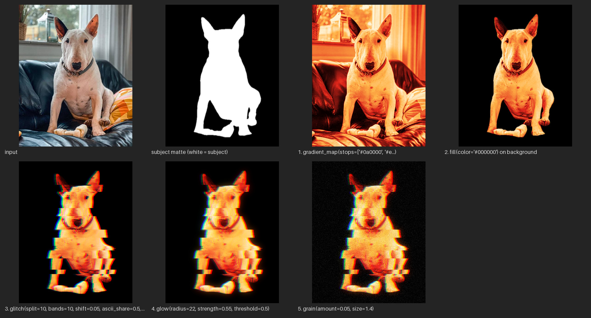
</p>

The sheet (written to `out/steps/<photo>__<recipe>/`, with one picture per step) shows the photo, the subject cut-out
(white = subject), and the result of each step, with the exact parameters. In Python it is `trace(photo, recipe)`, and `photo-fx run --steps` does it for a whole batch (linked from the report).
The last picture is exactly what `render` returns, because both run the same code.

## Animation

Add an `[animation]` table and any numeric parameter can change over the clip. `photo-fx run` (or `photo-fx animate`) renders
it to `.mp4` and also saves a filmstrip PNG, so the animation can be shown where a video cannot go.

<p align="center">
  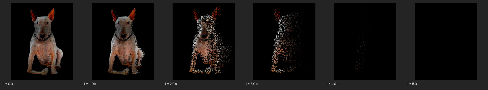
</p>
<p align="center"><sub><code>06-evaporate.toml</code>: the dog, drawn as text, evaporates. Frames at 0, 1, 2, 3, 4 and 5 seconds.</sub></p>

```toml
[animation]
seconds = 5
fps = 30
hold_start = 0.5            # still frames before the motion starts
hold_end = 0.3

[[step]]
effect = "disperse"
progress = { from = 0.0, to = 0.88, ease = [0.25, 0.1, 0.75, 0.9] }   # a name or four cubic-bezier numbers
clock = { from = 0.0, to = 5.0, over = "clip" }                      # keeps running through the holds
wind = 0.3
angle = 30                  # degrees above the horizontal
```

The `disperse` effect cuts the picture into character-sized pieces, each with its own fixed path, so frames fit together.
The outline floats first, a front sweeps across, and each piece lets go when it arrives and is carried off on the wind. It
follows the motion-design principles of anticipation, easing and three layers of movement, and a test checks that no piece
travels more than a third of the picture. Easing can be `linear`, `in`, `out`, `in-out`, a cubic-bezier preset (`gentle`,
`standard`, `accelerate`, `decelerate`, `emphasized`, `sine`) or your own four numbers.

Generated videos are not committed to this repository: only the filmstrip is.

## Effects

Colour grades and gradient maps, light and texture, halftone, ASCII art, glitch, background removal and evaporating
particles, grouped by category. **[The effect catalogue](docs/effects/README.md)** (an index and a page per category) shows every effect with a picture of it, a
one-line description, its parameters and defaults, and the example recipe that made the picture.
`uv run photo-fx effects` prints the main parameters of every effect (`--advanced` adds the technique options, `photo-fx effects NAME` shows one effect in full).

Adding an effect adds files named for it and edits none. `uv run poe new-effect my_effect --category light` writes
them from the template, working as written:

- `src/photo_fx/effects/my_effect/effect.py` (and `__init__.py`): its parameter model and a pure function
  `def my_effect(rgb, params) -> rgb` with the decorator `@effect(category="...", params=...)`. Its docstring becomes its
  documentation. Every package in [`src/photo_fx/effects/`](src/photo_fx/effects) is found automatically. Effects never
  import each other: what two of them share goes to `src/photo_fx/ops/`.
- `tests/effects/my_effect/test_my_effect.py`: tests of the property that defines it.
- `examples/effects/my_effect.toml`: a short example recipe (size 480), which makes its picture in the catalogue,
  `docs/gallery/my_effect.jpg` (`uv run poe gallery --only my_effect`).

The shared tests then check automatically that it keeps the image's shape and range, is deterministic, does not modify
its input, has a category, a docstring, defaults and an example recipe, and uses the shared parameter names (`amount`,
not `strength`).

## Automatic checks

So that a person does not have to look at every result, these run during every export and appear in the report. They
never block an export, and `--strict` turns them into a failing exit code:

| Check | Flags |
| --- | --- |
| Subject coverage | A cut-out covering under 2% or over 97% of the photo (the subject was missed, or there is no background to separate). |
| Blank or broken result | An all-black or all-white picture, a flat colour with no detail, or invalid pixel values. |
| Frozen tail | An animation whose motion stops early, so the last part of the clip is frozen (the file is fine, the motion died). |

## Project layout

```
src/photo_fx/                  layers, top to bottom; each imports only from the layers below it
  cli.py         app       the `photo-fx` command (no logic of its own); `python -m photo_fx` runs it too
  pipeline.py              many photos x many recipes: cache, checks, export, report
  gallery.py               what is generated from the effects (catalogue page, pictures, fx.pyi); new-effect, driven by tools/dev.py
  sheet.py                 contact sheets, step sheets and parameter sweeps
  checks.py                automatic quality checks
  fx.py                    the effects as validated step builders for Python (+ generated fx.pyi)
  recipe.py                the public namespace: the core's recipe names, with the subject finder bound to matte
  imageio.py     adapters  file formats, EXIF and colour profiles, video; defines the one in-memory image type
  matte/                   subject_matte(rgb) -> alpha. Which model finds the subject (Apple Vision, or IS-Net on
                           ONNX Runtime, downloaded on first use) is hidden here
  effects/       effects   the effect library, one package per effect (code only), found automatically;
                           _template/ is what `poe new-effect` copies
  plugin.py                the effect-author API, also for other packages (EffectParams, param, Color, effect)
  core/          core      registry.py (effects register here), params.py (parameter models), types.py,
                           vocabulary.py, and the recipe engine: timing.py (easing, `ramp`, `Animation`), steps.py
                           (`Step`, `Recipe`), loader.py (TOML), runner.py (render, render_frames, render_all, trace;
                           given the photo and the subject)
  ops/           ops       shared numeric primitives named by concept: blur, cells, color, distance,
                           glyphs, resample, textart (internal; core may import ops; ops imports nothing above it)
  errors.py      errors    PhotoFxError and its subclasses: the bottom layer, importable from every other one
examples/        the demo project: one photo, six recipes, the committed results, a Python example
  effects/       one short example recipe per effect, <effect>.toml
docs/            the effect catalogue (effects/, generated: an index and a page per category) and its pictures (gallery/<effect>.jpg), roadmap, design decisions
recipes/         a larger set of experiments
tests/           mirrors src/: tests/effects/<effect>/test_<effect>.py for each effect's package
```

Each module owns one decision and callers never see it: `imageio` is the only place that knows about file formats,
`matte` the only place that knows about Vision or the portable model, and effects know nothing about files, mattes or recipes. The layers are
import-linter contracts in `pyproject.toml`, checked by the test suite (`uv run lint-imports` runs them alone). Why it is
built this way, decision by decision: [docs/design-decisions.md](docs/design-decisions.md).

## Development

```bash
uv sync
uv run poe setup       # once per clone: installs the git hooks and the commit-message template
uv run poe check       # before every push or merge: format, lint, dead code, dependencies, build, types, tests
uv run poe check-min-deps   # for CI: the tests on Python 3.12 with the lowest dependency releases the floors allow
uv run poe fix         # applies the automatic lint and format fixes
uv run poe new-effect my_effect --category light   # a new effect's files, from the template
uv run photo-fx render examples/photos/bullterrier.jpeg examples/effects/my_effect.toml   # look at it, in out/
uv run poe regenerate   # at integration: fx.pyi, docs/effects/, missing pictures
```

Commits follow [Conventional Commits](https://www.conventionalcommits.org/) (`type(scope): imperative subject`, header at
most 72 characters, body explaining why); a `commit-msg` hook checks it. The details are in [CLAUDE.md](CLAUDE.md#git-conventions).
How to contribute is in [CONTRIBUTING.md](CONTRIBUTING.md), what changed in each release in [CHANGELOG.md](CHANGELOG.md),
and how to report a security problem privately in [SECURITY.md](SECURITY.md).

Generated shared files (`src/photo_fx/fx.pyi`, `docs/effects/`) are not updated on feature branches, so branches that
add effects never conflict over them; each effect's picture is a file of its own. After merging, `uv run poe regenerate` brings them up to date in one
commit. Pictures that exist are kept (`uv run poe gallery --force` renders them again).

Every gate (ruff, vulture, deptry, the build check, mypy, the tests) is configured in `pyproject.toml` and listed in
[CLAUDE.md](CLAUDE.md#lint-types-and-the-other-gates); a push to `main` (or a tag) runs the whole gate through the pre-push hook; pushes to other branches are checked by CI when the pull request opens.

Tests that need Apple Vision are skipped off macOS, and tests that read videos back with `ffprobe` are skipped when no
ffmpeg is on the `PATH`. The portable backend is tested with tiny stand-in models built in the tests: the suite never
downloads the real model, and its one test of the real model runs only when the model is already in the cache.

## License

[MIT](LICENSE) © 2026 Janis Cakstins
