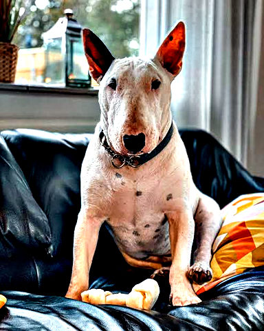
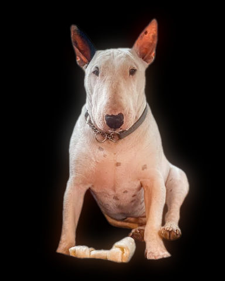

# Effects

Every effect, by category. Each picture is the effect's example recipe (linked in the last column) run on the
demo photo. Below each category, every parameter of its effects: unit, range, default and what it does.
`uv run photo-fx effects` prints the same documentation.

Generated by `photo-fx regenerate` from the effects themselves: do not edit by hand.

[Colour](#colour) | [Light](#light) | [Texture](#texture) | [Stylised](#stylised) | [Text](#text) | [Glitch](#glitch) | [Subject](#subject) | [Animation](#animation)

## Colour

| Example | Effect | What it does | Parameters | Recipe |
| --- | --- | --- | --- | --- |
|  | `grade` | Basic tone controls: `exposure` in stops, then `contrast` around `pivot`, then `saturation`. | `exposure=0.0` `contrast=1.0` `pivot=0.5` `saturation=1.0` | [grade.toml](../examples/effects/grade.toml) |
|  | `gradient_map` | Recolour by brightness: darkest pixels get the first stop, brightest the last, evenly spaced between. | `stops=('#000000', '#ffffff')` `shadow_clip=0.01` `highlight_clip=0.01` `quantile_method='linear'` | [gradient_map.toml](../examples/effects/gradient_map.toml) |
|  | `hue_shift` | Rotate every hue around the colour wheel by `hue` degrees: the quickest way to try another colour scheme. | `hue=90.0` | [hue_shift.toml](../examples/effects/hue_shift.toml) |
|  | `split_tone` | Tint the dark parts with `shadow` and the bright parts with `highlight`, without changing brightness. | `shadow='#3a1bff'` `highlight='#ff2bd6'` `amount=0.3` `balance=0.5` `softness=0.5` `black_fade=0.1` | [split_tone.toml](../examples/effects/split_tone.toml) |

### `grade`

| Parameter | Type | Unit | Range | Default | Description |
| --- | --- | --- | --- | --- | --- |
| `exposure` | number | stops | -10 to 10 | `0.0` | Brightness in photographic stops: +1 doubles every value, -1 halves it. |
| `contrast` | number | ratio | 0 to 5 | `1.0` | How far values are pushed away from the pivot: 1 = unchanged, 2 = twice as far, 0 = flat at the pivot. |
| `pivot` | number | fraction | 0 to 1 | `0.5` | The brightness (0..1) that contrast leaves where it is; values above it brighten, below it darken. |
| `saturation` | number | ratio | 0 to 5 | `1.0` | Colourfulness: 1 = unchanged, 0 = grey (Rec. 709 brightness kept), above 1 more vivid. |

### `gradient_map`

| Parameter | Type | Unit | Range | Default | Description |
| --- | --- | --- | --- | --- | --- |
| `stops` | list of colours |  |  | `('#000000', '#ffffff')` | The gradient's colours from darkest to brightest, evenly spaced; at least two. Two make a duotone, three a tritone. |
| `shadow_clip` | number | fraction | 0 to 0.5 | `0.01` | Share of the darkest pixels (0..0.5) that the contrast stretch pushes onto the first stop; 0 maps only the darkest pixel there. Larger gives deeper shadows. |
| `highlight_clip` | number | fraction | 0 to 0.5 | `0.01` | Share of the brightest pixels (0..0.5) that the contrast stretch pushes onto the last stop. Larger gives brighter highlights. |
| `quantile_method` | one of 'linear', 'lower', 'higher', 'nearest', 'midpoint', 'inverted_cdf', 'averaged_inverted_cdf', 'closest_observation', 'interpolated_inverted_cdf', 'hazen', 'weibull', 'median_unbiased', 'normal_unbiased' |  |  | `'linear'` | How the stretch's clip points are read from the picture's brightness (numpy's quantile methods): 'linear' interpolates between the two nearest pixels; 'lower', 'higher', 'nearest' and 'midpoint' take the darker, the brighter, the nearer pixel or their mean; 'inverted_cdf', 'averaged_inverted_cdf', 'closest_observation', 'interpolated_inverted_cdf', 'hazen', 'weibull', 'median_unbiased' and 'normal_unbiased' are the textbook sample-quantile definitions (Hyndman and Fan). Only visible on small or flat pictures. |

### `hue_shift`

| Parameter | Type | Unit | Range | Default | Description |
| --- | --- | --- | --- | --- | --- |
| `hue` | number | degrees | -360 to 360 | `90.0` | The turn around the colour wheel: 120 sends red to green, 360 is a full turn (unchanged). |

### `split_tone`

| Parameter | Type | Unit | Range | Default | Description |
| --- | --- | --- | --- | --- | --- |
| `shadow` | colour |  |  | `'#3a1bff'` | The tint of the dark parts: '#rrggbb', '#rgb' or [r, g, b] 0..1. |
| `highlight` | colour |  |  | `'#ff2bd6'` | The tint of the bright parts: '#rrggbb', '#rgb' or [r, g, b] 0..1. |
| `amount` | number | fraction | 0 to 1 | `0.3` | How strongly the tints are added: 0 = off, 0.2 a hint, 0.6 strong. |
| `balance` | number | fraction | 0 to 1 | `0.5` | The brightness (0..1) where the shadow tint hands over to the highlight tint. Raising it tints more of the picture with the shadow colour. |
| `softness` | number | fraction | 0.01 to 1 | `0.5` | Width of the brightness band (0.01..1), centred on balance, over which one tint blends into the other. Smaller makes a sharper hand-over. |
| `black_fade` | number | fraction | 0.001 to 1 | `0.1` | The brightness (0.001..1) up to which the tints fade in from nothing, so pure black stays black. Larger keeps more of the shadows untinted. |

## Light

| Example | Effect | What it does | Parameters | Recipe |
| --- | --- | --- | --- | --- |
|  | `clarity` | Local contrast: exaggerate how each area differs from its surroundings, so features stand out even when the whole face sits in a narrow band of brightness. | `radius=30.0` `amount=1.0` `truncate=4.0` `mode='reflect'` `constant_value=0.0` | [clarity.toml](../examples/effects/clarity.toml) |
|  | `glow` | Soft bloom around the bright parts: what is brighter than `threshold` is blurred by `radius` px and screened over the picture by `amount`. | `radius=24.0` `amount=0.6` `threshold=0.55` `truncate=4.0` `mode='reflect'` `constant_value=0.0` | [glow.toml](../examples/effects/glow.toml) |

### `clarity`

| Parameter | Type | Unit | Range | Default | Description |
| --- | --- | --- | --- | --- | --- |
| `radius` | number | px | 0 to 500 | `30.0` | Size of each area's 'surroundings': the Gaussian sigma of the blur, in px at the recipe's size. Larger compares bigger regions and takes longer (at the top of the range, with a large truncate, seconds per picture); 0 turns the effect off. |
| `amount` | number | ratio | 0 to 5 | `1.0` | How strongly each area's difference from its surroundings is exaggerated: 0 = off, 1 = doubled. |
| `truncate` | number | ratio | 1 to 10 | `4.0` | Where the Gaussian is cut off, in sigmas: the blur reaches truncate x radius px. Larger is more exact and slower. |
| `mode` | one of 'reflect', 'constant', 'nearest', 'mirror', 'wrap' |  |  | `'reflect'` | What the blur sees beyond the picture's edge: 'reflect' (mirrored, edge pixel repeated), 'mirror' (mirrored about the edge pixel), 'nearest' (the edge pixel repeated), 'wrap' (the opposite edge), 'constant' (constant_value). |
| `constant_value` | number | fraction | 0 to 1 | `0.0` | The brightness (0..1) assumed beyond the edge when mode is 'constant'; ignored otherwise. |

### `glow`

| Parameter | Type | Unit | Range | Default | Description |
| --- | --- | --- | --- | --- | --- |
| `radius` | number | px | 0 to 500 | `24.0` | Gaussian sigma of the halo in px at the recipe's size: larger spreads the light further and softer (and takes longer); 0 keeps the light on the bright parts themselves. |
| `amount` | number | ratio | 0 to 10 | `0.6` | How strongly the halo is screened over the picture: 0 = off, 1 = the halo at full brightness; above 1 it saturates to white sooner. |
| `threshold` | number | fraction | 0 to 0.99 | `0.55` | The brightness (0..1, per channel) where the glow starts: only values above it light the halo, rising to full at 1. Raising it limits the glow to the brightest highlights. |
| `truncate` | number | ratio | 1 to 10 | `4.0` | Where the halo's Gaussian is cut off, in sigmas: the halo reaches truncate x radius px. Larger is more exact and slower. |
| `mode` | one of 'reflect', 'constant', 'nearest', 'mirror', 'wrap' |  |  | `'reflect'` | What the halo's blur sees beyond the picture's edge: 'reflect' (mirrored, edge pixel repeated), 'mirror' (mirrored about the edge pixel), 'nearest' (the edge pixel repeated), 'wrap' (the opposite edge), 'constant' (constant_value, so the glow fades toward the edge when it is 0). |
| `constant_value` | number | fraction | 0 to 1 | `0.0` | The highlight (0..1) assumed beyond the edge when mode is 'constant'; ignored otherwise. |

## Texture

| Example | Effect | What it does | Parameters | Recipe |
| --- | --- | --- | --- | --- |
|  | `grain` | Film grain: brightness noise of standard deviation `amount` (0.08 visible, 0.2 heavy), clumped to `size` px. | `amount=0.08` `size=1.0` `seed=0` `truncate=4.0` `mode='reflect'` | [grain.toml](../examples/effects/grain.toml) |

### `grain`

| Parameter | Type | Unit | Range | Default | Description |
| --- | --- | --- | --- | --- | --- |
| `amount` | number | fraction | 0 to 1 | `0.08` | Standard deviation of the added brightness, in 0..1 picture units: 0 = none, 0.08 is visible, 0.2 is heavy. |
| `size` | number | px | 0 to 50 | `1.0` | Grain size in px: up to 1 every pixel varies on its own; above 1 the noise is blurred (Gaussian sigma = size / 2) into specks about this wide, keeping its standard deviation. Larger = coarser, softer grain. |
| `seed` | whole number | count | 0 to 4294967295 | `0` | Random seed: the same seed always gives the same grain, another seed a different pattern. |
| `truncate` | number | ratio | 1 to 10 | `4.0` | Where the clumping blur's Gaussian is cut off, in sigmas (only when size > 1). Larger is more exact and slower. |
| `mode` | one of 'reflect', 'nearest', 'mirror', 'wrap' |  |  | `'reflect'` | What the clumping blur sees beyond the picture's edge (only when size > 1): 'reflect' (mirrored, edge pixel repeated), 'mirror' (mirrored about the edge pixel), 'nearest' (the edge pixel repeated), 'wrap' (the opposite edge, so the grain tiles seamlessly). |

## Stylised

| Example | Effect | What it does | Parameters | Recipe |
| --- | --- | --- | --- | --- |
|  | `halftone` | Print-style dot screen: tone becomes dot size. | `cell=14` `angle=45.0` `ink=None` `paper='#000000'` `sigma=0.5` `feather=1.0` `truncate=4.0` `mode='reflect'` `constant_value=0.0` | [halftone.toml](../examples/effects/halftone.toml) |

### `halftone`

| Parameter | Type | Unit | Range | Default | Description |
| --- | --- | --- | --- | --- | --- |
| `cell` | whole number | px | 1 to 200 | `14` | Distance between neighbouring dots in px (the screen's pitch). Larger = fewer, bigger dots, a coarser print. |
| `angle` | number | degrees | -360 to 360 | `45.0` | Rotation of the dot grid in degrees, clockwise on screen: rows of dots run that many degrees below the x axis (negative = above). The grid is square, so 90 degrees on looks the same; 45 is the classic screen angle for one ink. |
| `ink` | colour or none |  |  | `None` | The ink: one colour for every dot ('#rrggbb', '#rgb' or three numbers 0..1); leave it out to give each dot the colour of the photo under it, brightened so small dots stay visible. |
| `paper` | colour |  |  | `'#000000'` | The paper colour between the dots. On a dark paper bright tones get the ink; on a light one, dark tones. |
| `sigma` | number | ratio | 0 to 5 | `0.5` | Gaussian sigma, in cells, of the blur that averages the tone each dot stands for: 0 = each dot sees only the pixel at its centre (detail, but noisy), larger = smoother tone that spreads into neighbouring dots. |
| `feather` | number | px | 0.1 to 50 | `1.0` | Width of each dot's soft edge in px (anti-aliasing): small = crisp dots, larger = blurrier dots. The ink stays the same. |
| `truncate` | number | ratio | 1 to 10 | `4.0` | Where the tone blur's Gaussian is cut off, in sigmas: it reaches truncate x sigma cells. Larger is more exact and slower. |
| `mode` | one of 'reflect', 'constant', 'nearest', 'mirror', 'wrap' |  |  | `'reflect'` | What the tone blur sees beyond the picture's edge: 'reflect' (mirrored, edge pixel repeated), 'mirror' (mirrored about the edge pixel), 'nearest' (the edge pixel repeated), 'wrap' (the opposite edge), 'constant' (constant_value). |
| `constant_value` | number | fraction | 0 to 1 | `0.0` | The brightness (0..1) assumed beyond the edge when mode is 'constant'; ignored otherwise. |

## Text

| Example | Effect | What it does | Parameters | Recipe |
| --- | --- | --- | --- | --- |
|  | `ascii` | Redraw the picture as text: a grid of characters `cell` px wide, each chosen by the brightness under it. | `cell=10` `chars=' .:-=+*#%@'` `ink=None` `paper='#000000'` `gamma=1.0` `photo=0.0` `font=None` | [ascii.toml](../examples/effects/ascii.toml) |

### `ascii`

| Parameter | Type | Unit | Range | Default | Description |
| --- | --- | --- | --- | --- | --- |
| `cell` | whole number | px | 1 to 200 | `10` | Width of one character, 1 to 200 px; the height follows from the font. Smaller = finer detail, more characters. |
| `chars` | text |  |  | `' .:-=+*#%@'` | The character palette, in any order, at least two different characters. It is sorted by how much ink each glyph puts down, so the densest is used for the brightest areas on dark paper and the darkest on light paper (see `paper`). Try ' .:-=+*#%@', ' .oO0@', '01', or blocks like ' ░▒▓█' (the font must have them). |
| `ink` | colour or none |  |  | `None` | The ink colour of every character ('#rrggbb', '#rgb' or [r, g, b] 0..1); none (the default) colours each character from the average colour of the photo under it, brightened so thin strokes stay readable: scaled until its strongest channel is full, or by 1 / 0.35 if that channel is below 0.35 (never darkened). |
| `paper` | colour |  |  | `'#000000'` | The paper colour behind the characters. Paper darker than mid grey (Rec. 709 luminance below 0.5) puts dense characters on bright areas; lighter paper puts them on dark areas. |
| `gamma` | number | ratio | 0.1 to 10 | `1.0` | Exponent on the amount of ink each character puts down, 0.1 to 10: 1 = linear, above 1 lighter midtones (less ink), below 1 more ink. |
| `photo` | number | fraction | 0 to 1 | `0.0` | How much of the original picture shows through the paper behind the characters, 0 to 1: 0 = text on flat `paper` (fine detail is lost to the grid), 1 = text laid over the untouched photo. |
| `font` | text or none |  |  | `None` | Path to a monospaced .ttf/.ttc font; none (the default) uses the first system monospaced font found. |

## Glitch

| Example | Effect | What it does | Parameters | Recipe |
| --- | --- | --- | --- | --- |
|  | `glitch` | `bands` random horizontal strips slide sideways by up to `shift` of the width, then red and blue are pushed `split` px apart. | `split=10` `bands=7` `shift=0.06` `ascii_share=0.0` `ascii_cell=9` `ascii_photo=0.0` `seed=0` `band_min_height=0.01` `band_max_height=0.06` `ascii_rows=3` `ascii_gamma=0.55` `ascii_chars=' .:-=+*#%@'` `ascii_ink=None` `ascii_paper='#000000'` `ascii_font=None` | [glitch.toml](../examples/effects/glitch.toml) |

### `glitch`

| Parameter | Type | Unit | Range | Default | Description |
| --- | --- | --- | --- | --- | --- |
| `split` | whole number | px | -500 to 500 | `10` | How far red is pushed right and blue left, -500 to 500 px (negative swaps the directions); 0 = no colour split. The picture wraps around at the edges. |
| `bands` | whole number | count | 0 to 500 | `7` | How many random horizontal strips slide sideways, 0 to 500; 0 = none. |
| `shift` | number | fraction | 0 to 1 | `0.06` | The furthest a strip slides, as a fraction 0 to 1 of the picture's width; each strip slides a random distance up to this, left or right, wrapping around. |
| `ascii_share` | number | fraction | 0 to 1 | `0.0` | The fraction 0 to 1 of the strips that also dissolve into text (rounded up to whole strips); 0 = no text. |
| `ascii_cell` | whole number | px | 1 to 200 | `9` | Width of one character of the text strips, 1 to 200 px. Larger = bigger, fewer characters. |
| `ascii_photo` | number | fraction | 0 to 1 | `0.0` | How much of the strip shows through behind its characters, 0 to 1: 0 = text on flat `ascii_paper`, 1 = text laid over the strip, keeping all its detail. |
| `seed` | whole number | count | 0 to 4294967295 | `0` | Random seed: the same seed always gives the same damage; any other gives different strips. |
| `band_min_height` | number | fraction | 0 to 1 | `0.01` | The lowest a strip can be, as a fraction 0 to 1 of the picture's height (never below 1 px). Each strip's height is drawn at random between this and `band_max_height` (set above it, the two swap roles). |
| `band_max_height` | number | fraction | 0 to 1 | `0.06` | The tallest a strip can be, as a fraction 0 to 1 of the picture's height. Raising it gives taller strips. |
| `ascii_rows` | whole number | count | 1 to 100 | `3` | The fewest rows of characters a text strip holds, 1 to 100: a thinner strip is widened (each row counted as twice `ascii_cell` tall) so its text stays legible, up to the whole picture. |
| `ascii_gamma` | number | ratio | 0.1 to 10 | `0.55` | Exponent on the amount of ink each character puts down, 0.1 to 10: below 1 (the default) more ink, so the text carries enough light to read against dark paper; above 1 less. |
| `ascii_chars` | text |  |  | `' .:-=+*#%@'` | The character palette of the text strips, in any order, at least two different characters; sorted by how much ink each glyph puts down, so the densest is used for the brightest areas on dark paper and the darkest on light paper (see `ascii_paper`). |
| `ascii_ink` | colour or none |  |  | `None` | The ink colour of the text strips ('#rrggbb', '#rgb' or [r, g, b] 0..1); none (the default) colours each character from the average colour of the strip under it, brightened as in the ascii effect (strongest channel scaled to full, or by 1 / 0.35 if below 0.35). |
| `ascii_paper` | colour |  |  | `'#000000'` | The paper colour behind the text strips' characters. Paper darker than mid grey (Rec. 709 luminance below 0.5) puts dense characters on bright areas; lighter paper puts them on dark areas. |
| `ascii_font` | text or none |  |  | `None` | Path to a monospaced .ttf/.ttc font for the text strips; none (the default) uses the first system monospaced font found. |

## Subject

| Example | Effect | What it does | Parameters | Recipe |
| --- | --- | --- | --- | --- |
|  | `fill` | Replace the whole picture with one colour. | `color='#000000'` | [fill.toml](../examples/effects/fill.toml) |

### `fill`

| Parameter | Type | Unit | Range | Default | Description |
| --- | --- | --- | --- | --- | --- |
| `color` | colour |  |  | `'#000000'` | The colour that fills the whole picture: '#rrggbb', '#rgb' or [r, g, b] 0..1. |

## Animation

| Example | Effect | What it does | Parameters | Recipe |
| --- | --- | --- | --- | --- |
|  | `disperse` | The picture at one moment of its dispersal: `progress` 0 = untouched, 1 = finished. | `cell=5` `font=None` `progress=0.0` `top=1.0` `edge=1.0` `sweep=0.0` `reach=1.0` `wind=0.2` `angle=10.0` `hover=0.0` `outward=0.0` `ambient=0.0` `clock=0.0` `seed=0` `edge_depth=0.15` `jitter=0.2` `anticipation=0.06` `pullback=0.15` `flight=0.2` `flight_variation=0.4` `finish=0.98` `hover_spread=0.45` `bob=0.004` `bob_cycles=3.0` `angle_spread=12.0` `distance_minimum=0.35` `outward_distance=0.12` `acceleration=0.5` `sway=0.012` `sway_cycles=1.5` `falloff=1.5` `flare=0.4` `flare_span=0.2` `ambient_period=3.0` `ambient_wavelength=0.2` `open_bottom=True` `normal_smoothing=1.0` | [disperse.toml](../examples/effects/disperse.toml) |
|  | `evaporate` | Dissolve the picture into pieces that float away, thin out and fade. | `cell=5` `font=None` `start=0.6` `end=0.3` `edge=0.0` `outward=0.0` `rise=0.3` `wind=0.0` `vanish=0.3` `seed=0` `rise_gamma=0.6` `rise_minimum=0.1` `rise_skew=1.5` `thinning=0.5` `falloff=1.5` `sway=0.12` `sway_minimum=0.3` `open_bottom=True` `normal_smoothing=1.0` | [evaporate.toml](../examples/effects/evaporate.toml) |

### `disperse`

| Parameter | Type | Unit | Range | Default | Description |
| --- | --- | --- | --- | --- | --- |
| `cell` | whole number | px | 1 to 64 | `5` | Character width in px; a piece is one character (its height comes from `font`). Use the same value as the ascii step before this one, so whole characters move. |
| `font` | text or none |  |  | `None` | Path to the monospaced .ttf/.ttc whose character height sizes the pieces, or None for the system font; use the same as the ascii step. A path that cannot be opened fails when the effect runs. |
| `progress` | number | fraction | 0 to 1 | `0.0` | The moment shown: 0 = untouched, 1 = finished (every piece that goes has gone). Animate it. |
| `top` | number | ratio | 0 to 10 | `1.0` | Weight of height in the order pieces leave: higher pieces go first. 0 = height does not matter. |
| `edge` | number | ratio | 0 to 10 | `1.0` | Weight of closeness to the outline (and the left, right and top borders) in the order: pieces near the edge go before the middle. 0 = closeness does not matter. |
| `sweep` | number | ratio | -1 to 1 | `0.0` | Weight of side in the order: positive starts at the left, negative at the right; its size is how much it matters next to `top` and `edge`. |
| `reach` | number | fraction | 0 to 1 | `1.0` | How much of the figure ever goes, in leaving order: 0.4 = the first 40% disperses and the rest stays, 1 = everything goes. |
| `wind` | number | fraction | -1 to 1 | `0.2` | The farthest any piece is carried by the time it vanishes, as a fraction of the picture width: positive blows right, negative left. Keep it under a third, or pieces cross too much of the picture in one go. |
| `angle` | number | degrees | -180 to 180 | `10.0` | Direction of the wind above the horizontal (on the side `wind` blows to); negative blows downward. |
| `hover` | number | fraction | 0 to 1 | `0.0` | Share of its journey a piece floats slowly along the wind before it goes (about 0..0.3 looks right). The outline starts at once, deeper pieces later (see `hover_spread`). 0 = off. |
| `outward` | number | fraction | 0 to 1 | `0.0` | How much a piece is also thrown away from the edge it came from (by up to `outward_distance`); pieces then fly in different directions, so leave it at 0 when everything should travel together on the wind. |
| `ambient` | number | ratio | 0 to 1 | `0.0` | Depth of the slow shimmer of the pieces that stay, as a share of their brightness (about 0..0.1 looks right; brightening stops at white). 0 = off. |
| `clock` | number | seconds | 0 to 3600 | `0.0` | The time the shimmer runs on: animate it over the whole clip (`over = "clip"`) so the picture is alive even while nothing detaches. |
| `seed` | whole number | count | 0 to 2147483647 | `0` | Random seed: each piece's fate is fixed by it, so every frame of one seed fits together. |
| `edge_depth` | number | fraction | 0.01 to 1 | `0.15` | Distance from the outline (fraction of the picture width) beyond which a piece counts as fully inside, for `edge` and `hover_spread`. Raising it makes closeness to the edge matter deeper in. |
| `jitter` | number | fraction | 0 to 1 | `0.2` | Random share of each piece's place in the leaving order: 0 = a clean front, raising it makes it ragged. |
| `anticipation` | number | fraction | 0.01 to 0.2 | `0.06` | Wind-up time before a piece goes, as a share of the clip: it eases back by `pullback` over this time. The first piece goes only after it, so every piece has one. |
| `pullback` | number | fraction | 0 to 1 | `0.15` | How far a piece eases back against its journey before it goes (anticipation), as a share of the journey. 0 = no wind-up. |
| `flight` | number | fraction | 0.01 to 0.5 | `0.2` | Average time from detaching to vanishing, as a share of the clip. Shorter flights keep fewer pieces in the air at once (about 0.1 keeps it to a third on a side-to-side sweep). |
| `flight_variation` | number | fraction | 0 to 0.9 | `0.4` | How much each piece's flight differs from `flight`: 0.4 = from 0.6x to 1.4x. 0 = all the same. |
| `finish` | number | fraction | 0.5 to 1 | `0.98` | The progress by which the last piece has vanished (a little under 1 gives a clean last frame). If `anticipation` and the longest flight do not fit before it, all pieces go at once. |
| `hover_spread` | number | fraction | 0 to 1 | `0.45` | With `hover`: how far into the clip a piece `edge_depth` inside starts to float (the outline starts at 0). 0 = everything floats at once. |
| `bob` | number | fraction | 0 to 0.05 | `0.004` | Height of the gentle up-and-down of a hovering piece, as a fraction of the picture height. |
| `bob_cycles` | number | cycles | 0 to 20 | `3.0` | Number of ups and downs while a piece hovers. |
| `angle_spread` | number | degrees | 0 to 180 | `12.0` | Range of each piece's own direction around the wind's `angle` (it differs by up to half of this). |
| `distance_minimum` | number | fraction | 0 to 1 | `0.35` | The shortest journey as a share of the longest (`wind`), so speeds differ; 1 = all travel equally far. |
| `outward_distance` | number | fraction | 0 to 1 | `0.12` | How far `outward` 1 throws a piece away from its edge, as a fraction of the picture's width (sideways) and height (up and down). |
| `acceleration` | number | ratio | 0 to 10 | `0.5` | How a piece speeds up on its way (an exit accelerates): it ends 1 + 2 x acceleration times as fast as it starts. 0 = steady speed. |
| `sway` | number | fraction | 0 to 0.2 | `0.012` | Largest sideways wobble of a flying piece, as a fraction of the picture width; it grows during the flight. 0 = none. |
| `sway_cycles` | number | cycles | 0 to 20 | `1.5` | Number of wobbles during a piece's flight. |
| `falloff` | number | ratio | 0 to 10 | `1.5` | How a flying piece fades: brightness is (1 - share of flight)^falloff. 0 = no fade (it just vanishes at the end), 1 = even, above 1 fades quickly at first. |
| `flare` | number | ratio | 0 to 2 | `0.4` | Extra brightness at the peak of the glow as a piece leaves (0.4 = 1.4x); brightening stops at white. 0 = no glow. |
| `flare_span` | number | fraction | 0.01 to 1 | `0.2` | Share of a piece's flight that the glow lasts; it peaks halfway through that. |
| `ambient_period` | number | seconds | 0.1 to 60 | `3.0` | Seconds per shimmer cycle (breathing is 2-4 s). |
| `ambient_wavelength` | number | fraction | 0.01 to 2 | `0.2` | Length of one shimmer wave as a fraction of the picture width; with the period it sets how fast the wave travels (against the wind). |
| `open_bottom` | true or false |  |  | `True` | True: the bottom border is not an edge for `edge` and `hover` (a portrait is cut off there). False: it counts like the other borders. |
| `normal_smoothing` | number | count | 0 to 10 | `1.0` | Blur, in characters (a Gaussian sigma), of the outline before `outward` reads its direction: raising it makes neighbouring pieces fly in more similar directions; 0 uses the raw outline. |

### `evaporate`

| Parameter | Type | Unit | Range | Default | Description |
| --- | --- | --- | --- | --- | --- |
| `cell` | whole number | px | 1 to 64 | `5` | Character width in px; a piece is one character (its height comes from `font`). Use the same value as the ascii step before this one, so whole characters fly away. |
| `font` | text or none |  |  | `None` | Path to the monospaced .ttf/.ttc whose character height sizes the pieces, or None for the system font; use the same as the ascii step. A path that cannot be opened fails when the effect runs. |
| `start` | number | fraction | 0 to 1 | `0.6` | Height (fraction of the picture, 0 = top) above which pieces begin to detach from the top down. 0 switches the top-down dissolve off. |
| `end` | number | fraction | 0 to 1 | `0.3` | Height (fraction of the picture, 0 = top) above which every piece has detached. Between `end` and `start` the chance rises smoothly. |
| `edge` | number | fraction | 0 to 1 | `0.0` | Width of the band (fraction of the picture width) along the figure's outline, and the left, right and top borders, where pieces detach; stronger nearer the edge. 0 switches it off. Raising it eats further in. |
| `outward` | number | fraction | 0 to 1 | `0.0` | How much a piece turns away from the edge it came from (the left of the head sheds to the left): 0 = straight up, 1 = as much sideways as up. |
| `rise` | number | fraction | 0 to 1 | `0.3` | Farthest a piece climbs, as a fraction of the picture height (at least one character row). Raising it spreads the smoke higher. |
| `wind` | number | ratio | -5 to 5 | `0.0` | Sideways drift in characters per row climbed: positive to the right, negative to the left. |
| `vanish` | number | fraction | 0 to 1 | `0.3` | Share of detached pieces already gone before they climb (0..1); `thinning` removes more with height. |
| `seed` | whole number | count | 0 to 2147483647 | `0` | Random seed: the same seed always gives the same dissolve, another seed another one. |
| `rise_gamma` | number | ratio | 0 to 5 | `0.6` | Gamma of the climb against how strongly a piece is pulled away (0..1): a piece climbs up to `rise` x pull^rise_gamma. Below 1 even weakly pulled pieces climb far, above 1 only the strongly pulled ones. |
| `rise_minimum` | number | fraction | 0 to 1 | `0.1` | Shortest climb as a share of a piece's longest one; 1 makes every piece climb the full way. |
| `rise_skew` | number | ratio | 0 to 5 | `1.5` | Exponent on each piece's random share of its climb: above 1 most pieces stay low and a few go high, 1 spreads them evenly, below 1 most go high. |
| `thinning` | number | fraction | 0 to 1 | `0.5` | Extra share of pieces gone by the time they climb the full `rise` (on top of `vanish`): raising it makes the smoke sparser higher up. |
| `falloff` | number | ratio | 0 to 5 | `1.5` | How fast a piece dims as it climbs: brightness is (1 - climbed share of `rise`)^falloff. 0 keeps full brightness, 1 dims evenly, above 1 dims quickly at first. |
| `sway` | number | ratio | 0 to 1 | `0.12` | Random sideways sway in characters per row climbed (a standard deviation): raising it makes the smoke spread wider the higher it goes. |
| `sway_minimum` | number | count | 0 to 5 | `0.3` | Sideways sway every detached piece has, however little it climbs, in characters (a standard deviation). |
| `open_bottom` | true or false |  |  | `True` | True: the bottom border is not an edge for `edge` (a portrait is simply cut off there). False: it sheds like the other borders. |
| `normal_smoothing` | number | count | 0 to 10 | `1.0` | Blur, in characters (a Gaussian sigma), of the outline before `outward` reads its direction: raising it makes neighbouring pieces fly in more similar directions; 0 uses the raw outline. |
