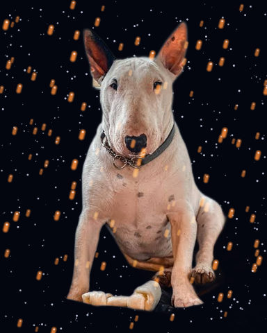

# Atmosphere

Weather and air: fog, haze, rain and the like.

[All effects](README.md)

| Example | Effect | What it does | Parameters | Recipe |
| --- | --- | --- | --- | --- |
|  | `fog` | Fog or smoke: mix the picture toward `color` by an opacity that is cloudy and heavier toward the bottom. | `amount=0.77` `color='#cfd8e3'` `gradient=0.7` `coverage=0.93` `scale=150.0` `seed=0` +9 advanced | [fog.toml](../../examples/effects/fog.toml) |
|  | `lens_drops` | Put `count` water drops on the picture, each showing the blurred scene turned upside down by `refraction`. | `count=14` `radius=24.0` `size_variation=0.5` `refraction=1.5` `blur=1.5` `highlight=0.0` `seed=0` +3 advanced | [lens_drops.toml](../../examples/effects/lens_drops.toml) |
|  | `particles` | Screen `density` particles of `color` per 1000 px² at random places, each a dot or a streak along `angle`: snow, rain, embers, floating dust, stars. | `density=1.0` `size=6.0` `length=0.0` `angle=90.0` `softness=0.5` `color='#ffffff'` `seed=0` +3 advanced | [particles.toml](../../examples/effects/particles.toml) |

### `fog`

| Parameter | Type | Unit | Range | Default | Description |
| --- | --- | --- | --- | --- | --- |
| `amount` | number (drivable) | fraction | 0 to 1 | `0.77` | How opaque the fog is where it is thickest (the bottom of the frame, in the densest cloud): the share of the fog colour mixed into the picture there. 0 = no fog, 0.5 = see-through, 1 = the colour itself, hiding the picture. Fog also lowers contrast, since every pixel moves toward the same colour. |
| `color` | colour |  |  | `'#cfd8e3'` | The colour of the fog: '#rrggbb', '#rgb' or [r, g, b] 0..1. A pale blue-grey is a cool morning mist, white a thick cloud, a warm grey smog, a dark grey or black a heavy, sooty plume. |
| `gradient` | number | fraction | 0 to 1 | `0.7` | How much thicker the fog is at the bottom of the frame than at the top, as a share of its opacity: the opacity falls in a straight line from the bottom row up, to 1 - gradient of its value at the top row. 0 = the same all the way up, 1 = no fog at the very top, as for mist lying on the ground. |
| `coverage` | number | fraction | 0 to 1 | `0.93` | About the share of the picture that has any cloud in it: 0 = none, 0.45 = clouds with clear air between them, 1 = cloud everywhere, in thicker and thinner places. The clouds are the highest parts of a noise field, so raising it widens them and joins them up. |
| `scale` | number | px | 1 to 1024 | `150.0` | Size of the biggest clouds across, in pixels, the spacing of the first noise lattice before `rise` stretches it; tuned for a picture about 480 px high. Larger = broad banks of fog; small = fine, wispy mottling. |
| `seed` | whole number | count | 0 to 4294967295 | `0` | Random seed: the same seed always gives the same clouds, another seed a different bank of fog. |

Advanced parameters (9)

| Parameter | Type | Unit | Range | Default | Description |
| --- | --- | --- | --- | --- | --- |
| `feather` | number | fraction | 0.01 to 1 | `1.0` | How soft the edge of a cloud is, as the share of the picture over which the fog thickens from its thinnest to full `amount` just above the coverage cut. Small = crisp, billowing outlines; 1 = clouds that melt into the air with no clear outline. |
| `floor` | number | fraction | 0 to 1 | `0.5` | How much of the `amount` is left between the clouds, as a share: the opacity where there is no cloud is `amount` x `floor`. 0 = open gaps of clear air, like plumes of smoke; 1 = an even veil with no clouds at all; 0.5 = a haze that thins between drifts but never clears. |
| `rise` | number | ratio | 1 to 8 | `1.0` | How much the clouds are drawn out upward, anchored at the bottom edge: 1 = round puffs, 2 = twice as tall as wide, 8 = long columns, like smoke from a chimney. |
| `turbulence` | number | px | 0 to 500 | `0.0` | How far in pixels two more noise fields (with the same `scale`, `octaves`, `persistence` and `lacunarity`) push the clouds sideways and up and down: the typical displacement (their standard deviation). 0 = smooth, regular clouds; larger = twisting, curling smoke; much larger than `scale` tears the clouds into scattered wisps. |
| `octaves` | whole number | count | 1 to 8 | `4` | How many layers of noise are summed to make the clouds, each finer than the last (by `lacunarity`) and weaker (by `persistence`). 1 = smooth blobs, more = more wispy detail. Layers finer than one pixel are dropped. |
| `persistence` | number | ratio | 0 to 1 | `0.5` | How much weaker each finer layer is than the one before: each layer's weight is this to the power of its number. 0 = only the coarsest layer, 1 = every layer equally strong (very rough). |
| `lacunarity` | number | ratio | 1 to 4 | `2.0` | How much finer each layer is than the one before: the lattice spacing is divided by this per layer. 1 = every layer the same size, 2 = each half as coarse, larger = detail drops off faster in size. |
| `resampling` | one of 'nearest', 'bilinear', 'bicubic' |  |  | `'bilinear'` | How the noise is read where `rise` and `turbulence` have moved it between pixels: 'nearest' takes the closest value (fastest, a little jagged), 'bilinear' blends the four around it (smooth), 'bicubic' fits a cubic spline through the neighbours (smoothest, a little slower). It matters only where something moves. Named `resampling`, not `interpolation`, because it reads a generated noise field, never the picture. |
| `edge` | one of 'reflect', 'nearest', 'mirror', 'wrap' |  |  | `'reflect'` | What the noise is beyond the picture's border when `turbulence` pushes a cloud in from outside: 'reflect' (mirrored, edge pixel repeated), 'mirror' (mirrored about the edge pixel), 'nearest' (the edge pixel repeated), 'wrap' (the opposite edge). |

Presets (`preset="name"` in a recipe step or `fx`):

| Preset | Description |
| --- | --- |
| `smoke` | Rising smoke or steam: soft plumes that thicken toward the bottom and curl as they rise; raise amount or change color for denser smoke. |

### `lens_drops`

| Parameter | Type | Unit | Range | Default | Description |
| --- | --- | --- | --- | --- | --- |
| `count` | whole number | count | 0 to 200 | `14` | How many drops there are, whatever the size of the picture (a number, not a density: the drops' size is in design px, so the same count looks alike at any size). 0 = none (the picture unchanged). |
| `radius` | number | px | 1 to 200 | `24.0` | The radius in px of the biggest drops; the smallest are smaller by `size_variation`. Tuned for a picture about 480 px high. Larger = bigger drops. |
| `size_variation` | number | fraction | 0 to 1 | `0.5` | How much the drops differ in size: each has a random share of `radius` from 1 - size_variation to 1. 0 = every drop alike, 1 = from the full radius down to specks. |
| `refraction` | number | ratio | 0.25 to 4 | `1.5` | How strongly a drop bends the scene: it shows the picture turned upside down about the drop's middle and this many times as wide. 1 = the same scale, turned round; above 1 a wider view in miniature, as in a real drop; below 1 a magnified view. |
| `blur` | number | px | 0 to 20 | `1.5` | How much the scene inside a drop is blurred, the sigma of a Gaussian in px, as a drop is never quite in focus. 0 = sharp. |
| `highlight` | number | fraction | 0 to 1 | `0.0` | How bright the drops' shine is: white light screened along the rim of each drop, strongest at its top (light from above) and fading to nothing at its bottom and in its middle. 0 = none, so a flat picture stays flat; 0.5 is a soft glint. |
| `seed` | whole number | count | 0 to 4294967295 | `0` | Random seed: the same seed always puts the same drops in the same places, another seed others. |

Advanced parameters (3)

| Parameter | Type | Unit | Range | Default | Description |
| --- | --- | --- | --- | --- | --- |
| `truncate` | number | ratio | 1 to 10 | `4.0` | Where the blur's Gaussian is cut off, in sigmas (only when blur > 0). Larger is more exact and slower. |
| `interpolation` | one of 'nearest', 'bilinear', 'bicubic' |  |  | `'bilinear'` | How a point between pixels is read from the picture inside a drop: 'nearest' takes the closest pixel (fastest, keeps every value exactly as it is but edges turn jagged), 'bilinear' blends the four pixels around it (smooth, slightly soft), 'bicubic' fits a cubic spline through the neighbouring pixels (sharpest, a little slower, and may ring beside hard edges). |
| `edge` | one of 'reflect', 'nearest', 'mirror', 'wrap' |  |  | `'reflect'` | What a drop sees beyond the picture's edge (a drop near the border or a strong refraction reads from outside it), and the blur with it: 'reflect' (mirrored, edge pixel repeated), 'mirror' (mirrored about the edge pixel), 'nearest' (the edge pixel repeated), 'wrap' (the opposite edge). |

### `particles`

| Parameter | Type | Unit | Range | Default | Description |
| --- | --- | --- | --- | --- | --- |
| `density` | number | density | 0 to 300 | `1.0` | How many particles there are: particles per 1000 design px² (a 32 x 32 px area at the recipe's size), so any picture size looks alike. 0 = none (the picture unchanged), 1 is a steady shower of rain, 7 a clear night sky of stars, 244 a dense field of tiny ones. |
| `size` | number | px | 1 to 200 | `6.0` | The width in px of the nearest, largest particles; farther ones are narrower by `size_falloff`. Tuned for a picture about 480 px high. Larger = bigger dots and thicker streaks. |
| `length` | number | px | 0 to 200 | `0.0` | The length in px of the streak each nearest particle draws from its head along `angle`; farther ones are shorter by `size_falloff`. Tuned for a picture about 480 px high. 0 = round dots, larger = longer streaks, as with a slower shutter. |
| `angle` | number (cyclic) | degrees | 0 to 360 | `90.0` | The direction a streak runs from its head, in degrees clockwise from pointing right, as seen on screen: 0 = right, 90 = down, 180 = left, 270 = up. Only streaks show it: with a `length` of 0 it changes nothing. |
| `softness` | number | fraction | 0 to 1 | `0.5` | How soft a particle's edge is: it falls from full brightness to none across this fraction of the particle's radius (at least one pixel), so large ones are blurrier than small ones, like particles out of focus. 0 = crisp one-pixel edges, 1 = fading out from the middle. |
| `color` | colour |  |  | `'#ffffff'` | The colour of the light: '#rrggbb', '#rgb' or [r, g, b] 0..1. Particles are screened over the picture, so they only lighten it. |
| `seed` | whole number | count | 0 to 4294967295 | `0` | Random seed: the same seed always puts the same particles in the same places, another seed others. |

Advanced parameters (3)

| Parameter | Type | Unit | Range | Default | Description |
| --- | --- | --- | --- | --- | --- |
| `layers` | whole number | count | 0 to 10 | `0` | How many depth planes the particles are in. In plane k of n the particle is k / n of the way from the farthest to the nearest, so more planes = a smoother range of depths, and 1 = every particle at the nearest depth. 0 = no planes, every depth between the nearest and the farthest occurs. |
| `size_falloff` | number | fraction | 0 to 1 | `0.5` | How much smaller the farthest particles are: their width and length are 1 - this of the nearest ones'. 0 = every particle the same size, 1 = from the nearest down to nothing at the farthest. |
| `brightness_falloff` | number | fraction | 0 to 1 | `0.5` | How much fainter the farthest particles are: their brightness is 1 - this of the nearest ones'. 0 = every particle equally bright, 1 = from the nearest down to nothing at the farthest. |

A step of `particles` has `opacity = 0.8` unless it sets its own.

Presets (`preset="name"` in a recipe step or `fx`):

| Preset | Description |
| --- | --- |
| `embers` | Glowing orange sparks rising and drifting right, each trailing a short streak down and to the left. |
| `floating_dust` | Faint warm specks of light of several sizes, near ones large and soft, as out-of-focus dust in a sunbeam. |
| `rain` | Thin pale streaks falling a little to the right, near ones long and bright, far ones short and faint. |
| `snow` | Soft white flakes in four depth layers, the near ones large, blurry and bright, the far ones small and fainter. |
| `starfield` | Small crisp stars of several sizes and brightnesses. Put a dark one-colour `gradient` step before it for a night sky. |
