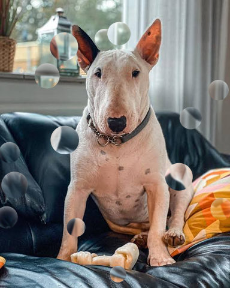

# Atmosphere

Weather and air: fog, haze, rain and the like.

[All effects](README.md)

| Example | Effect | What it does | Parameters | Recipe |
| --- | --- | --- | --- | --- |
|  | `embers` | Screen `count` sparks of `color` at random places over the picture, each rising with a streak behind it. | `count=120` `size=7.0` `softness=1.0` `length=8.0` `angle=15.0` `depth=0.5` `opacity=0.9` `color='#ff8a2b'` `seed=0` | [embers.toml](../../examples/effects/embers.toml) |
|  | `floating_dust` | Screen `count` soft round specks of `color` at random places over the picture, as out-of-focus dust. | `count=80` `size=24.0` `softness=0.8` `depth=0.5` `opacity=0.55` `color='#fff1d6'` `seed=0` | [floating_dust.toml](../../examples/effects/floating_dust.toml) |
|  | `fog` | Mix the picture toward `color` by a fog opacity that is cloudy and heavier toward the bottom. | `density=0.8` `color='#cfd8e3'` `gradient=0.7` `patchiness=0.6` `scale=150.0` `octaves=4` `persistence=0.5` `lacunarity=2.0` `seed=0` | [fog.toml](../../examples/effects/fog.toml) |
|  | `lens_drops` | Put `count` water drops on the picture, each showing the blurred scene turned upside down by `refraction`. | `count=14` `radius=24.0` `size_variation=0.5` `refraction=1.5` `blur=1.5` `highlight=0.0` `seed=0` `truncate=4.0` `interpolation='bilinear'` `edge='reflect'` | [lens_drops.toml](../../examples/effects/lens_drops.toml) |
|  | `rain` | Screen falling streaks of `color` over the picture, `density` of them per 1000 px², leaning by `angle`. | `density=1.0` `angle=10.0` `length=32.0` `thickness=1.5` `depth=0.5` `opacity=0.7` `color='#dbe6f5'` `seed=0` | [rain.toml](../../examples/effects/rain.toml) |
|  | `smoke` | Mix soft-edged plumes of `color` into the picture, up to `amount` thick. | `amount=0.5` `color='#e6e6e6'` `coverage=0.45` `feather=0.25` `scale=100.0` `rise=2.0` `turbulence=30.0` `octaves=4` `persistence=0.5` `lacunarity=2.0` `resampling='bilinear'` `edge='reflect'` `seed=0` | [smoke.toml](../../examples/effects/smoke.toml) |
|  | `snow` | Screen white flakes over the picture, `density` of them per 1000 px², in `layers` depth layers. | `density=0.5` `size=14.0` `layers=4` `softness=0.5` `opacity=0.8` `depth=0.5` `seed=0` | [snow.toml](../../examples/effects/snow.toml) |
|  | `sparkle` | Screen sparkles over `count` random pixels brighter than `threshold`: a soft dot with four rays each. | `count=60` `threshold=0.75` `size=10.0` `size_variation=0.5` `rays=2.0` `thickness=1.0` `opacity=1.0` `seed=0` | [sparkle.toml](../../examples/effects/sparkle.toml) |

### `embers`

| Parameter | Type | Unit | Range | Default | Description |
| --- | --- | --- | --- | --- | --- |
| `count` | whole number | count | 0 to 2000 | `120` | How many embers there are, whatever the size of the picture (a number, not a density). 0 = none (the picture unchanged), 120 is a lively shower of sparks. |
| `size` | number | px | 1 to 30 | `7.0` | The width in px of the nearest, largest embers; the farthest are narrower by `depth`. Tuned for a picture about 480 px high. Larger = fatter sparks. |
| `softness` | number | fraction | 0 to 1 | `1.0` | How soft an ember's edge is: it falls from full brightness to none across this fraction of the ember's radius (at least one pixel). 0 = crisp sparks, 1 = sparks glowing out from their middle. |
| `length` | number | px | 0 to 200 | `8.0` | The length in px of the streak each nearest ember leaves behind it; the farthest are shorter by `depth`. Tuned for a picture about 480 px high. 0 = round dots, larger = faster-looking sparks. |
| `angle` | number | degrees | -45 to 45 | `15.0` | How far the embers drift from straight up, in degrees: positive drifts to the right as they rise (wind from the left), negative to the left. 0 = straight up. The streaks trail the other way. |
| `depth` | number | fraction | 0 to 1 | `0.5` | How far apart the embers are in depth, which spreads their width, streak length and brightness: the farthest have 1 - depth times those of the nearest. 0 = every ember alike, 1 = from the nearest down to nothing at the farthest. |
| `opacity` | number | fraction | 0 to 1 | `0.9` | How bright the nearest embers are: the share of `color` they screen over the picture along their middle; the farthest are fainter. 0 = invisible, 1 = solid colour. |
| `color` | colour |  |  | `'#ff8a2b'` | The colour of the glow: '#rrggbb', '#rgb' or [r, g, b] 0..1. Embers are screened over the picture, so they only lighten it. |
| `seed` | whole number | count | 0 to 4294967295 | `0` | Random seed: the same seed always puts the same embers in the same places, another seed others. |

### `floating_dust`

| Parameter | Type | Unit | Range | Default | Description |
| --- | --- | --- | --- | --- | --- |
| `count` | whole number | count | 0 to 1000 | `80` | How many specks there are, whatever the size of the picture (a number, not a density). 0 = none (the picture unchanged), 80 is a scattering, 400 a dusty air. |
| `size` | number | px | 1 to 200 | `24.0` | The diameter in px of the nearest, largest specks; the farthest are narrower by `depth`. Tuned for a picture about 480 px high. Larger = bigger bokeh discs, as if the dust were closer to the lens. |
| `softness` | number | fraction | 0 to 1 | `0.8` | How soft a speck's edge is: the edge falls from full brightness to none across this fraction of the speck's radius (at least one pixel). 0 = crisp discs, 1 = specks fading out from their middle. |
| `depth` | number | fraction | 0 to 1 | `0.5` | How far apart the specks are in depth, which spreads their size and brightness: the farthest have 1 - depth times those of the nearest. 0 = every speck alike, 1 = from the nearest down to nothing at the farthest. |
| `opacity` | number | fraction | 0 to 1 | `0.55` | How bright the nearest specks are: the share of `color` they screen over the picture at their middle; the farthest are fainter. 0 = invisible, 1 = solid colour. |
| `color` | colour |  |  | `'#fff1d6'` | The colour of the light the specks catch: '#rrggbb', '#rgb' or [r, g, b] 0..1. Specks are screened over the picture, so they only lighten it. |
| `seed` | whole number | count | 0 to 4294967295 | `0` | Random seed: the same seed always puts the same specks in the same places, another seed others. |

### `fog`

| Parameter | Type | Unit | Range | Default | Description |
| --- | --- | --- | --- | --- | --- |
| `density` | number | fraction | 0 to 1 | `0.8` | How thick the fog is where it is thickest (the bottom of the frame, in the densest cloud): the share of the fog colour mixed into the picture there. 0 = no fog, 0.8 = a heavy haze, 1 = the colour itself, hiding the picture. Fog also lowers contrast, since every pixel moves toward the same colour. |
| `color` | colour |  |  | `'#cfd8e3'` | The colour of the fog: '#rrggbb', '#rgb' or [r, g, b] 0..1. A pale blue-grey is a cool morning mist, white a thick cloud, a warm grey smog. |
| `gradient` | number | fraction | 0 to 1 | `0.7` | How much thicker the fog is at the bottom of the frame than at the top, as a share of its density: the opacity falls in a straight line from the bottom row up, to 1 - gradient of its value at the top row. 0 = the same all the way up, 1 = no fog at the very top, as for mist lying on the ground. |
| `patchiness` | number | fraction | 0 to 1 | `0.6` | How cloudy the fog is: 0 = an even veil, 1 = drifts with clear gaps, where the noise is lowest the fog thins to nothing. The cloud shapes come from fractal noise (`scale`, `octaves`, `persistence`, `lacunarity`, `seed`). |
| `scale` | number | px | 1 to 1024 | `150.0` | Size of the biggest clouds in pixels, the spacing of the first noise lattice; tuned for a picture about 480 px high. Larger = broad banks of fog; small = fine, wispy mottling. |
| `octaves` | whole number | count | 1 to 8 | `4` | How many layers of noise are summed to make the clouds, each finer than the last (by `lacunarity`) and weaker (by `persistence`). 1 = smooth blobs, more = more wispy detail. Layers finer than one pixel are dropped. |
| `persistence` | number | ratio | 0 to 1 | `0.5` | How much weaker each finer layer of cloud is than the one before: each layer's weight is this to the power of its number. 0 = only the coarsest layer, 1 = every layer equally strong (very rough). |
| `lacunarity` | number | ratio | 1 to 4 | `2.0` | How much finer each layer of cloud is than the one before: the lattice spacing is divided by this per layer. 1 = every layer the same size, 2 = each half as coarse, larger = detail drops off faster in size. |
| `seed` | whole number | count | 0 to 4294967295 | `0` | Random seed: the same seed always gives the same clouds, another seed a different bank of fog. |

### `lens_drops`

| Parameter | Type | Unit | Range | Default | Description |
| --- | --- | --- | --- | --- | --- |
| `count` | whole number | count | 0 to 200 | `14` | How many drops there are, whatever the size of the picture (a number, not a density). 0 = none (the picture unchanged). |
| `radius` | number | px | 1 to 200 | `24.0` | The radius in px of the biggest drops; the smallest are smaller by `size_variation`. Tuned for a picture about 480 px high. Larger = bigger drops. |
| `size_variation` | number | fraction | 0 to 1 | `0.5` | How much the drops differ in size: each has a random share of `radius` from 1 - size_variation to 1. 0 = every drop alike, 1 = from the full radius down to specks. |
| `refraction` | number | ratio | 0.25 to 4 | `1.5` | How strongly a drop bends the scene: it shows the picture turned upside down about the drop's middle and this many times as wide. 1 = the same scale, turned round; above 1 a wider view in miniature, as in a real drop; below 1 a magnified view. |
| `blur` | number | px | 0 to 20 | `1.5` | How much the scene inside a drop is blurred, the sigma of a Gaussian in px, as a drop is never quite in focus. 0 = sharp. |
| `highlight` | number | fraction | 0 to 1 | `0.0` | How bright the drops' shine is: white light screened along the rim of each drop, strongest at its top (light from above) and fading to nothing at its bottom and in its middle. 0 = none, so a flat picture stays flat; 0.5 is a soft glint. |
| `seed` | whole number | count | 0 to 4294967295 | `0` | Random seed: the same seed always puts the same drops in the same places, another seed others. |
| `truncate` | number | ratio | 1 to 10 | `4.0` | Where the blur's Gaussian is cut off, in sigmas (only when blur > 0). Larger is more exact and slower. |
| `interpolation` | one of 'nearest', 'bilinear', 'bicubic' |  |  | `'bilinear'` | How a point between pixels is read from the picture inside a drop: 'nearest' takes the closest pixel (fastest, keeps every value exactly as it is but edges turn jagged), 'bilinear' blends the four pixels around it (smooth, slightly soft), 'bicubic' fits a cubic spline through the neighbouring pixels (sharpest, a little slower, and may ring beside hard edges). |
| `edge` | one of 'reflect', 'nearest', 'mirror', 'wrap' |  |  | `'reflect'` | What a drop sees beyond the picture's edge (a drop near the border or a strong refraction reads from outside it), and the blur with it: 'reflect' (mirrored, edge pixel repeated), 'mirror' (mirrored about the edge pixel), 'nearest' (the edge pixel repeated), 'wrap' (the opposite edge). |

### `rain`

| Parameter | Type | Unit | Range | Default | Description |
| --- | --- | --- | --- | --- | --- |
| `density` | number | count | 0 to 5 | `1.0` | How many streaks fall: streaks per 1000 square px of picture (a 32 x 32 px area), so the same density looks alike on any picture size. 0 = none (the picture unchanged), 1 is a steady shower, 3 a downpour. |
| `angle` | number | degrees | -45 to 45 | `10.0` | How far the streaks lean from straight down, in degrees: positive leans toward the right as they fall (wind from the left), negative toward the left. 0 = vertical. |
| `length` | number | px | 1 to 200 | `32.0` | The length of the nearest streaks in px; the farthest are shorter by `depth`. Tuned for a picture about 480 px high. Larger = longer streaks, as with a slower shutter. |
| `thickness` | number | px | 1 to 20 | `1.5` | The width of the nearest streaks in px; the farthest are narrower by `depth`. Tuned for a picture about 480 px high. Larger = fatter drops. |
| `depth` | number | fraction | 0 to 1 | `0.5` | How far apart the streaks are in depth, which spreads their length, width and brightness: the farthest have 1 - depth times those of the nearest. 0 = every streak alike, 1 = from the nearest down to nothing at the farthest. |
| `opacity` | number | fraction | 0 to 1 | `0.7` | How bright the nearest streaks are: the share of `color` they screen over the picture at their centre; the farthest are fainter by `depth`. 0 = invisible, 1 = solid colour. |
| `color` | colour |  |  | `'#dbe6f5'` | The colour of the rain: '#rrggbb', '#rgb' or [r, g, b] 0..1. Streaks are screened over the picture, so they only lighten it. |
| `seed` | whole number | count | 0 to 4294967295 | `0` | Random seed: the same seed always puts the same streaks in the same places, another seed others. |

### `smoke`

| Parameter | Type | Unit | Range | Default | Description |
| --- | --- | --- | --- | --- | --- |
| `amount` | number | fraction | 0 to 1 | `0.5` | How opaque the smoke is at the heart of a plume: the share of the smoke colour mixed into the picture there. 0 = no smoke, 0.5 = see-through smoke, 1 = solid colour hiding the picture. |
| `color` | colour |  |  | `'#e6e6e6'` | The colour of the smoke: '#rrggbb', '#rgb' or [r, g, b] 0..1. Pale grey is steam or light smoke, a dark grey or black a heavy, sooty plume. |
| `coverage` | number | fraction | 0 to 1 | `0.45` | About the share of the picture that has any smoke in it: 0 = none, 0.45 = plumes with clear air between them, 1 = smoke everywhere, in thicker and thinner places. The plumes are the highest parts of a noise field, so raising it widens them and joins them up. |
| `feather` | number | fraction | 0.01 to 1 | `0.25` | How soft the edge of a plume is, as the share of the picture over which the smoke fades from nothing to full `amount` just above the coverage cut. Small = crisp, billowing outlines; large = plumes that melt into the air with no clear outline. |
| `scale` | number | px | 1 to 1024 | `100.0` | Size of the biggest plumes across, in pixels, the spacing of the first noise lattice before `rise` stretches it; tuned for a picture about 480 px high. Larger = a few big clouds; small = many small wisps. |
| `rise` | number | ratio | 1 to 8 | `2.0` | How much the plumes are drawn out upward, anchored at the bottom edge: 1 = round puffs, 2 = twice as tall as wide, 8 = long columns, like smoke from a chimney. |
| `turbulence` | number | px | 0 to 500 | `30.0` | How far in pixels two more noise fields (with the same `scale`, `octaves`, `persistence` and `lacunarity`) push the plumes sideways and up and down: the typical displacement (their standard deviation). 0 = smooth, regular plumes; larger = twisting, curling smoke; much larger than `scale` tears the plumes into scattered wisps. |
| `octaves` | whole number | count | 1 to 8 | `4` | How many layers of noise are summed to make the plumes, each finer than the last (by `lacunarity`) and weaker (by `persistence`). 1 = smooth blobs, more = more wispy detail. Layers finer than one pixel are dropped. |
| `persistence` | number | ratio | 0 to 1 | `0.5` | How much weaker each finer layer is than the one before: each layer's weight is this to the power of its number. 0 = only the coarsest layer, 1 = every layer equally strong (very rough). |
| `lacunarity` | number | ratio | 1 to 4 | `2.0` | How much finer each layer is than the one before: the lattice spacing is divided by this per layer. 1 = every layer the same size, 2 = each half as coarse, larger = detail drops off faster in size. |
| `resampling` | one of 'nearest', 'bilinear', 'bicubic' |  |  | `'bilinear'` | How the noise is read where `rise` and `turbulence` have moved it between pixels: 'nearest' takes the closest value (fastest, a little jagged), 'bilinear' blends the four around it (smooth), 'bicubic' fits a cubic spline through the neighbours (smoothest, a little slower). It matters only where something moves. Named `resampling`, not `interpolation`, because it reads a generated noise field, never the picture. |
| `edge` | one of 'reflect', 'nearest', 'mirror', 'wrap' |  |  | `'reflect'` | What the noise is beyond the picture's border when `turbulence` pushes a plume in from outside: 'reflect' (mirrored, edge pixel repeated), 'mirror' (mirrored about the edge pixel), 'nearest' (the edge pixel repeated), 'wrap' (the opposite edge). |
| `seed` | whole number | count | 0 to 4294967295 | `0` | Random seed: the same seed always gives the same smoke, another seed different plumes. |

### `snow`

| Parameter | Type | Unit | Range | Default | Description |
| --- | --- | --- | --- | --- | --- |
| `density` | number | count | 0 to 5 | `0.5` | How many flakes fall: flakes per 1000 square px of picture (a 32 x 32 px area), so the same density looks alike on any picture size. 0 = none (the picture unchanged), 0.5 is a light flurry, 3 a blizzard. |
| `size` | number | px | 1 to 100 | `14.0` | The diameter of the nearest, largest flakes in px; flakes in farther layers are smaller. Tuned for a picture about 480 px high. Larger = bigger flakes, as if they fell closer to the lens. |
| `layers` | whole number | count | 1 to 10 | `4` | How many depth layers the flakes fall in. The flake in layer k of n is k / n as wide as `size` and (1 - `depth` x (1 - k / n)) as bright as `opacity`, so more layers = a smoother range from fine far flakes to large near ones. 1 = every flake alike. |
| `softness` | number | fraction | 0 to 1 | `0.5` | How soft a flake's edge is: the edge falls from full brightness to none across this fraction of the flake's radius (at least one pixel), so large flakes are blurrier than small ones, like flakes out of focus. 0 = crisp one-pixel edges, 1 = a flake fading out from its middle. |
| `opacity` | number | fraction | 0 to 1 | `0.8` | How bright the nearest flakes are: the share of white they screen over the picture at their centre; farther flakes are fainter. 0 = invisible, 1 = solid white. |
| `depth` | number | fraction | 0 to 1 | `0.5` | How much fainter the farthest flakes are: a flake in layer k of n has 1 - depth x (1 - k / n) of the brightness of the nearest. 0 = every layer equally bright, 1 = the far layers fade to nothing. |
| `seed` | whole number | count | 0 to 4294967295 | `0` | Random seed: the same seed always puts the same flakes in the same places, another seed others. |

### `sparkle`

| Parameter | Type | Unit | Range | Default | Description |
| --- | --- | --- | --- | --- | --- |
| `count` | whole number | count | 0 to 2000 | `60` | How many sparkles: at most this many, each on a different pixel brighter than `threshold` (fewer when the picture has fewer such pixels). 0 = none (the picture unchanged). |
| `threshold` | number | fraction | 0 to 1 | `0.75` | How bright a pixel must be to get a sparkle: its brightness (Rec. 709 luminance, 0..1) must be above this. Raising it keeps the sparkles to the brightest highlights; 1 = none, nothing is brighter than white. |
| `size` | number | px | 1 to 100 | `10.0` | The diameter in px of the biggest sparkles' soft dot; the smallest are narrower by `size_variation`. Tuned for a picture about 480 px high. Larger = bigger glints. |
| `size_variation` | number | fraction | 0 to 1 | `0.5` | How much the sparkles differ in size and brightness: each has a random scale from 1 - size_variation to 1 times `size` and `opacity`. 0 = every sparkle alike, 1 = from the biggest down to nothing. |
| `rays` | number | ratio | 0 to 10 | `2.0` | How long the four rays of the cross are, as a multiple of the sparkle's dot diameter: each ray runs this far from the middle, straight left, right, up and down, `thickness` wide. 0 = a soft dot only, no rays. |
| `thickness` | number | px | 0 to 10 | `1.0` | The width in px of each ray (with a soft one-pixel edge). 1 = a hairline, larger = bolder rays. |
| `opacity` | number | fraction | 0 to 1 | `1.0` | How bright the biggest sparkles are: the share of white they screen over the picture at their middle; smaller ones are fainter. 0 = invisible, 1 = solid white. |
| `seed` | whole number | count | 0 to 4294967295 | `0` | Random seed: the same seed always puts the same sparkles on the same picture, another seed others. |
