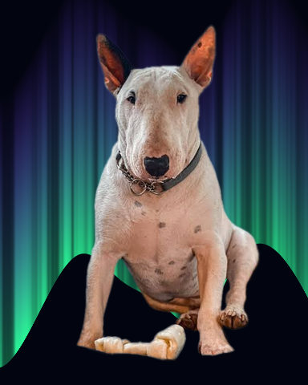
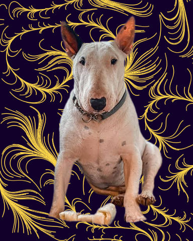
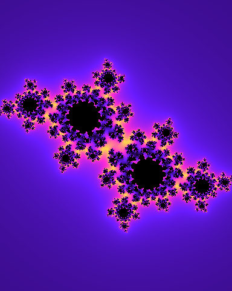
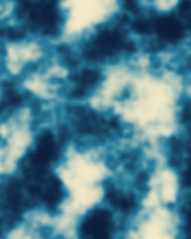
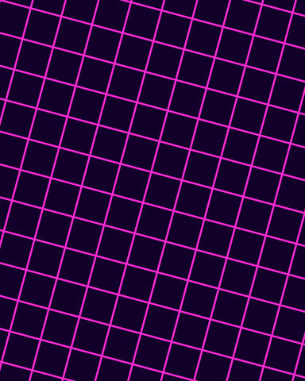
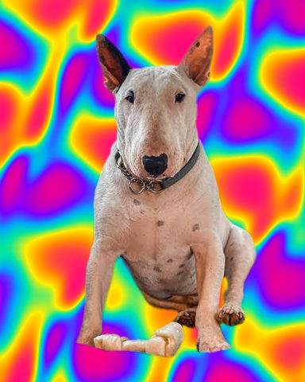
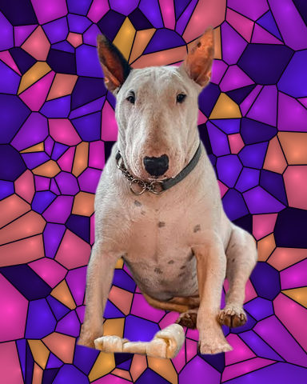

# Backgrounds

Generated or replaced backgrounds behind the subject.

[All effects](README.md)

| Example | Effect | What it does | Parameters | Recipe |
| --- | --- | --- | --- | --- |
|  | `aurora` | Replace the picture with an aurora: a curtain of light with a wavy base and vertical rays over a dark sky. | `colors=('#2bff9a', '#7a2cff')` `sky='#02050f'` `base=0.75` `height=0.7` `falloff=0.8` `waviness=40.0` `scale=200.0` `rays=0.7` `ray_width=10.0` `octaves=3` `persistence=0.5` `lacunarity=2.0` `seed=0` | [aurora.toml](../../examples/effects/aurora.toml) |
|  | `flow_lines` | Replace the picture with streamlines of a noise flow: lines that start at random points and follow the flow. | `density=0.002` `length=120` `step=1.0` `thickness=1.5` `scale=120.0` `octaves=2` `persistence=0.5` `lacunarity=2.0` `twist=180.0` `seed=0` `line='#ffd84a'` `background='#12002b'` | [flow_lines.toml](../../examples/effects/flow_lines.toml) |
|  | `fractal` | Replace the picture with the Mandelbrot set or a Julia set, coloured by how fast each point escapes. | `kind='julia'` `zoom=1.0` `x=0.0` `y=0.0` `c_real=-0.8` `c_imag=0.156` `iterations=64` `period=24.0` `colors=('#12002b', '#6a1bff', '#ff2bd6', '#ffd84a')` `interior='#000000'` | [fractal.toml](../../examples/effects/fractal.toml) |
|  | `gradient` | Replace the picture with a gradient through `colors`: a straight band, rings round a centre or a sweep. | `kind='linear'` `colors=('#12002b', '#ff2bd6')` `angle=90.0` `x=0.5` `y=0.5` `radius=0.75` `repeat=1` `reflect=False` | [gradient.toml](../../examples/effects/gradient.toml) |
|  | `noise_field` | Replace the picture with a noise field of `kind` (value, perlin or worley), coloured through `colors`. | `kind='perlin'` `scale=120.0` `octaves=4` `persistence=0.5` `lacunarity=2.0` `colors=('#0b1d3a', '#2a7f9e', '#f4e9c8')` `seed=0` | [noise_field.toml](../../examples/effects/noise_field.toml) |
|  | `pattern` | Replace the picture with a repeating pattern of stripes, checks, dots or a grid in two colours. | `kind='grid'` `cell=32.0` `angle=0.0` `foreground='#ffffff'` `background='#101018'` `thickness=0.2` `radius=0.3` `feather=1.0` | [pattern.toml](../../examples/effects/pattern.toml) |
|  | `plasma` | Replace the picture with a plasma: warped, crossed sine waves coloured through `colors`. | `scale=160.0` `octaves=2` `persistence=0.5` `lacunarity=2.0` `warp=25.0` `colors=('#ff0080', '#ff8c00', '#ffee00', '#00e5a0', '#00a2ff', '#7a00ff', '#ff0080')` `seed=0` | [plasma.toml](../../examples/effects/plasma.toml) |
|  | `starfield` | A night sky of `count` stars of `color` over `sky`: a generated picture that replaces the input. | `count=600` `size=3.0` `depth=0.7` `color='#dfe8ff'` `sky='#04060f'` `seed=0` | [starfield.toml](../../examples/effects/starfield.toml) |
|  | `voronoi_cells` | Replace the picture with a Voronoi diagram: random cells filled from a colour ramp, with thin borders. | `cells=80` `seed=0` `colors=('#12002b', '#6a1bff', '#ff2bd6', '#ffb347')` `shade=0.35` `line_width=1.5` `line_color='#0a0014'` | [voronoi_cells.toml](../../examples/effects/voronoi_cells.toml) |

### `aurora`

| Parameter | Type | Unit | Range | Default | Description |
| --- | --- | --- | --- | --- | --- |
| `colors` | list of colours |  |  | `('#2bff9a', '#7a2cff')` | The curtain's colours from its base to its top, evenly spaced along the way up; at least two. The classic aurora is green at the base turning violet or red higher up. |
| `sky` | colour |  |  | `'#02050f'` | The colour of the night sky, seen below the curtain's base, above its top and between its rays: '#rrggbb', '#rgb' or [r, g, b] 0..1. A very dark blue looks better than pure black. |
| `base` | number | fraction | 0 to 1 | `0.75` | Where the curtain's bright lower edge lies, as a fraction of the picture's height from the top (0 = the top edge, 1 = the bottom edge). Below it the sky is dark. Waviness moves it up and down along the picture. |
| `height` | number | fraction | 0.05 to 1 | `0.7` | How far up from its base the curtain reaches before it has faded out completely, as a fraction of the picture's height. Larger = a taller curtain. |
| `falloff` | number | ratio | 0.2 to 8 | `0.8` | How fast the light fades going up: the brightness at a height h above the base, as a fraction of the curtain's height, is (1 - h) to this power. 1 = a straight fade, above 1 = a bright edge with the glow quickly falling away, below 1 = light that reaches high before dimming. |
| `waviness` | number | px | 0 to 500 | `40.0` | How far the curtain's base wanders up and down across the picture, in pixels: the typical distance from the `base` line (the standard deviation of the ripple); tuned for a picture about 480 px high. 0 = a straight, level base. |
| `scale` | number | px | 2 to 2048 | `200.0` | Size in pixels, along the picture, of the curtain's coarsest ripples: the spacing of the first noise lattice of the base's wobble. Larger = long, slow folds; small = a quickly rippling hem. |
| `rays` | number | fraction | 0 to 1 | `0.7` | How strongly the curtain is broken into vertical rays: each ray has a brightness of its own and this is how far the dimmest drop below the brightest. 0 = a smooth, even curtain, 1 = rays separated by dark sky. |
| `ray_width` | number | px | 1 to 256 | `10.0` | Width in pixels of the broadest rays, the spacing of the first noise lattice across the picture; tuned for a picture about 480 px high. Larger = a few wide shafts; small = a fine comb of streaks. |
| `octaves` | whole number | count | 1 to 8 | `3` | How many layers of noise are summed for the base's wobble and for the rays, each finer than the last (by `lacunarity`) and weaker (by `persistence`). 1 = smooth, more = more ragged detail. Layers finer than one pixel are dropped. |
| `persistence` | number | ratio | 0 to 1 | `0.5` | How much weaker each finer layer of the wobble and the rays is than the one before: each layer's weight is this to the power of its number. 0 = only the coarsest layer, 1 = every layer equally strong. |
| `lacunarity` | number | ratio | 1 to 4 | `2.0` | How much finer each layer is than the one before: the lattice spacing is divided by this per layer. 1 = every layer the same size, 2 = each half as coarse, larger = detail drops off faster in size. |
| `seed` | whole number | count | 0 to 4294967295 | `0` | Random seed: the same seed always gives the same curtain (its folds and its rays), another seed a different one. |

### `flow_lines`

| Parameter | Type | Unit | Range | Default | Description |
| --- | --- | --- | --- | --- | --- |
| `density` | number | fraction | 0 to 0.05 | `0.002` | How many lines: the share of the picture's pixels that start one, so a 480 x 384 picture at 0.002 has about 370. 0 draws none. More = a denser weave; lines cross freely. |
| `length` | whole number | count | 1 to 2000 | `120` | How many steps each line follows the flow; with `step` it sets the line's length in px. A line also ends where it reaches the edge of the picture. |
| `step` | number | px | 0.5 to 16 | `1.0` | The distance in px a line moves each step. Keep it at or below the line's thickness for a solid line; larger steps leave dotted lines. |
| `thickness` | number | px | 0.5 to 16 | `1.5` | The width of the lines in px (a soft disc of this diameter is stamped at every step). Tuned for a picture about 480 px high. |
| `scale` | number | px | 4 to 1024 | `120.0` | The size of the flow's coarsest swirls in px, the spacing of the first noise lattice. Larger = broader, gentler bends. Tuned for a picture about 480 px high. |
| `octaves` | whole number | count | 1 to 8 | `2` | How many layers of noise are summed for the flow, each finer than the last (by `lacunarity`) and weaker (by `persistence`). 1 = smooth sweeping lines, more = wigglier ones. |
| `persistence` | number | ratio | 0 to 1 | `0.5` | How much weaker each finer layer of the flow is than the one before. 0 = only the coarsest layer. |
| `lacunarity` | number | ratio | 1 to 4 | `2.0` | How much finer each layer of the flow is than the one before: the lattice spacing is divided by this. |
| `twist` | number | degrees | 0 to 720 | `180.0` | How far the flow turns for each standard deviation of the noise: a line's direction is the noise times this, measured clockwise on screen from the right. 0 = every line runs straight to the right; larger = tighter, more varied swirls. |
| `seed` | whole number | count | 0 to 2147483647 | `0` | Seeds the flow and the line starts: the same seed gives the same picture. The starts and the flow are independent random streams of it. |
| `line` | colour |  |  | `'#ffd84a'` | The colour of the lines. |
| `background` | colour |  |  | `'#12002b'` | The colour behind the lines. |

### `fractal`

| Parameter | Type | Unit | Range | Default | Description |
| --- | --- | --- | --- | --- | --- |
| `kind` | one of 'mandelbrot', 'julia' |  |  | `'julia'` | Which set: 'mandelbrot' (every point is the constant c, z starts at 0; centre it with x = -0.5 to see the whole set) or 'julia' (every point is the start z, with the one constant `c_real` + i `c_imag`). |
| `zoom` | number | ratio | 0.1 to 10000 | `1.0` | Magnification. At 1 the picture's shorter side shows 4 units of the complex plane, enough for the whole Mandelbrot set or any Julia set; 2 shows 2 units. |
| `x` | number | ratio | -2 to 2 | `0.0` | The real part of the point at the centre of the picture, in units of the complex plane. 0 centres a Julia set; -0.5 centres the Mandelbrot set. |
| `y` | number | ratio | -2 to 2 | `0.0` | The imaginary part of the point at the centre of the picture, in units of the complex plane; positive moves the view up. |
| `c_real` | number | ratio | -2 to 2 | `-0.8` | Julia only: the real part of the constant c in z -> z^2 + c. It decides the shape: a point inside the Mandelbrot set gives a connected Julia set, one outside a dust. Ignored by 'mandelbrot'. |
| `c_imag` | number | ratio | -2 to 2 | `0.156` | Julia only: the imaginary part of the constant c. Ignored by 'mandelbrot'. |
| `iterations` | whole number | count | 1 to 2000 | `64` | How many times z -> z^2 + c is applied before a point is taken to stay for ever (the interior). More reveals finer detail at the set's edge and costs time in proportion; zooming in needs more. |
| `period` | number | count | 1 to 1000 | `24.0` | How many iterations of escape time take the colours from the first to the last of `colors`; they then run back, so the bands cycle without a seam. Smaller = more, thinner bands. |
| `colors` | list of colours |  |  | `('#12002b', '#6a1bff', '#ff2bd6', '#ffd84a')` | The colours of the bands, evenly spaced; at least two. Points that escape early (far from the set) take the first colours. |
| `interior` | colour |  |  | `'#000000'` | The colour of the points that never escape: the inside of the set. |

### `gradient`

| Parameter | Type | Unit | Range | Default | Description |
| --- | --- | --- | --- | --- | --- |
| `kind` | one of 'linear', 'radial', 'conic' |  |  | `'linear'` | The layout: 'linear' (colours run in a straight band across the whole picture, at `angle`), 'radial' (rings round the centre `x`, `y`, the last colour `radius` away) or 'conic' (a clockwise sweep round the centre, starting at `angle`; the last colour meets the first at a hard seam). |
| `colors` | list of colours |  |  | `('#12002b', '#ff2bd6')` | The gradient's colours in order, evenly spaced; at least two. Linear: from the start of the band to its end. Radial: from the centre outwards. Conic: round the turn. |
| `angle` | number | degrees | 0 to 360 | `90.0` | Linear: the direction the colours run, measured clockwise on screen from the right: 0 = left to right, 90 = top to bottom. Conic: where the sweep starts, on the same scale (0 = right of the centre, 90 = below it). Ignored by 'radial'. |
| `x` | number | fraction | 0 to 1 | `0.5` | Horizontal position of the centre as a fraction of the width (0 = left edge, 1 = right edge). Used by 'radial' and 'conic'; 'linear' is always centred. |
| `y` | number | fraction | 0 to 1 | `0.5` | Vertical position of the centre as a fraction of the height (0 = top edge, 1 = bottom edge). Used by 'radial' and 'conic'; 'linear' is always centred. |
| `radius` | number | fraction | 0.01 to 4 | `0.75` | Radial only: the distance from the centre at which the last colour is reached, as a fraction of the picture's shorter side; farther out stays on the last colour. Larger = a wider, softer glow. Ignored by 'linear' and 'conic'. |
| `repeat` | whole number | count | 1 to 64 | `1` | How many times the list of colours is fitted along the gradient (the band, the radius, one turn): 1 = once, 2 = twice as fast. Radial stays on the last colour beyond the radius. |
| `reflect` | true or false |  |  | `False` | Run every second repeat backwards, so neighbouring repeats meet on the same colour instead of jumping from the last colour back to the first. Has no effect with `repeat` 1. |

### `noise_field`

| Parameter | Type | Unit | Range | Default | Description |
| --- | --- | --- | --- | --- | --- |
| `kind` | one of 'value', 'perlin', 'worley' |  |  | `'perlin'` | The noise: 'value' (random values on a lattice, smoothly interpolated: soft blotches), 'perlin' (gradient noise: random slopes on a lattice, finer and more even, zero at the lattice points) or 'worley' (cellular noise: the distance to the nearest of a scatter of random points, one per cell of `scale` px, dark at each point and brightening away from it; a single layer, so it ignores `octaves`, `persistence` and `lacunarity`). |
| `scale` | number | px | 2 to 1024 | `120.0` | Size of the coarsest features in pixels: the spacing of the first lattice (value, perlin) or the size of a cell (worley); tuned for a picture about 480 px high. Larger = broad, slow variation; small = fine grain. |
| `octaves` | whole number | count | 1 to 8 | `4` | How many layers of noise are summed (value, perlin), each finer than the last (by `lacunarity`) and weaker (by `persistence`). 1 = smooth, more = more fine detail. Layers finer than one pixel are dropped. |
| `persistence` | number | ratio | 0 to 1 | `0.5` | How much weaker each finer layer is than the one before (value, perlin): each layer's weight is this to the power of its number. 0 = only the coarsest layer, 1 = every layer equally strong (very rough). |
| `lacunarity` | number | ratio | 1 to 4 | `2.0` | How much finer each layer is than the one before (value, perlin): the lattice spacing is divided by this per layer. 1 = every layer the same size, 2 = each half as coarse, larger = detail drops off faster. |
| `colors` | list of colours |  |  | `('#0b1d3a', '#2a7f9e', '#f4e9c8')` | The colours the noise is shown in, from its lowest values to its highest, evenly spaced along the ramp; at least two. Each pixel's place on the ramp is its rank in the noise, so every colour is used about equally. |
| `seed` | whole number | count | 0 to 4294967295 | `0` | Random seed: the same seed always gives the same picture, another seed a different one. |

### `pattern`

| Parameter | Type | Unit | Range | Default | Description |
| --- | --- | --- | --- | --- | --- |
| `kind` | one of 'stripes', 'checks', 'dots', 'grid' |  |  | `'grid'` | The pattern: 'stripes' (parallel bands, `thickness` wide), 'checks' (a chessboard of `cell` px squares, the top-left one in the foreground colour), 'dots' (a disc of `radius` in every cell) or 'grid' (lines `thickness` wide along the cell borders). |
| `cell` | number | px | 2 to 512 | `32.0` | The size of one repeat in px: the distance from one stripe to the next, the side of a check, a dot or a grid square. Tuned for a picture about 480 px high; larger = a coarser pattern. |
| `angle` | number | degrees | 0 to 360 | `0.0` | Turns the pattern clockwise on screen about the picture's top-left corner. At 0 the stripes are vertical and the checks, dots and grid lines are aligned with the picture's edges; at 90 the stripes are horizontal. |
| `foreground` | colour |  |  | `'#ffffff'` | The colour of the stripes, the dark checks, the dots and the grid lines. |
| `background` | colour |  |  | `'#101018'` | The colour between them. |
| `thickness` | number | fraction | 0 to 1 | `0.2` | Used by 'stripes' and 'grid': the width of a stripe or a grid line as a fraction of `cell`; 1 fills everything with the foreground colour. Ignored by 'checks' and 'dots'. |
| `radius` | number | fraction | 0 to 0.75 | `0.3` | Used by 'dots' only: the radius of a dot as a fraction of `cell`; 0.5 touches the neighbours, above 0.71 the dots overlap into a filled picture. Ignored by 'stripes', 'checks' and 'grid'. |
| `feather` | number | px | 0 to 32 | `1.0` | The width of the soft edge in px, centred on the shape's border and blended linearly: 0 = hard (jagged) edges, 1 = anti-aliased, larger = blurred shapes. |

### `plasma`

| Parameter | Type | Unit | Range | Default | Description |
| --- | --- | --- | --- | --- | --- |
| `scale` | number | px | 4 to 1024 | `160.0` | Wavelength in pixels of the coarsest layer's waves, the distance from crest to crest; tuned for a picture about 480 px high. Larger = broad, slow swirls; small = fine, busy ripples. |
| `octaves` | whole number | count | 1 to 8 | `2` | How many layers of waves are summed, each finer than the last (by `lacunarity`) and weaker (by `persistence`). Each layer is two sine waves crossing at random angles. 1 = a plain weave of two waves, more = richer, busier patterns. Layers with fewer than 2 px a wavelength are dropped. |
| `persistence` | number | ratio | 0 to 1 | `0.5` | How much weaker each finer layer is than the one before: each layer's weight is this to the power of its number. 0 = only the coarsest layer, 1 = every layer equally strong (very busy). |
| `lacunarity` | number | ratio | 1 to 4 | `2.0` | How much finer each layer is than the one before: its wavelength is divided by this per layer. 1 = every layer the same size, 2 = each half as long, larger = detail drops off faster in size. |
| `warp` | number | px | 0 to 500 | `25.0` | How far in pixels each layer's waves are pushed along by the two waves of the layer before it (a layer's position is shifted by up to this much). 0 = plain straight waves; larger = the swirling, folded look of a plasma. The first layer has nothing before it, so it is not warped. |
| `colors` | list of colours |  |  | `('#ff0080', '#ff8c00', '#ffee00', '#00e5a0', '#00a2ff', '#7a00ff', '#ff0080')` | The colours the plasma is shown in, from its lowest values to its highest, evenly spaced along the ramp; at least two. Each pixel's place on the ramp is its rank in the pattern, so every colour is used about equally. The default's last colour is its first, so the palette comes round without a seam. |
| `seed` | whole number | count | 0 to 4294967295 | `0` | Random seed: the same seed always gives the same plasma (the angles and phases of the waves), another seed a different one. |

### `starfield`

| Parameter | Type | Unit | Range | Default | Description |
| --- | --- | --- | --- | --- | --- |
| `count` | whole number | count | 0 to 20000 | `600` | How many stars there are, whatever the size of the picture (a number, not a density). 0 = an empty sky, 600 a clear night. |
| `size` | number | px | 1 to 50 | `3.0` | The diameter in px of the nearest, biggest stars (the others are smaller by their depth). Tuned for a picture about 480 px high. Larger = bigger stars. |
| `depth` | number | fraction | 0 to 1 | `0.7` | How far apart the stars are in depth, which spreads their size and brightness: a star is between 1 - depth and 1 times the full size and brightness. 0 = every star alike, 1 = from the nearest down to specks too small to see. |
| `color` | colour |  |  | `'#dfe8ff'` | The colour of the stars' light: '#rrggbb', '#rgb' or [r, g, b] 0..1. The default is a cold white. Stars are screened over the sky, so they only lighten it. |
| `sky` | colour |  |  | `'#04060f'` | The colour of the sky between the stars: '#rrggbb', '#rgb' or [r, g, b] 0..1. The default is a blue-black night. |
| `seed` | whole number | count | 0 to 4294967295 | `0` | Random seed: the same seed always puts the same stars in the same places, another seed others. |

### `voronoi_cells`

| Parameter | Type | Unit | Range | Default | Description |
| --- | --- | --- | --- | --- | --- |
| `cells` | whole number | count | 4 to 2000 | `80` | How many cells (random points, the sites) the picture is divided into. More = smaller cells; the average cell is the picture's area divided by this. |
| `seed` | whole number | count | 0 to 2147483647 | `0` | Seeds the random positions and colours: the same seed gives the same cells. |
| `colors` | list of colours |  |  | `('#12002b', '#6a1bff', '#ff2bd6', '#ffb347')` | The colour ramp, evenly spaced; at least two. Each cell takes the colour at its own random position along it, so a longer list gives more variety. |
| `shade` | number | fraction | 0 to 1 | `0.35` | How much each cell darkens away from its site: 0 = flat colour, 1 = black on the cell's border. The darkening is the distance to the site over the distance to the site plus the distance to the border, so it grows steadily from the site to the border and gives every cell a dome look. |
| `line_width` | number | px | 0 to 32 | `1.5` | The width of the border lines between cells in px, with anti-aliased edges; 0 = no borders (below 1 px the lines get fainter). Tuned for a picture about 480 px high. |
| `line_color` | colour |  |  | `'#0a0014'` | The colour of the border lines. |
