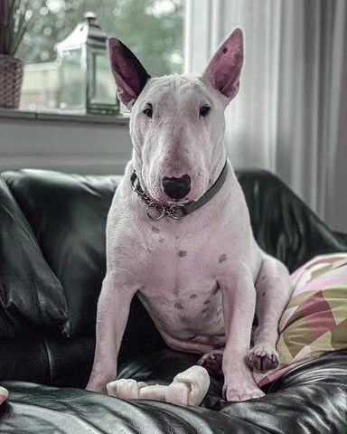
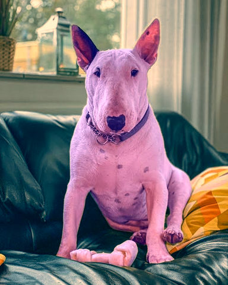
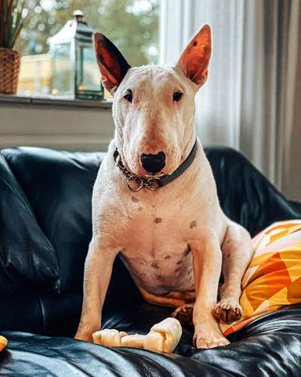
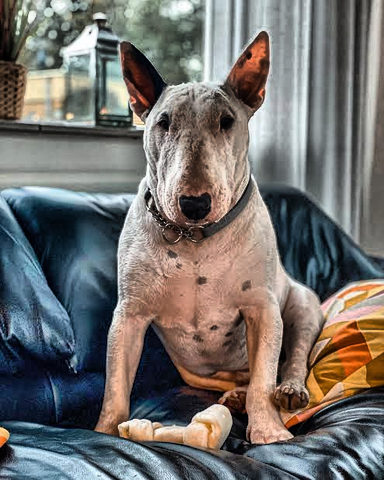
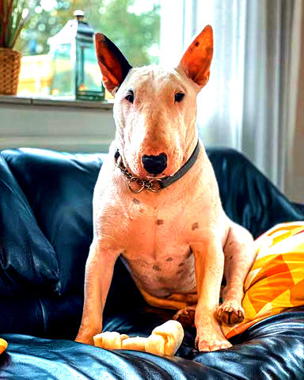
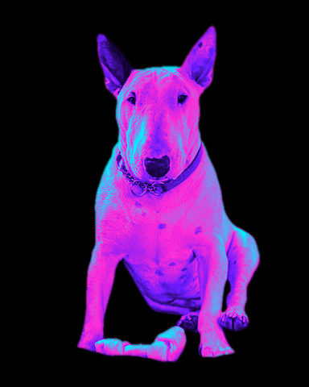
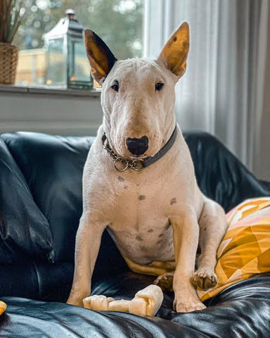

# Colour

Grades, gradient maps, tints and hue changes: they recolour the picture and leave its shapes alone.

[All effects](README.md)

| Example | Effect | What it does | Parameters | Recipe |
| --- | --- | --- | --- | --- |
|  | `auto_levels` | Stretch the tones so the darkest values become black and the brightest white, ignoring `clip` at each end. | `clip=0.005` `mode='per_channel'` | [auto_levels.toml](../../examples/effects/auto_levels.toml) |
|  | `channel_mixer` | Build each output channel as a weighted sum of the input red, green and blue, set by a 3x3 matrix of weights. | `red_from_red=1.0` `red_from_green=0.0` `red_from_blue=0.0` `green_from_red=0.0` `green_from_green=1.0` `green_from_blue=0.0` `blue_from_red=0.0` `blue_from_green=0.0` `blue_from_blue=1.0` | [channel_mixer.toml](../../examples/effects/channel_mixer.toml) |
|  | `color_balance` | Push the shadows, midtones and highlights each toward a colour: split toning, duotone, teal and orange grading. | `shadows='#3a1bff'` `midtones='#808080'` `highlights='#ff2bd6'` `amount=0.3` `balance=0.5` `softness=1.0` +1 advanced | [color_balance.toml](../../examples/effects/color_balance.toml) |
|  | `curves` | Bend tones along smooth curves through control points: a master curve, then one per colour channel. | `black=0.0` `shadows=0.25` `midtones=0.5` `highlights=0.75` `white=1.0` +9 advanced | [curves.toml](../../examples/effects/curves.toml) |
|  | `equalize` | Equalise the brightness histogram tile by tile (CLAHE, Zuiderveld 1994), keeping each pixel's colour. | `tiles=8` `limit=3.0` `bins=256` | [equalize.toml](../../examples/effects/equalize.toml) |
|  | `grade` | White balance, exposure, contrast, saturation: `temperature`/`tint` fix a warm or cool cast first. | `temperature=0.0` `tint=0.0` `exposure=0.0` `contrast=1.0` `pivot=0.5` `saturation=1.0` `vibrance=0.0` | [grade.toml](../../examples/effects/grade.toml) |
|  | `gradient_map` | Recolour by brightness: darkest pixels get the first stop, brightest the last, evenly spaced between. | `stops=('#000000', '#ffffff')` `shadow_clip=0.01` `highlight_clip=0.01` +1 advanced | [gradient_map.toml](../../examples/effects/gradient_map.toml) |
|  | `levels` | Remap tones with an input black point, white point and midtone `gamma`, then an output range. | `black=0.0` `white=1.0` `gamma=1.0` `output_black=0.0` `output_white=1.0` | [levels.toml](../../examples/effects/levels.toml) |
|  | `selective_color` | Shift the hue, saturation and lightness of the colours in one hue range, leaving every other pixel untouched. | `hue=0.0` `width=60.0` `feather=30.0` `hue_shift=0.0` `saturation=1.0` `lightness=0.0` | [selective_color.toml](../../examples/effects/selective_color.toml) |

### `auto_levels`

| Parameter | Type | Unit | Range | Default | Description |
| --- | --- | --- | --- | --- | --- |
| `clip` | number | fraction | 0 to 0.45 | `0.005` | The share of values (0..0.45) that end up saturated at each end, pure black and pure white: 0.005 is 0.5 percent, 0 stretches exactly from the darkest to the brightest value. Raising it gives more contrast and ignores stray dark or bright pixels, at the cost of detail in the extremes. |
| `mode` | one of 'linked', 'per_channel' |  |  | `'per_channel'` | What is stretched: 'per_channel' stretches red, green and blue separately, which also removes a colour cast but shifts colours (Photoshop's Enhance Per Channel Contrast); 'linked' finds one black and one white point over all channels together and stretches them alike, so colours keep their relationships (Enhance Monochromatic Contrast). |

### `channel_mixer`

| Parameter | Type | Unit | Range | Default | Description |
| --- | --- | --- | --- | --- | --- |
| `red_from_red` | number | ratio | -3 to 3 | `1.0` | Weight of input red in output red, -3..3: 1 keeps it as it is (default), 0 removes it, above 1 amplifies it, a negative weight inverts it. |
| `red_from_green` | number | ratio | -3 to 3 | `0.0` | Weight of input green in output red, -3..3: 1 passes it through, 0 leaves it out, a negative weight subtracts it. |
| `red_from_blue` | number | ratio | -3 to 3 | `0.0` | Weight of input blue in output red, -3..3: 1 passes it through, 0 leaves it out, a negative weight subtracts it. |
| `green_from_red` | number | ratio | -3 to 3 | `0.0` | Weight of input red in output green, -3..3: 1 passes it through, 0 leaves it out, a negative weight subtracts it. |
| `green_from_green` | number | ratio | -3 to 3 | `1.0` | Weight of input green in output green, -3..3: 1 keeps it as it is (default), 0 removes it, above 1 amplifies it, a negative weight inverts it. |
| `green_from_blue` | number | ratio | -3 to 3 | `0.0` | Weight of input blue in output green, -3..3: 1 passes it through, 0 leaves it out, a negative weight subtracts it. |
| `blue_from_red` | number | ratio | -3 to 3 | `0.0` | Weight of input red in output blue, -3..3: 1 passes it through, 0 leaves it out, a negative weight subtracts it. |
| `blue_from_green` | number | ratio | -3 to 3 | `0.0` | Weight of input green in output blue, -3..3: 1 passes it through, 0 leaves it out, a negative weight subtracts it. |
| `blue_from_blue` | number | ratio | -3 to 3 | `1.0` | Weight of input blue in output blue, -3..3: 1 keeps it as it is (default), 0 removes it, above 1 amplifies it, a negative weight inverts it. |

Presets (`preset="name"` in a recipe step or `fx`):

| Preset | Description |
| --- | --- |
| `infrared` | False-colour infrared: green is read as red, so foliage and bright greens turn pink and pale. |
| `monochrome` | Black and white by Rec. 709 luma: every channel is the picture's brightness. Set the rows to your own shares (summing to 1) for a colour filter. |

### `color_balance`

| Parameter | Type | Unit | Range | Default | Description |
| --- | --- | --- | --- | --- | --- |
| `shadows` | colour |  |  | `'#3a1bff'` | The colour the dark parts are pushed toward: '#rrggbb', '#rgb' or [r, g, b] 0..1. Mid grey '#808080' leaves them alone; a lighter or darker colour than that also lightens or darkens them unless `preserve_luminosity` is on. |
| `midtones` | colour |  |  | `'#808080'` | The colour the middle tones are pushed toward: '#rrggbb', '#rgb' or [r, g, b] 0..1. Mid grey '#808080' leaves them alone. |
| `highlights` | colour |  |  | `'#ff2bd6'` | The colour the bright parts are pushed toward: '#rrggbb', '#rgb' or [r, g, b] 0..1. Mid grey '#808080' leaves them alone. |
| `amount` | number (drivable) | fraction | 0 to 1 | `0.3` | How far each range is pushed toward its colour: 0 = off, 0.2 a hint, 0.6 strong, 1 moves a range by the full distance from mid grey to its colour. |
| `balance` | number (drivable) | fraction | 0 to 1 | `0.5` | Where the three ranges sit on the brightness scale (0..1): 0.5 splits it evenly, shadows below a quarter and highlights above three quarters. Raising it lets the shadows reach higher up and shrinks the highlights; lowering it does the reverse. |
| `softness` | number | fraction | 0.01 to 1 | `1.0` | How far neighbouring ranges overlap (0.01..1): 1 blends each into the next over half the brightness scale, with no pure midtones except at the centre; smaller makes sharper hand-overs and a wider band of pure midtones. |

Advanced parameters (1)

| Parameter | Type | Unit | Range | Default | Description |
| --- | --- | --- | --- | --- | --- |
| `preserve_luminosity` | true or false |  |  | `True` | Keep each pixel's Rec. 709 luma while pushing colours: on, the brightness a push adds or removes is taken off or put back on all three channels, so only the colour changes (Photoshop's 'Preserve Luminosity'); off, a push toward a lighter or darker colour also lightens or darkens. Where a channel reaches 0 or 1 the luma is only kept as far as the clipping allows. |

Presets (`preset="name"` in a recipe step or `fx`):

| Preset | Description |
| --- | --- |
| `teal_orange` | The blockbuster colour grade: teal in the shadows, orange in the highlights, olive between. |
| `split_tone` | Split toning, duotone style: violet shadows and pink highlights, the two blended through the midtones. |
| `color_balance` | A starting point for colour balancing: cool shadows, untouched midtones, warm highlights. |

### `curves`

| Parameter | Type | Unit | Range | Default | Description |
| --- | --- | --- | --- | --- | --- |
| `black` | number | fraction | 0 to 1 | `0.0` | The master curve's output for pure black, on the input axis at 0 (0..1): raising it lifts the blacks to a matte grey. |
| `shadows` | number | fraction | 0 to 1 | `0.25` | The master curve's output for the input a quarter of the way up (0..1; 0.25 = unchanged): lower darkens the shadows, higher opens them up. |
| `midtones` | number | fraction | 0 to 1 | `0.5` | The master curve's output for the middle input, 0.5 (0..1; 0.5 = unchanged): lower darkens the midtones, higher brightens them. |
| `highlights` | number | fraction | 0 to 1 | `0.75` | The master curve's output for the input three quarters of the way up (0..1; 0.75 = unchanged): lower dims the highlights, higher makes them brighter. |
| `white` | number | fraction | 0 to 1 | `1.0` | The master curve's output for pure white, at 1 on the input axis (0..1): lowering it dims the whites. |

Advanced parameters (9)

| Parameter | Type | Unit | Range | Default | Description |
| --- | --- | --- | --- | --- | --- |
| `red_shadows` | number | fraction | 0 to 1 | `0.25` | The red curve's output for the input a quarter of the way up (0..1; 0.25 = unchanged), applied after the master curve: raising it adds red to the shadows, lowering it takes red away. Its ends stay at black and white. |
| `red_midtones` | number | fraction | 0 to 1 | `0.5` | The red curve's output for the input the middle, 0.5 (0..1; 0.5 = unchanged), applied after the master curve: raising it adds red to the midtones, lowering it takes red away. Its ends stay at black and white. |
| `red_highlights` | number | fraction | 0 to 1 | `0.75` | The red curve's output for the input three quarters of the way up (0..1; 0.75 = unchanged), applied after the master curve: raising it adds red to the highlights, lowering it takes red away. Its ends stay at black and white. |
| `green_shadows` | number | fraction | 0 to 1 | `0.25` | The green curve's output for the input a quarter of the way up (0..1; 0.25 = unchanged), applied after the master curve: raising it adds green to the shadows, lowering it takes green away. Its ends stay at black and white. |
| `green_midtones` | number | fraction | 0 to 1 | `0.5` | The green curve's output for the input the middle, 0.5 (0..1; 0.5 = unchanged), applied after the master curve: raising it adds green to the midtones, lowering it takes green away. Its ends stay at black and white. |
| `green_highlights` | number | fraction | 0 to 1 | `0.75` | The green curve's output for the input three quarters of the way up (0..1; 0.75 = unchanged), applied after the master curve: raising it adds green to the highlights, lowering it takes green away. Its ends stay at black and white. |
| `blue_shadows` | number | fraction | 0 to 1 | `0.25` | The blue curve's output for the input a quarter of the way up (0..1; 0.25 = unchanged), applied after the master curve: raising it adds blue to the shadows, lowering it takes blue away. Its ends stay at black and white. |
| `blue_midtones` | number | fraction | 0 to 1 | `0.5` | The blue curve's output for the input the middle, 0.5 (0..1; 0.5 = unchanged), applied after the master curve: raising it adds blue to the midtones, lowering it takes blue away. Its ends stay at black and white. |
| `blue_highlights` | number | fraction | 0 to 1 | `0.75` | The blue curve's output for the input three quarters of the way up (0..1; 0.75 = unchanged), applied after the master curve: raising it adds blue to the highlights, lowering it takes blue away. Its ends stay at black and white. |

Presets (`preset="name"` in a recipe step or `fx`):

| Preset | Description |
| --- | --- |
| `cross_process` | Cross-processed film: punchy contrast, warm yellow-green highlights and cool blue-green shadows. |
| `solarize` | Darkroom solarization: the tones rise to the middle grey, then fold back, so highlights turn dark with a bright edge where they meet. |

### `equalize`

| Parameter | Type | Unit | Range | Default | Description |
| --- | --- | --- | --- | --- | --- |
| `tiles` | whole number | count | 1 to 64 | `8` | Tiles per side: the picture is cut into tiles x tiles regions, each equalised by its own histogram and blended smoothly into its neighbours. 1 = one histogram for the whole picture (classic equalisation); raising it adapts to smaller regions and brings out local contrast. A picture with fewer pixel rows or columns than tiles gets one tile per row or column. |
| `limit` | number | ratio | 1 to 256 | `3.0` | Clip limit, as a multiple of the height every bin would have if a tile's histogram were flat: no bin may be taller, so no tone range is stretched more than this many times. 1 = the histogram is made flat, which leaves tones evenly spread (a gentle lift of the darkest bin by one step); raising it allows more contrast and amplifies noise in flat areas. A limit of `bins` or more never clips (classic equalisation). |
| `bins` | whole number | count | 2 to 256 | `256` | Histogram bins over the brightness range 0..1: fewer bins give a coarser mapping and fewer distinct brightnesses in the result (2 = every tile ends up with two brightnesses), 256 matches 8-bit pictures. |

### `grade`

| Parameter | Type | Unit | Range | Default | Description |
| --- | --- | --- | --- | --- | --- |
| `temperature` | number (drivable) | stops | -2 to 2 | `0.0` | Warm-cool shift in stops (-2..2): the difference in stops between the red and the blue gain, shared evenly (red up and blue down by half of it each). Positive warms the picture (more orange), negative cools it (more blue), 0 leaves the colour balance alone. Use a negative value to correct a picture shot under warm light. |
| `tint` | number (drivable) | stops | -1 to 1 | `0.0` | Green-magenta shift in stops (-1..1): the green gain is multiplied by 2 to the power of minus tint. Positive adds magenta (less green), negative adds green, 0 leaves the balance alone. |
| `exposure` | number (drivable) | stops | -10 to 10 | `0.0` | Brightness in photographic stops: +1 doubles every value, -1 halves it. |
| `contrast` | number (drivable) | ratio | 0 to 5 | `1.0` | How far values are pushed away from the pivot: 1 = unchanged, 2 = twice as far, 0 = flat at the pivot. |
| `pivot` | number | fraction | 0 to 1 | `0.5` | The brightness (0..1) that contrast leaves where it is; values above it brighten, below it darken. |
| `saturation` | number (drivable) | ratio | 0 to 5 | `1.0` | Colourfulness: 1 = unchanged, 0 = grey (Rec. 709 brightness kept), above 1 more vivid. |
| `vibrance` | number (drivable) | fraction | 0 to 1 | `0.0` | How far muted colours are pushed toward full saturation (0..1), after `saturation`: 0 changes nothing, 1 raises a colour's saturation s to s + s * (1 - s), so a colour at 0.2 goes to 0.36 while one at 0.9 only reaches 0.99. Greys and fully saturated colours stay as they are; colours are never made duller. |

Presets (`preset="name"` in a recipe step or `fx`):

| Preset | Description |
| --- | --- |
| `white_balance` | White balance: corrects a warm (orange) cast and a slight magenta tint. For a cool cast use a positive temperature. |

### `gradient_map`

| Parameter | Type | Unit | Range | Default | Description |
| --- | --- | --- | --- | --- | --- |
| `stops` | list of colours |  |  | `('#000000', '#ffffff')` | The gradient's colours from darkest to brightest, evenly spaced; at least two. Two make a duotone, three a tritone. |
| `shadow_clip` | number | fraction | 0 to 0.5 | `0.01` | Share of the darkest pixels (0..0.5) that the contrast stretch pushes onto the first stop; 0 maps only the darkest pixel there. Larger gives deeper shadows. |
| `highlight_clip` | number | fraction | 0 to 0.5 | `0.01` | Share of the brightest pixels (0..0.5) that the contrast stretch pushes onto the last stop. Larger gives brighter highlights. |

Advanced parameters (1)

| Parameter | Type | Unit | Range | Default | Description |
| --- | --- | --- | --- | --- | --- |
| `quantile_method` | one of 'linear', 'lower', 'higher', 'nearest', 'midpoint', 'inverted_cdf', 'averaged_inverted_cdf', 'closest_observation', 'interpolated_inverted_cdf', 'hazen', 'weibull', 'median_unbiased', 'normal_unbiased' |  |  | `'linear'` | How the stretch's clip points are read from the picture's brightness (numpy's quantile methods): 'linear' interpolates between the two nearest pixels; 'lower', 'higher', 'nearest' and 'midpoint' take the darker, the brighter, the nearer pixel or their mean; 'inverted_cdf', 'averaged_inverted_cdf', 'closest_observation', 'interpolated_inverted_cdf', 'hazen', 'weibull', 'median_unbiased' and 'normal_unbiased' are the textbook sample-quantile definitions (Hyndman and Fan). Only visible on small or flat pictures. |

Presets (`preset="name"` in a recipe step or `fx`):

| Preset | Description |
| --- | --- |
| `sepia` | Warm brown monochrome, from dark chocolate to cream, like an aged print. |
| `cyanotype` | Prussian-blue monochrome fading to pale cyan, like a blueprint print. |
| `thermal` | Heat-camera false colour: indigo for the coldest, through red and orange, to white-hot. |
| `night_vision` | Green phosphor monochrome, as a night-vision scope shows it (no noise or vignette). |
| `xray` | Inverted pale blue on deep navy, like a radiograph (the brightest parts become the darkest). |

### `levels`

| Parameter | Type | Unit | Range | Default | Description |
| --- | --- | --- | --- | --- | --- |
| `black` | number | fraction | 0 to 1 | `0.0` | The input black point (0..1): values at or below it become the output black. Raising it darkens shadows and adds contrast. |
| `white` | number | fraction | 0 to 1 | `1.0` | The input white point (0..1): values at or above it become the output white. Lowering it brightens highlights and adds contrast. At or below `black` the picture is cut at `black` into the two output ends. |
| `gamma` | number | ratio | 0.1 to 10 | `1.0` | The midtone gamma: 1 = linear, above 1 brightens the midtones, below 1 darkens them; black and white stay where they are (output = input ** (1 / gamma), as in Photoshop). |
| `output_black` | number (drivable) | fraction | 0 to 1 | `0.0` | The darkest value that can be output (0..1): raising it lifts the blacks to a matte grey, the faded-film look (0.1 = gentle, 1 = everything white). Above `output_white` the tones are reversed. |
| `output_white` | number | fraction | 0 to 1 | `1.0` | The brightest value that can be output (0..1): lowering it dims the whites. |

Presets (`preset="name"` in a recipe step or `fx`):

| Preset | Description |
| --- | --- |
| `invert` | The photographic negative: every channel value v becomes 1 - v, so each colour turns to its complement. |

### `selective_color`

| Parameter | Type | Unit | Range | Default | Description |
| --- | --- | --- | --- | --- | --- |
| `hue` | number (cyclic) | degrees | 0 to 360 | `0.0` | Centre of the range on the colour wheel, 0..360 degrees: 0 red, 60 yellow, 120 green, 180 cyan, 240 blue, 300 magenta; 360 is red again. |
| `width` | number | degrees | 0 to 360 | `60.0` | Full width of the range, 0..360 degrees, centred on `hue`; colours inside it are changed at full strength. 360 takes in every colour; raising it widens the range. |
| `feather` | number | degrees | 0 to 180 | `30.0` | How far beyond each edge of the range the change fades out, 0..180 degrees: the weight falls in a straight line from full at the edge to none that far away. 0 gives a hard edge; raising it blends the range into its neighbours. |
| `hue_shift` | number (drivable) | degrees | -180 to 180 | `0.0` | How far the selected hues are turned round the colour wheel, -180..180 degrees; positive goes red toward yellow, green, blue. 0 keeps the hue. With `width` 360 and `feather` 0 every colour turns (preset `hue_shift`). |
| `saturation` | number | ratio | 0 to 3 | `1.0` | Gain on the saturation of the selected colours: 1 keeps it, 0 turns them grey, above 1 makes them more vivid (stopping at full saturation). |
| `lightness` | number | fraction | -1 to 1 | `0.0` | Brightness (HSV value) of the selected colours, -1..1: -1 takes them all the way to black, +1 all the way to the full value, 0 keeps it; a value of 0.5 closes half the gap in that direction. |

Presets (`preset="name"` in a recipe step or `fx`):

| Preset | Description |
| --- | --- |
| `hue_shift` | Every colour turned 150 degrees round the wheel (vivid colours fully, pale ones less); greys stay. |
