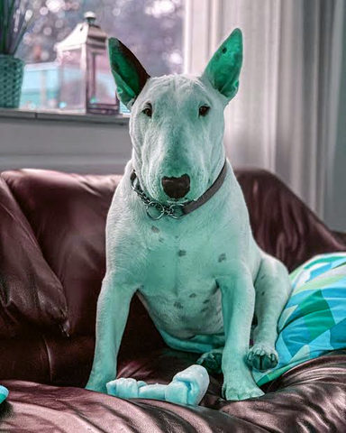
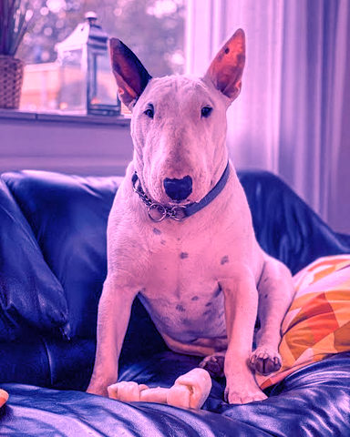

# Colour

Grades, gradient maps, tints and hue changes: they recolour the picture and leave its shapes alone.

[All effects](README.md)

| Example | Effect | What it does | Parameters | Recipe |
| --- | --- | --- | --- | --- |
|  | `grade` | Basic tone controls: `exposure` in stops, then `contrast` around `pivot`, then `saturation`. | `exposure=0.0` `contrast=1.0` `pivot=0.5` `saturation=1.0` | [grade.toml](../../examples/effects/grade.toml) |
|  | `gradient_map` | Recolour by brightness: darkest pixels get the first stop, brightest the last, evenly spaced between. | `stops=('#000000', '#ffffff')` `shadow_clip=0.01` `highlight_clip=0.01` `quantile_method='linear'` | [gradient_map.toml](../../examples/effects/gradient_map.toml) |
|  | `hue_shift` | Rotate every hue around the colour wheel by `hue` degrees: the quickest way to try another colour scheme. | `hue=90.0` | [hue_shift.toml](../../examples/effects/hue_shift.toml) |
|  | `split_tone` | Tint the dark parts with `shadow` and the bright parts with `highlight`, without changing brightness. | `shadow='#3a1bff'` `highlight='#ff2bd6'` `amount=0.3` `balance=0.5` `softness=0.5` `black_fade=0.1` | [split_tone.toml](../../examples/effects/split_tone.toml) |

### `grade`

| Parameter | Type | Unit | Range | Default | Description |
| --- | --- | --- | --- | --- | --- |
| `exposure` | number | stops | -10 to 10 | `0.0` | Brightness in photographic stops: +1 doubles every value, -1 halves it. |
| `contrast` | number | ratio | 0 to 5 | `1.0` | How far values are pushed away from the pivot: 1 = unchanged, 2 = twice as far, 0 = flat at the pivot. |
| `pivot` | number | fraction | 0 to 1 | `0.5` | The brightness (0..1) that contrast leaves where it is; values above it brighten, below it darken. |
| `saturation` | number | ratio | 0 to 5 | `1.0` | Colourfulness: 1 = unchanged, 0 = grey (Rec. 709 brightness kept), above 1 more vivid. |

### `gradient_map`

| Parameter | Type | Unit | Range | Default | Description |
| --- | --- | --- | --- | --- | --- |
| `stops` | list of colours |  |  | `('#000000', '#ffffff')` | The gradient's colours from darkest to brightest, evenly spaced; at least two. Two make a duotone, three a tritone. |
| `shadow_clip` | number | fraction | 0 to 0.5 | `0.01` | Share of the darkest pixels (0..0.5) that the contrast stretch pushes onto the first stop; 0 maps only the darkest pixel there. Larger gives deeper shadows. |
| `highlight_clip` | number | fraction | 0 to 0.5 | `0.01` | Share of the brightest pixels (0..0.5) that the contrast stretch pushes onto the last stop. Larger gives brighter highlights. |
| `quantile_method` | one of 'linear', 'lower', 'higher', 'nearest', 'midpoint', 'inverted_cdf', 'averaged_inverted_cdf', 'closest_observation', 'interpolated_inverted_cdf', 'hazen', 'weibull', 'median_unbiased', 'normal_unbiased' |  |  | `'linear'` | How the stretch's clip points are read from the picture's brightness (numpy's quantile methods): 'linear' interpolates between the two nearest pixels; 'lower', 'higher', 'nearest' and 'midpoint' take the darker, the brighter, the nearer pixel or their mean; 'inverted_cdf', 'averaged_inverted_cdf', 'closest_observation', 'interpolated_inverted_cdf', 'hazen', 'weibull', 'median_unbiased' and 'normal_unbiased' are the textbook sample-quantile definitions (Hyndman and Fan). Only visible on small or flat pictures. |

### `hue_shift`

| Parameter | Type | Unit | Range | Default | Description |
| --- | --- | --- | --- | --- | --- |
| `hue` | number | degrees | -360 to 360 | `90.0` | The turn around the colour wheel: 120 sends red to green, 360 is a full turn (unchanged). |

### `split_tone`

| Parameter | Type | Unit | Range | Default | Description |
| --- | --- | --- | --- | --- | --- |
| `shadow` | colour |  |  | `'#3a1bff'` | The tint of the dark parts: '#rrggbb', '#rgb' or [r, g, b] 0..1. |
| `highlight` | colour |  |  | `'#ff2bd6'` | The tint of the bright parts: '#rrggbb', '#rgb' or [r, g, b] 0..1. |
| `amount` | number | fraction | 0 to 1 | `0.3` | How strongly the tints are added: 0 = off, 0.2 a hint, 0.6 strong. |
| `balance` | number | fraction | 0 to 1 | `0.5` | The brightness (0..1) where the shadow tint hands over to the highlight tint. Raising it tints more of the picture with the shadow colour. |
| `softness` | number | fraction | 0.01 to 1 | `0.5` | Width of the brightness band (0.01..1), centred on balance, over which one tint blends into the other. Smaller makes a sharper hand-over. |
| `black_fade` | number | fraction | 0.001 to 1 | `0.1` | The brightness (0.001..1) up to which the tints fade in from nothing, so pure black stays black. Larger keeps more of the shadows untinted. |
