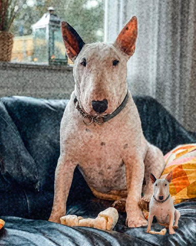

# Compositing

Ways of combining the picture with other layers.

[All effects](README.md)

| Example | Effect | What it does | Parameters | Recipe |
| --- | --- | --- | --- | --- |
|  | `blend` | Lay a second picture over the photo with a blend mode, fitted by cover, contain, stretch, width or tile. | `image='#808080'` `mode='multiply'` `fit='cover'` `at='center'` `scale=1.0` `margin=0.0` +1 advanced | [blend.toml](../../examples/effects/blend.toml) |

### `blend`

| Parameter | Type | Unit | Range | Default | Description |
| --- | --- | --- | --- | --- | --- |
| `image` | picture |  |  | `'#808080'` | The picture laid over the photo (a texture, a light leak): a path in a recipe file (relative to the file), a colour such as '#808080' (a flat picture) or, in Python, a Picture or an array. Its own transparency is respected. |
| `mode` | one of 'normal', 'multiply', 'screen', 'overlay', 'soft_light', 'difference', 'color' |  |  | `'multiply'` | How the picture combines with the photo, as the W3C Compositing and Blending Level 1 modes: 'normal' shows the picture, 'multiply' darkens, 'screen' lightens, 'overlay' deepens contrast by the photo's tones, 'soft_light' does so gently by the picture's, 'difference' subtracts, 'color' gives the photo the picture's hue and saturation and keeps its brightness. Mid grey leaves the photo unchanged under 'overlay' and 'soft_light'. |
| `fit` | one of 'cover', 'contain', 'stretch', 'width', 'tile' |  |  | `'cover'` | How the picture is fitted to the photo: 'cover' fills it keeping the aspect and crops the overhang, 'contain' fits inside it keeping the aspect (the rest of the photo is untouched), 'stretch' fills it ignoring the aspect, 'width' keeps the aspect and makes the picture as wide as the photo times `scale` (a logo or sticker), 'tile' repeats that picture over the photo. |
| `at` | one of 'top_left', 'top', 'top_right', 'left', 'center', 'right', 'bottom_left', 'bottom', 'bottom_right' |  |  | `'center'` | Where the fitted picture sits, or which tile sits there: 'top_left', 'top', 'top_right', 'left', 'center', 'right', 'bottom_left', 'bottom' or 'bottom_right'. It decides what 'cover' crops. |
| `scale` | number | ratio | 0.01 to 2 | `1.0` | The fitted picture's size as a multiple of the size `fit` gives it: 1 as fitted, 0.5 half as wide and tall. With 'width' it is the picture's width as a share of the photo's (0.2 a fifth); with 'tile', 0.25 puts four tiles across the photo. |
| `margin` | number | fraction | 0 to 0.45 | `0.0` | Space kept clear around the fitted picture, as a share of the photo's long side, 0 to 0.45 (never more than leaves a pixel of the shorter side). Raising it shrinks what 'cover', 'contain' and 'stretch' fill and moves a smaller picture at an edge or corner inward. |

Advanced parameters (1)

| Parameter | Type | Unit | Range | Default | Description |
| --- | --- | --- | --- | --- | --- |
| `resample` | one of 'nearest', 'bilinear', 'bicubic', 'lanczos' |  |  | `'lanczos'` | The filter that sizes the picture: 'nearest' keeps hard pixels, 'bilinear' is soft, 'bicubic' is sharper, 'lanczos' is sharpest and the best for shrinking. |

Presets (`preset="name"` in a recipe step or `fx`):

| Preset | Description |
| --- | --- |
| `logo` | A logo or sticker in the bottom right corner, a fifth of the photo's width, with its own transparency. |
