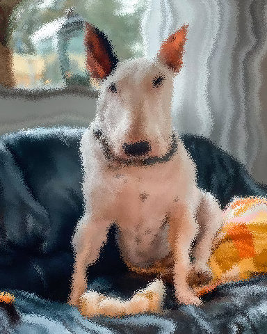
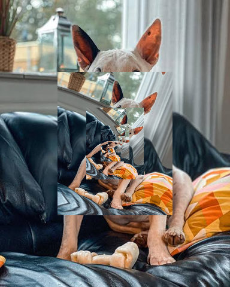
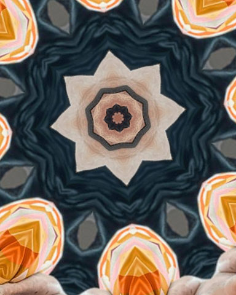
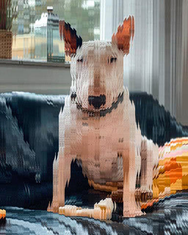
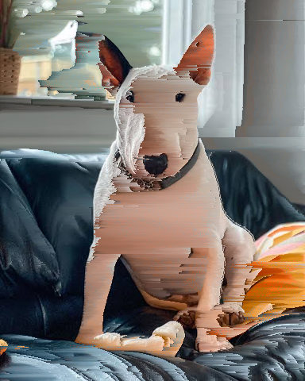
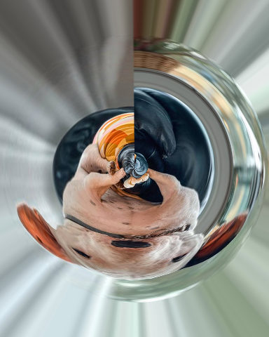
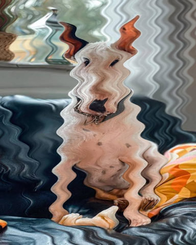
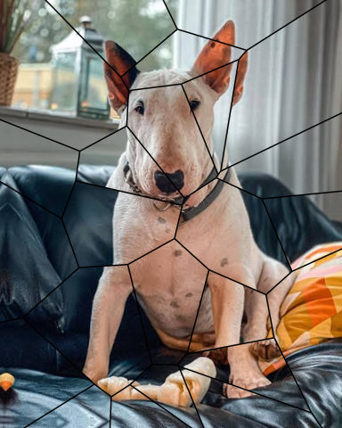
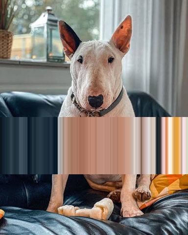
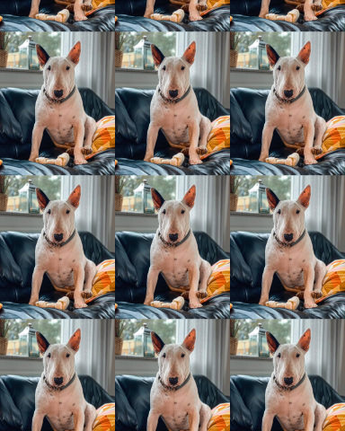

# Distortion

Warps that bend, ripple or displace the picture's geometry.

[All effects](README.md)

| Example | Effect | What it does | Parameters | Recipe |
| --- | --- | --- | --- | --- |
|  | `displace` | Move every pixel by two independent noise fields (down and right), the longest move being `amount` px. | `amount=12.0` `scale=80.0` `octaves=3` `persistence=0.5` `lacunarity=2.0` `seed=0` +2 advanced | [displace.toml](../../examples/effects/displace.toml) |
|  | `droste` | Show the picture again, `scale` times as large and turned by `turn`, in its own middle, up to `repeats` times. | `scale=0.5` `turn=20.0` `repeats=4` +2 advanced | [droste.toml](../../examples/effects/droste.toml) |
|  | `fisheye` | Bend the picture as a fisheye lens with its axis at `x`, `y` would, magnifying the middle. | `amount=0.6` `x=0.5` `y=0.5` +1 advanced | [fisheye.toml](../../examples/effects/fisheye.toml) |
|  | `flow_warp` | Carry the picture `amount` px along a flow whose direction is `angle` plus `variation` degrees of fractal noise. | `amount=20.0` `scale=80.0` `octaves=3` `seed=0` `angle=0.0` `variation=60.0` +5 advanced | [flow_warp.toml](../../examples/effects/flow_warp.toml) |
|  | `kaleidoscope` | Fold the picture about the centre `x`, `y` into `segments` sectors, each a wedge of the picture and its mirror. | `segments=6` `angle=0.0` `x=0.5` `y=0.5` +2 advanced | [kaleidoscope.toml](../../examples/effects/kaleidoscope.toml) |
|  | `lens_distortion` | Bend the picture as a lens with radial distortion `distortion` about the axis `x`, `y` does. | `distortion=0.2` `fit='frame'` `x=0.5` `y=0.5` +2 advanced | [lens_distortion.toml](../../examples/effects/lens_distortion.toml) |
|  | `lenticular` | Cut the picture into vertical strips of `strip` px and slide every second one sideways by `shift` px. | `strip=6` `shift=5.0` +1 advanced | [lenticular.toml](../../examples/effects/lenticular.toml) |
|  | `melt` | Pull the bright parts of each column downward, up to `amount` px, by a drip length that differs per column. | `amount=40.0` `scale=12.0` `seed=0` +2 advanced | [melt.toml](../../examples/effects/melt.toml) |
|  | `parallax` | Shift every layer of the picture by amount x long side x (depth - focus) px along `angle`, as a sideways camera move would. | `angle=0.0` `amount=0.02` `focus=0.5` +2 advanced | [parallax.toml](../../examples/effects/parallax.toml) |
|  | `perspective` | Tilt the picture as a camera would see it: keystone it by `vertical` then `horizontal`, skew, turn and zoom it. | `vertical=0.25` `horizontal=0.0` `shear_x=0.0` `shear_y=0.0` `rotate=0.0` `scale=0.0` +2 advanced | [perspective.toml](../../examples/effects/perspective.toml) |
|  | `pinch_bulge` | Push the picture out (`amount` above 0, a bulge) or in (below 0, a pinch) about the centre `x`, `y`. | `amount=0.5` `radius=0.5` `x=0.5` `y=0.5` +2 advanced | [pinch_bulge.toml](../../examples/effects/pinch_bulge.toml) |
|  | `pixel_sort` | Sort every run of pixels whose key lies between `low` and `high` along the rows (or columns) by that key. | `by='brightness'` `low=0.25` `high=0.75` `axis='horizontal'` `order='ascending'` | [pixel_sort.toml](../../examples/effects/pixel_sort.toml) |
|  | `polar` | Wrap the picture round the centre `x`, `y` into a planet (`mode` 'to'), or unwrap such a planet ('from'). | `mode='to'` `x=0.5` `y=0.5` +2 advanced | [polar.toml](../../examples/effects/polar.toml) |
|  | `ripple` | Move every pixel by a sine wave of `wavelength` and `amplitude` that travels in the direction `angle`. | `wavelength=40.0` `amplitude=6.0` `phase=0.0` `angle=0.0` +2 advanced | [ripple.toml](../../examples/effects/ripple.toml) |
|  | `shatter` | Break the picture into pieces, move and turn each, optionally flatten each to its mean colour, and draw `gap` px lines between them. | `pieces=24` `shape='voronoi'` `detail=0.0` `fill=0.0` `offset=10.0` `angle=5.0` `gap=0.0` `color='#000000'` `seed=0` +2 advanced | [shatter.toml](../../examples/effects/shatter.toml) |
|  | `slice_shift` | Cut the picture into horizontal strips at random rows and slide each sideways by a random distance. | `slices=30` `amount=0.05` `seed=0` | [slice_shift.toml](../../examples/effects/slice_shift.toml) |
|  | `stretch` | Repeat one row (or column) of the picture over the `span` of rows (columns) beside it. | `axis='vertical'` `at=0.5` `span=0.15` `side='both'` | [stretch.toml](../../examples/effects/stretch.toml) |
|  | `swirl` | Twist the picture about the centre `x`, `y` by `angle` degrees there, falling to nothing at `radius`. | `angle=90.0` `radius=0.5` `x=0.5` `y=0.5` +2 advanced | [swirl.toml](../../examples/effects/swirl.toml) |
|  | `tile` | Repeat the whole picture, scaled down, in a grid of `columns` by `rows`. | `columns=3` `rows=3` | [tile.toml](../../examples/effects/tile.toml) |

### `displace`

| Parameter | Type | Unit | Range | Default | Description |
| --- | --- | --- | --- | --- | --- |
| `amount` | number (drivable) | px | 0 to 500 | `12.0` | The farthest any pixel's move is, in pixels: the moves are scaled so that the largest one, wherever the noise is strongest, is exactly this far. Raising it tears the picture up more; 0 leaves it unchanged. |
| `scale` | number | px | 1 to 1024 | `80.0` | Size of the coarsest waves of the displacement in pixels, the spacing of the first noise lattice. Larger = broad, slow wobbles that bend the picture; small = fine, jittery tearing; 1 (with 1 octave and 'nearest') = every pixel moves on its own, frosted glass, most by about a quarter of `amount`. |
| `octaves` | whole number | count | 1 to 8 | `3` | How many layers of noise are summed, each finer than the last (by `lacunarity`) and weaker (by `persistence`). 1 = smooth waves, more = more fine, ragged detail. Layers finer than one pixel are dropped. |
| `persistence` | number | ratio | 0 to 1 | `0.5` | How much weaker each finer layer is than the one before: each layer's weight is this to the power of its number. 0 = only the coarsest layer, 1 = every layer equally strong (very rough). |
| `lacunarity` | number | ratio | 1 to 4 | `2.0` | How much finer each layer is than the one before: the lattice spacing is divided by this per layer. 1 = every layer the same size, 2 = each half as coarse, larger = detail drops off faster in size. |
| `seed` | whole number | count | 0 to 4294967295 | `0` | Random seed: the same seed always gives the same displacement, another seed a different one. |

Advanced parameters (2)

| Parameter | Type | Unit | Range | Default | Description |
| --- | --- | --- | --- | --- | --- |
| `interpolation` | one of 'nearest', 'bilinear', 'bicubic' |  |  | `'bilinear'` | How a point between pixels is read from the picture: 'nearest' takes the closest pixel (fastest, keeps every value exactly as it is but edges turn jagged), 'bilinear' blends the four pixels around it (smooth, slightly soft), 'bicubic' fits a cubic spline through the neighbouring pixels (sharpest, a little slower, and may ring beside hard edges). |
| `edge` | one of 'reflect', 'nearest', 'mirror', 'wrap' |  |  | `'reflect'` | What a pixel near the border sees when its move reads from beyond the picture: 'reflect' (mirrored, edge pixel repeated), 'mirror' (mirrored about the edge pixel), 'nearest' (the edge pixel repeated), 'wrap' (the opposite edge). |

### `droste`

| Parameter | Type | Unit | Range | Default | Description |
| --- | --- | --- | --- | --- | --- |
| `scale` | number | ratio | 0.1 to 0.9 | `0.5` | How much smaller each copy is than the one around it, strictly between 0 and 1: 0.5 = each copy is half the size of the last, 0.9 = a slow shrink with many copies close together, 0.1 = one small copy. The copy has the picture's own shape and sits in its middle. |
| `turn` | number (cyclic) | degrees | -180 to 180 | `20.0` | How far each copy is turned from the one around it, in degrees: positive turns the copies clockwise as the picture is seen, negative anticlockwise, 0 leaves them upright (nested frames); other values make the copies spiral into the middle. |
| `repeats` | whole number | count | 1 to 12 | `4` | How many copies are drawn inside one another at most, 1 to 12: the copy this deep shows the picture's middle instead of a further copy. Raising it adds ever smaller copies towards the middle. |

Advanced parameters (2)

| Parameter | Type | Unit | Range | Default | Description |
| --- | --- | --- | --- | --- | --- |
| `interpolation` | one of 'nearest', 'bilinear', 'bicubic' |  |  | `'bilinear'` | How a point between pixels is read from the picture: 'nearest' takes the closest pixel (fastest, keeps every value exactly as it is but the small copies turn blocky), 'bilinear' blends the four pixels around it (smooth, slightly soft), 'bicubic' fits a cubic spline through the neighbouring pixels (sharpest, a little slower, and may ring beside hard edges). |
| `edge` | one of 'reflect', 'nearest', 'mirror', 'wrap' |  |  | `'reflect'` | What a turned copy shows where it reads from beyond the picture (a turned copy's corners reach past the edge): 'reflect' (mirrored, edge pixel repeated), 'mirror' (mirrored about the edge pixel), 'nearest' (the edge pixel repeated), 'wrap' (the opposite edge). |

### `fisheye`

| Parameter | Type | Unit | Range | Default | Description |
| --- | --- | --- | --- | --- | --- |
| `amount` | number | fraction | 0 to 0.9 | `0.6` | How wide the lens sees, as a fraction of 90 degrees: the half angle of its field of view, reaching the farthest corner of the picture, is amount x 90 degrees (0.5 is a 90 degree lens, 0.9 a 162 degree one). Larger bends the picture more: the middle swells and the edges are squeezed in toward the corner; 0 leaves the picture unchanged. Wider than 0.9 is not offered, as the middle would grow beyond all reason. |
| `x` | number | fraction | 0 to 1 | `0.5` | The lens axis's horizontal position as a fraction of the way across the picture: 0 = the first pixel column, 0.5 = the middle, 1 = the last. |
| `y` | number | fraction | 0 to 1 | `0.5` | The lens axis's vertical position as a fraction of the way down the picture: 0 = the first pixel row, 0.5 = the middle, 1 = the last. |

Advanced parameters (1)

| Parameter | Type | Unit | Range | Default | Description |
| --- | --- | --- | --- | --- | --- |
| `interpolation` | one of 'nearest', 'bilinear', 'bicubic' |  |  | `'bilinear'` | How a point between pixels is read from the picture: 'nearest' takes the closest pixel (fastest, keeps every value exactly as it is but the magnified middle turns blocky), 'bilinear' blends the four pixels around it (smooth, slightly soft), 'bicubic' fits a cubic spline through the neighbouring pixels (sharpest, a little slower, and may ring beside hard edges). |

### `flow_warp`

| Parameter | Type | Unit | Range | Default | Description |
| --- | --- | --- | --- | --- | --- |
| `amount` | number | px | 0 to 500 | `20.0` | How far in pixels the picture is carried along the flow in all, the length of the path each pixel's content travels in `steps` equal steps (the path bends with the flow, so it ends nearer than this where it turns). Raising it makes longer streaks; 0 leaves the picture unchanged. |
| `scale` | number | px | 1 to 1024 | `80.0` | Size of the coarsest swirls of the flow in pixels, the spacing of the first noise lattice. Larger = broad, sweeping currents; small = fine, busy eddies. |
| `octaves` | whole number | count | 1 to 8 | `3` | How many layers of noise are summed to make the flow, each finer than the last (by `lacunarity`) and weaker (by `persistence`). 1 = smooth currents, more = more fine, ragged detail. Layers finer than one pixel are dropped. |
| `seed` | whole number | count | 0 to 4294967295 | `0` | Random seed: the same seed always gives the same flow, another seed a different one. |
| `angle` | number (cyclic) | degrees | -180 to 180 | `0.0` | The direction the flow runs in on average, in degrees clockwise from pointing right: 0 carries the picture to the right, 90 down, -90 up, 180 to the left. With `variation` 0 the whole picture is carried this way. |
| `variation` | number | degrees | 0 to 360 | `60.0` | How far the noise turns the flow away from `angle`: the typical turn, in degrees, either way (the noise's standard deviation). 0 = one straight current; 60 = streaks that wander about the angle; 360 = currents running every way, with eddies where they meet. |

Advanced parameters (5)

| Parameter | Type | Unit | Range | Default | Description |
| --- | --- | --- | --- | --- | --- |
| `steps` | whole number | count | 1 to 32 | `6` | How many equal steps the journey is made in, the picture being resampled once per step: with 1 every pixel moves straight `amount` px in the direction of the flow where it stands; more steps follow the bends of the flow and smear the picture into streaks along it, a little softer each time. Raising it costs time in proportion. |
| `persistence` | number | ratio | 0 to 1 | `0.5` | How much weaker each finer layer is than the one before: each layer's weight is this to the power of its number. 0 = only the coarsest layer, 1 = every layer equally strong (very rough). |
| `lacunarity` | number | ratio | 1 to 4 | `2.0` | How much finer each layer is than the one before: the lattice spacing is divided by this per layer. 1 = every layer the same size, 2 = each half as coarse, larger = detail drops off faster in size. |
| `interpolation` | one of 'nearest', 'bilinear', 'bicubic' |  |  | `'bilinear'` | How a point between pixels is read from the picture: 'nearest' takes the closest pixel (fastest, keeps every value exactly as it is but edges turn jagged), 'bilinear' blends the four pixels around it (smooth, slightly soft), 'bicubic' fits a cubic spline through the neighbouring pixels (sharpest, a little slower, and may ring beside hard edges). |
| `edge` | one of 'reflect', 'nearest', 'mirror', 'wrap' |  |  | `'reflect'` | What a pixel near the border sees when the flow carries it in from beyond the picture: 'reflect' (mirrored, edge pixel repeated), 'mirror' (mirrored about the edge pixel), 'nearest' (the edge pixel repeated), 'wrap' (the opposite edge). |

### `kaleidoscope`

| Parameter | Type | Unit | Range | Default | Description |
| --- | --- | --- | --- | --- | --- |
| `segments` | whole number | count | 1 to 64 | `6` | How many times the pattern repeats round the centre: the full circle is cut into this many equal sectors, each holding a wedge of the picture (half a sector wide) and its mirror image, so every wedge borders its own reflection and the seams between them do not show. 1 = one line through the centre: the half of the picture clockwise from `angle` is kept and its reflection replaces the other half (a face made symmetric, a reflection in water); 2 = mirrored across that line and again across the line at right angles (the kept quarter copied into the other three); raising it makes more, narrower wedges. |
| `angle` | number (cyclic) | degrees | -180 to 180 | `0.0` | Where the pattern starts, as the direction in degrees, clockwise from pointing right (as CSS rotate), of the first mirror axis and of the wedge that follows it: 0 puts an axis along the line right of the centre; turning it turns the mirror axes, and shows a different wedge of the picture. With 1 segment, 0 keeps the bottom half, 90 the left, 180 the top and -90 the right. The pattern repeats every 360 / segments degrees. |
| `x` | number | fraction | 0 to 1 | `0.5` | The centre's horizontal position as a fraction of the way across the picture: 0 = the first pixel column, 0.5 = the middle, 1 = the last. |
| `y` | number | fraction | 0 to 1 | `0.5` | The centre's vertical position as a fraction of the way down the picture: 0 = the first pixel row, 0.5 = the middle, 1 = the last. |

Advanced parameters (2)

| Parameter | Type | Unit | Range | Default | Description |
| --- | --- | --- | --- | --- | --- |
| `interpolation` | one of 'nearest', 'bilinear', 'bicubic' |  |  | `'bilinear'` | How a point between pixels is read from the picture: 'nearest' takes the closest pixel (fastest, keeps every value exactly as it is but edges turn jagged), 'bilinear' blends the four pixels around it (smooth, slightly soft), 'bicubic' fits a cubic spline through the neighbouring pixels (sharpest, a little slower, and may ring beside hard edges). With 'nearest' every output pixel is an input pixel, so a mirror (1 or 2 segments through the middle) is exact and exactly symmetric; the other two blend, and a mirror then differs from an exact reflection by rounding error only. |
| `edge` | one of 'reflect', 'nearest', 'mirror', 'wrap' |  |  | `'reflect'` | What the kaleidoscope sees beyond the picture's edge (a wedge reaches past it in the corners, and wherever the centre is off to one side): 'reflect' (mirrored, edge pixel repeated), 'mirror' (mirrored about the edge pixel), 'nearest' (the edge pixel repeated), 'wrap' (the opposite edge). |

### `lens_distortion`

| Parameter | Type | Unit | Range | Default | Description |
| --- | --- | --- | --- | --- | --- |
| `distortion` | number | ratio | -0.3 to 1 | `0.2` | The lens's radial distortion coefficient (the k1 of the Brown-Conrady model), with the distance from the axis measured in units of the farthest corner's. Positive is barrel distortion: straight lines bow outward and the picture looks wrapped around a ball. Negative is pincushion: lines bow inward and the corners are pulled out. The size is how much farther from the axis than its own place each pixel's source lies at the farthest corner: 0.2 is 20% farther. -0.3 is the most pincushion that does not fold the picture over, 1 the strongest barrel; 0 leaves the picture unchanged. |
| `fit` | one of 'frame', 'centre' |  |  | `'frame'` | How the picture is scaled back after the bend: 'frame' keeps the farthest corner in its corner, so the picture fills the frame (a barrel is zoomed in and loses its sides, and nothing beyond the picture is shown; a pincushion is zoomed out toward the middle and pulls in what lies beyond the middle of each edge, which the edge rule fills); 'centre' keeps the scale at the lens axis, so a barrel shrinks toward the middle, and the edge rule fills the corners it exposes. |
| `x` | number | fraction | 0 to 1 | `0.5` | The lens axis's horizontal position as a fraction of the way across the picture: 0 = the first pixel column, 0.5 = the middle, 1 = the last. |
| `y` | number | fraction | 0 to 1 | `0.5` | The lens axis's vertical position as a fraction of the way down the picture: 0 = the first pixel row, 0.5 = the middle, 1 = the last. |

Advanced parameters (2)

| Parameter | Type | Unit | Range | Default | Description |
| --- | --- | --- | --- | --- | --- |
| `interpolation` | one of 'nearest', 'bilinear', 'bicubic' |  |  | `'bilinear'` | How a point between pixels is read from the picture: 'nearest' takes the closest pixel (fastest, keeps every value exactly as it is but lines turn jagged), 'bilinear' blends the four pixels around it (smooth, slightly soft), 'bicubic' fits a cubic spline through the neighbouring pixels (sharpest, a little slower, and may ring beside hard edges). |
| `edge` | one of 'reflect', 'nearest', 'mirror', 'wrap' |  |  | `'reflect'` | What shows where the bend reads from beyond the picture (with fit 'centre', or a pincushion): 'reflect' (mirrored, edge pixel repeated), 'mirror' (mirrored about the edge pixel), 'nearest' (the edge pixel repeated), 'wrap' (the opposite edge). |

### `lenticular`

| Parameter | Type | Unit | Range | Default | Description |
| --- | --- | --- | --- | --- | --- |
| `strip` | whole number | px | 1 to 500 | `6` | The width of each vertical strip in pixels, counted from the left edge; a last strip at the right edge may be narrower. Narrow strips make a fine comb, wide ones a coarse stagger; a strip wider than the picture leaves it whole. Tuned for a picture about 480 px high. |
| `shift` | number | px | -500 to 500 | `5.0` | How far every second strip (the 2nd, 4th, ... from the left) is slid sideways, in pixels: positive moves its picture right, negative left, 0 leaves the picture unchanged. A distance that is not a whole number blends the two pixels it lies between. Raising it separates the two interleaved views further. |

Advanced parameters (1)

| Parameter | Type | Unit | Range | Default | Description |
| --- | --- | --- | --- | --- | --- |
| `edge` | one of 'wrap', 'nearest', 'reflect', 'mirror' |  |  | `'nearest'` | What a slid strip shows where its picture has moved off the picture's side: 'nearest' (the outermost column repeated), 'wrap' (the opposite side comes round), 'reflect' (mirrored, edge column repeated), 'mirror' (mirrored about the edge column). |

### `melt`

| Parameter | Type | Unit | Range | Default | Description |
| --- | --- | --- | --- | --- | --- |
| `amount` | number | px | 0 to 500 | `40.0` | The longest drip, in px: a white pixel in the columns that drip most is pulled down by this much, less bright pixels by their brightness's share of it, black ones not at all. 0 leaves the picture unchanged. |
| `scale` | number | px | 1 to 200 | `12.0` | How wide a drip is in px: neighbouring columns drip alike over about this distance. Small = a fringe of thin needles, large = a few broad runs. |
| `seed` | whole number | count | 0 to 4294967295 | `0` | Random seed: the same seed always gives the same drips, another seed a different pattern of long and short columns. |

Advanced parameters (2)

| Parameter | Type | Unit | Range | Default | Description |
| --- | --- | --- | --- | --- | --- |
| `interpolation` | one of 'nearest', 'bilinear', 'bicubic' |  |  | `'bilinear'` | How a point between pixels is read from the picture: 'nearest' takes the closest pixel (fastest, keeps every value exactly as it is but edges turn jagged), 'bilinear' blends the pixels above and below it (smooth, slightly soft), 'bicubic' fits a cubic spline through the neighbours (sharpest, a little slower, and may ring beside hard edges). |
| `edge` | one of 'reflect', 'nearest', 'mirror', 'wrap' |  |  | `'nearest'` | What the drips read above the picture's top edge (only the top `amount` rows are pulled from there): 'nearest' (the top row repeated, so the top smears down), 'reflect' (mirrored, edge pixel repeated), 'mirror' (mirrored about the edge pixel), 'wrap' (the bottom of the picture). |

### `parallax`

| Parameter | Type | Unit | Range | Default | Description |
| --- | --- | --- | --- | --- | --- |
| `angle` | number (cyclic) | degrees | 0 to 360 | `0.0` | The direction the nearest layers move, counter-clockwise as seen in the picture: 0 = right, 90 = up, 180 = left. Layers farther than the focus move the opposite way. |
| `amount` | number | fraction | 0 to 0.1 | `0.02` | How far the nearest layer (depth 1) moves when the focus is the farthest depth, as a fraction of the picture's long side: a layer moves amount x (its depth - focus) of it. Raising it exaggerates the shift; 0 leaves the picture unchanged. |
| `focus` | number | fraction | 0 to 1 | `0.5` | The depth that stays still, as a fraction of the picture's depth range: 1 = the nearest, 0 = the farthest. Nearer layers move along `angle`, farther ones the opposite way; raising it moves more of the picture against `angle`. |

Advanced parameters (2)

| Parameter | Type | Unit | Range | Default | Description |
| --- | --- | --- | --- | --- | --- |
| `interpolation` | one of 'nearest', 'bilinear', 'bicubic' |  |  | `'bilinear'` | How a point between pixels is read from the picture: 'nearest' takes the closest pixel (fastest, keeps every value exactly as it is but edges turn jagged), 'bilinear' blends the four pixels around it (smooth, slightly soft), 'bicubic' fits a cubic spline through the neighbouring pixels (sharpest, a little slower, and may ring beside hard edges). |
| `edge` | one of 'reflect', 'nearest', 'mirror', 'wrap' |  |  | `'reflect'` | What a pixel near the border sees when its shift reads from beyond the picture: 'reflect' (mirrored, edge pixel repeated), 'mirror' (mirrored about the edge pixel), 'nearest' (the edge pixel repeated), 'wrap' (the opposite edge). |

### `perspective`

| Parameter | Type | Unit | Range | Default | Description |
| --- | --- | --- | --- | --- | --- |
| `vertical` | number | fraction | -0.9 to 0.9 | `0.25` | The vertical keystone: the fraction by which the far edge shrinks while the near one keeps its width, straight lines staying straight, as when a camera tilts back to shoot a tall building. Positive makes the top the far side (the top edge narrows to 1 - vertical of the bottom edge), negative makes the bottom the far side; 0 = none. Raising it makes a steeper converging; it stops short of 1, where the far edge would shrink to a point. |
| `horizontal` | number | fraction | -0.9 to 0.9 | `0.0` | The horizontal keystone: the fraction by which the far edge shrinks while the near one keeps its height, as when a camera turns to the side. Positive makes the right side the far side (the right edge shortens to 1 - horizontal of the left edge), negative makes the left side the far side; 0 = none. Applied after the vertical keystone. |
| `shear_x` | number | ratio | -2 to 2 | `0.0` | The horizontal skew, after the keystones, as a slope in columns per row: each row slides sideways by this many pixels for every pixel it lies below the centre (and the other way above it), so a vertical line leans into a line of this slope. 0 = none, 0.2 = a lean of about 11 degrees, 1 = 45 degrees, positive slides the lower half right and the upper half left, negative the other way. Applied before `shear_y`. |
| `shear_y` | number | ratio | -2 to 2 | `0.0` | The vertical skew, after `shear_x`, as a slope in rows per column: each column slides down by this many pixels for every pixel it lies right of the centre (and up on the left of it), so a horizontal line tilts into a line of this slope. 0 = none, positive tilts the right side down, negative the right side up. |
| `rotate` | number (cyclic) | degrees | -180 to 180 | `0.0` | How far the picture is turned about its centre, after the keystones and skews, in degrees: positive turns clockwise, negative counter-clockwise; 0 = none. The corners it uncovers are filled by `edge`. |
| `scale` | number | fraction | -0.9 to 4 | `0.0` | How much the picture is enlarged about its centre, after the keystones, skews and turn, as a fraction of its size: 0 = unchanged, 0.5 = half as big again, -0.5 = half the size (the empty margin is filled by `edge`). Enlarging it hides the corners that the keystone and turn uncover. |

Advanced parameters (2)

| Parameter | Type | Unit | Range | Default | Description |
| --- | --- | --- | --- | --- | --- |
| `interpolation` | one of 'nearest', 'bilinear', 'bicubic' |  |  | `'bilinear'` | How a point between pixels is read from the picture: 'nearest' takes the closest pixel (fastest, keeps every value exactly as it is but edges turn jagged), 'bilinear' blends the four pixels around it (smooth, slightly soft), 'bicubic' fits a cubic spline through the neighbouring pixels (sharpest, a little slower, and may ring beside hard edges). |
| `edge` | one of 'reflect', 'nearest', 'mirror', 'wrap' |  |  | `'reflect'` | What fills the margins the keystone, skew, turn and zoom uncover around the picture: 'reflect' (mirrored, edge pixel repeated), 'mirror' (mirrored about the edge pixel), 'nearest' (the edge pixel repeated: streaks), 'wrap' (the opposite edge). |

### `pinch_bulge`

| Parameter | Type | Unit | Range | Default | Description |
| --- | --- | --- | --- | --- | --- |
| `amount` | number | fraction | -1 to 1 | `0.5` | How far the middle is pushed. Positive is a bulge: the picture at the centre is magnified, as seen through a lens or a bubble, ever more toward the centre and without limit at 1 (the pixels around the centre all show the centre pixel). Negative is a pinch: the picture at the centre is shrunk, as if drawn into a point, down to half size at -1. The push fades smoothly to nothing at the radius, so no pixel is folded over; 0 leaves the picture unchanged. |
| `radius` | number | fraction | 0 to 2 | `0.5` | How far from the centre the effect reaches, as a fraction of the shorter side of the picture, measured from the first pixel to the last (0.5 = a disc as wide as half of it, 2 = a disc that covers the whole picture and more). Pixels from this far out are untouched; 0 leaves the picture unchanged. |
| `x` | number | fraction | 0 to 1 | `0.5` | The centre's horizontal position as a fraction of the way across the picture: 0 = the first pixel column, 0.5 = the middle, 1 = the last. |
| `y` | number | fraction | 0 to 1 | `0.5` | The centre's vertical position as a fraction of the way down the picture: 0 = the first pixel row, 0.5 = the middle, 1 = the last. |

Advanced parameters (2)

| Parameter | Type | Unit | Range | Default | Description |
| --- | --- | --- | --- | --- | --- |
| `interpolation` | one of 'nearest', 'bilinear', 'bicubic' |  |  | `'bilinear'` | How a point between pixels is read from the picture: 'nearest' takes the closest pixel (fastest, keeps every value exactly as it is but a bulge turns blocky), 'bilinear' blends the four pixels around it (smooth, slightly soft), 'bicubic' fits a cubic spline through the neighbouring pixels (sharpest, a little slower, and may ring beside hard edges). |
| `edge` | one of 'reflect', 'nearest', 'mirror', 'wrap' |  |  | `'reflect'` | What a pinch sees beyond the picture's edge (it reads from farther out than it shows): 'reflect' (mirrored, edge pixel repeated), 'mirror' (mirrored about the edge pixel), 'nearest' (the edge pixel repeated), 'wrap' (the opposite edge). |

### `pixel_sort`

| Parameter | Type | Unit | Range | Default | Description |
| --- | --- | --- | --- | --- | --- |
| `by` | one of 'brightness', 'hue' |  |  | `'brightness'` | What the pixels are measured and put in order by: 'brightness' (perceived brightness, Rec. 709 weights; 0 = black, 1 = white) or 'hue' (the position on the colour circle, 0 = red, 1/3 = green, 2/3 = blue; a grey has hue 0). Brightness gives smooth light-to-dark smears, hue rainbow streaks. |
| `low` | number | fraction | 0 to 1 | `0.25` | The lowest key, 0 to 1, a pixel may have and still be sorted: pixels below it stay where they are and break a run in two. Raising it leaves more of the dark (or low-hue) pixels alone. If it is above `high`, nothing is sorted. |
| `high` | number | fraction | 0 to 1 | `0.75` | The highest key, 0 to 1, a pixel may have and still be sorted: pixels above it stay where they are and break a run in two. Lowering it leaves more of the bright (or high-hue) pixels alone, which protects the highlights. If it is below `low`, nothing is sorted. |
| `axis` | one of 'horizontal', 'vertical' |  |  | `'horizontal'` | The direction the pixels are sorted along: 'horizontal' sorts along every row (the streaks run across the picture), 'vertical' along every column (the streaks run down it). |
| `order` | one of 'ascending', 'descending' |  |  | `'ascending'` | Which way a run is ordered: 'ascending' puts the lowest key first (the left or top end of the run), 'descending' the highest key first. |

### `polar`

| Parameter | Type | Unit | Range | Default | Description |
| --- | --- | --- | --- | --- | --- |
| `mode` | one of 'to', 'from' |  |  | `'to'` | Which way to convert: 'to' wraps the picture round the centre into a tiny planet (its bottom row at the centre, its top row on the rim of a circle as wide as the shorter side, the left edge straight up and the columns running clockwise, so the sky of a panorama ends up outside); 'from' is the opposite, it takes a picture that is such a planet round the centre and unwraps it into a flat picture, so 'from' undoes 'to'. |
| `x` | number | fraction | 0 to 1 | `0.5` | The planet's centre horizontal position as a fraction of the way across the picture: 0 = the first pixel column, 0.5 = the middle, 1 = the last. |
| `y` | number | fraction | 0 to 1 | `0.5` | The planet's centre vertical position as a fraction of the way down the picture: 0 = the first pixel row, 0.5 = the middle, 1 = the last. |

Advanced parameters (2)

| Parameter | Type | Unit | Range | Default | Description |
| --- | --- | --- | --- | --- | --- |
| `interpolation` | one of 'nearest', 'bilinear', 'bicubic' |  |  | `'bilinear'` | How a point between pixels is read from the picture: 'nearest' takes the closest pixel (fastest, keeps every value exactly as it is but the middle of a planet turns blocky), 'bilinear' blends the four pixels around it (smooth, slightly soft), 'bicubic' fits a cubic spline through the neighbouring pixels (sharpest, a little slower, and may ring beside hard edges). |
| `edge` | one of 'reflect', 'nearest', 'mirror', 'wrap' |  |  | `'nearest'` | What lies beyond the planet's rim in 'to', or beyond the picture where an off-centre planet leaves it in 'from' (the angle itself never has an edge; it wraps round): 'nearest' (the edge pixel repeated: the sky stays one flat tone of the top row), 'reflect' (mirrored, edge pixel repeated), 'mirror' (mirrored about the edge pixel), 'wrap' (the opposite edge). |

### `ripple`

| Parameter | Type | Unit | Range | Default | Description |
| --- | --- | --- | --- | --- | --- |
| `wavelength` | number | px | 2 to 4000 | `40.0` | The distance in pixels from one crest of the wave to the next, along the wave's direction. Raising it gives long, lazy swells; lowering it gives tight, fine ripples (below about 4 px the wave is too fine for the pixels to show it). |
| `amplitude` | number | px | 0 to 500 | `6.0` | How far in pixels the wave moves a pixel at its crest, perpendicular to the wave's direction. Raising it makes taller waves and a more broken-up picture; 0 leaves the picture unchanged. |
| `phase` | number (cyclic) | degrees | -180 to 180 | `0.0` | Where the wave starts, in degrees of one cycle: 0 has the wave at zero along the line through the picture's centre and rising away from it in the wave's direction, 90 has a crest there, and 360 is a whole cycle and so the same as 0. Changing it slides the wave along. |
| `angle` | number (cyclic) | degrees | -180 to 180 | `0.0` | The direction the wave travels in, in degrees clockwise from pointing right: 0 sends the wave along the picture's width, so each column is moved up or down and the crests are horizontal ripples running across; 90 sends it down the picture, so each row is moved left or right. Pixels are always moved at a right angle to this direction. |

Advanced parameters (2)

| Parameter | Type | Unit | Range | Default | Description |
| --- | --- | --- | --- | --- | --- |
| `interpolation` | one of 'nearest', 'bilinear', 'bicubic' |  |  | `'bilinear'` | How a point between pixels is read from the picture: 'nearest' takes the closest pixel (fastest, keeps every value exactly as it is but edges turn jagged), 'bilinear' blends the four pixels around it (smooth, slightly soft), 'bicubic' fits a cubic spline through the neighbouring pixels (sharpest, a little slower, and may ring beside hard edges). |
| `edge` | one of 'reflect', 'nearest', 'mirror', 'wrap' |  |  | `'reflect'` | What the wave sees beyond the picture's edge (it moves pixels in from outside along the edges): 'reflect' (mirrored, edge pixel repeated), 'mirror' (mirrored about the edge pixel), 'nearest' (the edge pixel repeated), 'wrap' (the opposite edge). |

### `shatter`

| Parameter | Type | Unit | Range | Default | Description |
| --- | --- | --- | --- | --- | --- |
| `pieces` | whole number | count | 4 to 500 | `24` | How many points the picture breaks round, 4 to 500: with `shape` 'voronoi' each is a piece (the cell nearer to it than to any other, so the average piece is the picture's area divided by this); with 'triangles' the points are corners of triangles, and there are more pieces than points (see `shape`). More = smaller pieces. |
| `shape` | one of 'voronoi', 'triangles' |  |  | `'voronoi'` | The pieces' shape. 'voronoi' = the cells round the points, as broken glass; 'triangles' = the Delaunay triangles of the points and of points added round the picture's edge, about as far apart as the others are (about 4 times the square root of `pieces` of them), as in a low-poly picture. That makes 2 x `pieces` + b - 2 triangles for b edge points: about 2.75 per point at 24 points on a 4:3 picture, fewer per point as `pieces` grows. |
| `detail` | number | fraction | 0 to 1 | `0.0` | How far the points follow the picture's detail: 0 = they lie anywhere at random; 1 = they gather along its edges, in proportion to how sharply the brightness changes, so edges break into small pieces and plain areas into large ones. In between mixes the two. A picture with no edges gets random points whatever this is. |
| `fill` | number | fraction | 0 to 1 | `0.0` | How far each piece is flattened to one colour, the average of what it shows: 0 = each piece shows the picture (moved and turned), as it is; 1 = each piece is one flat colour, as stained glass or low-poly; in between mixes the two. |
| `offset` | number | px | 0 to 200 | `10.0` | The farthest a piece's picture is moved, in pixels, up or down and left or right: each piece draws its own random move up to this far in each direction. 0 = no piece moves. Raising it tears the picture further apart. Tuned for a picture about 480 px high. |
| `angle` | number | degrees | 0 to 45 | `5.0` | The most a piece's picture is turned, in degrees, about the piece's own centre: each piece draws its own random turn up to this far clockwise or anticlockwise. 0 = no piece turns. |
| `gap` | number | px | 0 to 32 | `0.0` | The width of the lines between the pieces, in pixels, with anti-aliased edges; 0 = no lines, the pieces simply meet (below 1 px the lines get fainter). Raising it draws the cracks in `color`. Tuned for a picture about 480 px high. |
| `color` | colour |  |  | `'#000000'` | The colour of the lines between the pieces. |
| `seed` | whole number | count | 0 to 4294967295 | `0` | Random seed for where the pieces lie and how each moves and turns: the same seed always gives the same break, another seed a different one. |

Advanced parameters (2)

| Parameter | Type | Unit | Range | Default | Description |
| --- | --- | --- | --- | --- | --- |
| `interpolation` | one of 'nearest', 'bilinear', 'bicubic' |  |  | `'bilinear'` | How a point between pixels is read from the picture: 'nearest' takes the closest pixel (fastest, keeps every value exactly as it is but turned pieces turn jagged), 'bilinear' blends the four pixels around it (smooth, slightly soft), 'bicubic' fits a cubic spline through the neighbouring pixels (sharpest, a little slower, and may ring beside hard edges). |
| `edge` | one of 'reflect', 'nearest', 'mirror', 'wrap' |  |  | `'reflect'` | What lies beyond the picture's edge, for a moved piece that reads from there and for the edges `detail` looks for at the border (with 'wrap' a mismatch between opposite sides counts as an edge): 'reflect' (mirrored, edge pixel repeated), 'mirror' (mirrored about the edge pixel), 'nearest' (the edge pixel repeated), 'wrap' (the opposite edge). |

### `slice_shift`

| Parameter | Type | Unit | Range | Default | Description |
| --- | --- | --- | --- | --- | --- |
| `slices` | whole number | count | 1 to 500 | `30` | How many horizontal strips the picture is cut into, 1 to 500 (never more than it has rows). The cuts fall at random rows, so the strips differ in height; 1 slides the whole picture as one. More strips make a finer, busier tear. |
| `amount` | number | fraction | 0 to 1 | `0.05` | The furthest a strip slides, as a fraction 0 to 1 of the picture's width: each strip slides by a random whole number of pixels between that far left and that far right, so a strip may also stay put. 0 leaves the picture unchanged; 1 can slide a strip by a whole picture width. |
| `seed` | whole number | count | 0 to 4294967295 | `0` | Random seed for where the cuts fall and how far each strip slides: the same seed always gives the same tear, any other seed gives a different one. |

### `stretch`

| Parameter | Type | Unit | Range | Default | Description |
| --- | --- | --- | --- | --- | --- |
| `axis` | one of 'vertical', 'horizontal' |  |  | `'vertical'` | Which way the line is smeared: 'vertical' repeats one pixel row up and down over the rows beside it (streaks run down the picture), 'horizontal' repeats one pixel column left and right (streaks run across). |
| `at` | number | fraction | 0 to 1 | `0.5` | Where the line that is smeared lies, as a fraction 0 to 1 of the way across the picture (down it for 'vertical', right for 'horizontal'): 0 = the first row or column, 0.5 = the middle, 1 = the last. Moving it chooses which colours the smear carries. |
| `span` | number | fraction | 0 to 1 | `0.15` | How far the line is smeared, as a fraction 0 to 1 of the picture's height (width for 'horizontal') on each side that `side` names, rounded to whole pixels. 0 = nothing is smeared; 1 = the line covers the whole picture. Raising it hides more of the picture behind the smear. |
| `side` | one of 'both', 'after', 'before' |  |  | `'both'` | Which sides of the line are smeared: 'both' (outward each way), 'after' (down, or right) or 'before' (up, or left). The other side keeps the picture as it is. |

### `swirl`

| Parameter | Type | Unit | Range | Default | Description |
| --- | --- | --- | --- | --- | --- |
| `angle` | number | degrees | -720 to 720 | `90.0` | How far the picture is turned at the centre, in degrees: positive turns clockwise, negative counter-clockwise, 360 is a whole turn. The turn falls off with the square of the distance left to the radius, so the picture is twisted into a spiral and unturned at the radius. Larger is a tighter spiral; 0 leaves the picture unchanged. |
| `radius` | number | fraction | 0 to 2 | `0.5` | How far from the centre the swirl reaches, as a fraction of the shorter side of the picture, measured from the first pixel to the last (0.5 = a disc as wide as half of it, 2 = a disc that covers the whole picture and more). Pixels from this far out are untouched; 0 leaves the picture unchanged. |
| `x` | number | fraction | 0 to 1 | `0.5` | The centre's horizontal position as a fraction of the way across the picture: 0 = the first pixel column, 0.5 = the middle, 1 = the last. |
| `y` | number | fraction | 0 to 1 | `0.5` | The centre's vertical position as a fraction of the way down the picture: 0 = the first pixel row, 0.5 = the middle, 1 = the last. |

Advanced parameters (2)

| Parameter | Type | Unit | Range | Default | Description |
| --- | --- | --- | --- | --- | --- |
| `interpolation` | one of 'nearest', 'bilinear', 'bicubic' |  |  | `'bilinear'` | How a point between pixels is read from the picture: 'nearest' takes the closest pixel (fastest, keeps every value exactly as it is but edges turn jagged), 'bilinear' blends the four pixels around it (smooth, slightly soft), 'bicubic' fits a cubic spline through the neighbouring pixels (sharpest, a little slower, and may ring beside hard edges). |
| `edge` | one of 'reflect', 'nearest', 'mirror', 'wrap' |  |  | `'reflect'` | What the swirl sees beyond the picture's edge (a swirl near the border turns pixels in from outside): 'reflect' (mirrored, edge pixel repeated), 'mirror' (mirrored about the edge pixel), 'nearest' (the edge pixel repeated), 'wrap' (the opposite edge). |

### `tile`

| Parameter | Type | Unit | Range | Default | Description |
| --- | --- | --- | --- | --- | --- |
| `columns` | whole number | count | 1 to 100 | `3` | How many copies of the picture sit side by side, 1 to 100; 1 keeps the picture whole across. Each copy is the width of the picture divided by this, rounded down (at least 1 px). |
| `rows` | whole number | count | 1 to 100 | `3` | How many copies sit one above another, 1 to 100; 1 keeps the picture whole down. Each copy is the height of the picture divided by this, rounded down (at least 1 px). |
