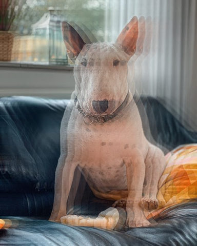
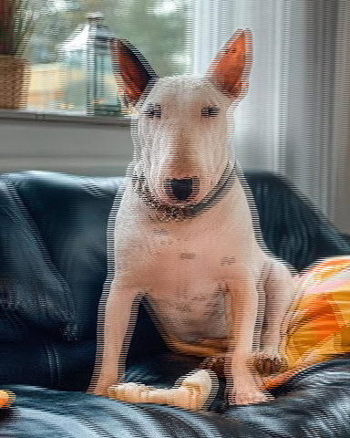
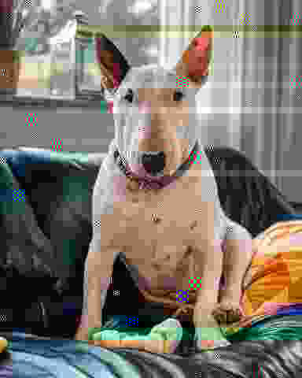
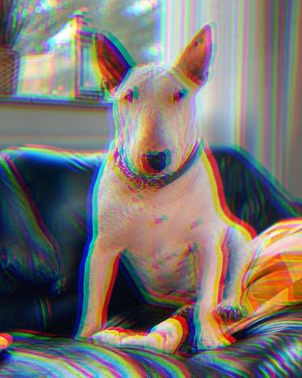
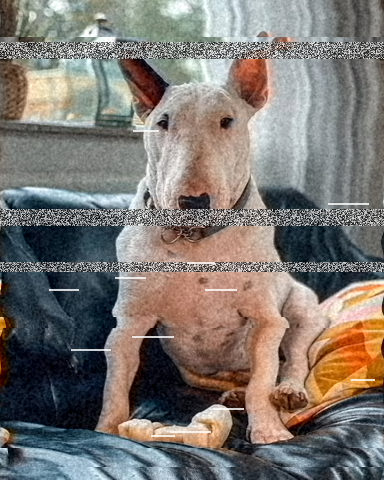

# Glitch

Digital-error looks: displaced slices, colour splits and corrupted blocks.

[All effects](README.md)

| Example | Effect | What it does | Parameters | Recipe |
| --- | --- | --- | --- | --- |
|  | `dead_pixels` | Make `count` cells of `size` px faulty: a share `stuck` of them shows `color`, the rest black. | `count=120` `size=4` `stuck=0.5` `color='#ffffff'` `seed=0` | [dead_pixels.toml](../../examples/effects/dead_pixels.toml) |
|  | `echo` | Lay `copies` translucent copies over the picture, each (`dx`, `dy`) px further from it and weaker by `fade`. | `copies=4` `dx=14.0` `dy=0.0` `fade=0.5` +1 advanced | [echo.toml](../../examples/effects/echo.toml) |
|  | `interlace` | Slide every other row of the picture sideways by `offset` px, leaving the rows between untouched. | `offset=6.0` `field='odd'` +1 advanced | [interlace.toml](../../examples/effects/interlace.toml) |
|  | `jpeg_crush` | Blocky JPEG artefacts, or a corrupted file: compress the picture with a JPEG codec written as maths at `quality`, damage `hits` coefficients, and decode it. | `quality=6` `hits=0` `seed=0` +2 advanced | [jpeg_crush.toml](../../examples/effects/jpeg_crush.toml) |
|  | `ntsc` | Smear the colour of the picture along its rows and let a share of it crawl into brightness, like an NTSC signal. | `sigma=4.0` `crawl=0.3` `phase=0.0` +2 advanced | [ntsc.toml](../../examples/effects/ntsc.toml) |
|  | `rgb_split` | Push red `amount` px along `angle` and the opposite channels `amount` px the other way: an RGB split, a glitch fringe or a red-cyan 3D anaglyph. | `pair='red_blue'` `angle=330.0` `amount=8.0` +1 advanced | [rgb_split.toml](../../examples/effects/rgb_split.toml) |
|  | `vhs` | Make the picture look like a worn videotape or a failing analog signal: tracking bands, dropouts, wobbling rows, bled colour and tape noise (static, snow). | `tracking=0.06` `bands=3` `band_static=0.0` `dropouts=0` `bleed=5.0` `noise=0.03` `wobble=1.5` `seed=0` +5 advanced | [vhs.toml](../../examples/effects/vhs.toml) |

### `dead_pixels`

| Parameter | Type | Unit | Range | Default | Description |
| --- | --- | --- | --- | --- | --- |
| `count` | whole number | count | 0 to 100000 | `120` | How many faulty pixels there are, each a square of `size` px: 0 leaves the picture unchanged. They lie on a grid of `size` px cells, so none overlaps another, and each is a different one. A count larger than the number of cells fills every cell. Raising it adds faulty pixels and never moves one already there. A count, not a density: the pixels' size is in design px, so the same count covers the same share of any picture size. |
| `size` | whole number | px | 1 to 64 | `4` | The width and height in px of one faulty pixel, tuned for a picture about 480 px high: 1 is a single pixel of the picture, larger is a screen with bigger pixels, a block at the edge being cut off by it. |
| `stuck` | number | fraction | 0 to 1 | `0.5` | The share of the faulty pixels that are stuck on `color`; the rest are dead and black. 0 = all dead, 1 = all stuck. The number stuck is `count` x `stuck`, rounded to a whole pixel. |
| `color` | colour |  |  | `'#ffffff'` | The colour a stuck pixel shows whatever the picture is under it: '#rrggbb', '#rgb' or [r, g, b] 0..1. White is the usual fault; a red, green or blue is one stuck sub-pixel. |
| `seed` | whole number | count | 0 to 4294967295 | `0` | Chooses where the faulty pixels are and which of them are stuck; the same seed and count give the same picture, another seed another one. |

### `echo`

| Parameter | Type | Unit | Range | Default | Description |
| --- | --- | --- | --- | --- | --- |
| `copies` | whole number | count | 0 to 32 | `4` | How many copies are laid over the picture, 0 to 32; 0 leaves the picture unchanged. More copies make a longer trail (the time grows with the count). |
| `dx` | number | px | -500 to 500 | `14.0` | How far each copy lies to the right of the one before it, in pixels, -500 to 500 (negative is to the left); copy k is k times this far from the picture. A fraction of a pixel blends the two pixels it lies between. |
| `dy` | number | px | -500 to 500 | `0.0` | How far each copy lies below the one before it, in pixels, -500 to 500 (negative is above); copy k is k times this far from the picture. With dx and dy both 0 the copies lie on the picture and change nothing. |
| `fade` | number | fraction | 0 to 1 | `0.5` | How much weaker each copy is than the one before it, 0 to 1: the original counts 1, copy k counts (1 - fade) to the power k. 0 gives every copy the strength of the original; 0.5 halves each; 1 makes the copies vanish and leaves the picture unchanged. |

Advanced parameters (1)

| Parameter | Type | Unit | Range | Default | Description |
| --- | --- | --- | --- | --- | --- |
| `edge` | one of 'nearest', 'wrap', 'reflect', 'mirror' |  |  | `'nearest'` | What a copy shows where it has moved off the picture's edge: 'nearest' repeats the picture's edge pixels (a smear along the edge), 'wrap' brings back what left on the other side, 'reflect' mirrors the picture (the edge line repeated once), 'mirror' mirrors it about the edge line. |

### `interlace`

| Parameter | Type | Unit | Range | Default | Description |
| --- | --- | --- | --- | --- | --- |
| `offset` | number | px | -500 to 500 | `6.0` | How far the slid field moves sideways, -500 to 500 px, tuned for a picture about 480 px high: positive moves its rows right, negative left, 0 leaves the picture unchanged. A distance between two pixels blends them. Raising it widens the teeth of the comb along every vertical edge. |
| `field` | one of 'odd', 'even' |  |  | `'odd'` | Which field slides: 'odd' the second, fourth, sixth... row (counting from the top as the first), 'even' the first, third, fifth... row. The other field stays where it was. |

Advanced parameters (1)

| Parameter | Type | Unit | Range | Default | Description |
| --- | --- | --- | --- | --- | --- |
| `edge` | one of 'wrap', 'nearest', 'reflect', 'mirror' |  |  | `'nearest'` | What fills the gap the slide opens at the side: 'nearest' holds the row's last pixel there, 'wrap' brings back what left on the other side, 'reflect' mirrors the row (the edge pixel repeated once), 'mirror' mirrors it about the edge pixel. |

### `jpeg_crush`

| Parameter | Type | Unit | Range | Default | Description |
| --- | --- | --- | --- | --- | --- |
| `quality` | whole number | count | 1 to 100 | `6` | The JPEG quality, 1 to 100, on the scale JPEG tools use (the Independent JPEG Group's): 100 keeps almost everything, about 75 is a normal photo, about 6 shows 8 px blocks, ringing round edges and colour bleed, 1 is a few flat blocks. Lowering it coarsens the quantisation of every 8 x 8 block, so each hit is also a larger jump in the picture. |
| `hits` | whole number | count | 0 to 5000 | `0` | How many coefficients are damaged after the compression, 0 to 5000, each at a random place in a random 8 x 8 block of the brightness or one of the two colour planes, as a corrupted file shows. 0 leaves the plain crushed picture, and then `seed`, `dc_share` and `magnitude` do nothing. Raising it spreads more damage over the picture. |
| `seed` | whole number | count | 0 to 4294967295 | `0` | Random seed for where the hits land and how large they are: the same seed always gives the same damage, any other a different one. |

Advanced parameters (2)

| Parameter | Type | Unit | Range | Default | Description |
| --- | --- | --- | --- | --- | --- |
| `dc_share` | number | fraction | 0 to 1 | `0.3` | The share of hits, 0 to 1, that land on a block's DC value (its average) rather than on one of its 63 detail coefficients. A DC hit shifts the block and, as JPEG stores each average as a difference from the block before, every later block of its row: a streak to the right edge. A detail hit only marks its own block with a pattern. |
| `magnitude` | whole number | count | 1 to 100 | `8` | The largest change a hit makes to a coefficient, 1 to 100 quantisation steps: each hit adds or subtracts a whole number of steps between 1 and this. Raising it makes the damage louder. |

Presets (`preset="name"` in a recipe step or `fx`):

| Preset | Description |
| --- | --- |
| `byte_corrupt` | A corrupted JPEG: a moderate-quality picture with 40 damaged coefficients, showing as smeared blocks, colour streaks and stripes. |

### `ntsc`

| Parameter | Type | Unit | Range | Default | Description |
| --- | --- | --- | --- | --- | --- |
| `sigma` | number | px | 0 to 100 | `4.0` | How far the colour smears sideways, as the standard deviation in px of a Gaussian along each row, 0 to 100, tuned for a picture about 480 px high: 0 keeps the colour where it is, raising it bleeds colour further past the edges of what it belongs to. Brightness is not smeared. |
| `crawl` | number | fraction | 0 to 1 | `0.3` | How much of the colour signal leaks into brightness as dot crawl, 0 to 1: a fine diagonal chequer on coloured areas, as strong as the colour is. 0 = none, 1 = the full colour signal; grey areas show none. |
| `phase` | number | cycles | 0 to 1 | `0.0` | Where the chequer of the dot crawl is in its cycle, 0 to 1 (1 is the same as 0): moving it sideways through a full cycle makes the dots crawl; half a cycle swaps light dots and dark dots. |

Advanced parameters (2)

| Parameter | Type | Unit | Range | Default | Description |
| --- | --- | --- | --- | --- | --- |
| `truncate` | number | count | 0.5 to 10 | `4.0` | Where the smear's Gaussian is cut off, in sigmas, 0.5 to 10: the colour spreads over about this many sigmas on either side. Lower is faster and gives a slightly sharper tail. |
| `edge` | one of 'reflect', 'nearest', 'mirror', 'wrap' |  |  | `'reflect'` | What colour is smeared in from beyond the left and right edges: 'reflect' the picture mirrored (edge pixel repeated), 'nearest' its edge pixel repeated, 'mirror' mirrored about the edge pixel, 'wrap' the opposite side. |

### `rgb_split`

| Parameter | Type | Unit | Range | Default | Description |
| --- | --- | --- | --- | --- | --- |
| `pair` | one of 'red_blue', 'red_cyan' |  |  | `'red_blue'` | Which channels part: 'red_blue' moves red one way and blue the other and leaves green in place (colour fringes on a colour picture); 'red_cyan' moves red one way and green and blue together the other, as in 3D glasses (grey the picture first, e.g. with `grade` at saturation 0, for the classic anaglyph). |
| `angle` | number (cyclic) | degrees | 0 to 360 | `330.0` | The direction red moves, in degrees clockwise from pointing right on the screen (as CSS `rotate`), 0 to 360: 0 = right, 90 = down, 180 = left, 270 = up. Blue (and green with 'red_cyan') moves the opposite way. |
| `amount` | number | px | 0 to 500 | `8.0` | How far red and its opposite channels each move from where they were, in pixels, 0 to 500; they end up twice this far apart. 0 leaves the picture unchanged. A fraction of a pixel blends the two pixels it lies between. Raising it pulls the colour fringes further apart. |

Advanced parameters (1)

| Parameter | Type | Unit | Range | Default | Description |
| --- | --- | --- | --- | --- | --- |
| `edge` | one of 'nearest', 'wrap', 'reflect', 'mirror' |  |  | `'nearest'` | What a moved channel shows where it has left the picture's edge: 'nearest' repeats the channel's edge pixels (a coloured smear along the edge), 'wrap' brings back what left on the other side, 'reflect' mirrors the channel (the edge line repeated once), 'mirror' mirrors it about the edge line. |

Presets (`preset="name"` in a recipe step or `fx`):

| Preset | Description |
| --- | --- |
| `anaglyph` | A red-cyan 3D anaglyph: red slid left, green and blue right. Grey the picture first with `grade` saturation 0 for the classic look. |

### `vhs`

| Parameter | Type | Unit | Range | Default | Description |
| --- | --- | --- | --- | --- | --- |
| `tracking` | number | fraction | 0 to 1 | `0.06` | How far a tracking band slides sideways, at most, as a fraction 0 to 1 of the picture's width: each band slides by a random whole number of pixels up to this, left or right. 0 = the bands do not move. |
| `bands` | whole number | count | 0 to 50 | `3` | How many horizontal tracking bands slide, 0 to 50, at random rows; 0 = none. |
| `band_static` | number (drivable) | fraction | 0 to 1 | `0.0` | How much of each tracking band is replaced by grey static (analog snow), 0 to 1: the share of every pixel in a band that becomes a random grey. 0 = none; 1 = bands of pure static. Does nothing when `bands` is 0. |
| `dropouts` | whole number | count | 0 to 2000 | `0` | How many dropout streaks, 0 to 2000: short white marks where the signal was lost, each as tall as a speck of tape noise (`noise_size`) and between half of `tracking` and `tracking` of the picture's width long. 0 = none; raising it covers more of the picture. |
| `bleed` | number | px | 0 to 100 | `5.0` | How far colour bleeds to the right of what it belongs to, 0 to 100 px, tuned for a picture about 480 px high: colour lags the brightness by this many pixels and is blurred sideways by a Gaussian of this standard deviation. 0 = no bleed; raising it smears red and blue far past their edges. |
| `noise` | number | fraction | 0 to 1 | `0.03` | The standard deviation of the tape noise added to brightness, 0 to 1 in picture units: 0 = none, 0.03 is visible, 0.1 is heavy. Colour is not touched. |
| `wobble` | number | px | 0 to 50 | `1.5` | How far the rows wander sideways, as the standard deviation in px of a slow random drift from row to row, 0 to 50, tuned for a picture about 480 px high: 0 = straight rows, a few px = the shaky edges of a worn tape. |
| `seed` | whole number | count | 0 to 4294967295 | `0` | Random seed for the bands, the dropouts, the noise and the wobble: the same seed always gives the same damage, any other a different one. |

Advanced parameters (5)

| Parameter | Type | Unit | Range | Default | Description |
| --- | --- | --- | --- | --- | --- |
| `band_height` | number | fraction | 0 to 1 | `0.04` | The tallest a tracking band can be, as a fraction 0 to 1 of the picture's height; each band is between half this and this tall (never under 1 px). |
| `noise_size` | number | px | 0.5 to 50 | `1.5` | How wide a speck of tape noise is, 0.5 to 50 px (up to 1 px every pixel is its own speck), tuned for a picture about 480 px high. Raising it gives coarser grain. |
| `wobble_size` | number | px | 0.5 to 500 | `12.0` | How many rows one wander of the wobble spans, 0.5 to 500 px, tuned for a picture about 480 px high: small is a jitter from row to row, large a slow sway. |
| `truncate` | number | count | 0.5 to 10 | `4.0` | Where the blurs of the bleed, the noise and the wobble are cut off, in sigmas, 0.5 to 10. Lower is faster and gives slightly sharper tails. |
| `edge` | one of 'wrap', 'nearest', 'reflect', 'mirror' |  |  | `'wrap'` | What lies beyond the picture's left and right edges for everything that moves or blurs sideways: 'wrap' the opposite side, 'nearest' the edge pixel repeated, 'reflect' the picture mirrored (edge pixel repeated once), 'mirror' mirrored about the edge pixel. For the noise and wobble the rules act on the rows and columns of their own fields. |

Presets (`preset="name"` in a recipe step or `fx`):

| Preset | Description |
| --- | --- |
| `signal_noise` | A bad analog signal: a clean picture crossed by solid bands of static (snow) and short white tape dropouts. |
