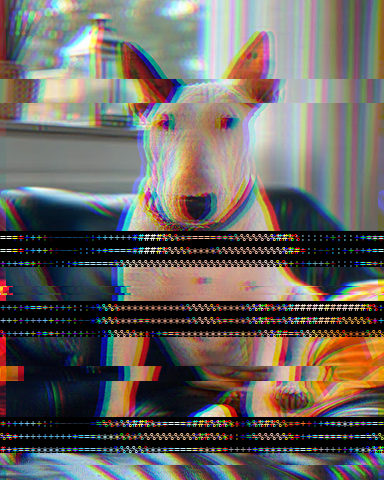
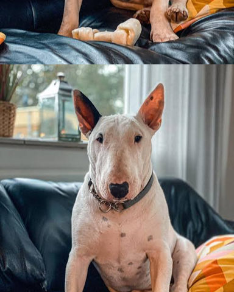

# Glitch

Digital-error looks: displaced slices, colour splits and corrupted blocks.

[All effects](README.md)

| Example | Effect | What it does | Parameters | Recipe |
| --- | --- | --- | --- | --- |
|  | `echo` | Lay `copies` translucent copies over the picture, each (`dx`, `dy`) px further from it and weaker by `fade`. | `copies=4` `dx=14.0` `dy=0.0` `fade=0.5` `edge='nearest'` | [echo.toml](../../examples/effects/echo.toml) |
|  | `glitch` | `bands` random horizontal strips slide sideways by up to `shift` of the width, then red and blue are pushed `split` px apart. | `split=10` `bands=7` `shift=0.06` `ascii_share=0.0` `ascii_cell=9` `ascii_photo=0.0` `seed=0` `band_min_height=0.01` `band_max_height=0.06` `ascii_rows=3` `ascii_gamma=0.55` `ascii_chars=' .:-=+*#%@'` `ascii_ink=None` `ascii_ink_floor=0.35` `ascii_paper='#000000'` `ascii_paper_threshold=0.5` `ascii_font=None` | [glitch.toml](../../examples/effects/glitch.toml) |
|  | `rgb_split` | Push the red and blue channels `amount` px apart along `angle`, leaving green where it is. | `angle=30.0` `amount=8.0` `edge='nearest'` | [rgb_split.toml](../../examples/effects/rgb_split.toml) |
|  | `scan_roll` | Roll the picture by `offset` of its height (`axis` 'vertical') or width ('horizontal'), as a slipped sync does. | `axis='vertical'` `offset=0.2` `edge='wrap'` | [scan_roll.toml](../../examples/effects/scan_roll.toml) |

### `echo`

| Parameter | Type | Unit | Range | Default | Description |
| --- | --- | --- | --- | --- | --- |
| `copies` | whole number | count | 0 to 32 | `4` | How many copies are laid over the picture, 0 to 32; 0 leaves the picture unchanged. More copies make a longer trail (the time grows with the count). |
| `dx` | number | px | -500 to 500 | `14.0` | How far each copy lies to the right of the one before it, in pixels, -500 to 500 (negative is to the left); copy k is k times this far from the picture. A fraction of a pixel blends the two pixels it lies between. |
| `dy` | number | px | -500 to 500 | `0.0` | How far each copy lies below the one before it, in pixels, -500 to 500 (negative is above); copy k is k times this far from the picture. With dx and dy both 0 the copies lie on the picture and change nothing. |
| `fade` | number | fraction | 0 to 1 | `0.5` | How much weaker each copy is than the one before it, 0 to 1: the original counts 1, copy k counts (1 - fade) to the power k. 0 gives every copy the strength of the original; 0.5 halves each; 1 makes the copies vanish and leaves the picture unchanged. |
| `edge` | one of 'nearest', 'wrap', 'reflect', 'mirror' |  |  | `'nearest'` | What a copy shows where it has moved off the picture's edge: 'nearest' repeats the picture's edge pixels (a smear along the edge), 'wrap' brings back what left on the other side, 'reflect' mirrors the picture (the edge line repeated once), 'mirror' mirrors it about the edge line. |

### `glitch`

| Parameter | Type | Unit | Range | Default | Description |
| --- | --- | --- | --- | --- | --- |
| `split` | whole number | px | -500 to 500 | `10` | How far red is pushed right and blue left, -500 to 500 px (negative swaps the directions); 0 = no colour split. The picture wraps around at the edges. |
| `bands` | whole number | count | 0 to 500 | `7` | How many random horizontal strips slide sideways, 0 to 500; 0 = none. |
| `shift` | number | fraction | 0 to 1 | `0.06` | The furthest a strip slides, as a fraction 0 to 1 of the picture's width; each strip slides a random distance up to this, left or right, wrapping around. |
| `ascii_share` | number | fraction | 0 to 1 | `0.0` | The fraction 0 to 1 of the strips that also dissolve into text (rounded up to whole strips); 0 = no text. |
| `ascii_cell` | whole number | px | 1 to 200 | `9` | Width of one character of the text strips, 1 to 200 px. Larger = bigger, fewer characters. |
| `ascii_photo` | number | fraction | 0 to 1 | `0.0` | How much of the strip shows through behind its characters, 0 to 1: 0 = text on flat `ascii_paper`, 1 = text laid over the strip, keeping all its detail. |
| `seed` | whole number | count | 0 to 4294967295 | `0` | Random seed: the same seed always gives the same damage; any other gives different strips. |
| `band_min_height` | number | fraction | 0 to 1 | `0.01` | The lowest a strip can be, as a fraction 0 to 1 of the picture's height (never below 1 px). Each strip's height is drawn at random between this and `band_max_height`, which it may not exceed. |
| `band_max_height` | number | fraction | 0 to 1 | `0.06` | The tallest a strip can be, as a fraction 0 to 1 of the picture's height. Raising it gives taller strips. |
| `ascii_rows` | whole number | count | 1 to 100 | `3` | The fewest rows of characters a text strip holds, 1 to 100: a thinner strip is widened (each row counted as twice `ascii_cell` tall) so its text stays legible, up to the whole picture. |
| `ascii_gamma` | number | ratio | 0.1 to 10 | `0.55` | Exponent on the amount of ink each character puts down, 0.1 to 10: below 1 (the default) more ink, so the text carries enough light to read against dark paper; above 1 less. |
| `ascii_chars` | text |  |  | `' .:-=+*#%@'` | The character palette of the text strips, in any order, at least two different characters; sorted by how much ink each glyph puts down, so the densest is used for the brightest areas on dark paper and the darkest on light paper (see `ascii_paper`). |
| `ascii_ink` | colour or none |  |  | `None` | The ink colour of the text strips ('#rrggbb', '#rgb' or [r, g, b] 0..1); none (the default) colours each character from the average colour of the strip under it, brightened as in the ascii effect (strongest channel scaled to full, by at most 1 / `ascii_ink_floor`). |
| `ascii_ink_floor` | number | fraction | 0.01 to 1 | `0.35` | With no `ascii_ink`: the most a character's colour is brightened, as a floor 0.01 to 1 on its strongest channel: a colour whose strongest channel is below it is scaled by 1 / ascii_ink_floor instead of up to full, so dark strips stay dark. Lowering it brightens dark colours more; 1 = colours as they are. |
| `ascii_paper` | colour |  |  | `'#000000'` | The paper colour behind the text strips' characters. Dark paper (Rec. 709 luminance below `ascii_paper_threshold`) puts dense characters on bright areas; lighter paper puts them on dark areas. |
| `ascii_paper_threshold` | number | fraction | 0 to 1 | `0.5` | The Rec. 709 luminance, 0 to 1, below which `ascii_paper` counts as dark (dense characters on bright areas) rather than light (dense characters on dark areas); 0.5 = mid grey. Raising it lets lighter paper count as dark: 0 treats every paper as light, 1 every paper but white as dark. |
| `ascii_font` | text or none |  |  | `None` | Path to a monospaced .ttf/.ttc font for the text strips; none (the default) uses the first system monospaced font found. |

### `rgb_split`

| Parameter | Type | Unit | Range | Default | Description |
| --- | --- | --- | --- | --- | --- |
| `angle` | number | degrees | 0 to 360 | `30.0` | The direction red moves, in degrees counter-clockwise from pointing right (as on a protractor), 0 to 360: 0 = right, 90 = up, 180 = left, 270 = down. Blue moves the opposite way. |
| `amount` | number | px | 0 to 500 | `8.0` | How far red and blue each move from where they were, in pixels, 0 to 500; they end up twice this far apart. 0 leaves the picture unchanged. A fraction of a pixel blends the two pixels it lies between. Raising it pulls the colour fringes further apart. |
| `edge` | one of 'nearest', 'wrap', 'reflect', 'mirror' |  |  | `'nearest'` | What a moved channel shows where it has left the picture's edge: 'nearest' repeats the channel's edge pixels (a coloured smear along the edge), 'wrap' brings back what left on the other side, 'reflect' mirrors the channel (the edge line repeated once), 'mirror' mirrors it about the edge line. |

### `scan_roll`

| Parameter | Type | Unit | Range | Default | Description |
| --- | --- | --- | --- | --- | --- |
| `axis` | one of 'vertical', 'horizontal' |  |  | `'vertical'` | The direction of the roll: 'vertical' slides the picture up or down, as a television whose vertical hold slipped; 'horizontal' slides it left or right, as a horizontal hold would. |
| `offset` | number | fraction | -1 to 1 | `0.2` | How far the picture rolls, as a fraction of its height ('vertical') or width ('horizontal'), -1 to 1: positive moves it down or to the right, negative up or to the left, 0 leaves it where it is. A whole picture (1 or -1) with 'wrap' brings it back to where it was. A distance that ends between two pixels blends the two (linear interpolation along the roll). |
| `edge` | one of 'wrap', 'nearest', 'reflect', 'mirror' |  |  | `'wrap'` | What fills the gap the roll opens: 'wrap' brings back what left on the other side, a true roll; 'nearest' holds the picture's first or last line there (a smear); 'reflect' mirrors the picture (the edge line repeated once); 'mirror' mirrors it about the edge line. |
