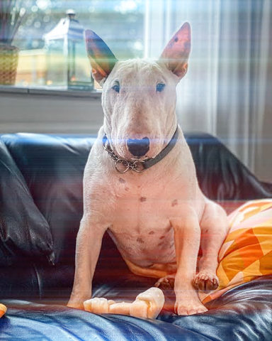
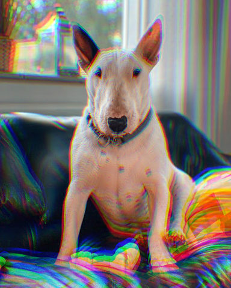
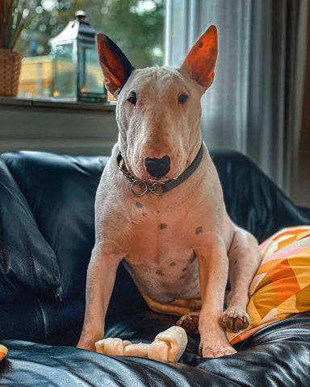
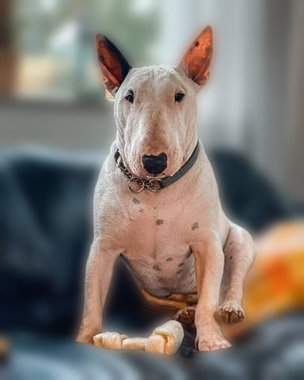
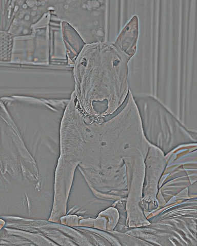
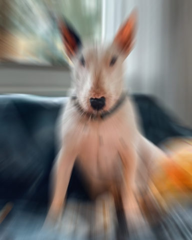
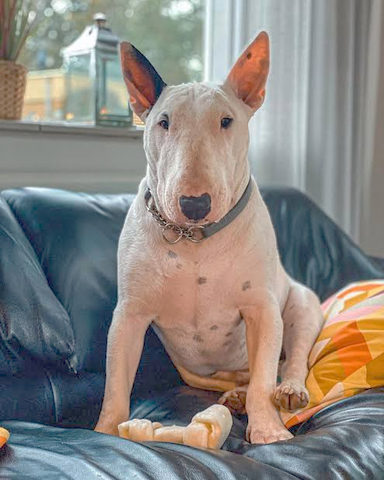
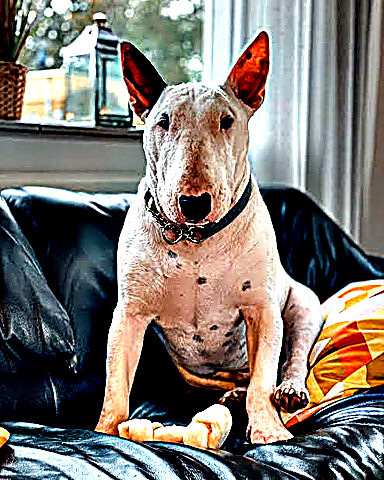
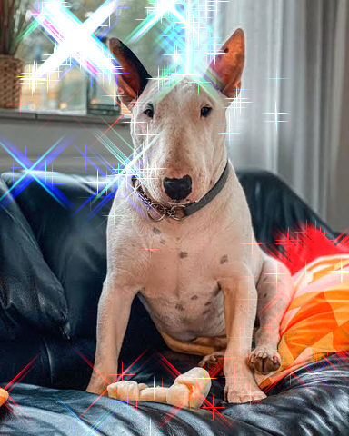
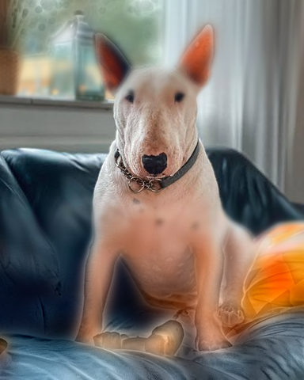

# Light

Glow, bloom and local contrast: they add or shape the light in the picture.

[All effects](README.md)

| Example | Effect | What it does | Parameters | Recipe |
| --- | --- | --- | --- | --- |
|  | `anamorphic_streaks` | Horizontal streaks of light: what is brighter than `threshold` is smeared along its row, tinted `color` and screened over the picture by `amount`. | `length=0.25` `threshold=0.8` `amount=3.0` `color='#8fb8ff'` | [anamorphic_streaks.toml](../../examples/effects/anamorphic_streaks.toml) |
|  | `bloom` | Light bleeding from what is brighter than `threshold`, blurred at `octaves` scales and screened over the picture. | `radius=32.0` `threshold=0.6` `amount=0.7` `octaves=4` `persistence=0.5` `truncate=4.0` `edge='reflect'` | [bloom.toml](../../examples/effects/bloom.toml) |
|  | `chromatic_aberration` | Shift red outward and blue inward from the centre `x`, `y` by up to `amount` px, leaving green alone. | `amount=4.0` `x=0.5` `y=0.5` `interpolation='bilinear'` `edge='reflect'` | [chromatic_aberration.toml](../../examples/effects/chromatic_aberration.toml) |
|  | `clarity` | Local contrast: exaggerate how each area differs from its surroundings, so features stand out even when the whole face sits in a narrow band of brightness. | `radius=30.0` `amount=1.0` `truncate=4.0` `edge='reflect'` `constant_value=0.0` | [clarity.toml](../../examples/effects/clarity.toml) |
|  | `dehaze` | Remove haze and fog by inverting the atmospheric scattering model I = J t + A (1 - t) (He, Sun, Tang 2009). | `amount=0.9` `patch=15` `radius=30.0` `edge_threshold=0.03` `transmission_floor=0.1` `airlight_fraction=0.001` | [dehaze.toml](../../examples/effects/dehaze.toml) |
|  | `gaussian_blur` | Soften the picture with a Gaussian blur of standard deviation `radius` px. | `radius=4.0` `truncate=4.0` `edge='reflect'` `constant_value=0.0` | [gaussian_blur.toml](../../examples/effects/gaussian_blur.toml) |
|  | `glow` | Soft bloom around the bright parts: what is brighter than `threshold` is blurred by `radius` px and screened over the picture by `amount`. | `radius=24.0` `amount=0.6` `threshold=0.55` `truncate=4.0` `edge='reflect'` `constant_value=0.0` | [glow.toml](../../examples/effects/glow.toml) |
|  | `halation` | A coloured glow around the highlights: where the brightest channel is above `threshold` it is blurred by `radius` px, tinted `color` and screened over the picture by `amount`. | `radius=20.0` `threshold=0.7` `amount=0.7` `color='#ff4a14'` `truncate=4.0` `edge='reflect'` | [halation.toml](../../examples/effects/halation.toml) |
|  | `highpass` | Keep only the detail finer than `radius` px: the picture minus its Gaussian blur, centred on mid-grey. | `radius=4.0` `truncate=4.0` `edge='reflect'` | [highpass.toml](../../examples/effects/highpass.toml) |
|  | `lens_blur` | Blur the picture over a disc of `radius` px, as an out-of-focus lens does, favouring bright pixels. | `radius=8.0` `highlights=0.0` `edge='reflect'` | [lens_blur.toml](../../examples/effects/lens_blur.toml) |
|  | `lens_flare` | A lens flare: a halo and a ring round the light at (`x`, `y`) and `ghosts` discs along the line through the picture's centre, tinted `color` and screened over the picture by `amount`. | `x=0.75` `y=0.25` `ghosts=5` `spacing=0.45` `size=0.05` `halo=0.2` `ring=0.12` `ring_width=0.02` `amount=0.8` `color='#ffe2b8'` | [lens_flare.toml](../../examples/effects/lens_flare.toml) |
|  | `light_leak` | Warm washes of light coming in from the side `angle` points to: `blobs` seeded patches, tinted `color` and screened over the picture by `amount`. | `color='#ff8a3d'` `amount=0.8` `size=0.25` `angle=0.0` `blobs=3` `seed=0` | [light_leak.toml](../../examples/effects/light_leak.toml) |
|  | `light_rays` | God rays: what is brighter than `threshold` is streaked away from (`x`, `y`) and screened over the picture by `amount`. | `x=0.5` `y=0.3` `length=0.5` `threshold=0.7` `amount=2.5` `samples=16` `decay=0.95` `interpolation='bilinear'` `edge='reflect'` | [light_rays.toml](../../examples/effects/light_rays.toml) |
|  | `motion_blur` | Smear the picture along a straight line of `length` px at `angle` degrees, as a moving camera would. | `angle=0.0` `length=24.0` `edge='reflect'` | [motion_blur.toml](../../examples/effects/motion_blur.toml) |
|  | `radial_blur` | Smear the picture around a centre (`mode` 'spin') or away from it ('zoom'), by `amount`. | `mode='zoom'` `amount=0.1` `x=0.5` `y=0.5` `samples=8` `interpolation='bilinear'` `edge='reflect'` | [radial_blur.toml](../../examples/effects/radial_blur.toml) |
|  | `shadows_highlights` | Lighten the dark areas and darken the bright ones of the picture, as judged by an edge-aware local brightness. | `shadows=0.5` `highlights=0.0` `radius=30.0` `edge_threshold=0.1` | [shadows_highlights.toml](../../examples/effects/shadows_highlights.toml) |
|  | `sharpen` | Sharpen with an unsharp mask: add `amount` times the detail that a `radius` px Gaussian blur removes. | `radius=2.0` `amount=0.8` `threshold=0.0` `truncate=4.0` `edge='reflect'` | [sharpen.toml](../../examples/effects/sharpen.toml) |
|  | `soft_focus` | A dreamy glow over the whole picture: a copy blurred by `radius` px is screened over the sharp one. | `radius=12.0` `opacity=0.5` `truncate=4.0` `edge='reflect'` | [soft_focus.toml](../../examples/effects/soft_focus.toml) |
|  | `starburst` | Diffraction spikes: what is brighter than `threshold` gets `rays` thin lines of light, tinted `color` and screened over the picture by `amount`. | `rays=4` `length=0.1` `threshold=0.95` `amount=0.8` `angle=0.0` `color='#ffffff'` | [starburst.toml](../../examples/effects/starburst.toml) |
|  | `tilt_shift` | A miniature look: the band `width` wide at `focus` stays sharp, and away from it the picture is blurred up to `radius` and its colour raised by `saturation`. | `focus=0.5` `width=0.2` `feather=0.25` `angle=0.0` `radius=10.0` `saturation=0.3` `levels=4` `truncate=4.0` `edge='reflect'` | [tilt_shift.toml](../../examples/effects/tilt_shift.toml) |
|  | `tone_map` | Compress the broad brightness differences of the picture and keep (or boost) its fine detail. | `contrast=0.5` `amount=0.5` `radius=30.0` `edge_threshold=0.5` | [tone_map.toml](../../examples/effects/tone_map.toml) |
|  | `vignette` | Fade the picture toward `color` from `radius` out to its corners, the centre untouched. | `amount=0.5` `radius=0.5` `feather=0.5` `roundness=1.0` `color='#000000'` | [vignette.toml](../../examples/effects/vignette.toml) |

### `anamorphic_streaks`

| Parameter | Type | Unit | Range | Default | Description |
| --- | --- | --- | --- | --- | --- |
| `length` | number | fraction | 0.001 to 1 | `0.25` | How far the streaks reach sideways, as a fraction of the picture's width: the distance over which a streak fades to 37% of its brightness (the faint tail runs on, to the picture's edge). Raising it makes longer, fainter streaks. |
| `threshold` | number | fraction | 0 to 0.99 | `0.8` | The brightness (0..1, per channel) where a streak starts: only values above it light the streaks, rising to full at 1. Raising it limits the streaks to the brightest highlights. |
| `amount` | number | ratio | 0 to 10 | `3.0` | How strongly the streaks are screened over the picture: 0 = off; the streak is spread thin along its length, so a long one needs a high amount (above 1 it saturates to white sooner). |
| `color` | colour |  |  | `'#8fb8ff'` | The tint of the streaks: '#rrggbb', '#rgb' or [r, g, b] 0..1. The default is the cool blue of coated anamorphic lenses; white keeps the colour of the light that makes them. |

### `bloom`

| Parameter | Type | Unit | Range | Default | Description |
| --- | --- | --- | --- | --- | --- |
| `radius` | number | px | 0 to 500 | `32.0` | Gaussian sigma of the widest halo in px at the recipe's size: larger spreads the light further; 0 keeps the light on the highlights themselves. Each further octave is half as wide. |
| `threshold` | number | fraction | 0 to 0.99 | `0.6` | The brightness (0..1, per channel) where the bloom starts: only values above it give light, rising to full at 1. Raising it limits the bloom to the brightest highlights. |
| `amount` | number | ratio | 0 to 10 | `0.7` | How strongly the halo is screened over the picture: 0 = off, 1 = the halo at full brightness; above 1 it saturates to white sooner. |
| `octaves` | whole number | count | 1 to 8 | `4` | How many scales the halo is built from: octave 1 has the sigma `radius`, each next one half of the one before (radius / 2, radius / 4...). 1 = a single Gaussian, as in glow; more adds a tighter, brighter core around the highlights. |
| `persistence` | number | ratio | 0 to 1 | `0.5` | How much weight each octave gets relative to the wider one before it (the weights are persistence^0, persistence^1... scaled to add up to 1): 0 = the widest octave alone, 1 = every octave equally. Lower values give a softer, more diffuse bloom; higher values a tighter, more concentrated one. |
| `truncate` | number | ratio | 1 to 10 | `4.0` | Where each octave's Gaussian is cut off, in sigmas: it reaches truncate x its sigma px. Larger is more exact and slower. |
| `edge` | one of 'reflect', 'nearest', 'mirror', 'wrap' |  |  | `'reflect'` | What the halo's blur sees beyond the picture's edge: 'reflect' (mirrored, edge pixel repeated), 'mirror' (mirrored about the edge pixel), 'nearest' (the edge pixel repeated) or 'wrap' (the opposite edge). |

### `chromatic_aberration`

| Parameter | Type | Unit | Range | Default | Description |
| --- | --- | --- | --- | --- | --- |
| `amount` | number | px | 0 to 100 | `4.0` | How far red and blue are pulled apart, in pixels at the farthest corner of the picture: there the red is shifted this far outward from the centre and the blue this far inward, while green stays where it is. The shift grows in proportion to the distance from the centre, so it is half as much halfway out and nothing at the centre. A larger amount is wider fringes; 0 leaves the picture unchanged. A shift larger than the distance to the farthest corner is limited to it. |
| `x` | number | fraction | 0 to 1 | `0.5` | The centre's horizontal position as a fraction of the way across the picture: 0 = the first pixel column, 0.5 = the middle, 1 = the last. |
| `y` | number | fraction | 0 to 1 | `0.5` | The centre's vertical position as a fraction of the way down the picture: 0 = the first pixel row, 0.5 = the middle, 1 = the last. |
| `interpolation` | one of 'nearest', 'bilinear', 'bicubic' |  |  | `'bilinear'` | How a point between pixels is read from a colour channel: 'nearest' takes the closest pixel (fastest, but the fringes step), 'bilinear' blends the four pixels around it (smooth, slightly soft), 'bicubic' fits a cubic spline through the neighbouring pixels (sharpest, a little slower, and may ring beside hard edges). |
| `edge` | one of 'reflect', 'nearest', 'mirror', 'wrap' |  |  | `'reflect'` | What the blue sees beyond the picture's edge (it reads from farther out than it shows): 'reflect' (mirrored, edge pixel repeated), 'mirror' (mirrored about the edge pixel), 'nearest' (the edge pixel repeated), 'wrap' (the opposite edge). |

### `clarity`

| Parameter | Type | Unit | Range | Default | Description |
| --- | --- | --- | --- | --- | --- |
| `radius` | number | px | 0 to 500 | `30.0` | Size of each area's 'surroundings': the Gaussian sigma of the blur, in px at the recipe's size. Larger compares bigger regions; 0 turns the effect off. |
| `amount` | number | ratio | 0 to 5 | `1.0` | How strongly each area's difference from its surroundings is exaggerated: 0 = off, 1 = doubled. |
| `truncate` | number | ratio | 1 to 10 | `4.0` | Where the Gaussian is cut off, in sigmas: the blur reaches truncate x radius px. Larger is more exact and slower. |
| `edge` | one of 'reflect', 'constant', 'nearest', 'mirror', 'wrap' |  |  | `'reflect'` | What the blur sees beyond the picture's edge: 'reflect' (mirrored, edge pixel repeated), 'mirror' (mirrored about the edge pixel), 'nearest' (the edge pixel repeated), 'wrap' (the opposite edge), 'constant' (constant_value). |
| `constant_value` | number | fraction | 0 to 1 | `0.0` | The brightness (0..1) assumed beyond the edge when edge is 'constant'; ignored otherwise. |

### `dehaze`

| Parameter | Type | Unit | Range | Default | Description |
| --- | --- | --- | --- | --- | --- |
| `amount` | number | fraction | 0 to 1 | `0.9` | How much of the haze is taken out (He, Sun and Tang's omega): 0 = off, 1 = all of it that the dark channel finds, which also flattens real distance cues; a little below 1 keeps the picture natural. |
| `patch` | whole number | px | 1 to 201 | `15` | Side of the square patch in which the darkest value is taken to find the haze, in px at the recipe's size (an even size is centred half a pixel off). Larger patches estimate the haze more reliably but blur it over bigger areas and miss thin haze; 1 judges every pixel by its own darkest channel. |
| `radius` | number | px | 0 to 500 | `30.0` | Radius of the guided filter that refines the haze estimate to follow the picture's edges, in px at the recipe's size (rounded to whole px). Larger gives a smoother haze with fewer halos far from edges; 0 keeps the blocky patch estimate. |
| `edge_threshold` | number | fraction | 0.001 to 1 | `0.03` | The brightness step (0..1, Rec. 709 luma) that counts as an edge the refined haze estimate must not blur across: steps above it keep the haze of their own side, steps below it are smoothed. Raising it gives a smoother estimate and halos around edges; lowering it follows ever smaller edges. |
| `transmission_floor` | number | fraction | 0.01 to 1 | `0.1` | The lowest transmission (He, Sun and Tang's t0), the share of a pixel's light that reaches the camera: colours are stretched by at most 1 / transmission_floor, so a low floor clears thick haze but amplifies noise and clips; 1 allows no stretch at all. |
| `airlight_fraction` | number | fraction | 0.0001 to 0.1 | `0.001` | The share of the picture's pixels, those with the highest dark channel (the haziest), among which the brightest one is taken as the colour of the haze (He, Sun and Tang use 0.1 percent = 0.001; at least one pixel is always used). Raising it makes the estimate less sensitive to a single odd pixel but can pick a bright object instead of the sky. |

### `gaussian_blur`

| Parameter | Type | Unit | Range | Default | Description |
| --- | --- | --- | --- | --- | --- |
| `radius` | number | px | 0 to 500 | `4.0` | The Gaussian's standard deviation (sigma) in px at the recipe's size: larger is softer and spreads detail further; 0 leaves the picture unchanged. |
| `truncate` | number | ratio | 1 to 10 | `4.0` | Where the Gaussian is cut off, in sigmas: the blur reaches truncate x radius px. Larger is more exact and slower; below 3 the blur turns visibly boxy. |
| `edge` | one of 'reflect', 'constant', 'nearest', 'mirror', 'wrap' |  |  | `'reflect'` | What the blur sees beyond the picture's edge: 'reflect' (mirrored, edge pixel repeated), 'mirror' (mirrored about the edge pixel), 'nearest' (the edge pixel repeated), 'wrap' (the opposite edge), 'constant' (constant_value, so the edge fades toward it). |
| `constant_value` | number | fraction | 0 to 1 | `0.0` | The brightness (0..1, every channel) assumed beyond the edge when edge is 'constant': 0 darkens the edge, 1 lightens it; ignored otherwise. |

### `glow`

| Parameter | Type | Unit | Range | Default | Description |
| --- | --- | --- | --- | --- | --- |
| `radius` | number | px | 0 to 500 | `24.0` | Gaussian sigma of the halo in px at the recipe's size: larger spreads the light further and softer; 0 keeps the light on the bright parts themselves. |
| `amount` | number | ratio | 0 to 10 | `0.6` | How strongly the halo is screened over the picture: 0 = off, 1 = the halo at full brightness; above 1 it saturates to white sooner. |
| `threshold` | number | fraction | 0 to 0.99 | `0.55` | The brightness (0..1, per channel) where the glow starts: only values above it light the halo, rising to full at 1. Raising it limits the glow to the brightest highlights. |
| `truncate` | number | ratio | 1 to 10 | `4.0` | Where the halo's Gaussian is cut off, in sigmas: the halo reaches truncate x radius px. Larger is more exact and slower. |
| `edge` | one of 'reflect', 'constant', 'nearest', 'mirror', 'wrap' |  |  | `'reflect'` | What the halo's blur sees beyond the picture's edge: 'reflect' (mirrored, edge pixel repeated), 'mirror' (mirrored about the edge pixel), 'nearest' (the edge pixel repeated), 'wrap' (the opposite edge), 'constant' (constant_value, so the glow fades toward the edge when it is 0). |
| `constant_value` | number | fraction | 0 to 1 | `0.0` | The highlight (0..1) assumed beyond the edge when edge is 'constant'; ignored otherwise. |

### `halation`

| Parameter | Type | Unit | Range | Default | Description |
| --- | --- | --- | --- | --- | --- |
| `radius` | number | px | 0 to 500 | `20.0` | Gaussian sigma of the glow in px at the recipe's size: larger spreads the glow further from the highlights; 0 keeps it on the highlights themselves. |
| `threshold` | number | fraction | 0 to 0.99 | `0.7` | The brightness (0..1) where the glow starts, judged on the brightest of a pixel's three channels: only values above it glow, rising to full at 1. Raising it limits the halation to the brightest highlights. |
| `amount` | number | ratio | 0 to 10 | `0.7` | How strongly the tinted glow is screened over the picture: 0 = off, 1 = the glow at full brightness; above 1 it saturates sooner. |
| `color` | colour |  |  | `'#ff4a14'` | The colour of the glow: '#rrggbb', '#rgb' or [r, g, b] 0..1. The default is the red-orange of film's red-sensitive layer; white makes a neutral glow. |
| `truncate` | number | ratio | 1 to 10 | `4.0` | Where the glow's Gaussian is cut off, in sigmas: it reaches truncate x radius px. Larger is more exact and slower. |
| `edge` | one of 'reflect', 'nearest', 'mirror', 'wrap' |  |  | `'reflect'` | What the glow's blur sees beyond the picture's edge: 'reflect' (mirrored, edge pixel repeated), 'mirror' (mirrored about the edge pixel), 'nearest' (the edge pixel repeated) or 'wrap' (the opposite edge). |

### `highpass`

| Parameter | Type | Unit | Range | Default | Description |
| --- | --- | --- | --- | --- | --- |
| `radius` | number | px | 0 to 100 | `4.0` | Gaussian sigma of the blurred copy in px at the recipe's size: detail finer than this is kept, coarser tones are removed. Small radii keep only the finest texture, large ones keep edges and local contrast; 0 keeps nothing but mid-grey. |
| `truncate` | number | ratio | 1 to 10 | `4.0` | Where the blur's Gaussian is cut off, in sigmas: the blur reaches truncate x radius px. Larger is more exact and slower. |
| `edge` | one of 'reflect', 'nearest', 'mirror', 'wrap' |  |  | `'reflect'` | What the blur sees beyond the picture's edge: 'reflect' (mirrored, edge pixel repeated), 'mirror' (mirrored about the edge pixel), 'nearest' (the edge pixel repeated), 'wrap' (the opposite edge). |

### `lens_blur`

| Parameter | Type | Unit | Range | Default | Description |
| --- | --- | --- | --- | --- | --- |
| `radius` | number | px | 0 to 100 | `8.0` | The radius of the disc in px at the recipe's size: larger is further out of focus and spreads each point into a bigger circle; 0 leaves the picture unchanged. |
| `highlights` | number | ratio | 0 to 50 | `0.0` | How much brighter pixels count in the average: a pixel of brightness b (0..1) counts 1 + highlights x b times as much as a black one, so with 0 every pixel counts the same (a plain average), and raising it turns bright lights into distinct, luminous discs (bokeh) while dark areas hardly bleed into them. |
| `edge` | one of 'reflect', 'nearest', 'mirror', 'wrap' |  |  | `'reflect'` | What the blur sees beyond the picture's edge: 'reflect' (mirrored, edge pixel repeated), 'mirror' (mirrored about the edge pixel), 'nearest' (the edge pixel repeated), 'wrap' (the opposite edge). |

### `lens_flare`

| Parameter | Type | Unit | Range | Default | Description |
| --- | --- | --- | --- | --- | --- |
| `x` | number | fraction | 0 to 1 | `0.75` | The light's horizontal position as a fraction of the way across the picture: 0 = the first pixel column, 0.5 = the middle, 1 = the last. |
| `y` | number | fraction | 0 to 1 | `0.25` | The light's vertical position as a fraction of the way down the picture: 0 = the first pixel row, 0.5 = the middle, 1 = the last. |
| `ghosts` | whole number | count | 0 to 12 | `5` | How many ghosts (soft discs, the lens's reflections of the light) lie along the line from the light through the picture's centre; each is dimmer than the one before, the last 1/ghosts as bright as the first. 0 = none. |
| `spacing` | number | ratio | 0 to 3 | `0.45` | Where the ghosts lie on that line, as multiples of the distance from the light to the picture's centre: ghost number i sits i x spacing of the way from the light toward the centre. 1 puts the first on the centre, 2 mirrors the light through it, more goes beyond; 0 piles them on the light. A light at the centre gives them no line, so they sit on it. |
| `size` | number | fraction | 0.002 to 0.5 | `0.05` | The radius of each ghost as a fraction of the picture's diagonal: the disc is brightest at its middle and falls smoothly to nothing at this distance. Raising it makes bigger, softer ghosts. |
| `halo` | number | fraction | 0 to 1 | `0.2` | The radius of the soft glow round the light, as a fraction of the picture's diagonal: brightest at the light and falling smoothly to nothing at this distance. 0 = no halo. |
| `ring` | number | fraction | 0 to 1 | `0.12` | The radius of the thin ring round the light, as a fraction of the picture's diagonal: the distance from the light at which the ring is brightest. 0 = no ring. |
| `ring_width` | number | fraction | 0.002 to 0.5 | `0.02` | How far each side of its radius the ring reaches, as a fraction of the picture's diagonal: it falls smoothly from full brightness on the radius to nothing this far off. Raising it makes a wider, softer ring. |
| `amount` | number | ratio | 0 to 10 | `0.8` | How strongly the flare is screened over the picture: 0 = off, 1 = the light at full brightness where it is brightest (the light itself and the first ghost); above 1 it saturates to white sooner. |
| `color` | colour |  |  | `'#ffe2b8'` | The tint of the flare: '#rrggbb', '#rgb' or [r, g, b] 0..1. The default is a warm white; white keeps the flare colourless. |

### `light_leak`

| Parameter | Type | Unit | Range | Default | Description |
| --- | --- | --- | --- | --- | --- |
| `color` | colour |  |  | `'#ff8a3d'` | The tint of the light: '#rrggbb', '#rgb' or [r, g, b] 0..1. The default is the orange of a leaking film back; red or yellow give other leaks. |
| `amount` | number | ratio | 0 to 2 | `0.8` | How strongly the light is screened over the picture: 0 = off, 1 = the brightest patch at full brightness in `color`; above 1 it saturates to white sooner. |
| `size` | number | fraction | 0.01 to 1 | `0.25` | How big the patches are and how deep they reach into the picture, as a fraction of its diagonal: each patch is a soft bump whose width is between half of this and all of it, centred between the edge and this far in. Raising it floods more of the picture. |
| `angle` | number | degrees | 0 to 360 | `0.0` | The side the light comes in from, as the direction from the picture's centre, counterclockwise as seen on it: 0 = the right edge, 90 = the top, 180 = the left, 270 = the bottom; in between, the corner. |
| `blobs` | whole number | count | 1 to 16 | `3` | How many patches of light there are, at random places along that side (each brighter or fainter and stretched along the edge by chance). Overlapping patches merge into one wash; raising it gives a more even, wider leak. |
| `seed` | whole number | count | 0 to 4294967295 | `0` | Random seed: the same seed always gives the same leak (the same patches in the same places), another seed a different one. |

### `light_rays`

| Parameter | Type | Unit | Range | Default | Description |
| --- | --- | --- | --- | --- | --- |
| `x` | number | fraction | 0 to 1 | `0.5` | The light's horizontal position as a fraction of the way across the picture: 0 = the first pixel column, 0.5 = the middle, 1 = the last. The rays point away from it. |
| `y` | number | fraction | 0 to 1 | `0.3` | The light's vertical position as a fraction of the way down the picture: 0 = the first pixel row, 0.5 = the middle, 1 = the last. The rays point away from it. |
| `length` | number | fraction | 0 to 1 | `0.5` | How far the rays reach back toward the light, as a fraction of each pixel's distance from it: a pixel gathers light from the line between itself and the light, as far as this share of the way (0.5 = half way, 1 = all the way to the light). A highlight streaks outward from itself up to 1 / (1 - length) times its distance from the light; 0 gives no rays. |
| `threshold` | number | fraction | 0 to 0.99 | `0.7` | The brightness (0..1, per channel) where light starts: only values above it make rays, rising to full at 1. Raising it limits the rays to the brightest highlights. |
| `amount` | number | ratio | 0 to 10 | `2.5` | How strongly the rays are screened over the picture: 0 = off, 1 = the rays at full brightness; above 1 they saturate to white sooner. The rays are an average along the pixel's line to the light, so a highlight far from the pixel gives them much less than the highlight itself: a few times 1 is usual. |
| `samples` | whole number | count | 1 to 256 | `16` | How many readings of the picture along each ray are added up, spread evenly over its length: more is smoother and slower (the time grows with it); few show as separate ghost copies of a highlight. With 1 the highlights only brighten themselves. |
| `decay` | number | ratio | 0 to 1 | `0.95` | How much less each reading counts than the one nearer the pixel (the weights are decay^0, decay^1... scaled to add up to 1): 1 = all alike, rays of even brightness to their tips; lower values make them fade away from the highlight; 0 = no rays at all. |
| `interpolation` | one of 'nearest', 'bilinear', 'bicubic' |  |  | `'bilinear'` | How a point between pixels is read from the picture: 'nearest' takes the closest pixel (fastest, but steps and ghosts show), 'bilinear' blends the four pixels around it (smooth, slightly soft), 'bicubic' fits a cubic spline through the neighbouring pixels (sharpest, a little slower). |
| `edge` | one of 'reflect', 'nearest', 'mirror', 'wrap' |  |  | `'reflect'` | What a reading sees beyond the picture's edge: 'reflect' (mirrored, edge pixel repeated), 'mirror' (mirrored about the edge pixel), 'nearest' (the edge pixel repeated), 'wrap' (the opposite edge). The readings lie between a pixel and the light, so they leave the picture only when the light itself is outside it; this rule then matters at the border for 'bicubic' only, whose spline fit reads it. |

### `motion_blur`

| Parameter | Type | Unit | Range | Default | Description |
| --- | --- | --- | --- | --- | --- |
| `angle` | number | degrees | 0 to 360 | `0.0` | The direction of the motion, counter-clockwise as seen in the picture: 0 = horizontal, 90 = vertical, 45 = rising to the right. Opposite directions (0 and 180) give the same blur. |
| `length` | number | px | 0 to 500 | `24.0` | How far the smear reaches along the line, end to end, in px at the recipe's size: larger is a faster motion; 0 leaves the picture unchanged. |
| `edge` | one of 'reflect', 'nearest', 'mirror', 'wrap' |  |  | `'reflect'` | What the blur sees beyond the picture's edge: 'reflect' (mirrored, edge pixel repeated), 'mirror' (mirrored about the edge pixel), 'nearest' (the edge pixel repeated), 'wrap' (the opposite edge). |

### `radial_blur`

| Parameter | Type | Unit | Range | Default | Description |
| --- | --- | --- | --- | --- | --- |
| `mode` | one of 'spin', 'zoom' |  |  | `'zoom'` | The direction of the smear: 'spin' averages along the circle around the centre, as a rotating camera or wheel would blur; 'zoom' averages along the ray through the centre, as zooming the lens during the exposure would. The centre itself stays sharp in both. |
| `amount` | number | fraction | 0 to 1 | `0.1` | How far each pixel is smeared. 'spin': the arc, as a fraction of a full turn (0.1 = 36 degrees, 1 = a whole circle), centred on the pixel. 'zoom': the range of scales, as a fraction of the pixel's distance from the centre (0.1 = from 5% closer to 5% farther, 1 = from half to one and a half times the distance). Larger is a longer smear and stronger at the edges; 0 leaves the picture unchanged. |
| `x` | number | fraction | 0 to 1 | `0.5` | The centre's horizontal position as a fraction of the way across the picture: 0 = the first pixel column, 0.5 = the middle, 1 = the last. |
| `y` | number | fraction | 0 to 1 | `0.5` | The centre's vertical position as a fraction of the way down the picture: 0 = the first pixel row, 0.5 = the middle, 1 = the last. |
| `samples` | whole number | count | 1 to 256 | `8` | How many points along each arc or ray are averaged, spread evenly over its length and read from the picture by the chosen interpolation: more is smoother and slower (the time grows with it), and a smear of more than a few pixels per sample shows as separate ghost copies. With 1 the picture is unchanged. |
| `interpolation` | one of 'nearest', 'bilinear', 'bicubic' |  |  | `'bilinear'` | How a point between pixels is read from the picture: 'nearest' takes the closest pixel (fastest, keeps every value exactly as it is but steps and ghosts show in smooth areas), 'bilinear' blends the four pixels around it (smooth, slightly soft), 'bicubic' fits a cubic spline through the neighbouring pixels (sharpest and most exact on smooth gradients, a little slower, and may ring beside hard edges). |
| `edge` | one of 'reflect', 'nearest', 'mirror', 'wrap' |  |  | `'reflect'` | What the smear sees beyond the picture's edge (arcs and rays near the corners leave it): 'reflect' (mirrored, edge pixel repeated), 'mirror' (mirrored about the edge pixel), 'nearest' (the edge pixel repeated), 'wrap' (the opposite edge). |

### `shadows_highlights`

| Parameter | Type | Unit | Range | Default | Description |
| --- | --- | --- | --- | --- | --- |
| `shadows` | number | ratio | 0 to 4 | `0.5` | How much dark areas are lightened: 0 = off. In the darkest surroundings a value v becomes v^(1 / (1 + shadows)), a gamma of 1 + shadows (1 = square root, 3 = fourth root); surroundings that are brighter are lifted less, and areas brighter than mid grey hardly at all. Black stays black. |
| `highlights` | number | ratio | 0 to 4 | `0.0` | How much bright areas are darkened: 0 = off. In the brightest surroundings a value v becomes v^(1 + highlights), a gamma of 1 + highlights (1 = squared, 3 = to the fourth power); surroundings that are darker are darkened less, and areas darker than mid grey hardly at all. White stays white. |
| `radius` | number | px | 0 to 500 | `30.0` | Size of the surroundings that decide whether an area is dark or bright, in px at the recipe's size (rounded to whole px): the base layer is an average over a square of 2 x radius + 1 px. Larger judges bigger regions and recovers whole dark or bright areas; smaller follows fine detail; 0 judges every pixel by its own brightness (a plain tone curve). |
| `edge_threshold` | number | fraction | 0.001 to 1 | `0.1` | The brightness step (0..1, Rec. 709 luma) that counts as an edge the base layer must not blur across: steps above it keep their own side of the base, which avoids halos around them; steps below it are averaged away. Raising it makes the base smoother and more like a plain blur; lowering it follows ever smaller edges. |

### `sharpen`

| Parameter | Type | Unit | Range | Default | Description |
| --- | --- | --- | --- | --- | --- |
| `radius` | number | px | 0 to 100 | `2.0` | Gaussian sigma of the blurred copy in px at the recipe's size: small radii sharpen fine texture, large ones add local contrast around coarse edges; 0 leaves the picture unchanged. |
| `amount` | number | ratio | 0 to 5 | `0.8` | How much of the detail is added back: 0 = off, 1 = the full difference from the blurred copy; above 1 edges overshoot and halos show. |
| `threshold` | number | fraction | 0 to 1 | `0.0` | The smallest difference (0..1, per channel) from the blurred copy that is sharpened: smaller differences are left alone, which keeps grain and smooth skin from being sharpened; 0 sharpens everything. |
| `truncate` | number | ratio | 1 to 10 | `4.0` | Where the blur's Gaussian is cut off, in sigmas: the blur reaches truncate x radius px. Larger is more exact and slower. |
| `edge` | one of 'reflect', 'nearest', 'mirror', 'wrap' |  |  | `'reflect'` | What the blur sees beyond the picture's edge: 'reflect' (mirrored, edge pixel repeated), 'mirror' (mirrored about the edge pixel), 'nearest' (the edge pixel repeated), 'wrap' (the opposite edge). |

### `soft_focus`

| Parameter | Type | Unit | Range | Default | Description |
| --- | --- | --- | --- | --- | --- |
| `radius` | number | px | 0 to 500 | `12.0` | Gaussian sigma of the blurred copy in px at the recipe's size: larger is dreamier and softer; 0 blurs nothing, so the picture is only brightened by screening it with itself. |
| `opacity` | number | fraction | 0 to 1 | `0.5` | How much of the screened result replaces the sharp picture: 0 = off (the picture unchanged), 1 = the full soft focus. Raising it brightens and softens more. |
| `truncate` | number | ratio | 1 to 10 | `4.0` | Where the blur's Gaussian is cut off, in sigmas: it reaches truncate x radius px. Larger is more exact and slower. |
| `edge` | one of 'reflect', 'nearest', 'mirror', 'wrap' |  |  | `'reflect'` | What the blur sees beyond the picture's edge: 'reflect' (mirrored, edge pixel repeated), 'mirror' (mirrored about the edge pixel), 'nearest' (the edge pixel repeated) or 'wrap' (the opposite edge). |

### `starburst`

| Parameter | Type | Unit | Range | Default | Description |
| --- | --- | --- | --- | --- | --- |
| `rays` | whole number | count | 1 to 32 | `4` | How many spikes leave each bright point, evenly spread round it: 4 = a cross, 6 = a six-pointed star, 1 = a single comet tail. Raising it makes a denser star. |
| `length` | number | fraction | 0.001 to 1 | `0.1` | How far each spike reaches, as a fraction of the picture's diagonal: it fades linearly from the point to nothing at this distance. Raising it makes longer, fainter-tipped spikes. |
| `threshold` | number | fraction | 0 to 0.99 | `0.95` | The brightness (0..1, per channel) where a spike starts: only values above it make light, rising to full at 1. Raising it limits the spikes to the brightest points; lowered, large bright areas flood the picture with light. |
| `amount` | number | ratio | 0 to 10 | `0.8` | How strongly the spikes are screened over the picture: 0 = off, 1 = a spike as bright as the point that makes it, at the point; above 1 it saturates to white sooner. |
| `angle` | number | degrees | 0 to 360 | `0.0` | The direction of the first spike, counterclockwise as seen on the picture: 0 = to the right, 90 = up. The other spikes follow at equal angles, so with 4 spikes 45 turns the cross into an X. |
| `color` | colour |  |  | `'#ffffff'` | The tint of the spikes: '#rrggbb', '#rgb' or [r, g, b] 0..1. White keeps the colour of the light that makes them. |

### `tilt_shift`

| Parameter | Type | Unit | Range | Default | Description |
| --- | --- | --- | --- | --- | --- |
| `focus` | number | fraction | 0 to 1 | `0.5` | Where the middle of the sharp band lies across the picture, as a fraction of its extent at right angles to the band: 0 = the top (for angle 0), 0.5 = the middle, 1 = the bottom. |
| `width` | number | fraction | 0 to 1 | `0.2` | How wide the sharp band is, as a fraction of the picture's extent at right angles to it: the whole band stays exactly as it is. Raising it keeps more of the picture sharp. |
| `feather` | number | fraction | 0.01 to 1 | `0.25` | How far from the band's edge the blur takes to reach its full radius, as a fraction of the picture's extent at right angles to the band: the blur and the colour boost grow evenly across it. Raising it makes a gentler fall-off, lowering it an abrupt one. |
| `angle` | number | degrees | 0 to 360 | `0.0` | The direction of the band, counterclockwise as seen on the picture: 0 = horizontal, with the focus counted from the top; 90 = vertical, counted from the left; 45 runs from the lower left to the upper right. |
| `radius` | number | px | 0 to 100 | `10.0` | The Gaussian sigma in px at the recipe's size that the blur reaches at the full distance from the band (a further `feather` from its edge): larger blurs the far picture more; 0 = no blur. |
| `saturation` | number | ratio | 0 to 2 | `0.3` | How much colour is added away from the band, the usual miniature look: where the blur is at its full radius each colour moves this much further (1 + saturation times) from the grey of the pixel, and partway through the feather by the same share; nothing in the band. 0 = no change in colour. |
| `levels` | whole number | count | 1 to 16 | `4` | How many blurred copies of the picture the blur is built from: copy k has the sigma radius x k / levels, and each pixel mixes the two copies (or the sharp picture and the first) nearest its distance from the band. More is smoother between levels and slower; 1 mixes the sharp picture with one blur. |
| `truncate` | number | ratio | 1 to 10 | `4.0` | Where each blurred copy's Gaussian is cut off, in sigmas: it reaches truncate x its sigma px. Larger is more exact and slower. |
| `edge` | one of 'reflect', 'nearest', 'mirror', 'wrap' |  |  | `'reflect'` | What the blur sees beyond the picture's edge: 'reflect' (mirrored, edge pixel repeated), 'mirror' (mirrored about the edge pixel), 'nearest' (the edge pixel repeated) or 'wrap' (the opposite edge). |

### `tone_map`

| Parameter | Type | Unit | Range | Default | Description |
| --- | --- | --- | --- | --- | --- |
| `contrast` | number | ratio | 0 to 1 | `0.5` | How much of the broad brightness differences between areas is kept: 1 = all of them (no compression), 0.5 = halved in stops (a picture with dark areas three stops below its bright ones gets them one and a half apart), 0 = every area brought up to white and only the detail left. Lowering it lightens dark areas the most; white stays white. |
| `amount` | number | ratio | 0 to 5 | `0.5` | How strongly the fine detail (what is left of the brightness once the broad areas are taken out) is exaggerated: 0 = kept as it is, 1 = doubled in stops. Raising it brings out texture; it can clip highlights. |
| `radius` | number | px | 0 to 500 | `30.0` | Size of what counts as a broad area, in px at the recipe's size (rounded to whole px): the base layer is an average over a square of 2 x radius + 1 px. Larger treats bigger structures as base and keeps only finer ones as detail; 0 makes every pixel its own base, a plain global curve (a grey v becomes v^contrast). |
| `edge_threshold` | number | stops | 0.01 to 8 | `0.5` | The brightness step, in stops, that counts as an edge the base layer must not blur across: steps above it keep their own side of the base, which avoids halos around them; steps below it are averaged away and count as detail. Raising it makes the base smoother and more like a plain blur. |

### `vignette`

| Parameter | Type | Unit | Range | Default | Description |
| --- | --- | --- | --- | --- | --- |
| `amount` | number | fraction | 0 to 1 | `0.5` | How far the edges are mixed toward the colour where the vignette is fullest: 0 = off, 0.5 = halfway, 1 = the colour itself at the corners. |
| `radius` | number | fraction | 0 to 1 | `0.5` | Where the vignette starts, as a fraction of the distance from the centre to a corner: everything inside is untouched. Raising it clears more of the picture; 1 leaves even the corners alone. |
| `feather` | number | fraction | 0 to 1 | `0.5` | How far beyond the radius the vignette takes to reach full strength, as a fraction of the distance from the centre to a corner (a smooth S-curve). 0 = a hard edge; raising it softens the transition. |
| `roundness` | number | fraction | 0 to 1 | `1.0` | The shape of the vignette's contours: 1 = an ellipse that follows the picture's proportions, 0 = a rectangle, which darkens the middle of each edge as much as a corner; in between, a rounded rectangle. |
| `color` | colour |  |  | `'#000000'` | The colour the edges fade to: '#rrggbb', '#rgb' or [r, g, b] 0..1. Black darkens, white lightens. |
