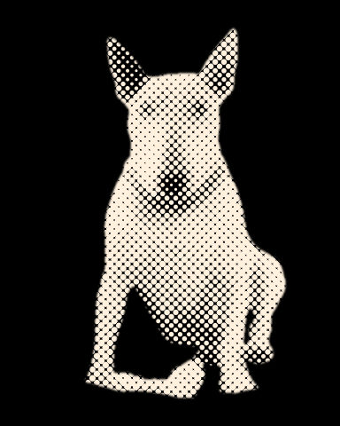
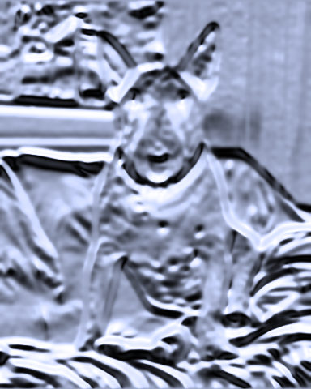
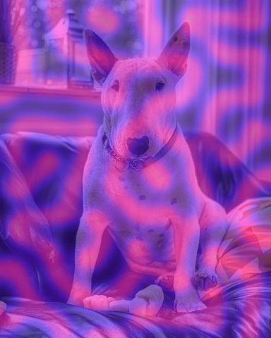
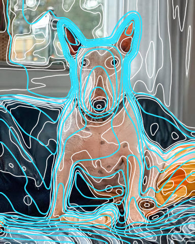

# Stylised

Looks that redraw the picture in a printing or drawing style, such as halftone.

[All effects](README.md)

| Example | Effect | What it does | Parameters | Recipe |
| --- | --- | --- | --- | --- |
|  | `halftone` | Print-style dot screen: tone becomes dot size. | `cell=14` `angle=45.0` `ink=None` `ink_floor=0.35` `paper='#000000'` `paper_threshold=0.5` `sigma=0.5` `feather=1.0` `truncate=4.0` `edge='reflect'` `constant_value=0.0` | [halftone.toml](../../examples/effects/halftone.toml) |
|  | `liquid_metal` | Chrome that follows the picture's brightness: its relief, `relief` px tall, mirrors a sky above a ground. | `smoothing=3.0` `relief=35.0` `horizon=0.65` `tint='#c9d6ff'` `truncate=4.0` `edge='reflect'` | [liquid_metal.toml](../../examples/effects/liquid_metal.toml) |
|  | `reaction_diffusion` | Grow a Gray-Scott reaction-diffusion pattern (spots, worms, mazes) from the picture's bright parts. | `feed=0.037` `kill=0.06` `steps=300` `cell=8.0` `threshold=0.6` `colors=('#12002b', '#6a1bff', '#ff2bd6', '#ffd84a')` `resampling='bilinear'` `edge='reflect'` | [reaction_diffusion.toml](../../examples/effects/reaction_diffusion.toml) |
|  | `topographic` | Draw contour lines where the picture's smoothed brightness crosses `levels` evenly spaced heights. | `levels=8` `thickness=1.5` `line='#ffffff'` `fill='none'` `colors=('#16324f', '#3f7d6a', '#d9c97a', '#9c6b43', '#f4f1ea')` `smoothing=5.0` `truncate=4.0` `edge='reflect'` | [topographic.toml](../../examples/effects/topographic.toml) |

### `halftone`

| Parameter | Type | Unit | Range | Default | Description |
| --- | --- | --- | --- | --- | --- |
| `cell` | whole number | px | 1 to 200 | `14` | Distance between neighbouring dots in px (the screen's pitch). Larger = fewer, bigger dots, a coarser print. |
| `angle` | number | degrees | -360 to 360 | `45.0` | Rotation of the dot grid in degrees, clockwise on screen: rows of dots run that many degrees below the x axis (negative = above). The grid is square, so 90 degrees on looks the same; 45 is the classic screen angle for one ink. |
| `ink` | colour or none |  |  | `None` | The ink: one colour for every dot ('#rrggbb', '#rgb' or three numbers 0..1); leave it out to give each dot the colour of the photo under it, brightened so small dots stay visible (by at most 1 / `ink_floor`). |
| `ink_floor` | number | fraction | 0.01 to 1 | `0.35` | With no `ink`: the most a dot's colour is brightened, as a floor 0.01 to 1 on its strongest channel: a colour whose strongest channel is below it is scaled by 1 / ink_floor instead of up to full, so dark areas stay dark. Lowering it brightens dark colours more; 1 = colours as they are. |
| `paper` | colour |  |  | `'#000000'` | The paper colour between the dots. On a dark paper (Rec. 709 luminance below `paper_threshold`) bright tones get the ink; on a light one, dark tones. |
| `paper_threshold` | number | fraction | 0 to 1 | `0.5` | The Rec. 709 luminance, 0 to 1, below which `paper` counts as dark (bright tones get the ink) rather than light (dark tones get it); 0.5 = mid grey. Raising it lets lighter paper count as dark: 0 treats every paper as light, 1 every paper but white as dark. |
| `sigma` | number | ratio | 0 to 5 | `0.5` | Gaussian sigma, in cells, of the blur that averages the tone each dot stands for: 0 = each dot sees only the pixel at its centre (detail, but noisy), larger = smoother tone that spreads into neighbouring dots. |
| `feather` | number | px | 0.1 to 50 | `1.0` | Width of each dot's soft edge in px (anti-aliasing): small = crisp dots, larger = blurrier dots. The ink stays the same. |
| `truncate` | number | ratio | 1 to 10 | `4.0` | Where the tone blur's Gaussian is cut off, in sigmas: it reaches truncate x sigma cells. Larger is more exact and slower. |
| `edge` | one of 'reflect', 'constant', 'nearest', 'mirror', 'wrap' |  |  | `'reflect'` | What the tone blur sees beyond the picture's edge: 'reflect' (mirrored, edge pixel repeated), 'mirror' (mirrored about the edge pixel), 'nearest' (the edge pixel repeated), 'wrap' (the opposite edge), 'constant' (constant_value). |
| `constant_value` | number | fraction | 0 to 1 | `0.0` | The brightness (0..1) assumed beyond the edge when edge is 'constant'; ignored otherwise. |

### `liquid_metal`

| Parameter | Type | Unit | Range | Default | Description |
| --- | --- | --- | --- | --- | --- |
| `smoothing` | number | px | 0 to 20 | `3.0` | Gaussian sigma in px with which the brightness is smoothed before it is read as height: 0 = every pixel is a bump and the metal is rough with the picture's texture and noise, larger = broad, flowing swells. |
| `relief` | number | px | 0 to 200 | `35.0` | How tall the relief is: a white pixel stands this many px above a black one, so the slope between neighbours is their brightness difference times this. 0 = a flat mirror (one tint-coloured picture when the horizon is at 0.5), larger = steeper relief and a more contrasty, more broken-up reflection. Sizes are in px, so the defaults suit a picture about 480 px high: scale `smoothing` and `relief` with the picture's size. |
| `horizon` | number | fraction | 0.05 to 0.95 | `0.65` | Where the environment's horizon is, as a fraction of the way from the ground (0, looking straight down) to the sky (1, looking straight up), kept off the extremes so there is always some of both; a flat surface looks at 0.5. The metal is exactly `tint` at the horizon, darker towards the ground and lighter towards the sky: raising it turns more of the reflections dark, lowering it more of them light. |
| `tint` | colour |  |  | `'#c9d6ff'` | The metal's colour as it looks at the horizon ('#rrggbb', '#rgb' or [r, g, b] 0..1): the metal runs from black on the ground through this to white in the sky. A light bluish silver by default; gold is '#e6b84d'. |
| `truncate` | number | ratio | 1 to 10 | `4.0` | Where the smoothing Gaussian is cut off, in sigmas (only matters when `smoothing` > 0). Larger is more exact and slower. |
| `edge` | one of 'reflect', 'nearest', 'mirror', 'wrap' |  |  | `'reflect'` | What the smoothing and the slope see beyond the picture's edge: 'reflect' (mirrored, edge pixel repeated), 'mirror' (mirrored about the edge pixel), 'nearest' (the edge pixel repeated), 'wrap' (the opposite edge, so a tileable picture polishes without a seam). |

### `reaction_diffusion`

| Parameter | Type | Unit | Range | Default | Description |
| --- | --- | --- | --- | --- | --- |
| `feed` | number | ratio | 0.01 to 0.08 | `0.037` | The feed rate F of the Gray-Scott model: how fast chemical u is replenished. Together with `kill` it decides the kind of pattern: about 0.03 to 0.04 with a kill of 0.06 gives spots and worms, higher feeds give mazes and fingerprints, the extremes leave nothing but the seed. |
| `kill` | number | ratio | 0.04 to 0.07 | `0.06` | The kill rate k of the Gray-Scott model: how fast chemical v is removed. Raising it makes the pattern sparser (isolated spots); lowering it fills the picture. |
| `steps` | whole number | count | 0 to 5000 | `300` | How many simulation steps run. 0 shows only the seed; more lets the pattern grow outward from it and costs time in proportion (and more cells, so smaller `cell`, cost more per step). |
| `cell` | number | px | 1 to 64 | `8.0` | The size of one simulation cell in px: the model runs on a coarse grid and is read back over the picture by `resampling`. 1 simulates every pixel (slow on large pictures); larger = a coarser, larger-scale pattern that runs faster. Tuned for a picture about 480 px high. |
| `threshold` | number | fraction | 0 to 1 | `0.6` | Brightness (0..1) above which the picture seeds the pattern: only the brighter parts start it. Lower seeds more of the picture; at 1 nothing seeds and the result is a flat first colour. |
| `colors` | list of colours |  |  | `('#12002b', '#6a1bff', '#ff2bd6', '#ffd84a')` | The colour ramp, evenly spaced; at least two. Untouched areas take the first colour and the strongest pattern the last. |
| `resampling` | one of 'nearest', 'bilinear', 'bicubic' |  |  | `'bilinear'` | How the picture is read at each cell and how the cells are read back over the picture: 'nearest' takes the closest cell (blocky), 'bilinear' blends the four around (smooth), 'bicubic' fits a cubic spline (the smoothest, may overshoot slightly). |
| `edge` | one of 'reflect', 'nearest', 'mirror', 'wrap' |  |  | `'reflect'` | What lies beyond the picture's border for the diffusion and for reading: 'reflect' (mirrored, edge pixel repeated), 'mirror' (mirrored about the edge pixel), 'nearest' (the edge pixel repeated), 'wrap' (the opposite edge, so the pattern tiles). |

### `topographic`

| Parameter | Type | Unit | Range | Default | Description |
| --- | --- | --- | --- | --- | --- |
| `levels` | whole number | count | 2 to 64 | `8` | How many bands the brightness range 0..1 is cut into; there is a contour line at each of the levels - 1 heights between them. 2 = a single line at middle grey, 8 = a clear contour map, 14 = a busy one, 64 = a dense engraving. |
| `thickness` | number | px | 0.5 to 20 | `1.5` | How wide the lines are, in pixels across the line however steep the slope of brightness there; tuned for a picture about 480 px high. Edges are anti-aliased, so fractions of a pixel show as partial strength. |
| `line` | colour |  |  | `'#ffffff'` | The colour of the contour lines: '#rrggbb', '#rgb' or [r, g, b] 0..1. |
| `fill` | one of 'none', 'bands' |  |  | `'none'` | What lies between the lines: 'none' (the photo itself, with the lines drawn over it) or 'bands' (the photo is replaced by flat colour, each band coloured from `colors` by its height, like a hypsometric map). |
| `colors` | list of colours |  |  | `('#16324f', '#3f7d6a', '#d9c97a', '#9c6b43', '#f4f1ea')` | The colours of the bands for fill 'bands', from the lowest band (darkest brightness) to the highest, evenly spaced along the ramp; at least two. Ignored by fill 'none'. |
| `smoothing` | number | px | 0 to 50 | `5.0` | Sigma in pixels of the Gaussian blur the brightness gets before the contours are found, so that grain and fine texture do not break the lines into specks; tuned for a picture about 480 px high. 0 = the brightness as it is, raising it gives smoother, simpler contours. |
| `truncate` | number | ratio | 1 to 10 | `4.0` | Where the smoothing blur is cut off, in sigmas: it reaches truncate x `smoothing` px. Larger is more exact and slower; below 3 the blur turns visibly boxy. |
| `edge` | one of 'reflect', 'nearest', 'mirror', 'wrap' |  |  | `'reflect'` | What the smoothing sees beyond the picture's edge: 'reflect' (mirrored, edge pixel repeated), 'mirror' (mirrored about the edge pixel), 'nearest' (the edge pixel repeated), 'wrap' (the opposite edge). |
