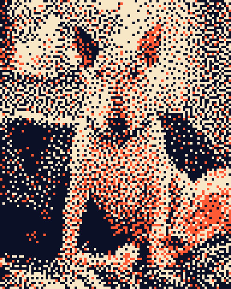
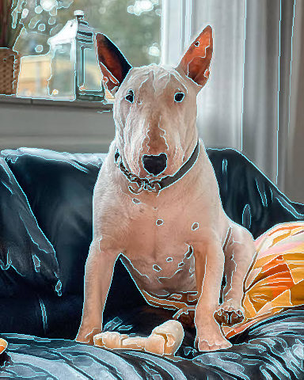
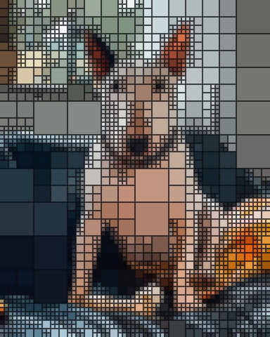
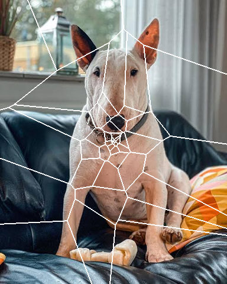

# Stylised

Looks that redraw the picture in a printing or drawing style, such as halftone.

[All effects](README.md)

| Example | Effect | What it does | Parameters | Recipe |
| --- | --- | --- | --- | --- |
|  | `dither` | Redraw the picture in a few colours, its tones kept as dots of `cell` size: ordered or error-diffusion dither, 1-bit black and white, retro palettes, and the presets `posterize`, `threshold` and `palette_quantize`. | `method='floyd_steinberg'` `palette='photo'` `colors=8` `cell=0.0005` `pattern=1.0` +6 advanced | [dither.toml](../../examples/effects/dither.toml) |
|  | `edges` | Edge detection and sketch ink lines in `color` on `background`, by Sobel, Canny or difference of Gaussians. | `method='canny'` `radius=1.5` `threshold=0.1` `softness=0.5` `color='#ffffff'` `background='#000000'` +2 advanced | [edges.toml](../../examples/effects/edges.toml) |
|  | `halftone` | Print-style dot screen: tone becomes dot size. | `cell=14` `angle=45.0` `ink=None` `ink_floor=0.35` `paper='#000000'` `paper_threshold=0.5` `sigma=0.5` `feather=1.0` +3 advanced | [halftone.toml](../../examples/effects/halftone.toml) |
|  | `liquid_metal` | Chrome that follows the picture's brightness: its relief, `relief` px tall, mirrors a sky above a ground. | `smoothing=3.0` `relief=35.0` `horizon=0.65` `tint='#c9d6ff'` +2 advanced | [liquid_metal.toml](../../examples/effects/liquid_metal.toml) |
|  | `quadtree` | Redraw the picture as flat cells that split only where it varies: large in even areas, small at edges. | `threshold=0.06` `max_cell=0.125` `min_cell=0.01` `gap=0.002` `gap_color='#000000'` `rounding=0.0` | [quadtree.toml](../../examples/effects/quadtree.toml) |
|  | `reaction_diffusion` | Grow a Gray-Scott reaction-diffusion pattern (spots, worms, mazes) from the picture's bright parts. | `feed=0.037` `kill=0.06` `steps=300` `cell=8.0` `threshold=0.6` `colors=('#12002b', '#6a1bff', '#ff2bd6', '#ffd84a')` +2 advanced | [reaction_diffusion.toml](../../examples/effects/reaction_diffusion.toml) |
|  | `seams` | Draw a solid line or band along every border between the pieces of a partition. | `width=0.004` `color='#ffffff'` | [seams.toml](../../examples/effects/seams.toml) |
|  | `topographic` | Draw contour lines where the smoothed `field` crosses `levels` evenly spaced heights. | `field='light'` `levels=8` `thickness=1.5` `line='#ffffff'` `fill='none'` `colors=('#16324f', '#3f7d6a', '#d9c97a', '#9c6b43', '#f4f1ea')` `smoothing=5.0` +2 advanced | [topographic.toml](../../examples/effects/topographic.toml) |

### `dither`

| Parameter | Type | Unit | Range | Default | Description |
| --- | --- | --- | --- | --- | --- |
| `method` | one of 'floyd_steinberg', 'atkinson', 'bayer', 'blue_noise' |  |  | `'floyd_steinberg'` | How tones become a pattern of dots. 'floyd_steinberg' and 'atkinson' pass each pixel's error on to its neighbours (organic grain; Floyd-Steinberg keeps every tone, Atkinson drops a quarter of the error, so highlights and shadows go clean and the contrast is higher). 'bayer' is a regular crosshatch of an 8 x 8 matrix. 'blue_noise' is an even, grainless scatter from a repeating 64 x 64 tile, the one with no visible pattern. Both of those mix colours of any palette, in steps of a sixteenth. |
| `palette` | one of 'photo', 'gameboy', 'cga', 'ega', 'pico8', 'cube2', 'cube3', 'cube4', 'cube5', 'cube6' or list of colours |  |  | `'photo'` | Where the colours come from. 'photo' finds `colors` colours in the picture itself (k-means); 'gameboy' (the 4 greens widely used to draw a Game Boy screen), 'cga' (black, cyan, magenta, white), 'ega' (the 16 IBM EGA colours), 'pico8' (the 16 PICO-8 colours) and 'cube2', 'cube3', 'cube4', 'cube5' and 'cube6' (every mix of 2 to 6 evenly spaced levels of red, green and blue: 8 to 216 colours) are fixed palettes; or give your own list of at least two colours, in any order ('#rrggbb', '#rgb' or three numbers 0 to 1). |
| `colors` | whole number | count | 2 to 256 | `8` | How many colours to find when `palette` is 'photo' (ignored for any other palette). Raising it keeps more detail and gradation; fewer than this many are used if the picture has fewer distinct colours. 'bayer' and 'blue_noise' take longer with more colours. |
| `cell` | number | fraction | 0.0005 to 0.1 | `0.0005` | The size of one dot, as a share of the picture's long side (at least one pixel): the picture is dithered on a grid of this size and shown with hard square dots. The default is one pixel on a picture up to 2000 px wide; about 0.004 is two pixels on a 480 px picture and 0.02 or more a chunky pixel look. Raising it gives coarser, larger dots. |
| `pattern` | number | fraction | 0 to 1 | `1.0` | How much of the dot pattern is used: 1 = the method as designed; lower passes less error on (floyd_steinberg, atkinson) or mixes fewer colours per dot (bayer, blue_noise), so flatter areas; 0 gives each dot its nearest palette colour, plain flat colours with no pattern, whatever the method. |

Advanced parameters (6)

| Parameter | Type | Unit | Range | Default | Description |
| --- | --- | --- | --- | --- | --- |
| `space` | one of 'oklab', 'rgb' |  |  | `'oklab'` | The colour space in which dots are matched to palette colours, the 'photo' colours are searched, and errors are measured. 'oklab' is where equal distances look equally different, so colours match as the eye sees them; 'rgb' is the picture's own red, green and blue values, where each channel is matched on its own: with a 'cube' palette and `pattern` 0 it snaps every channel to a few levels, hard colour separations. |
| `init` | one of 'k-means++', 'random' |  |  | `'k-means++'` | How the search for colours starts (palette 'photo'): 'k-means++' spreads the starting colours out (Arthur and Vassilvitskii, 2007) and usually finds a better set; 'random' starts from `colors` random pixels. |
| `iterations` | whole number | count | 1 to 100 | `20` | The most k-means rounds to run when `palette` is 'photo'. Each round moves every colour to the average of the pixels nearest to it; raising it lets the search settle further. |
| `tolerance` | number | fraction | 0 to 1 | `0.001` | Stop the k-means rounds early once no colour has moved farther than this in `space` (in Oklab black to white is 1). 0 runs all `iterations`; raising it stops sooner with a rougher result. |
| `sample` | whole number | count | 1 to 1000000 | `10000` | How many randomly chosen dots the colours are searched on when `palette` is 'photo'; every dot is still repainted. A picture with fewer dots is searched whole. Raising it costs time and can find rare colours; lowering it is faster but may miss small areas of colour. |
| `seed` | whole number | count | 0 to 4294967295 | `0` | Random seed for the choice of sample dots and starting colours when `palette` is 'photo': the same seed always gives the same picture, another seed may find slightly different colours. |

Presets (`preset="name"` in a recipe step or `fx`):

| Preset | Description |
| --- | --- |
| `posterize` | Posterize: each channel snapped to a few levels (4 each); hard colour separations. Set `palette` cube2 to cube6 for 2 to 6 levels. |
| `threshold` | Threshold: a black-and-white cutout, a 1-bit two-colour bitmap, split where Oklab lightness is 0.5 (about a 0.39 grey). Move the split with a `grade` step before it: `exposure` above 0 lights more of the picture. Set `palette` for other inks. |
| `palette_quantize` | Palette quantize: the picture's own 8 most characteristic colours (k-means in Oklab), flat. Set `colors`, or `palette` for a retro set (gameboy, cga, ega, pico8). |

### `edges`

| Parameter | Type | Unit | Range | Default | Description |
| --- | --- | --- | --- | --- | --- |
| `method` | one of 'sobel', 'canny', 'dog' |  |  | `'canny'` | How edges are found: 'sobel' (the steepness of the brightness: wide, soft bands that follow the picture's gradients), 'canny' (the same steepness reduced to thin connected lines: the weakest lines are dropped unless they join a strong one) or 'dog' (sketch ink lines: the difference of Gaussians itself, so one line along each dark stroke and on the dark side of each edge, from features between `radius` and 1.6 times `radius` in size; slow gradients and fine texture fall away). |
| `radius` | number | px | 0.5 to 50 | `1.5` | How far the picture is smoothed before edges are looked for, as the Gaussian sigma in px at the recipe's size ('dog': the finer of its two Gaussians). Raising it drops fine detail and noise and makes broader, smoother edges. |
| `threshold` | number | fraction | 0.01 to 1 | `0.1` | How strong an edge must be to show, as a share of the strongest edge there can be after smoothing (black straight to white = 1; a faint edge is near 0.05). Raising it keeps only the strongest edges. |
| `softness` | number | fraction | 0 to 1 | `0.5` | How gradually edges fade in around `threshold`: they are fully drawn from threshold x (1 + softness) and not at all below threshold x (1 - softness), and 'canny' also keeps a line down to that lower value if it touches one above the upper. 0 = every edge fully drawn or not at all; raising it adds weaker edges as faint lines. |
| `color` | colour |  |  | `'#ffffff'` | The colour of the edges: '#rrggbb', '#rgb' or [r, g, b] 0..1. Laid over a picture with the blend mode 'screen' only the edges light up; dark on a light `background` it is line art. |
| `background` | colour |  |  | `'#000000'` | The colour where there is no edge: '#rrggbb', '#rgb' or [r, g, b] 0..1. Black suits 'screen' blending, a light colour with a dark `color` gives a drawing. |

Advanced parameters (2)

| Parameter | Type | Unit | Range | Default | Description |
| --- | --- | --- | --- | --- | --- |
| `truncate` | number | ratio | 1 to 10 | `4.0` | Where the Gaussians are cut off, in sigmas: they reach truncate x radius px. Larger is more exact and slower. |
| `edge` | one of 'reflect', 'nearest', 'mirror', 'wrap' |  |  | `'reflect'` | What the smoothing and the gradient see beyond the picture's border: 'reflect' (mirrored, edge pixel repeated), 'mirror' (mirrored about the edge pixel), 'nearest' (the edge pixel repeated) or 'wrap' (the opposite edge). |

### `halftone`

| Parameter | Type | Unit | Range | Default | Description |
| --- | --- | --- | --- | --- | --- |
| `cell` | whole number | px | 1 to 200 | `14` | Distance between neighbouring dots in px (the screen's pitch). Larger = fewer, bigger dots, a coarser print. |
| `angle` | number (cyclic) | degrees | -180 to 180 | `45.0` | Rotation of the dot grid in degrees, clockwise on screen: rows of dots run that many degrees below the x axis (negative = above). The grid is square, so 90 degrees on looks the same; 45 is the classic screen angle for one ink. |
| `ink` | colour or none |  |  | `None` | The ink: one colour for every dot ('#rrggbb', '#rgb' or three numbers 0..1); leave it out to give each dot the colour of the photo under it, brightened so small dots stay visible (by at most 1 / `ink_floor`). |
| `ink_floor` | number | fraction | 0.01 to 1 | `0.35` | With no `ink`: the most a dot's colour is brightened, as a floor 0.01 to 1 on its strongest channel: a colour whose strongest channel is below it is scaled by 1 / ink_floor instead of up to full, so dark areas stay dark. Lowering it brightens dark colours more; 1 = colours as they are. |
| `paper` | colour |  |  | `'#000000'` | The paper colour between the dots. On a dark paper (Rec. 709 luminance below `paper_threshold`) bright tones get the ink; on a light one, dark tones. |
| `paper_threshold` | number | fraction | 0 to 1 | `0.5` | The Rec. 709 luminance, 0 to 1, below which `paper` counts as dark (bright tones get the ink) rather than light (dark tones get it); 0.5 = mid grey. Raising it lets lighter paper count as dark: 0 treats every paper as light, 1 every paper but white as dark. |
| `sigma` | number | ratio | 0 to 5 | `0.5` | Gaussian sigma, in cells, of the blur that averages the tone each dot stands for: 0 = each dot sees only the pixel at its centre (detail, but noisy), larger = smoother tone that spreads into neighbouring dots. |
| `feather` | number | px | 0.1 to 50 | `1.0` | Width of each dot's soft edge in px (anti-aliasing): small = crisp dots, larger = blurrier dots. The ink stays the same. |

Advanced parameters (3)

| Parameter | Type | Unit | Range | Default | Description |
| --- | --- | --- | --- | --- | --- |
| `truncate` | number | ratio | 1 to 10 | `4.0` | Where the tone blur's Gaussian is cut off, in sigmas: it reaches truncate x sigma cells. Larger is more exact and slower. |
| `edge` | one of 'reflect', 'constant', 'nearest', 'mirror', 'wrap' |  |  | `'reflect'` | What the tone blur sees beyond the picture's edge: 'reflect' (mirrored, edge pixel repeated), 'mirror' (mirrored about the edge pixel), 'nearest' (the edge pixel repeated), 'wrap' (the opposite edge), 'constant' (constant_value). |
| `constant_value` | number | fraction | 0 to 1 | `0.0` | The brightness (0..1) assumed beyond the edge when edge is 'constant'; ignored otherwise. |

### `liquid_metal`

| Parameter | Type | Unit | Range | Default | Description |
| --- | --- | --- | --- | --- | --- |
| `smoothing` | number | px | 0 to 20 | `3.0` | Gaussian sigma in px with which the brightness is smoothed before it is read as height: 0 = every pixel is a bump and the metal is rough with the picture's texture and noise, larger = broad, flowing swells. |
| `relief` | number | px | 0 to 200 | `35.0` | How tall the relief is: a white pixel stands this many px above a black one, so the slope between neighbours is their brightness difference times this. 0 = a flat mirror (one tint-coloured picture when the horizon is at 0.5), larger = steeper relief and a more contrasty, more broken-up reflection. Sizes are in px, so the defaults suit a picture about 480 px high: scale `smoothing` and `relief` with the picture's size. |
| `horizon` | number | fraction | 0.05 to 0.95 | `0.65` | Where the environment's horizon is, as a fraction of the way from the ground (0, looking straight down) to the sky (1, looking straight up), kept off the extremes so there is always some of both; a flat surface looks at 0.5. The metal is exactly `tint` at the horizon, darker towards the ground and lighter towards the sky: raising it turns more of the reflections dark, lowering it more of them light. |
| `tint` | colour |  |  | `'#c9d6ff'` | The metal's colour as it looks at the horizon ('#rrggbb', '#rgb' or [r, g, b] 0..1): the metal runs from black on the ground through this to white in the sky. A light bluish silver by default; gold is '#e6b84d'. |

Advanced parameters (2)

| Parameter | Type | Unit | Range | Default | Description |
| --- | --- | --- | --- | --- | --- |
| `truncate` | number | ratio | 1 to 10 | `4.0` | Where the smoothing Gaussian is cut off, in sigmas (only matters when `smoothing` > 0). Larger is more exact and slower. |
| `edge` | one of 'reflect', 'nearest', 'mirror', 'wrap' |  |  | `'reflect'` | What the smoothing and the slope see beyond the picture's edge: 'reflect' (mirrored, edge pixel repeated), 'mirror' (mirrored about the edge pixel), 'nearest' (the edge pixel repeated), 'wrap' (the opposite edge, so a tileable picture polishes without a seam). |

### `quadtree`

| Parameter | Type | Unit | Range | Default | Description |
| --- | --- | --- | --- | --- | --- |
| `threshold` | number | fraction | 0 to 0.5 | `0.06` | How uneven a cell has to be before it splits into four: the spread of its colour, the largest standard deviation of red, green or blue inside it, on a 0 to 0.5 scale (0.5 is the most any cell can have, half black and half white). 0 splits every cell that is not perfectly flat; 0.5 splits none. Raising it gives bigger cells and a coarser picture. |
| `max_cell` | number | fraction | 0.005 to 1 | `0.125` | The largest a cell can be, as a share of the picture's long side: the picture starts as an even grid of cells at most this size. Raising it makes the flat parts coarser. |
| `min_cell` | number | fraction | 0.002 to 1 | `0.01` | The smallest a cell can be, as a share of the picture's long side, never above `max_cell`. A cell does not split into halves smaller than this. Lowering it keeps finer detail at edges. |
| `gap` | number | fraction | 0 to 0.05 | `0.002` | Width of the line between neighbouring cells, as a share of the picture's long side: 0 = cells touch, about 0.002 a thin grid, 0.01 or more visible tiles. The picture's own edge gets no line. A cell no wider than the line is all line, so keep it below `min_cell`. |
| `gap_color` | colour |  |  | `'#000000'` | The colour of the lines between cells, and of the corners a `rounding` cuts away: '#rrggbb', '#rgb' or three numbers 0 to 1. |
| `rounding` | number | fraction | 0 to 1 | `0.0` | How round each cell's corners are, as a share of half its shorter side: 0 = square cells, 1 = a circle in each square cell. |

### `reaction_diffusion`

| Parameter | Type | Unit | Range | Default | Description |
| --- | --- | --- | --- | --- | --- |
| `feed` | number | ratio | 0.01 to 0.08 | `0.037` | The feed rate F of the Gray-Scott model: how fast chemical u is replenished. Together with `kill` it decides the kind of pattern: about 0.03 to 0.04 with a kill of 0.06 gives spots and worms, higher feeds give mazes and fingerprints, the extremes leave nothing but the seed. |
| `kill` | number | ratio | 0.04 to 0.07 | `0.06` | The kill rate k of the Gray-Scott model: how fast chemical v is removed. Raising it makes the pattern sparser (isolated spots); lowering it fills the picture. |
| `steps` | whole number | count | 0 to 5000 | `300` | How many simulation steps run. 0 shows only the seed; more lets the pattern grow outward from it and costs time in proportion (and more cells, so smaller `cell`, cost more per step). |
| `cell` | number | px | 1 to 64 | `8.0` | The size of one simulation cell in px: the model runs on a coarse grid and is read back over the picture by `resampling`. 1 simulates every pixel (slow on large pictures); larger = a coarser, larger-scale pattern that runs faster. Tuned for a picture about 480 px high. |
| `threshold` | number | fraction | 0 to 1 | `0.6` | Brightness (0..1) above which the picture seeds the pattern: only the brighter parts start it. Lower seeds more of the picture; at 1 nothing seeds and the result is a flat first colour. |
| `colors` | list of colours |  |  | `('#12002b', '#6a1bff', '#ff2bd6', '#ffd84a')` | The colour ramp, evenly spaced; at least two. Untouched areas take the first colour and the strongest pattern the last. |

Advanced parameters (2)

| Parameter | Type | Unit | Range | Default | Description |
| --- | --- | --- | --- | --- | --- |
| `resampling` | one of 'nearest', 'bilinear', 'bicubic' |  |  | `'bilinear'` | How the picture is read at each cell and how the cells are read back over the picture: 'nearest' takes the closest cell (blocky), 'bilinear' blends the four around (smooth), 'bicubic' fits a cubic spline (the smoothest, may overshoot slightly). |
| `edge` | one of 'reflect', 'nearest', 'mirror', 'wrap' |  |  | `'reflect'` | What lies beyond the picture's border for the diffusion and for reading: 'reflect' (mirrored, edge pixel repeated), 'mirror' (mirrored about the edge pixel), 'nearest' (the edge pixel repeated), 'wrap' (the opposite edge, so the pattern tiles). |

### `seams`

| Parameter | Type | Unit | Range | Default | Description |
| --- | --- | --- | --- | --- | --- |
| `width` | number | fraction | 0 to 0.1 | `0.004` | Width of the line as a share of the picture's long side (0 to 0.1), centred on each border: 0 draws nothing, about 0.002 is a hairline, 0.02 or more a band. Raising it widens the line. |
| `color` | colour |  |  | `'#ffffff'` | Colour of the line, solid: '#rrggbb', '#rgb' or three numbers from 0 to 1. |

### `topographic`

| Parameter | Type | Unit | Range | Default | Description |
| --- | --- | --- | --- | --- | --- |
| `field` | field name |  |  | `'light'` | What the contours follow: 'light' (the picture's own brightness, a plain contour map), 'depth' (how near things are, a LiDAR look), 'subject', 'background' or a region of the recipe. Its range 0..1 is cut into `levels` bands. |
| `levels` | whole number | count | 2 to 64 | `8` | How many bands the field's range 0..1 is cut into; there is a contour line at each of the levels - 1 heights between them. 2 = a single line at the middle of the range, 8 = a clear contour map, 14 = a busy one, 64 = a dense engraving. |
| `thickness` | number | px | 0.5 to 20 | `1.5` | How wide the lines are, in pixels across the line however steep the field's slope there; tuned for a picture about 480 px high. Edges are anti-aliased, so fractions of a pixel show as partial strength. |
| `line` | colour |  |  | `'#ffffff'` | The colour of the contour lines: '#rrggbb', '#rgb' or [r, g, b] 0..1. |
| `fill` | one of 'none', 'bands' |  |  | `'none'` | What lies between the lines: 'none' (the photo itself, with the lines drawn over it) or 'bands' (the photo is replaced by flat colour, each band coloured from `colors` by its height, like a hypsometric map). |
| `colors` | list of colours |  |  | `('#16324f', '#3f7d6a', '#d9c97a', '#9c6b43', '#f4f1ea')` | The colours of the bands for fill 'bands', from the lowest band (the field near 0) to the highest, evenly spaced along the ramp; at least two. Ignored by fill 'none'. |
| `smoothing` | number | px | 0 to 50 | `5.0` | Sigma in pixels of the Gaussian blur the field gets before the contours are found, so that grain and fine texture do not break the lines into specks; tuned for a picture about 480 px high. 0 = the field as it is, raising it gives smoother, simpler contours. |

Advanced parameters (2)

| Parameter | Type | Unit | Range | Default | Description |
| --- | --- | --- | --- | --- | --- |
| `truncate` | number | ratio | 1 to 10 | `4.0` | Where the smoothing blur is cut off, in sigmas: it reaches truncate x `smoothing` px. Larger is more exact and slower; below 3 the blur turns visibly boxy. |
| `edge` | one of 'reflect', 'nearest', 'mirror', 'wrap' |  |  | `'reflect'` | What the smoothing sees beyond the picture's edge: 'reflect' (mirrored, edge pixel repeated), 'mirror' (mirrored about the edge pixel), 'nearest' (the edge pixel repeated), 'wrap' (the opposite edge). |

