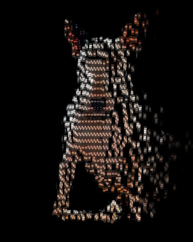
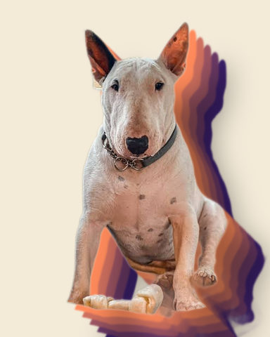
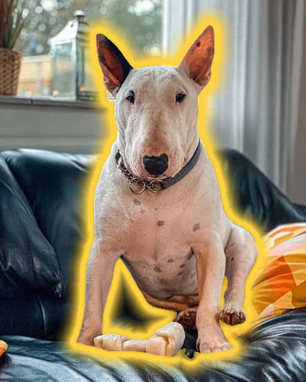
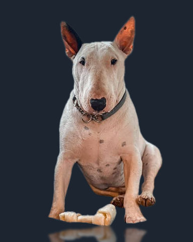
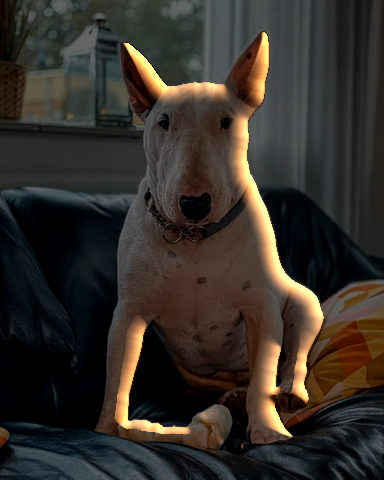

# Subject

Effects that work on the cut-out subject, apart from its background.

[All effects](README.md)

| Example | Effect | What it does | Parameters | Recipe |
| --- | --- | --- | --- | --- |
|  | `disperse` | One moment of the picture dissolving into drifting pieces (evaporate, dissolve, disintegrate, wind-blown, halo). | `cell=5` `progress=0.0` `top=1.0` `outline=1.0` `sweep=0.0` `reach=1.0` `wind=0.2` `angle=10.0` `seed=0` +30 advanced | [disperse.toml](../../examples/effects/disperse.toml) |
|  | `drop_shadow` | Copies of the subject's silhouette behind it, each `offset` px farther along `angle` and softened by `blur`: a drop shadow, layered paper cutouts or a long shadow. | `copies=1` `offset=22.0` `angle=56.0` `blur=24.0` `color='#000000'` `end_color='#000000'` `copy_opacity=1.0` `fade=0.0` +2 advanced | [drop_shadow.toml](../../examples/effects/drop_shadow.toml) |
|  | `outline` | A coloured stroke of `width` px around the subject's silhouette, with an optional soft halo of `glow` px. | `width=6.0` `color='#ffffff'` `position='outside'` `glow=0.0` +1 advanced | [outline.toml](../../examples/effects/outline.toml) |
|  | `reflection` | A floor mirror: the picture above the subject's lowest row is mirrored about it, softened and fading with depth. | `height=0.4` `fade=0.7` `blur=2.0` +3 advanced | [reflection.toml](../../examples/effects/reflection.toml) |
|  | `rim_light` | Light along the subject's edge from one side: a band of `width` px inside the edge, tinted `color`. | `angle=40.0` `color='#ff9a4d'` `width=12.0` `amount=1.0` `falloff=1.5` +4 advanced | [rim_light.toml](../../examples/effects/rim_light.toml) |

### `disperse`

| Parameter | Type | Unit | Range | Default | Description |
| --- | --- | --- | --- | --- | --- |
| `cell` | whole number | px | 1 to 64 | `5` | Character width in px; a piece is one character (its height comes from the bundled font). Use the same value as the ascii step before this one, so whole characters move. |
| `progress` | number | fraction | 0 to 1 | `0.0` | The moment shown: 0 = untouched, 1 = finished (every piece that goes has gone). |
| `top` | number | ratio | 0 to 10 | `1.0` | Weight of height in the order pieces leave: higher pieces go first. 0 = height does not matter. |
| `outline` | number | ratio | 0 to 10 | `1.0` | Weight of closeness to the outline (and the left, right and top borders) in the order: pieces near the edge go before the middle. 0 = closeness does not matter. |
| `sweep` | number | ratio | -1 to 1 | `0.0` | Weight of side in the order: positive starts at the left, negative at the right; its size is how much it matters next to `top` and `outline`. |
| `reach` | number | fraction | 0 to 1 | `1.0` | How much of the figure ever goes, in leaving order: 0.4 = the first 40% disperses and the rest stays, 1 = everything goes. |
| `wind` | number | fraction | -1 to 1 | `0.2` | The farthest any piece is carried by the time it vanishes, as a fraction of the picture width: positive blows right, negative left. Keep it under a third, or pieces cross too much of the picture in one go. |
| `angle` | number (cyclic) | degrees | -180 to 180 | `10.0` | Direction of the wind above the horizontal (on the side `wind` blows to); negative blows downward. |
| `seed` | whole number | count | 0 to 2147483647 | `0` | Random seed: each piece's fate is fixed by it, so one seed always gives the same pieces the same fates. |

Advanced parameters (30)

| Parameter | Type | Unit | Range | Default | Description |
| --- | --- | --- | --- | --- | --- |
| `hover` | number | fraction | 0 to 1 | `0.0` | Share of its journey a piece floats slowly along the wind before it goes (about 0..0.3 looks right). The outline starts at once, deeper pieces later (see `hover_spread`). 0 = off. |
| `outward` | number | fraction | 0 to 1 | `0.0` | How much a piece is also thrown away from the edge it came from (by up to `outward_distance`); pieces then fly in different directions, so leave it at 0 when everything should travel together on the wind. |
| `ambient` | number | ratio | 0 to 1 | `0.0` | Depth of the slow shimmer of the pieces that stay, as a share of their brightness (about 0..0.1 looks right; brightening stops at white). 0 = off. |
| `outline_depth` | number | fraction | 0.01 to 1 | `0.15` | Distance from the outline (fraction of the picture width) beyond which a piece counts as fully inside, for `outline` and `hover_spread`. Raising it makes closeness to the edge matter deeper in. |
| `jitter` | number | fraction | 0 to 1 | `0.2` | Random share of each piece's place in the leaving order: 0 = a clean front, raising it makes it ragged. |
| `anticipation` | number | fraction | 0.01 to 0.2 | `0.06` | Wind-up time before a piece goes, as a share of `progress`: it eases back by `pullback` over this time. The first piece goes only after it, so every piece has one. |
| `pullback` | number | fraction | 0 to 1 | `0.15` | How far a piece eases back against its journey before it goes (anticipation), as a share of the journey. 0 = no wind-up. |
| `flight` | number | fraction | 0.01 to 0.5 | `0.2` | Average time from detaching to vanishing, as a share of `progress`. Shorter flights keep fewer pieces in the air at once (about 0.1 keeps it to a third on a side-to-side sweep). |
| `flight_variation` | number | fraction | 0 to 0.9 | `0.4` | How much each piece's flight differs from `flight`: 0.4 = from 0.6x to 1.4x. 0 = all the same. |
| `finish` | number | fraction | 0.5 to 1 | `0.98` | The progress by which the last piece has vanished (a little under 1 leaves nothing behind at the end). If `anticipation` and the longest flight do not fit before it, all pieces go at once. |
| `hover_spread` | number | fraction | 0 to 1 | `0.45` | With `hover`: how far into `progress` a piece `outline_depth` inside starts to float (the outline starts at 0). 0 = everything floats at once. |
| `bob` | number | fraction | 0 to 0.05 | `0.004` | Height of the gentle up-and-down of a hovering piece, as a fraction of the picture height. |
| `bob_cycles` | number | cycles | 0 to 20 | `3.0` | Number of ups and downs while a piece hovers. |
| `angle_spread` | number | degrees | 0 to 180 | `12.0` | Range of each piece's own direction around the wind's `angle` (it differs by up to half of this). |
| `distance_minimum` | number | fraction | 0 to 1 | `0.35` | The shortest journey as a share of the longest (`wind`), so speeds differ; 1 = all travel equally far. |
| `outward_distance` | number | fraction | 0 to 1 | `0.12` | How far `outward` 1 throws a piece away from its edge, as a fraction of the picture's width (sideways) and height (up and down). |
| `acceleration` | number | ratio | 0 to 10 | `0.5` | How a piece speeds up on its way (an exit accelerates): it ends 1 + 2 x acceleration times as fast as it starts. 0 = steady speed. |
| `sway` | number | fraction | 0 to 0.2 | `0.012` | Largest sideways wobble of a flying piece, as a fraction of the picture width; it grows during the flight. 0 = none. |
| `sway_cycles` | number | cycles | 0 to 20 | `1.5` | Number of wobbles during a piece's flight. |
| `falloff` | number | ratio | 0 to 10 | `1.5` | How a flying piece fades: brightness is (1 - share of flight)^falloff. 0 = no fade (it just vanishes at the end), 1 = even, above 1 fades quickly at first. |
| `flare` | number | ratio | 0 to 2 | `0.4` | Extra brightness at the peak of the glow as a piece leaves (0.4 = 1.4x); brightening stops at white. 0 = no glow. |
| `flare_span` | number | fraction | 0.01 to 1 | `0.2` | Share of a piece's flight that the glow lasts; it peaks halfway through that. |
| `ambient_phase` | number | cycles | 0 to 1 | `0.0` | Where the shimmer wave is in its cycle: 0 and 1 are the same picture, 0.5 is half a cycle on. Raising it moves the wave against the wind; with `ambient` at 0 it does nothing. |
| `ambient_wavelength` | number | fraction | 0.01 to 2 | `0.2` | Length of one shimmer wave as a fraction of the picture width; a shorter one packs more waves across the picture. |
| `open_bottom` | true or false |  |  | `True` | True: the bottom border is not an edge for `outline` and `hover` (a portrait is cut off there). False: it counts like the other borders. |
| `normal_smoothing` | number | count | 0 to 10 | `1.0` | Blur, in characters (a Gaussian sigma), of the outline before `outward` reads its direction: raising it makes neighbouring pieces fly in more similar directions; 0 uses the raw outline. |
| `normal_truncate` | number | ratio | 1 to 10 | `4.0` | Where the `normal_smoothing` blur is cut off, in sigmas: it reaches this many times `normal_smoothing` characters from the outline, so the pieces' direction `outward` is read from that far out. Larger is more exact and slower, smaller shortens the reach. Nothing changes with `normal_smoothing` at 0. |
| `edge` | one of 'reflect', 'constant', 'nearest', 'mirror', 'wrap' |  |  | `'reflect'` | What the `normal_smoothing` blur sees beyond the picture's border: 'reflect' (mirrored, border row repeated; a border stays an edge), 'mirror' (mirrored about the border row), 'nearest' (the border row repeated), 'wrap' (the opposite border), 'constant' (open space, as if nothing were there, which blurs the outline toward the border). |
| `subject_threshold` | number | fraction | 0 to 1 | `0.5` | With a subject: how much of a piece, 0 to 1, the subject must cover on average for the piece to belong to the figure that `outline` and `hover` work from; 0.5 = more than half. Lowering it takes in more of a soft edge (hair, fur), raising it less. Ignored without a subject. |
| `background_threshold` | number | fraction | 0 to 1 | `0.02` | How bright, 0 to 1, some pixel of a piece must be for the piece to count as picture rather than black background: a piece no brighter never flies and is drawn black once the dispersal (or the shimmer) has begun. Raising it drops dim, noisy pieces; without a subject it also decides the figure's outline. |

Presets (`preset="name"` in a recipe step or `fx`):

| Preset | Description |
| --- | --- |
| `evaporate` | The top of the figure dissolves into pieces that rise like smoke, thin out and fade. |
| `halo` | The top of the head and the sides shed outward, symmetric: a halo of dissolving pieces. |
| `windblown` | The edges dissolve and everything is blown to the right, like dust in a wind. |
| `disintegrate` | Heavy: the whole outline and the top come apart, in long plumes in every direction. |

### `drop_shadow`

| Parameter | Type | Unit | Range | Default | Description |
| --- | --- | --- | --- | --- | --- |
| `copies` | whole number | count | 1 to 400 | `1` | How many copies of the silhouette are stacked behind the subject: 1 = a single shadow, more = a deeper stack of layers. |
| `offset` | number | px | 0 to 1000 | `22.0` | How far each copy lies beyond the one before it, in px at the recipe's size: the first is `offset` from the subject, the last `copies` x `offset`. 0 = every copy hidden behind the subject, leaving only what `blur` spreads past its edge. |
| `angle` | number (cyclic) | degrees | -180 to 180 | `56.0` | The direction the copies step away in, clockwise as seen in the picture: 0 = to the right, 45 = to the lower right, 90 = down, 180 = to the left, -90 = up. |
| `blur` | number | px | 0 to 200 | `24.0` | Gaussian sigma of each copy's soft edge in px: raising it makes the copies larger and fainter at their edge; 0 = hard-edged silhouettes. |
| `color` | colour |  |  | `'#000000'` | The colour of the copy nearest the subject: '#rrggbb', '#rgb' or [r, g, b] 0..1. Black darkens what lies behind the subject; another colour tints it. |
| `end_color` | colour |  |  | `'#000000'` | The colour of the farthest copy; the copies between step evenly from `color` to it. With one copy only `color` is used. |
| `copy_opacity` | number | fraction | 0 to 1 | `1.0` | How much of what lies behind each copy it covers: 1 = fully, below 1 the copies show through each other and the picture; 0 = no copies. Overlapping copies compound (two copies at 0.5 cover 0.75); the step's `opacity` mixes the finished stack in once. |
| `fade` | number | fraction | 0 to 1 | `0.0` | How much of `copy_opacity` the farthest copy loses, falling in a straight line along the copies: 0 = all copies alike, 0.5 = the farthest half as opaque, 1 = it vanishes. With one copy nothing fades. |

Advanced parameters (2)

| Parameter | Type | Unit | Range | Default | Description |
| --- | --- | --- | --- | --- | --- |
| `truncate` | number | ratio | 1 to 10 | `4.0` | Where each copy's Gaussian is cut off, in sigmas: it reaches truncate x blur px. Larger is more exact and slower. |
| `edge` | one of 'reflect', 'nearest', 'mirror', 'wrap' |  |  | `'nearest'` | What the copies see beyond the picture's edge, when moved and softened: 'nearest' (the outermost row repeated, so a subject cut off by the border casts its copies on without a gap), 'reflect' (mirrored, edge pixel repeated), 'mirror' (mirrored about the edge pixel) or 'wrap' (the opposite edge). |

A step of `drop_shadow` has `opacity = 0.6` unless it sets its own.

Presets (`preset="name"` in a recipe step or `fx`):

| Preset | Description |
| --- | --- |
| `long_shadow` | The flat-design long shadow: 150 copies 2 px apart, one colour, fading out over 300 px. Shows on light backgrounds; set color for dark ones. |
| `layered_cutouts` | Cut-paper layers (set `opacity` 1): four opaque copies of the silhouette stacked behind the subject, from orange to purple. |

### `outline`

| Parameter | Type | Unit | Range | Default | Description |
| --- | --- | --- | --- | --- | --- |
| `width` | number | px | 0 to 200 | `6.0` | Thickness of the stroke in px at the recipe's size; raising it thickens the line. 0 = no stroke. |
| `color` | colour |  |  | `'#ffffff'` | The colour of the stroke and of its halo: '#rrggbb', '#rgb' or [r, g, b] 0..1. |
| `position` | one of 'outside', 'inside', 'center' |  |  | `'outside'` | Which side of the silhouette's edge the stroke lies on: 'outside' (around the subject, whose own pixels stay untouched), 'inside' (painted over the subject's rim) or 'center' (half of `width` on each side). |
| `glow` | number | px | 0 to 200 | `0.0` | How far a soft halo of the same colour reaches beyond the stroke, in px; it fades smoothly from the stroke to nothing. Raising it spreads the halo (a large value makes an aura). 0 = no halo. |

Advanced parameters (1)

| Parameter | Type | Unit | Range | Default | Description |
| --- | --- | --- | --- | --- | --- |
| `subject_threshold` | number | fraction | 0 to 1 | `0.5` | The subject's value, 0 to 1, from which a pixel belongs to the subject whose edge is outlined: 0.5 = more than half covered. Lowering it takes in more of a soft edge (hair, fur), raising it less. |

### `reflection`

| Parameter | Type | Unit | Range | Default | Description |
| --- | --- | --- | --- | --- | --- |
| `height` | number | fraction | 0 to 1 | `0.4` | How tall the reflection is, as a fraction of the subject's height: 0.4 = 40% of it is mirrored into the floor below the subject's lowest row, 1 = all of it; 0 = no reflection. Where the picture ends first, the reflection is cut there. |
| `fade` | number | fraction | 0 to 1 | `0.7` | How much of its strength the reflection loses between the floor line and its end, in a straight line: 0 = as strong at the end as at the floor line, 1 = fades out completely at its end. |
| `blur` | number | px | 0 to 100 | `2.0` | Gaussian sigma of the reflection's softness in px at the recipe's size: raising it makes a blurrier mirror, as on a rough floor; 0 = a sharp mirror image. |

Advanced parameters (3)

| Parameter | Type | Unit | Range | Default | Description |
| --- | --- | --- | --- | --- | --- |
| `threshold` | number | fraction | 0 to 1 | `0.5` | How much of a subject row, 0 to 1, must be subject for the row to count as part of it when its lowest and highest rows are found: 0.5 = a pixel of at least half. Lowering it counts faint fringes, so the floor line moves down and the subject's height grows. |
| `truncate` | number | ratio | 1 to 10 | `4.0` | Where the blur's Gaussian is cut off, in sigmas: it reaches truncate x blur px. Larger is more exact and slower. |
| `edge` | one of 'reflect', 'nearest', 'mirror', 'wrap' |  |  | `'reflect'` | What the blur sees beyond the picture's edge, and beyond the floor line, where the reflection is mirrored: 'reflect' (mirrored, edge pixel repeated, which continues the mirror image), 'mirror' (mirrored about the edge pixel), 'nearest' (the edge pixel repeated) or 'wrap' (the opposite edge). |

A step of `reflection` has `opacity = 0.6` unless it sets its own.

### `rim_light`

| Parameter | Type | Unit | Range | Default | Description |
| --- | --- | --- | --- | --- | --- |
| `angle` | number (cyclic) | degrees | -180 to 180 | `40.0` | The direction the light comes from, counter-clockwise from the right: 0 = from the right, 90 = from above, 180 or -180 = from the left, -90 = from below. Only edges whose outward direction faces it are lit. |
| `color` | colour |  |  | `'#ff9a4d'` | The colour of the light: '#rrggbb', '#rgb' or [r, g, b] 0..1. The default is a warm orange. |
| `width` | number | px | 1 to 200 | `12.0` | Depth of the lit band inside the subject's edge, in px at the recipe's size: raising it lets the light reach further in. |
| `amount` | number | ratio | 0 to 5 | `1.0` | How strong the light is where it is brightest (an edge that faces the light head-on): 0 = off, 1 = the colour at full strength, above 1 saturates sooner. |
| `falloff` | number | ratio | 0.1 to 10 | `1.5` | How the light fades from the edge into the band: it is (1 - depth / width)^falloff of its strength. 1 = evenly, above 1 stays close to the edge, below 1 carries further in. |

Advanced parameters (4)

| Parameter | Type | Unit | Range | Default | Description |
| --- | --- | --- | --- | --- | --- |
| `smoothing` | number | px | 0 to 50 | `2.0` | Gaussian sigma, in px, with which the silhouette is smoothed before the edge's direction is read: raising it evens out the jaggedness of a pixel edge (fur), at the cost of detail in small features. 0 uses the raw edge. |
| `truncate` | number | ratio | 1 to 10 | `4.0` | Where the `smoothing` blur is cut off, in sigmas: it reaches truncate x smoothing px. Larger is more exact and slower. |
| `edge` | one of 'reflect', 'nearest', 'mirror', 'wrap' |  |  | `'reflect'` | What the `smoothing` blur sees beyond the picture's border: 'reflect' (mirrored, border pixel repeated), 'mirror' (mirrored about the border pixel), 'nearest' (the border pixel repeated) or 'wrap' (the opposite border). |
| `subject_threshold` | number | fraction | 0 to 1 | `0.5` | The subject's value, 0 to 1, from which a pixel belongs to the subject whose edge is lit: 0.5 = more than half covered. Lowering it takes in more of a soft edge (hair, fur), raising it less. |

