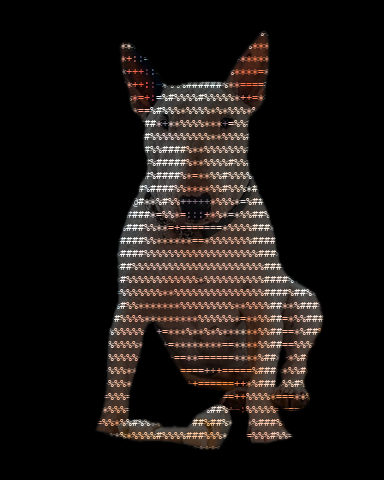

# Text

Pictures redrawn as characters, such as ASCII art.

[All effects](README.md)

| Example | Effect | What it does | Parameters | Recipe |
| --- | --- | --- | --- | --- |
|  | `ascii` | Redraw the picture as text: a grid of characters `cell` px wide, each chosen by the brightness under it. | `cell=10` `chars=' .:-=+*#%@'` `ink=None` `ink_floor=0.35` `paper='#000000'` `paper_threshold=0.5` `gamma=1.0` `photo=0.0` +1 advanced | [ascii.toml](../../examples/effects/ascii.toml) |

### `ascii`

| Parameter | Type | Unit | Range | Default | Description |
| --- | --- | --- | --- | --- | --- |
| `cell` | whole number | px | 1 to 200 | `10` | Width of one character, 1 to 200 px; the height follows from the font. Smaller = finer detail, more characters. |
| `chars` | text |  |  | `' .:-=+*#%@'` | The character palette, in any order, at least two different characters. It is sorted by how much ink each glyph puts down, so the densest is used for the brightest areas on dark paper and the darkest on light paper (see `paper`). Try ' .:-=+*#%@', ' .oO0@', '01', or blocks like ' ░▒▓█' (the font must have them). |
| `ink` | colour or none |  |  | `None` | The ink colour of every character ('#rrggbb', '#rgb' or [r, g, b] 0..1); none (the default) colours each character from the average colour of the photo under it, brightened so thin strokes stay readable: scaled until its strongest channel is full, by at most 1 / `ink_floor` (never darkened). |
| `ink_floor` | number | fraction | 0.01 to 1 | `0.35` | With no `ink`: the most a character's colour is brightened, as a floor 0.01 to 1 on its strongest channel: a colour whose strongest channel is below it is scaled by 1 / ink_floor instead of up to full, so dark areas stay dark. Lowering it brightens dark colours more (and their noise); 1 = colours as they are. |
| `paper` | colour |  |  | `'#000000'` | The paper colour behind the characters. Dark paper (Rec. 709 luminance below `paper_threshold`) puts dense characters on bright areas; lighter paper puts them on dark areas. |
| `paper_threshold` | number | fraction | 0 to 1 | `0.5` | The Rec. 709 luminance, 0 to 1, below which `paper` counts as dark (dense characters on bright areas) rather than light (dense characters on dark areas); 0.5 = mid grey. Raising it lets lighter paper count as dark: 0 treats every paper as light, 1 every paper but white as dark. |
| `gamma` | number | ratio | 0.1 to 10 | `1.0` | Exponent on the amount of ink each character puts down, 0.1 to 10: 1 = linear, above 1 lighter midtones (less ink), below 1 more ink. |
| `photo` | number | fraction | 0 to 1 | `0.0` | How much of the original picture shows through the paper behind the characters, 0 to 1: 0 = text on flat `paper` (fine detail is lost to the grid), 1 = text laid over the untouched photo. |

Advanced parameters (1)

| Parameter | Type | Unit | Range | Default | Description |
| --- | --- | --- | --- | --- | --- |
| `font` | text or none |  |  | `None` | Path to a monospaced .ttf/.ttc font; none (the default) uses the first system monospaced font found. |

