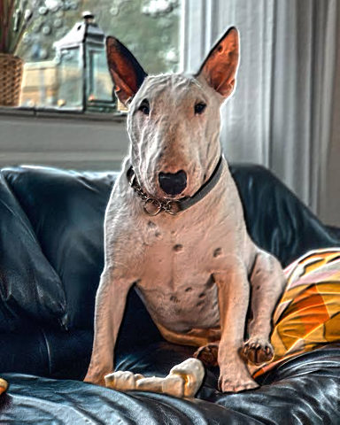
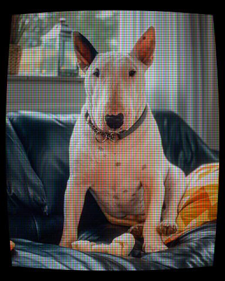
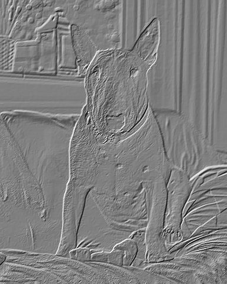
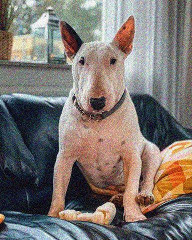
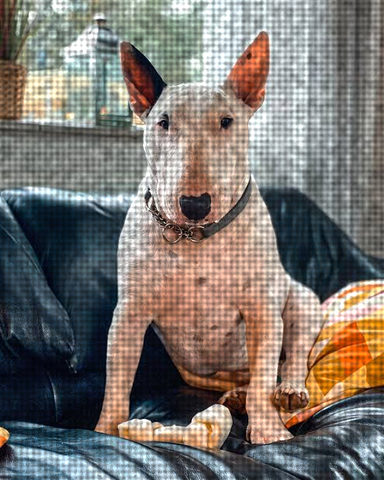
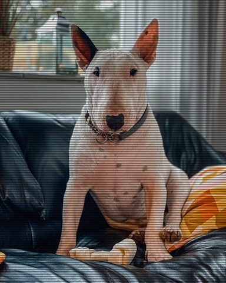
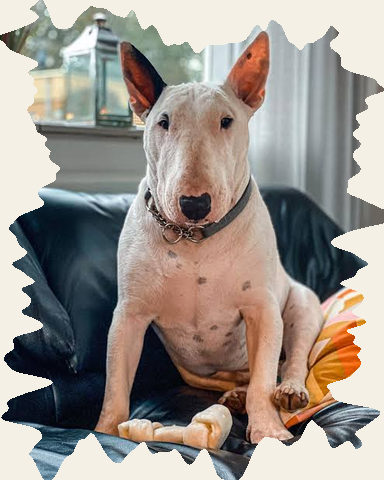

# Texture

Grain and other surface texture laid over the picture.

[All effects](README.md)

| Example | Effect | What it does | Parameters | Recipe |
| --- | --- | --- | --- | --- |
|  | `bump_light` | Light the picture's brightness, read as a relief `height` px tall, from `angle` at `elevation`. | `angle=315.0` `elevation=45.0` `height=8.0` `blur=1.0` +2 advanced | [bump_light.toml](../../examples/effects/bump_light.toml) |
|  | `crt` | Show the picture on a CRT: bulged glass, a glow, scanlines, a shadow mask, a dim edge and the bezel `border`. | `curve=0.15` `shadow_mask=0.35` `scanlines=0.3` `bloom=0.3` `vignette=0.35` +8 advanced | [crt.toml](../../examples/effects/crt.toml) |
|  | `dust_scratches` | Draw light and dark specks, hairs and scratches at random places over the picture. | `density=0.6` `size=8.0` `scratches=2` `light='#ffffff'` `dark='#000000'` `seed=0` +3 advanced | [dust_scratches.toml](../../examples/effects/dust_scratches.toml) |
|  | `emboss` | Read the brightness as a relief `height` px tall and light it from `angle`. | `angle=315.0` `height=6.0` `saturation=0.0` +1 advanced | [emboss.toml](../../examples/effects/emboss.toml) |
|  | `film_grain` | Film grain: noise per channel whose deviation runs from `shadows` at black to `highlights` at white. | `shadows=0.1` `highlights=0.03` `size=1.0` `seed=0` +2 advanced | [film_grain.toml](../../examples/effects/film_grain.toml) |
|  | `grain` | Film grain: brightness noise of standard deviation `amount` (0.08 visible, 0.2 heavy), clumped to `size` px. | `amount=0.08` `size=1.0` `seed=0` +2 advanced | [grain.toml](../../examples/effects/grain.toml) |
|  | `noise` | Add noise of standard deviation `amount` (0.06 visible, 0.2 heavy) to every pixel, grey or per channel. | `amount=0.06` `distribution='gaussian'` `color=True` `seed=0` | [noise.toml](../../examples/effects/noise.toml) |
|  | `paper_texture` | Lay a paper, canvas or linen texture over the picture: each pixel is multiplied by 1 + `amount` x texture. | `kind='paper'` `amount=0.1` `scale=6.0` `octaves=3` `spacing=6.0` `seed=0` +3 advanced | [paper_texture.toml](../../examples/effects/paper_texture.toml) |
|  | `pixel_grid` | The picture on an LCD: each `cell` px cell split into red, green and blue stripes with a dark `gap` between. | `cell=4` `gap=0.15` `amount=0.4` | [pixel_grid.toml](../../examples/effects/pixel_grid.toml) |
|  | `scanlines` | Dark horizontal lines every `spacing` px, each `thickness` x `spacing` thick, darkening by `darkness`. | `spacing=3.0` `thickness=0.5` `darkness=0.35` `offset=0.0` | [scanlines.toml](../../examples/effects/scanlines.toml) |
|  | `torn_edge` | Tear the border away: each side's pixels closer than a wandering distance of about `width` px become `fill`. | `width=24.0` `roughness=0.5` `scale=24.0` `octaves=3` `persistence=0.4` `lacunarity=2.0` `fill='#f5f0e6'` `seed=0` | [torn_edge.toml](../../examples/effects/torn_edge.toml) |

### `bump_light`

| Parameter | Type | Unit | Range | Default | Description |
| --- | --- | --- | --- | --- | --- |
| `angle` | number (cyclic) | degrees | 0 to 360 | `315.0` | Where the light comes from, in degrees clockwise from the top of the picture: 0 = above, 90 = the right, 180 = below, 270 = the left, 315 = the upper left. Slopes that face it are brightened, those that face away darkened. |
| `elevation` | number | degrees | 1 to 90 | `45.0` | How high the light stands above the picture's plane, in degrees: 90 = straight above (every slope only dims a little, whatever `angle`), 45 = the usual raking light, 1 = grazing, so the relief is dramatic and the lit side is clipped to white. |
| `height` | number | px | 0 to 100 | `8.0` | How tall the relief is: a white pixel stands this many px above a black one, so the slope between neighbours is their brightness difference times this. 0 = flat (the picture is unchanged), larger = steeper relief and stronger lighting. |
| `blur` | number | px | 0 to 20 | `1.0` | Gaussian sigma in px with which the brightness is smoothed before it is read as height: 0 = every pixel is a bump (noise and grain shows), larger = broader, softer swells. |

Advanced parameters (2)

| Parameter | Type | Unit | Range | Default | Description |
| --- | --- | --- | --- | --- | --- |
| `truncate` | number | ratio | 1 to 10 | `4.0` | Where the smoothing Gaussian is cut off, in sigmas (only matters when `blur` > 0). Larger is more exact and slower. |
| `edge` | one of 'reflect', 'nearest', 'mirror', 'wrap' |  |  | `'reflect'` | What the smoothing and the slope see beyond the picture's edge: 'reflect' (mirrored, edge pixel repeated), 'mirror' (mirrored about the edge pixel), 'nearest' (the edge pixel repeated), 'wrap' (the opposite edge, so a tileable picture lights without a seam). |

### `crt`

| Parameter | Type | Unit | Range | Default | Description |
| --- | --- | --- | --- | --- | --- |
| `curve` | number | ratio | 0 to 1 | `0.15` | How far the glass bulges: each pixel shows the picture at 1 + curve x (d / R)^2 times its distance from the middle, d its own distance from it and R the distance of a corner (the radial term of the Brown-Conrady lens model), so straight lines bow outward, more toward the corners, and the corners and edges reach beyond the picture and show `border` instead. 0 = a flat screen; 1 = a strongly bulged one. |
| `shadow_mask` | number | fraction | 0 to 1 | `0.35` | How strongly the shadow mask shows: the screen is covered with red, green and blue vertical stripes, and a stripe lets through only its own colour. 0 = no mask; at 1 each channel is lit in a third of the columns only. The mask keeps the picture's average brightness (the lit stripes are brightened by as much as the others are darkened), so raising it shows the stripes without dimming the picture. |
| `scanlines` | number | fraction | 0 to 1 | `0.3` | How dark the gaps between the lines of the raster are: the picture is darkened between the lines by up to this share, smoothly, so a line is brightest in its middle. 0 = no scanlines, 1 = black between them. |
| `bloom` | number | ratio | 0 to 2 | `0.3` | How strongly the bright parts glow into their surroundings, as light spreading in the glass: the blurred highlights are screened over the picture by this much. 0 = no glow, 1 = the halo at full brightness, above 1 it reaches white sooner. |
| `vignette` | number | fraction | 0 to 1 | `0.35` | How much dimmer the screen is at its corners than in the middle: the picture is darkened in proportion to the square of the distance from the middle, up to this share at a corner. 0 = an evenly lit screen. |

Advanced parameters (8)

| Parameter | Type | Unit | Range | Default | Description |
| --- | --- | --- | --- | --- | --- |
| `border` | colour |  |  | `'#000000'` | The colour beyond the curved screen, where the glass ends and the bezel begins: '#rrggbb', '#rgb' or [r, g, b] 0..1. It covers everything else there, and is only seen where `curve` is above 0. |
| `shadow_mask_pitch` | whole number | px | 3 to 24 | `3` | The width in px of one triad of red, green and blue stripes, a third of it for each, tuned for a picture about 480 px high: 3 gives stripes one pixel wide, larger gives coarser ones. |
| `scanline_spacing` | number | px | 2 to 32 | `4.0` | The distance in px from one line of the raster to the next, tuned for a picture about 480 px high: lines are centred on rows 0, spacing, 2 x spacing... and the gaps between them lie half a spacing away. A larger spacing is fewer, wider-set lines. |
| `bloom_radius` | number | px | 0 to 100 | `10.0` | Gaussian sigma in px of the glow, tuned for a picture about 480 px high: larger spreads the light further; 0 keeps it on the highlights themselves. |
| `bloom_threshold` | number | fraction | 0 to 0.99 | `0.5` | The brightness (0..1, per channel) where the glow starts: only values above it give light, rising to full at 1. Raising it limits the glow to the brightest parts. |
| `truncate` | number | ratio | 1 to 10 | `4.0` | Where the glow's Gaussian is cut off, in sigmas: it reaches truncate x `bloom_radius` px. Larger is more exact and slower. |
| `interpolation` | one of 'nearest', 'bilinear', 'bicubic' |  |  | `'bilinear'` | How a point between pixels is read when the glass bends the picture: 'nearest' takes the closest pixel (fastest, but lines turn jagged), 'bilinear' blends the four pixels around it (smooth, slightly soft), 'bicubic' fits a cubic spline through the neighbouring pixels (sharpest, a little slower, and may ring beside hard edges). |
| `edge` | one of 'reflect', 'nearest', 'mirror', 'wrap' |  |  | `'reflect'` | What the bend and the glow's blur see beyond the picture's edge: 'reflect' (mirrored, edge pixel repeated), 'mirror' (mirrored about the edge pixel), 'nearest' (the edge pixel repeated), 'wrap' (the opposite edge). The bend's own beyond is covered by `border`. |

### `dust_scratches`

| Parameter | Type | Unit | Range | Default | Description |
| --- | --- | --- | --- | --- | --- |
| `density` | number | count | 0 to 5 | `0.6` | How many specks and hairs there are: marks per 1000 square px of picture (a 32 x 32 px area), so the same density looks alike on any picture size. 0 = none, 0.6 is a light dusting, 3 is filthy. |
| `size` | number | px | 1 to 50 | `8.0` | The size of the biggest dust mark in px: a speck's diameter or a hair's length. Most marks are smaller (speck radii are random, with many tiny ones); larger = bigger blotches and longer hairs. |
| `scratches` | whole number | count | 0 to 100 | `2` | How many scratches: thin, long, nearly vertical lines, each running over half to all of the picture's height. 0 = none. |
| `light` | colour |  |  | `'#ffffff'` | The colour of the light marks (dust on a dark print, scratches into the emulsion): '#rrggbb', '#rgb' or [r, g, b] 0..1. Each mark is light or dark with equal chance. |
| `dark` | colour |  |  | `'#000000'` | The colour of the dark marks (dust on the scanner glass): '#rrggbb', '#rgb' or [r, g, b] 0..1. |
| `seed` | whole number | count | 0 to 4294967295 | `0` | Random seed: the same seed always puts the same marks in the same places, another seed others. |

Advanced parameters (3)

| Parameter | Type | Unit | Range | Default | Description |
| --- | --- | --- | --- | --- | --- |
| `hairs` | number | fraction | 0 to 1 | `0.15` | The share of the dust marks drawn as hairs (short thin lines in any direction) instead of round specks: 0 = only specks, 1 = only hairs. |
| `angle` | number | degrees | 0 to 45 | `4.0` | The most a scratch may lean away from vertical, in degrees: each scratch gets a random lean up to this, to either side. 0 = all exactly vertical. |
| `width` | number | px | 0.5 to 10 | `1.0` | How wide a scratch is in px. Larger = bolder scratches. |

A step of `dust_scratches` has `opacity = 0.8` unless it sets its own.

### `emboss`

| Parameter | Type | Unit | Range | Default | Description |
| --- | --- | --- | --- | --- | --- |
| `angle` | number (cyclic) | degrees | 0 to 360 | `315.0` | Where the light comes from, in degrees clockwise from the top of the picture: 0 = above, 90 = the right, 180 = below, 270 = the left, 315 = the upper left (the usual choice: it reads as raised). Surfaces that rise away from the light are brighter than mid grey and those that rise towards it darker; turning the light by 180 inverts the picture around mid grey. |
| `height` | number | px | 0 to 50 | `6.0` | How tall the relief is: a white pixel stands this many px above a black one, so the slope between neighbours is their brightness difference times this. 0 = a flat surface (mid grey), larger = steeper relief and stronger shading, up to full black and white at sharp edges. |
| `saturation` | number | fraction | 0 to 1 | `0.0` | How much of the picture's colour comes back: 0 = a grey emboss on mid grey, 1 = the picture itself shaded by the relief (flat areas keep their colour), in between a mix of the two. |

Advanced parameters (1)

| Parameter | Type | Unit | Range | Default | Description |
| --- | --- | --- | --- | --- | --- |
| `edge` | one of 'reflect', 'nearest', 'mirror', 'wrap' |  |  | `'reflect'` | What the slope sees beyond the picture's edge: 'reflect' (mirrored, edge pixel repeated), 'mirror' (mirrored about the edge pixel), 'nearest' (the edge pixel repeated), 'wrap' (the opposite edge, so a tileable picture embosses without a seam). |

### `film_grain`

| Parameter | Type | Unit | Range | Default | Description |
| --- | --- | --- | --- | --- | --- |
| `shadows` | number | fraction | 0 to 1 | `0.1` | Standard deviation of the grain at black, in 0..1 picture units: 0 = none, 0.1 is visible, 0.25 is heavy. Real film is grainiest in the shadows. |
| `highlights` | number | fraction | 0 to 1 | `0.03` | Standard deviation of the grain at white, in 0..1 picture units. The grain between black and white runs linearly from `shadows` to this, by the pixel's brightness; set equal to `shadows` for an even grain, above it for grain that grows toward the highlights. |
| `size` | number | px | 0 to 50 | `1.0` | Grain size in px: up to 1 every pixel varies on its own; above 1 the noise is blurred (Gaussian sigma = size / 2) into specks about this wide, keeping its standard deviation. Larger = coarser, softer grain. |
| `seed` | whole number | count | 0 to 4294967295 | `0` | Random seed: the same seed always gives the same grain (a different one in each channel), another seed a different pattern. |

Advanced parameters (2)

| Parameter | Type | Unit | Range | Default | Description |
| --- | --- | --- | --- | --- | --- |
| `truncate` | number | ratio | 1 to 10 | `4.0` | Where the clumping blur's Gaussian is cut off, in sigmas (only when size > 1). Larger is more exact and slower. |
| `edge` | one of 'reflect', 'nearest', 'mirror', 'wrap' |  |  | `'reflect'` | What the clumping blur sees beyond the picture's edge (only when size > 1): 'reflect' (mirrored, edge pixel repeated), 'mirror' (mirrored about the edge pixel), 'nearest' (the edge pixel repeated), 'wrap' (the opposite edge, so the grain tiles seamlessly). |

### `grain`

| Parameter | Type | Unit | Range | Default | Description |
| --- | --- | --- | --- | --- | --- |
| `amount` | number (drivable) | fraction | 0 to 1 | `0.08` | Standard deviation of the added brightness, in 0..1 picture units: 0 = none, 0.08 is visible, 0.2 is heavy. |
| `size` | number | px | 0 to 50 | `1.0` | Grain size in px: up to 1 every pixel varies on its own; above 1 the noise is blurred (Gaussian sigma = size / 2) into specks about this wide, keeping its standard deviation. Larger = coarser, softer grain. |
| `seed` | whole number | count | 0 to 4294967295 | `0` | Random seed: the same seed always gives the same grain, another seed a different pattern. |

Advanced parameters (2)

| Parameter | Type | Unit | Range | Default | Description |
| --- | --- | --- | --- | --- | --- |
| `truncate` | number | ratio | 1 to 10 | `4.0` | Where the clumping blur's Gaussian is cut off, in sigmas (only when size > 1). Larger is more exact and slower. |
| `edge` | one of 'reflect', 'nearest', 'mirror', 'wrap' |  |  | `'reflect'` | What the clumping blur sees beyond the picture's edge (only when size > 1): 'reflect' (mirrored, edge pixel repeated), 'mirror' (mirrored about the edge pixel), 'nearest' (the edge pixel repeated), 'wrap' (the opposite edge, so the grain tiles seamlessly). |

### `noise`

| Parameter | Type | Unit | Range | Default | Description |
| --- | --- | --- | --- | --- | --- |
| `amount` | number (drivable) | fraction | 0 to 1 | `0.06` | Standard deviation of the added noise, in 0..1 picture units: 0 = none, 0.06 is visible, 0.2 is heavy. |
| `distribution` | one of 'gaussian', 'uniform' |  |  | `'gaussian'` | Where the noise values come from: 'gaussian' (bell curve: most values small, a few large) or 'uniform' (every value up to a limit of about 1.7 x `amount` equally likely: an even, bounded speckle). Both have the standard deviation `amount`. |
| `color` | true or false |  |  | `True` | True gives every channel its own noise (coloured speckle); False adds the same noise to all three (brightness-only, grey speckle). |
| `seed` | whole number | count | 0 to 4294967295 | `0` | Random seed: the same seed always gives the same noise, another seed a different pattern. |

### `paper_texture`

| Parameter | Type | Unit | Range | Default | Description |
| --- | --- | --- | --- | --- | --- |
| `kind` | one of 'paper', 'canvas', 'linen' |  |  | `'paper'` | The surface: 'paper' (random fibres only), 'canvas' (an even plain weave of threads `spacing` px apart, with the fibres mixed in) or 'linen' (the same weave, but every thread has its own random strength, so it looks uneven). |
| `amount` | number | fraction | 0 to 1 | `0.1` | How strong the texture is: the standard deviation of the brightness change as a fraction of each pixel's own value (the texture multiplies the picture, so black stays black and the average brightness is kept). 0 = unchanged, 0.1 is visible, 0.3 is heavy; values lighten and darken alike, and the result is clipped to 0..1. |
| `scale` | number | px | 1 to 256 | `6.0` | Size of the coarsest fibres in px, the spacing of the first noise lattice. Larger = broader, softer mottling; small values give a fine tooth. |
| `octaves` | whole number | count | 1 to 8 | `3` | How many layers of noise are summed for the fibres, each finer than the last (by `lacunarity`) and weaker (by `persistence`). 1 = smooth blotches, more = more fine detail. Layers finer than one pixel are dropped. |
| `spacing` | number | px | 3 to 64 | `6.0` | The thread pitch of 'canvas' and 'linen' in px: the distance from one thread to the next. Ignored for 'paper'. Larger = coarser weave. |
| `seed` | whole number | count | 0 to 4294967295 | `0` | Random seed: the same seed always gives the same texture (fibres and, for 'linen', thread strengths), another seed a different one. |

Advanced parameters (3)

| Parameter | Type | Unit | Range | Default | Description |
| --- | --- | --- | --- | --- | --- |
| `persistence` | number | ratio | 0 to 1 | `0.5` | How much weaker each finer layer of fibres is than the one before: each layer's weight is this to the power of its number. 0 = only the coarsest layer, 1 = every layer equally strong (very rough). |
| `lacunarity` | number | ratio | 1 to 4 | `2.0` | How much finer each layer of fibres is than the one before: the lattice spacing is divided by this per layer. 1 = every layer the same size, 2 = each half as coarse, larger = detail drops off faster in size. |
| `fibre` | number | fraction | 0 to 1 | `0.3` | For 'canvas' and 'linen', the share of the texture's variance that comes from the random fibres rather than the weave: 0 = a pure, regular weave, 1 = no weave (the same as 'paper'). Ignored for 'paper'. |

### `pixel_grid`

| Parameter | Type | Unit | Range | Default | Description |
| --- | --- | --- | --- | --- | --- |
| `cell` | whole number | px | 3 to 32 | `4` | Width and height in px of one grid cell, which holds one red, one green and one blue stripe, each a third of the cell wide. Larger = a coarser grid; the smallest, 3, gives stripes one pixel wide. |
| `gap` | number | fraction | 0 to 1 | `0.15` | Width of the dark lines between sub-pixels, as a fraction of a stripe's width (cell / 3): the same lines run between the stripes and between rows of cells, half of each inside its own sub-pixel. 0 = stripes touch, 1 = nothing is lit and the grid is black. Raising it darkens the picture and shows the grid. |
| `amount` | number | fraction | 0 to 1 | `0.4` | How far the picture is shown through the grid: 0 = the picture unchanged, 1 = the picture as the grid lights it (each channel only inside its own sub-pixels, a third of the picture's brightness or less), in between a mix of the two. |

### `scanlines`

| Parameter | Type | Unit | Range | Default | Description |
| --- | --- | --- | --- | --- | --- |
| `spacing` | number | px | 1 to 64 | `3.0` | Distance in px from the top of one line to the top of the next. A spacing that is not a whole number drifts against the pixel rows and the lines are anti-aliased. Larger = fewer, wider-set lines. |
| `thickness` | number | fraction | 0 to 1 | `0.5` | How thick each line is, as a fraction of `spacing`: 0 = no line (the picture is unchanged), 0.5 = lines and gaps equally wide, 1 = the lines touch and the whole picture is darkened alike. A line that covers only part of a pixel row darkens that row in proportion. |
| `darkness` | number | fraction | 0 to 1 | `0.35` | How much a line darkens what is under it: 0 = nothing (the picture is unchanged), 0.35 is a visible screen, 1 = black lines. A line multiplies the picture by 1 - darkness, so colours keep their ratios. |
| `offset` | number | px | 0 to 64 | `0.0` | How far down in px the first line starts from the top of the picture. Offsets of more than `spacing` repeat the pattern: the lines are at offset + k x spacing. |

### `torn_edge`

| Parameter | Type | Unit | Range | Default | Description |
| --- | --- | --- | --- | --- | --- |
| `width` | number | px | 0 to 200 | `24.0` | How far in the tear is from each side on average, in px: 0 = no tear. Larger = more of the border torn away. |
| `roughness` | number | fraction | 0 to 1 | `0.5` | How ragged the tear is: the standard deviation of its distance from the side as a fraction of `width`. 0 = a straight cut exactly `width` in, 0.3 is a gentle tear, 1 wanders between the very edge and twice the width. |
| `scale` | number | px | 1 to 200 | `24.0` | Size of the tear's broadest bays and tongues along the side, in px (the spacing of the first noise lattice). Larger = long slow waves, small = a jagged edge. |
| `octaves` | whole number | count | 1 to 8 | `3` | How many layers of detail make up the tear, each finer than the last (by `lacunarity`) and weaker (by `persistence`). 1 = smooth waves, more = a fibrous, ragged edge. Layers finer than a pixel are dropped. |
| `persistence` | number | ratio | 0 to 1 | `0.4` | How much weaker each finer layer of the tear is than the one before. 0 = only the broadest layer, 1 = every layer equally strong (very jagged). |
| `lacunarity` | number | ratio | 1 to 4 | `2.0` | How much finer each layer of the tear is than the one before: the lattice spacing is divided by this per layer. 1 = every layer the same size, larger = detail much finer than the waves. |
| `fill` | colour |  |  | `'#f5f0e6'` | The paper colour that replaces the torn-away border: '#rrggbb', '#rgb' or [r, g, b] 0..1. |
| `seed` | whole number | count | 0 to 4294967295 | `0` | Random seed: the same seed always tears the same line (each side its own), another seed a different one. |
