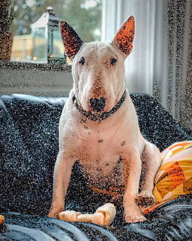
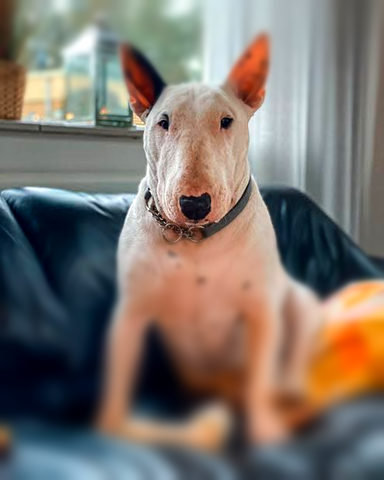
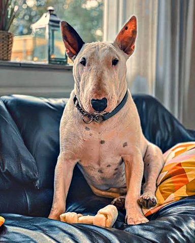

# Fields gallery

Each picture is its recipe in [`examples/fields/`](../../../examples/fields/) on the demo photo, rendered at 480 px. None
needs a model or a cut-out: the fields are a gradient and the picture's own brightness.

| Picture | Recipe | Shows |
|---|---|---|
|  | [shadow-grain](../../../examples/fields/shadow-grain.toml) | Grain gathers in the shadows, the highlights stay clean: the grain's amount is driven by a band of the picture's light |
|  | [tilt-shift](../../../examples/fields/tilt-shift.toml) | A miniature: sharp across the face, the blur growing with the distance from it: one blur step whose radius is driven by a band of a gradient |
|  | [tonal-grade](../../../examples/fields/tonal-grade.toml) | A grade per tone: warm highlights, the midtones as they are, cool lifted shadows: bands of the picture's light, a look each |
