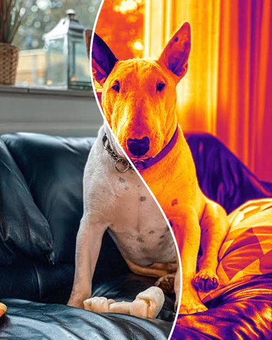
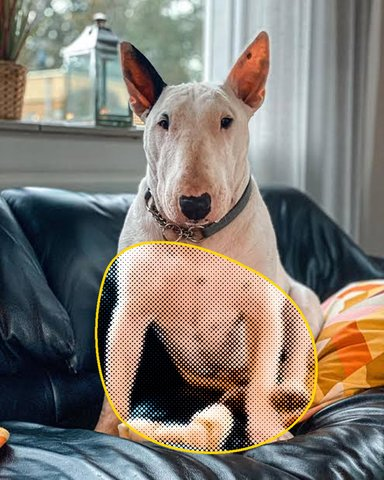
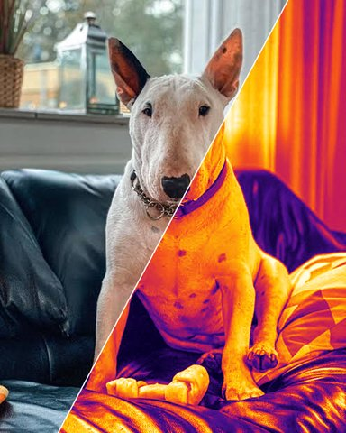
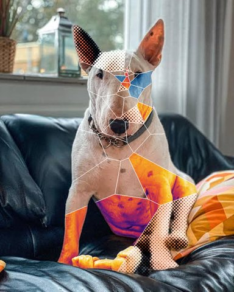
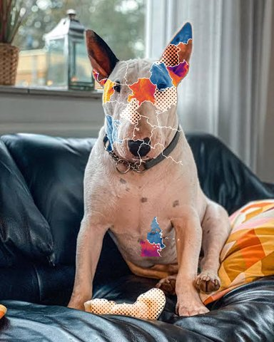
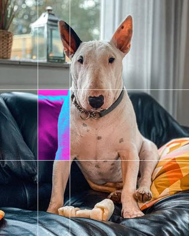
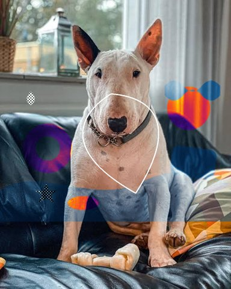
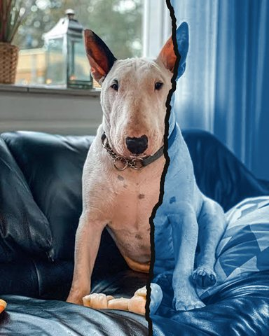
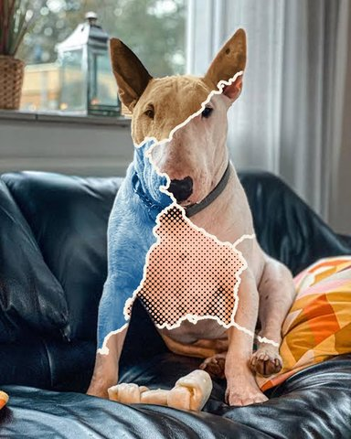

# Regions gallery

Each picture is its recipe in [`examples/regions/`](../../../examples/regions/) on the demo photo, rendered at 480 px.

| Picture | Recipe | Shows |
|---|---|---|
|  | [bezier-cut](../../../examples/regions/bezier-cut.toml) | A curved Bézier cut; one side gets a heat map |
|  | [bezier-shape](../../../examples/regions/bezier-shape.toml) | A closed Bézier shape halftones the chest and legs, with an outline |
|  | [diagonal](../../../examples/regions/diagonal.toml) | A diagonal cut: one side a heat map, a thin white line on the cut |
|  | [glass](../../../examples/regions/glass.toml) | Shattered glass round an impact point; some shards keep the original |
|  | [grid-first](../../../examples/regions/grid-first.toml) | The finder runs in each grid cell; what it finds is cut into shards with looks |
|  | [one-cell](../../../examples/regions/one-cell.toml) | An uneven 3 x 3 grid, one cell changed |
|  | [svg](../../../examples/regions/svg.toml) | Shapes from an SVG file are the pieces; outside them stays as it was |
|  | [tear](../../../examples/regions/tear.toml) | A ragged tear: cyanotype on one side, a solid dark band along it |
|  | [torn](../../../examples/regions/torn.toml) | The dog torn into scraps, a look each, a solid cream band along every tear |
